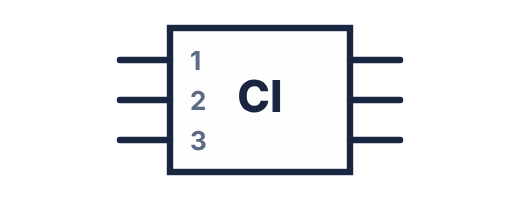

# 🗂️ FICHE MÉMO — Symboles IEC Normés
## Référence rapide pour schémas électriques — BAC Pro CIEL

---

> **Document élève — À plastifier et conserver dans le portfolio**  
> BAC Pro CIEL | Module E2 | Norme IEC 60617

---

## Symboles de base — Niveau S3

| N° | Composant | Symbole IEC | Remarques importantes |
|---|---|---|---|
| 1 | **Source de tension continue** | { width="210" } | Toujours indiquer la valeur en V : *9V*, *5V*, *12V* |
| 2 | **Pile / Batterie** | { width="210" } | Pour une seule pile : même symbole qu'une source simple |
| 3 | **Résistance** | { width="210" } | Symbole européen. Indiquer valeur : *R1 = 390 Ω* |
| 4 | **Diode** | { width="210" } | Le courant ne circule que dans le sens A → K |
| 5 | **LED** | { width="210" } | Indiquer couleur et V_F : *D1 rouge, V_F=2V* |
| 6 | **Condensateur non polarisé** | { width="210" } | Indiquer valeur en F, µF ou nF : *C1 = 100 nF* |
| 7 | **Condensateur polarisé** | { width="210" } | L'anode (+) est du côté de la barre droite — polarité obligatoire |
| 8 | **Interrupteur NO** | { width="210" } | NO = Normalement Ouvert. Indiquer : *S1* |
| 9 | **Interrupteur NF** | { width="210" } | NF = Normalement Fermé |
| 10 | **Poussoir NO** | { width="210" } | Bouton-poussoir momentané : actif uniquement quand appuyé |
| 11 | **Fil conducteur** | { width="210" } | Toujours horizontal ou vertical — jamais oblique sur un schéma |
| 12 | **Jonction (connexion)** | { width="210" } | OBLIGATOIRE pour indiquer une connexion. Sans point = croisement |
| 13 | **Croisement sans connexion** | { width="210" } | Deux fils se croisent mais ne se connectent PAS |
| 14 | **Masse / GND** | { width="210" } | Référence 0 V du circuit |
| 15 | **Lampe / Ampoule** | { width="210" } | Distinguer de la LED qui est une diode |

---

## Symboles avancés — Pour S7 et au-delà

| N° | Composant | Symbole IEC | Module d'introduction |
|---|---|---|---|
| 16 | **Transistor NPN** | { width="210" } | S10 |
| 17 | **Circuit intégré (CI)** | { width="210" } | S7 (Arduino) |
| 18 | **Connecteur / Borne** | { width="210" } | S7 |
| 19 | **Capteur générique** | { width="210" } | S12 (LM35) |
| 20 | **Moteur DC** | { width="210" } | S15 |

---

## Règles d'or du schéma normé

> [!NOTE] 1. TOUS LES FILS SONT HORIZONTAUX OU VERTICAUX — jamais obliques
>
> 2. LA SOURCE est toujours à GAUCHE  
>
> 3. LA MASSE (GND) est toujours en BAS  
>
> 4. Le courant circule de GAUCHE à DROITE et de HAUT en BAS  
>
> 5. Chaque composant porte un LABEL + sa VALEUR (R1=390Ω, D1=LED rouge)  
>
> 6. Une JONCTION = point noir • obligatoire  
>
> 7. Les symboles ont tous la MÊME TAILLE dans un même schéma  

---

## Exercice d'auto-contrôle — Reconnaître les symboles

*Sans regarder le tableau ci-dessus, associer chaque description au bon composant :*

| Description du symbole | Composant |
|---|---|
| Rectangle vide avec bornes aux extrémités | |
| Triangle + barre + deux flèches obliques | |
| Ligne avec segment angulé ouvert | |
| Triangle inversé avec pointe vers le bas | |
| Point noir sur intersection de fils | |
| Deux barres parallèles inégales avec bornes | |
| Deux barres parallèles égales avec bornes | |

??? success "Réponses"
    Résistance · LED · Interrupteur NO · Masse GND · Jonction · Source tension continue · Condensateur non polarisé*

---

## Correspondance schéma ↔ réalité ↔ breadboard

| Représentation schéma | Composant réel | Position breadboard |
|---|---|---|
| Fil horizontal | Câble mâle-mâle | Même rangée ou bus |
| Résistance verticale | Corps résistance 1/4W | 2 trous de la même demi-rangée |
| LED avec polarité | LED 5mm longue broche = A | Anode et cathode dans rangées différentes |
| Jonction • | Même rangée breadboard | 3 fils dans la même rangée |
| Masse GND | Fil noir vers bus − | Bus bleu de la breadboard |
| Source + | Fil rouge | Bus rouge de la breadboard |

---

## Codes couleurs des fils — Convention de câblage

| Couleur | Signification | Usage |
|---|---|---|
| 🔴 **Rouge** | Potentiel positif (+) | Alimentations, pôles + |
| ⚫ **Noir** | Masse / GND (0 V) | Pôles −, retours de circuit |
| 🟡 **Jaune** ou 🟠 **Orange** | Signal logique haut (HIGH) | Sorties numériques, signaux |
| 🔵 **Bleu** | Signal logique bas (LOW) ou entrée | Entrées numériques |
| 🟢 **Vert** | Signal analogique | Sorties analogiques, capteurs |
| ⬜ **Blanc** | Liaison neutre ou bus de données | Liaisons indifférentes |

> ℹ️ Ces couleurs ne sont pas imposées par la norme IEC pour les breadboards, mais constituent une **bonne pratique professionnelle** recommandée dès la première année.

---

*Fiche mémo symboles IEC — BAC Pro CIEL S3 Module E2 | MFR de Pontonx*  
*À plastifier — Document de référence permanent pour tous les TPs*
