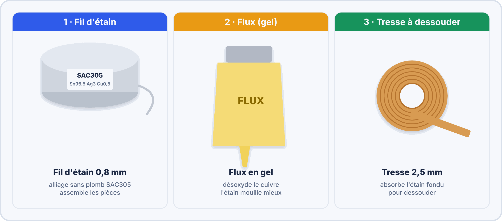
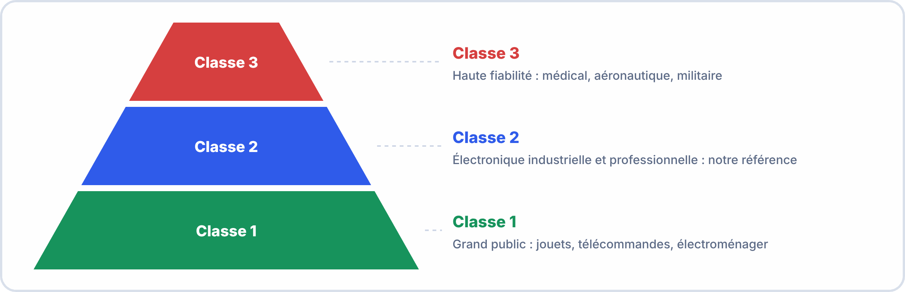
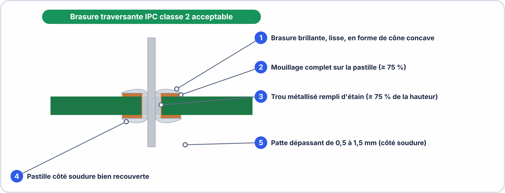
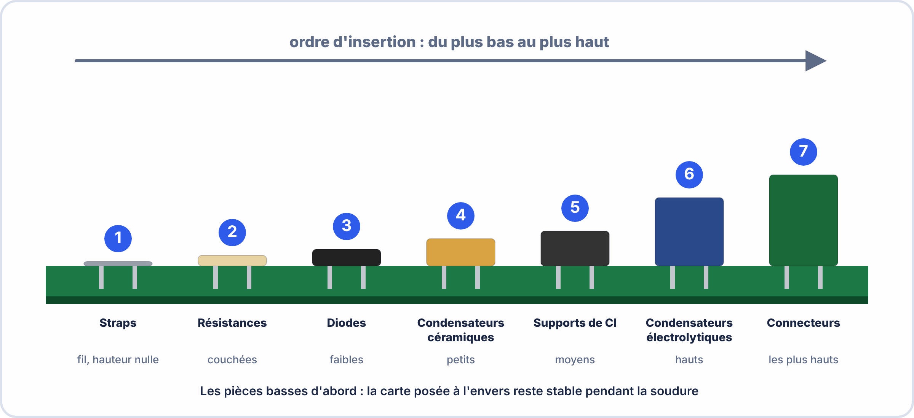

# 📘 FICHE DE COURS — S4 / Module E2
## Soudure à l'étain · Composants Traversants · Normes IPC-A-610

---

## 🗝️ Vocabulaire clé à maîtriser pour l'examen

| Terme | Définition à retenir |
|---|---|
| **Brasure** | Joint métallique obtenu en faisant fondre de l'alliage d'étain pour assembler un composant électronique à un circuit imprimé |
| **Soudure** | Terme courant utilisé à la place de "brasure" dans le métier |
| **Étain SAC305** | Alliage sans plomb composé de 96,5 % d'étain (Sn), 3 % d'argent (Ag), 0,5 % de cuivre (Cu) — standard actuel conforme RoHS |
| **Flux** | Agent chimique contenu dans l'étain qui nettoie les surfaces oxydées pour améliorer le mouillage |
| **Mouillage** | Capacité de l'étain en fusion à s'étaler et adhérer uniformément aux surfaces métalliques |
| **Composant traversant (THT)** | Through-Hole Technology — composant dont les pattes traversent le PCB et sont soudées côté opposé |
| **CMS / SMD** | Composant Monté en Surface — alternative au traversant, soudé directement sur le pad sans trou |
| **PCB** | Printed Circuit Board — circuit imprimé, support sur lequel sont montés les composants |
| **Pad / Pastille** | Zone de cuivre sur le PCB destinée à recevoir la soudure d'un composant |
| **IPC-A-610** | Norme internationale de référence pour l'acceptabilité des assemblages électroniques (contrôle qualité des brasures) |
| **Classe IPC** | Niveau d'exigence qualité : Classe 1 (électronique grand public), Classe 2 (électronique industrielle), Classe 3 (militaire/médical) |
| **Pont (bridging)** | Défaut de brasure : court-circuit entre deux pistes ou pads voisins dû à un excès d'étain |
| **Brasure froide (cold joint)** | Défaut : étain mal fondu, aspect mat et granuleux, connexion électrique médiocre |
| **Délaminage** | Défaut grave : le pad de cuivre se décolle du PCB suite à une surchauffe |

### 🤔 À ton avis ?

Pourquoi ne peut-on pas simplement « coller » les pattes d'un composant sur la carte avec de l'étain froid ?

??? question "Voir une réponse possible"
    Parce que l'étain doit **fondre** et **mouiller** à la fois la **patte** et la **pastille** de cuivre : c'est un vrai **alliage** qui assure la liaison **électrique** et **mécanique**. Si l'étain ne fond pas bien, on obtient une **brasure froide**, qui conduit mal et finit par casser.
    
    Dans cette séance, tu apprends le **geste**, la **norme de qualité** et le **contrôle** d'une soudure.

---

## 1. Le poste de soudure et ses équipements

### 1.1 Le fer à souder à température réglable

| Paramètre | Valeur recommandée | Pourquoi |
|---|---|---|
| **Température étain SAC305** | **360–380 °C** | Étain sans plomb a un point de fusion plus élevé (217 °C) que l'étain plombé (183 °C) |
| **Température étain Sn63Pb37** | **320–340 °C** | Étain plombé (plus ancien, encore présent en atelier) |
| **Type de panne recommandé** | Conique fine ou biseautée 1–2 mm | Précision + contact thermique optimal |
| **Durée de contact par brasure** | **2–3 secondes maximum** | Au-delà : risque délaminage du pad, dégradation du composant |

> ⚠️ **Règle d'or** : Le fer ne soude pas — il **transfère de la chaleur**. C'est la chaleur transférée qui fait fondre l'étain, pas le contact de l'étain avec le fer.

### 1.2 Les matériaux de soudure

| Matériau | Composition / Type | Rôle | Utilisation |
|---|---|---|---|
| **Étain SAC305** | Sn 96,5% · Ag 3% · Cu 0,5% | Matériau de jonction | Standard actuel RoHS, T° fusion 217 °C |
| **Étain plombé** | Sn 63% · Pb 37% | Matériau de jonction (ancien) | Encore présent dans certains ateliers, T° fusion 183 °C |
| **Flux (colophane)** | Résine de pin + activateurs | Nettoie les oxydes + améliore le mouillage | Contenu dans le fil d'étain (âme de flux) |
| **Tresse à dessouder** | Cuivre tressé imprégné de flux | Absorbe l'étain fondu pour dessouder | Appuyer avec le fer chaud sur la tresse posée sur la brasure |
| **Pompe à dessouder** | Piston à dépression | Aspire l'étain fondu | Armer le piston, faire fondre la brasure, appuyer sur le bouton |
| **Isopropanol (IPA)** | Alcool isopropylique 99% | Dissout les résidus de flux | Nettoyer le PCB après soudure avec chiffon non pelucheux |

> [!TIP] 💡 En clair
> Le fer à souder **ne soude pas** : il **transfère de la chaleur**. C'est la **chaleur** du fer qui fait fondre l'étain, jamais le contact direct de l'étain avec la panne.
>
> - **Température** : environ **360 °C** pour l'étain sans plomb (SAC305).
> - **Étain** : il contient du **flux**, qui nettoie le cuivre pour que l'étain « accroche ».
> - **Tresse** ou **pompe** : pour retirer un excès d'étain.

### ✅ Vérifie que tu as compris

**Q1.** À quoi sert le flux ?

??? success "Réponse"
    Il **nettoie** les surfaces de cuivre (il enlève les oxydes) pour que l'étain **mouille** bien.

**Q2.** À quelle température règle-t-on le fer pour de l'étain sans plomb ?

??? success "Réponse"
    Entre **360 et 380 °C** environ.

**Q3.** Combien de temps le fer doit-il rester en contact avec une brasure ?

??? success "Réponse"
    **2 à 3 secondes au maximum**, sinon la pastille risque de se décoller.

> [!SUCCESS] 🧠 À retenir
> - Le fer chauffe la patte et la pastille ; c'est cette chaleur qui fait fondre l'étain.
> - Contact : 2 à 3 secondes maximum.

---

## 2. Technique de soudure — Les 5 étapes

### Les 5 étapes dans le détail

| Étape | Action | Durée | Point critique |
|---|---|---|---|
| **1 — Insérer** | Insérer le composant dans les trous correspondants, plier légèrement les pattes à 45° pour maintenir en position | — | Vérifier la polarité AVANT d'insérer (LED, condensateur polarisé, diode) |
| **2 — Chauffer** | Poser la panne du fer sur le pad ET sur la patte simultanément | 1 s | Contact simultané pad+patte = transfert thermique optimal |
| **3 — Alimenter** | Amener le fil d'étain côté **opposé** à la panne | 1–2 s | Le fil d'étain ne touche JAMAIS directement la panne |
| **4 — Retirer** | Retirer le fil d'étain d'abord, puis le fer | < 1 s | L'ordre est important : fil avant fer |
| **5 — Couper** | Laisser refroidir 5 s (ne pas souffler), puis couper les pattes à 0,5–1 mm au-dessus de la brasure | — | Ne pas bouger le PCB pendant la solidification |

> ⚠️ **Erreur classique n°1 :** Poser l'étain sur la panne du fer (étain "pré-fondu") plutôt que de le laisser fondre au contact de la zone chauffée. Résultat : brasure froide garantie.

> ⚠️ **Erreur classique n°2 :** Souffler sur la brasure pour la refroidir plus vite. Résultat : cristallisation trop rapide → brasure froide.

> [!TIP] 💡 En clair
> Une bonne soudure se fait **toujours dans le même ordre** :
>
> 1. **Insérer** le composant (attention au sens).
> 2. **Chauffer** la patte **et** la pastille ensemble.
> 3. **Apporter l'étain** sur la zone chauffée, **du côté opposé à la panne**.
> 4. **Retirer l'étain**, **puis le fer**.
> 5. **Laisser refroidir** sans bouger ni souffler, puis **couper** la patte.

> [!WARNING] ⚠️ Erreurs fréquentes
> - Poser l'étain sur la panne du fer : il fond mais ne mouille pas la pastille.
> - Souffler sur la soudure pour la refroidir : elle cristallise trop vite (brasure froide).
> - Bouger la carte pendant le refroidissement : brasure « collée », fragile.

### ✅ Vérifie que tu as compris

**Q1.** Quel est l'ordre des deux retraits à l'étape 4 ?

??? success "Réponse"
    On retire **d'abord l'étain**, **puis le fer**.

**Q2.** Où amène-t-on l'étain ?

??? success "Réponse"
    Sur la **zone chauffée**, du côté **opposé à la panne** : c'est la chaleur de la patte et de la pastille qui le fait fondre.

**Q3.** Pourquoi ne faut-il pas souffler sur la soudure ?

??? success "Réponse"
    Un refroidissement trop rapide donne une **brasure froide** (mate et granuleuse).

> [!SUCCESS] 🧠 À retenir
> - Chauffer, étain, retirer l'étain, retirer le fer, refroidir.

---

## 3. Les normes IPC-A-610 — Contrôle qualité des brasures

### 3.1 Les 3 classes IPC

| Classe | Domaine | Niveau d'exigence | Exemples |
|---|---|---|---|
| **Classe 1** | Grand public | Minimal — fonctionnel mais aspect non critique | Jouets, télécommandes, électroménager bas de gamme |
| **Classe 2** | Industrie / Pro | Standard — fiabilité requise, durée de vie prolongée | PC, équipements industriels, télécoms |
| **Classe 3** | Haute fiabilité | Maximal — aucun défaut toléré, traçabilité totale | Militaire, médical, aérospatial |

> 📌 **En BAC Pro CIEL, on vise la Classe 2.** C'est le standard de l'industrie électronique professionnelle.

### 3.2 Caractéristiques d'une brasure IPC Classe 2 acceptable

| Critère IPC Classe 2 | Condition ACCEPTABLE | Condition REFUSÉE |
|---|---|---|
| **Mouillage** | Étain s'étale sur le pad et monte sur la patte — angle < 90° | Étain qui ne s'étale pas, angle > 90° |
| **Forme** | Conique, surface légèrement concave ou plane | Boule convexe (excès d'étain) |
| **Aspect** | Brillant ou légèrement mat (SAC305 peut être moins brillant que Sn/Pb) | Terne, granuleux, grumeleux |
| **Remplissage du trou** | ≥ 75% du trou rempli d'étain côté soudure | < 75% — risque de connexion fragile |
| **Patte visible** | La patte du composant doit être visible à travers l'étain | Patte complètement noyée (excès) |
| **Résidus de flux** | Résidus transparents ou légèrement jaunis acceptés si non corrosifs | Résidus noirs, carbonisés |
| **Pont** | Aucun pont entre pads voisins | Tout pont = refus immédiat |

### 3.3 Les 7 défauts IPC les plus courants

| Défaut IPC | Aspect visuel | Cause principale | Gravité |
|---|---|---|---|
| **Brasure froide** | Mat, granuleux, givré | Température trop basse ou trop courte | 🔴 Refus Classe 2 |
| **Pont (bridging)** | Filet d'étain entre 2 pads | Excès d'étain + pads trop proches | 🔴 Refus toutes classes |
| **Excès d'étain** | Boule ronde, convexe, opaque | Trop d'étain alimenté | 🟡 Refus Classe 2 si > 150% surface pad |
| **Manque d'étain** | Patte visible à nu, pad cuivre apparent | Pas assez d'étain ou mauvais mouillage | 🔴 Refus Classe 2 si < 75% trou |
| **Brasure collée** | Stries, aspect "perturbé" | Mouvement du composant pendant solidification | 🟡 Refus Classe 2 |
| **Soufflure (void)** | Trou / cratère dans la brasure | Humidité dans le PCB ou flux dégradé | 🟡 Refus si > 25% surface |
| **Délaminage** | Pad cuivre décollé | Surchauffe (> 3 s de contact) | 🔴 Refus toutes classes — PCB irréparable |

> [!TIP] 💡 En clair
> La norme **IPC-A-610** dit **ce qu'on accepte ou refuse** pour une soudure. Il y a **trois classes** : **Classe 1** (grand public), **Classe 2** (industrie, ce qu'on vise) et **Classe 3** (santé, aéronautique, haute fiabilité).
>
> Une **bonne brasure** est **brillante, lisse, en forme de cône légèrement creusé**, elle **recouvre** bien la pastille et la patte.
>
> Une **mauvaise brasure** se repère à son **aspect** : mate et granuleuse (froide), boule d'étain (excès), étain entre deux pastilles (pont), pastille décollée (délaminage).

### ✅ Vérifie que tu as compris

**Q1.** Quelle classe IPC vise-t-on en formation ?

??? success "Réponse"
    La **Classe 2** (électronique industrielle et professionnelle).

**Q2.** Une soudure est mate et granuleuse. Comment s'appelle ce défaut ? Quelle est sa cause ?

??? success "Réponse"
    Une **brasure froide** : le fer n'était pas assez chaud ou le contact a été trop court.

**Q3.** Quel défaut est irréparable ?

??? success "Réponse"
    Le **délaminage** (pastille décollée par surchauffe) : la carte est abîmée.

> [!SUCCESS] 🧠 À retenir
> - Brasure correcte : brillante, lisse, en cône creusé.
> - Défauts : froide, pont, excès, manque, collée, soufflure, délaminage.

---

## 4. Séquence d'insertion des composants traversants

L'ordre d'insertion est crucial pour la qualité et la facilité du montage :

| Ordre | Type de composant | Hauteur | Raison |
|---|---|---|---|
| **1** | Ponts de fils / cavaliers | < 1 mm | Les plus plats — posés en premier, ne gênent pas la suite |
| **2** | Résistances (couchées) | 3–5 mm | Faible hauteur, aucune polarité, posées tôt |
| **3** | Diodes | 5–8 mm | Attention à la polarité (bande = cathode) |
| **4** | Condensateurs céramiques | 5–10 mm | Pas de polarité, petits |
| **5** | Connecteurs / Barrettes | 5–15 mm | Fixation mécanique avant les grands composants |
| **6** | Condensateurs électrolytiques | 10–20 mm | **Polarité obligatoire** — patte longue = + |
| **7** | LEDs, transistors | 15–25 mm | **Polarité obligatoire** — patte longue = anode |

> 💡 **Règle mnémotechnique** : **"Du plus plat au plus grand"** — on commence toujours par ce qui couche le plus près du PCB.

> [!TIP] 💡 En clair
> On soude **du plus plat au plus grand** : ainsi la carte posée à l'envers **reste stable** et les composants hauts ne gênent pas l'accès aux plus petits.
>
> **Ordre :** straps, résistances, diodes, condensateurs céramiques, connecteurs, condensateurs électrolytiques, puis LED et transistors.

### ✅ Vérifie que tu as compris

**Q1.** Pourquoi soude-t-on les composants hauts en dernier ?

??? success "Réponse"
    Pour que la carte reste **stable à l'envers** et pour **garder l'accès** aux petits composants.

**Q2.** Quels composants demandent de respecter la **polarité** ?

??? success "Réponse"
    Les **diodes**, les **LED**, les **condensateurs électrolytiques** et les **transistors**.

---

## 5. Procédure de contrôle qualité après soudure

### 5.1 Inspection visuelle — La check-list IPC

Après soudure de tous les composants, inspecter chaque brasure avec la loupe :

| Point de contrôle | Critère | ☐ OK ☐ NOK |
|---|---|---|
| Mouillage | Étain s'étale sur pad et patte | ☐ ☐ |
| Forme | Conique ou légèrement concave | ☐ ☐ |
| Brillance | Brillant (Sn/Pb) ou semi-brillant (SAC305) | ☐ ☐ |
| Absence de pont | Aucun filet entre pads voisins | ☐ ☐ |
| Remplissage trou | ≥ 75% visible | ☐ ☐ |
| Patte coupée | 0,5–1 mm au-dessus de la brasure | ☐ ☐ |
| Résidus flux | Transparents ou nettoyés à l'IPA | ☐ ☐ |
| Polarités respectées | LED, condensateur, diode dans le bon sens | ☐ ☐ |

### 5.2 Test électrique après soudure

| Test | Instrument | Condition | Résultat attendu |
|---|---|---|---|
| Continuité alimentation | Multimètre mode ))) | Hors tension | BIP de + à − |
| Absence de court-circuit | Multimètre mode Ω | Hors tension | R > 1 kΩ entre + et − |
| Fonctionnement LED | Alimentation labo | Sous tension | LED allumée |
| Tension $V_{F}$ LED | Multimètre DCV | Sous tension | ≈ 2 V (rouge) |

> [!TIP] 💡 En clair
> Après la soudure, **contrôle avant d'alimenter** :
>
> 1. **Regarde** chaque brasure à la loupe (aspect, pont, remplissage).
> 2. **Vérifie** les polarités.
> 3. **Teste** la continuité de l'alimentation et l'absence de court-circuit entre + et − (en mode ohmmètre, hors tension).
> 4. **Alimente** seulement si tout est bon.

### ✅ Vérifie que tu as compris

**Q1.** Quel test réalise-t-on avant d'alimenter la carte ?

??? success "Réponse"
    La **continuité de l'alimentation** et l'**absence de court-circuit** entre + et −, **hors tension**.

**Q2.** Quelle valeur mesure-t-on entre + et − si tout va bien ?

??? success "Réponse"
    Une résistance **supérieure à 1 kΩ** (pas un court-circuit).

> [!SUCCESS] 🧠 À retenir
> - Regarder, vérifier les sens, tester hors tension, puis alimenter.

---

## ✅ Compétences RNCP travaillées

| Code | Compétence | Niveau |
|---|---|---|
| C2.1 | Préparer les ressources matérielles à la réalisation | ⭐⭐⭐ Maîtrise |
| C2.2 | Réaliser des câblages et montages (soudure THT) | ⭐⭐⭐ Maîtrise |
| C2.3 | Vérifier la conformité selon référentiel IPC | ⭐⭐ Application |
| C2.4 | Assurer la qualité et la traçabilité | ⭐ Découverte |
| C3.1 | Rendre compte de son activité par écrit | ⭐⭐ Application |
| S5 | Techniques de montage — soudure THT | ⭐⭐⭐ Maîtrise |
| S6 | Qualité, normes IPC, traçabilité | ⭐⭐ Application |

---

## 📝 Mémo rapide — À garder dans le portfolio

| Je dois... | Je retiens... |
|---|---|
| Régler mon fer pour SAC305 | **360–380 °C** |
| Connaître la séquence de soudure | **Chaleur → Étain → Retirer fil → Retirer fer** |
| Reconnaître une brasure froide | **Aspect mat, granuleux, givré** |
| Reconnaître un pont | **Filet d'étain entre deux pads → court-circuit** |
| Éviter le délaminage | **Jamais plus de 3 secondes de contact** |
| Ordre d'insertion composants | **Du plus plat (résistances) au plus grand (condensateurs, LEDs)** |
| Classe IPC visée en BAC Pro | **Classe 2 — standard industriel** |
| Nettoyer le PCB après soudure | **Isopropanol 99% + chiffon non pelucheux** |

---

*BAC Pro CIEL — S4 Module E2 | MFR de Pontonx | © Yahn LE PRETTRE*
