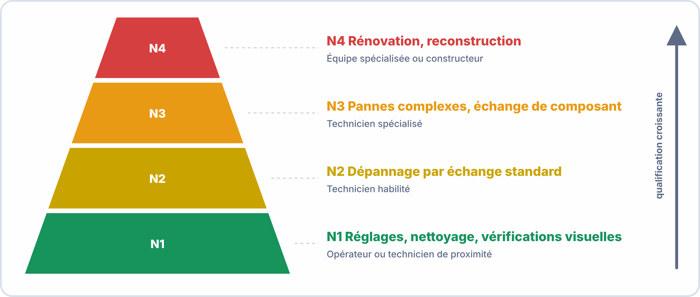
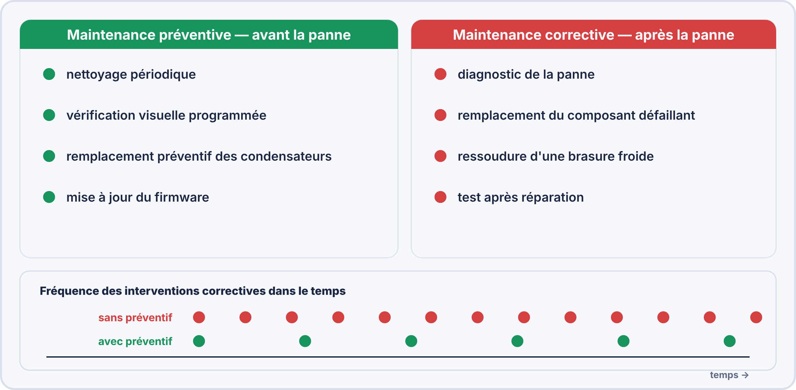
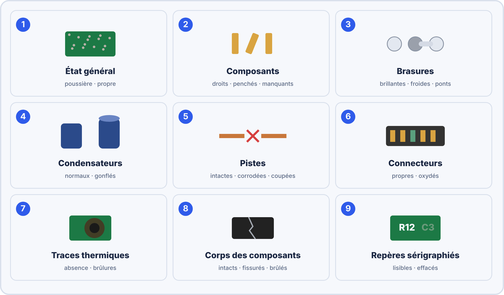
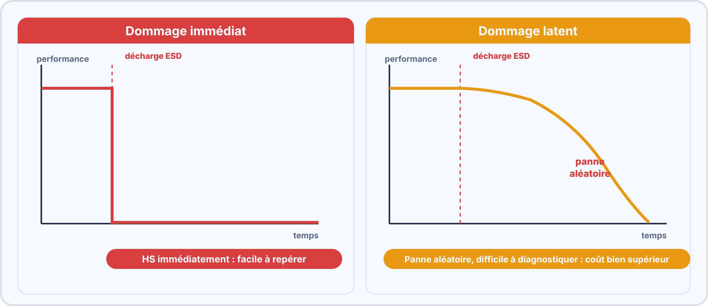
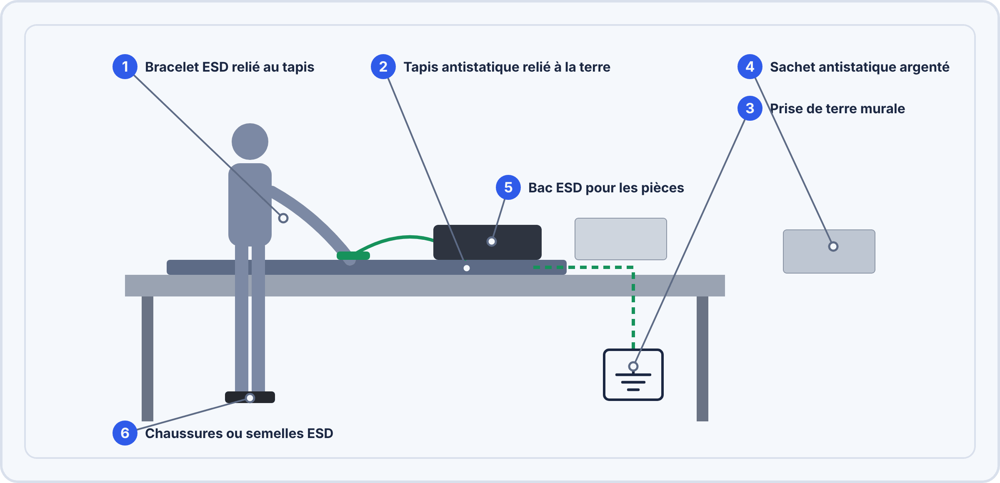
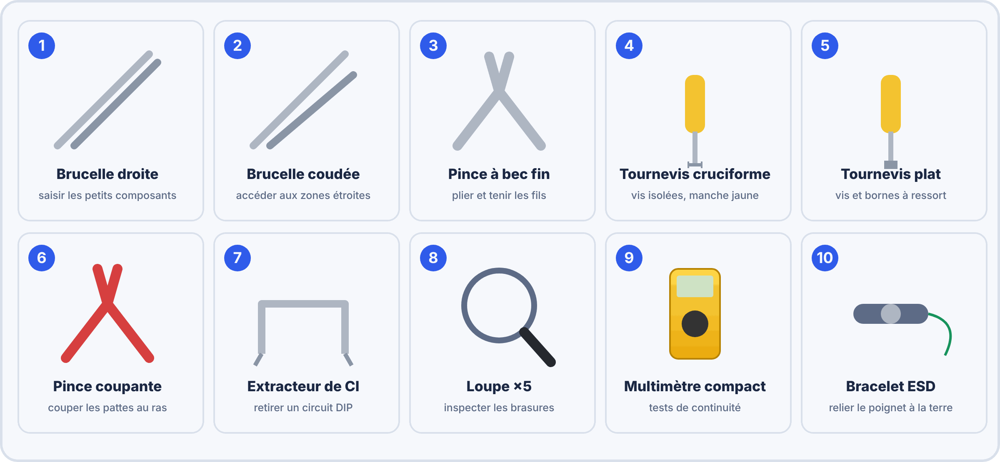

# 📘 FICHE DE COURS — S5 / Module E2
## Maintenance N1 · Nettoyage de Cartes · Diagnostic Visuel · ESD & Outillage

---

## 🗝️ Vocabulaire clé à maîtriser pour l'examen

| Terme | Définition à retenir |
|---|---|
| **Maintenance** | Ensemble des actions permettant de maintenir ou de rétablir un bien dans un état spécifié afin qu'il remplisse sa fonction (norme AFNOR NF EN 13306) |
| **Maintenance préventive** | Maintenance réalisée à intervalles prédéterminés pour réduire la probabilité de défaillance — avant la panne |
| **Maintenance corrective** | Maintenance réalisée après détection d'une défaillance pour remettre un bien en état — après la panne |
| **Niveau de maintenance (N1–N4)** | Classification AFNOR NF X 60-010 définissant qui peut réaliser quelle intervention selon sa qualification |
| **Maintenance N1** | Réglages simples, nettoyage, vérifications visuelles — réalisés par l'opérateur ou le technicien de proximité |
| **ESD** | ElectroStatic Discharge — décharge électrostatique pouvant détruire silencieusement les composants électroniques |
| **Dommage latent ESD** | Dégradation invisible du composant sans destruction immédiate — le composant fonctionne encore mais sa durée de vie est réduite de façon significative |
| **IPA** | Isopropanol (alcool isopropylique) à 99% — solvant de nettoyage des PCB, dissout les résidus de flux et la poussière |
| **Composant CMS / SMD** | Composant Monté en Surface — soudé directement sur le pad sans traverser le PCB (opposé au composant traversant THT) |
| **Diagnostic visuel** | Inspection à l'œil et à la loupe d'une carte selon une check-list de critères normés, sans outil de mesure électrique |
| **DEEE** | Déchets d'Équipements Électriques et Électroniques — filière légale de recyclage obligatoire (directive européenne WEEE) |
| **Check-list** | Liste de contrôle structurée à cocher permettant de s'assurer qu'aucun point d'inspection n'est oublié |

---

## 1. Les niveaux de maintenance — Norme AFNOR NF X 60-010

### 1.1 Les 4 niveaux définis

| Niveau | Désignation | Nature des opérations | Intervenant |
|---|---|---|---|
| **N1** | Maintenance de proximité | Nettoyage, réglages simples, remplacement de consommables, vérification visuelle | Opérateur sur place, technicien de proximité — **VOUS en BAC Pro** |
| **N2** | Maintenance courante | Dépannage par échange de pièces standard, petites réparations sur éléments accessibles | Technicien habilité |
| **N3** | Maintenance spécialisée | Diagnostic de pannes complexes, réparation par échange de sous-ensembles | Technicien spécialisé avec documentation technique |
| **N4** | Maintenance d'expertise | Révision générale, reconstruction, modifications | Équipe spécialisée, bureau d'études, constructeur |

> 📌 **Positionnement BAC Pro CIEL** : En sortie de formation, vous êtes qualifié pour les interventions **N1 et partiellement N2**. Les niveaux N3 et N4 nécessitent une expérience et une spécialisation supplémentaires.

### 1.2 Maintenance préventive vs corrective

| Type | Déclencheur | Avantage | Inconvénient | Exemple en électronique |
|---|---|---|---|---|
| **Préventive** | Calendrier / fréquence prédéfinie | Réduit les pannes imprévues | Coût même si pas nécessaire | Nettoyage PCB tous les 6 mois |
| **Corrective** | Apparition d'une panne | Intervient seulement si nécessaire | Arrêt non planifié de la production | Remplacer un condensateur claqué |

---

## 2. Le nettoyage de carte PCB

### 2.1 Pourquoi nettoyer une carte ?

La poussière, les résidus de flux et les dépôts conducteurs sont des causes directes de pannes :

| Contaminant | Origine | Risque |
|---|---|---|
| **Poussière / peluches** | Environnement, ventilateurs | Court-circuit entre pistes rapprochées, obstruction radiateurs |
| **Résidus de flux** | Soudure (S4) | Corrosion des pistes cuivre sur le long terme |
| **Condensation / traces blanches** | Humidité, température | Courant de fuite entre composants |
| **Dépôts conducteurs** | Particules métalliques, sels | Court-circuit progressif |
| **Graisse de doigts** | Manipulation sans gants | Corrosion, mauvaise conduction thermique |

### 2.2 Les produits et outils de nettoyage

| Outil / Produit | Usage | Précautions |
|---|---|---|
| **Isopropanol 99% (IPA)** | Dissoudre résidus flux, traces blanches, graisse | Inflammable — pas de source de chaleur. Bien ventiler. Ne pas utiliser sur plastiques fragiles. |
| **Pinceau antistatique** | Déloger poussière dans les zones serrées | Brosse douce (nylon ou soie) — ne jamais brosser fort, risque d'arracher des CMS |
| **Air comprimé ESD-safe** | Souffler la poussière en dehors de la carte | Tenir la bombe verticale. Ne jamais diriger vers le visage. Distance mini 15 cm. |
| **Chiffon non-pelucheux** | Essuyer l'IPA et les résidus après application | Ne pas frotter fort — risque ESD et rayures sur composants |
| **Eau déionisée** | Nettoyage en bain (procédés industriels) | Jamais d'eau du robinet — les ions créent des courts-circuits |

### 2.3 Procédure de nettoyage PCB — 6 étapes

> [!NOTE] PROCÉDURE DE NETTOYAGE PCB — Maintenance N1
>
> Étape 1 — Mettre hors tension et décharger (attendre 30 s après coupure alim)  
> Étape 2 — Équiper le poste ESD (bracelet + tapis)  
> Étape 3 — Air comprimé : souffler la poussière gross, carte inclinée à 45°  
> Étape 4 — Pinceau : brosser délicatement les zones serrées (connecteurs, CI)  
> Étape 5 — IPA sur chiffon : essuyer les zones sales (résidus flux, traces)  
> Étape 6 — Laisser sécher complètement à l'air (15 min) avant remise sous tension  

> ⚠️ **Règle absolue** : Ne jamais remettre une carte sous tension tant que l'IPA n'est pas complètement évaporé. L'IPA résiduel peut créer des courts-circuits.

---

## 3. Le diagnostic visuel — La check-list des 9 critères

### 3.1 Principe du diagnostic visuel

Le diagnostic visuel est la **première étape de tout intervention de maintenance** électronique. Il permet souvent de localiser la panne ou de prévenir une défaillance sans aucun outil de mesure. Il se réalise **systématiquement** avec une loupe et un éclairage rasant.

### 3.2 Les 9 critères de la check-list de diagnostic visuel

| N° | Critère | Ce qu'on recherche | Signe d'anomalie |
|---|---|---|---|
| **1** | **État général de propreté** | Poussière, corps étrangers, résidus | Dépôts épais, corps conducteurs (métal) |
| **2** | **Position et intégrité des composants** | Composants droits, fixés, présents | Composant penché, manquant, fracturé |
| **3** | **Qualité des brasures** | Brasures coniques, brillantes (S4) | Brasures froides, ponts, délaminage |
| **4** | **État des condensateurs** | Corps cylindrique lisse, pas de déformation | Sommet bombé ou fendu → condensateur HS |
| **5** | **État des pistes et du substrat PCB** | Cuivre intact, substrat vert/marron uniforme | Piste corrodée, interrompue, cloquage substrat |
| **6** | **État des connecteurs** | Contacts dorés ou argentés, propres | Oxydation (verdure), déformation, broche manquante |
| **7** | **Traces thermiques** | Absence de noircissement, pas d'odeur de brûlé | Composant noirci, pastille carbonisée, auréole brune |
| **8** | **Intégrité des corps de composants** | Boîtiers entiers, résines intactes | Fissure, éclat, résine fondue |
| **9** | **Lisibilité des sérigraphies** | Références des composants visibles | Sérigraphie effacée (signe d'usure ou de surchauffe) |

### 3.3 La grille de diagnostic visuel à utiliser en TP

> *(Voir fiche dédiée S5_E2_04 — Check-list diagnostic visuel)*

---

## 4. ESD — Electrostatique et protection des composants

### 4.1 Le phénomène ESD

| Paramètre | Valeur |
|---|---|
| Tension de charge d'une personne sur moquette | 5 000 à 35 000 V |
| Tension ressentie par l'homme (seuil de sensation) | > 3 000 V |
| Tension destructrice pour un composant CMOS | **dès 100 V** |
| Énergie d'une décharge ESD typique | Quelques µJ — imperceptible pour l'homme, fatal pour le composant |
| Durée d'une décharge | Quelques nanosecondes à microsecondes |

> ⚠️ **Conclusion clé** : Vous ne ressentez rien, le composant est détruit silencieusement. C'est pourquoi les protections ESD sont **non négociables**.

### 4.2 Le dommage latent — Le plus dangereux

Le dommage **immédiat** (destruction instantanée) est visible : le composant ne fonctionne plus. Le diagnostic est simple.

Le dommage **latent** (dégradation partielle) est **invisible** : le composant fonctionne encore, mais ses performances se dégradent progressivement. Il tombera en panne de façon prématurée, dans des semaines ou des mois, de façon aléatoire et difficile à diagnostiquer.

### 4.3 Les équipements de protection ESD

| Équipement ESD | Rôle | Obligatoire en atelier |
|---|---|---|
| **Bracelet antistatique** | Équilibre la charge du technicien avec le tapis et la terre | **OUI — absolument** |
| **Tapis antistatique** | Surface de travail qui dissipe les charges | OUI |
| **Câble de mise à la terre** | Relie tapis et bracelet à la terre du bâtiment | OUI |
| **Sachet antistatique** | Protège les composants pendant le transport et le stockage | OUI — pour tout composant sensible |
| **Bac ESD-safe** | Contient les composants en cours de manipulation | Recommandé |
| **Semelles / Chaussures ESD** | Complète la protection en zone de production | En zone de production industrielle |

> 📌 **Règle pratique** : Un bracelet sans câble de terre = inutile. Un tapis sans bracelet = insuffisant. Les deux ensemble + câble de terre = protection efficace.

### 4.4 L'emballage antistatique — Codes de couleur

| Couleur | Type | Protection | Usage |
|---|---|---|---|
| **Argenté / Métallisé** | Sac à blindage (shielding bag) | Blindage complet (Faraday) | Stockage et transport composants très sensibles |
| **Rose / Transparent rose** | Sac dissipatif | Dissipation de charges | Stockage courte durée, composants standard |
| **Noir** | Conducteur ou dissipatif | Dissipation | Bacs, mousses de rangement |
| **Vert ou Jaune** | Dissipatif (selon fabricant) | Dissipation | Tapis, sacs secondaires |

> ⚠️ **Erreur fréquente** : Poser un composant sur le dessus d'un sachet argenté (extérieur du sac). L'extérieur du sac est conducteur — il peut créer une décharge ! Toujours mettre le composant À L'INTÉRIEUR du sachet.

---

## 5. L'outillage de base du technicien CIEL

### 5.1 Inventaire et usage

| N° | Outil | Usage principal | Précaution |
|---|---|---|---|
| 1 | **Pince brucelle droite** | Saisir et positionner les composants (CMS, petits THT) | Ne jamais forcer — risque d'écraser le composant |
| 2 | **Pince brucelle coudée** | Accéder aux zones de faible hauteur ou en sous-face | Même précaution |
| 3 | **Pince plate fine (bec long)** | Maintenir les composants pendant la soudure, plier les pattes | Ne pas griffer les pistes de cuivre |
| 4 | **Tournevis cruciforme isolé** | Visser/dévisser sur carte sous tension | Isolation obligatoire — **jamais de tournevis non isolé sur carte** |
| 5 | **Tournevis plat isolé** | Même usage + ouverture de boîtiers clips | Même précaution isolation |
| 6 | **Pince coupante de précision** | Couper les pattes après soudure, fils fins | Toujours couper côté opposé à son visage |
| 7 | **Extracteur de CI DIP** | Retirer les circuits intégrés DIP de leurs supports | Insérer les deux fourches avant de lever — jamais de levier avec un tournevis |
| 8 | **Loupe ×5 (ou binoculaire)** | Inspection des brasures, lecture des marquages | Éclairage rasant pour révéler les défauts de surface |
| 9 | **Multimètre** | Mesures électriques (U, I, R, continuité, test diode) | Vérifier le calibre avant toute mesure — risque d'arc électrique |
| 10 | **Bracelet ESD** | Protection contre les décharges électrostatiques | Vérifier continuité du câble régulièrement (testeur ESD) |

### 5.2 Bonne utilisation de la loupe lors du diagnostic

| Technique | Description | Ce qu'on voit mieux |
|---|---|---|
| **Éclairage rasant** | Lampe positionnée à angle faible (15–20°) par rapport au PCB | Relief des brasures, ponts minuscules, déformations des composants |
| **Éclairage direct vertical** | Lampe perpendiculaire au PCB | Couleurs des composants, marquages, oxydation |
| **Observation sous deux angles** | Tourner le PCB pour voir un composant de face puis de profil | Brasures froides (invisible de face, visible de profil) |
| **Distance focale** | Respecter la distance recommandée par la loupe (3–10 cm pour ×5) | Image nette permettant la lecture des marquages |

---

## 6. La fiche d'intervention de maintenance N1

Toute intervention de maintenance, même simple, doit être **tracée** par une fiche d'intervention. C'est une exigence :

- **Qualité** : traçabilité des interventions et des anomalies trouvées
- **Légale** : preuve d'intervention en cas de litige
- **Pédagogique** : preuve de compétence pour les épreuves E4 et E5

> *(Voir fiche dédiée S5_E2_05 — Fiche d'intervention de maintenance N1)*

---

## ✅ Compétences RNCP travaillées

| Code | Compétence | Niveau |
|---|---|---|
| C1.1 | Analyser un système à maintenir | ⭐⭐ Application |
| C2.3 | Vérifier la conformité d'un équipement | ⭐⭐⭐ Maîtrise |
| C2.5 | Assurer la maintenance préventive N1 | ⭐⭐⭐ Maîtrise |
| C3.1 | Rendre compte par écrit (fiche d'intervention) | ⭐⭐⭐ Maîtrise |
| C3.2 | Respecter les procédures de sécurité | ⭐⭐⭐ Maîtrise |
| S5 | Techniques de maintenance | ⭐⭐⭐ Maîtrise |
| S6 | Qualité, normes, ESD, traçabilité | ⭐⭐⭐ Maîtrise |
| S7 | Outillage du technicien | ⭐⭐ Application |

---

## 📝 Mémo rapide — À garder dans le portfolio

| Je dois... | Je retiens... |
|---|---|
| Définir N1 | Nettoyage, vérif. visuelle, réglage simple — technicien de proximité |
| Nettoyer un PCB | IPA → pinceau → air comprimé → séchage 15 min avant mise sous tension |
| Diagnostiquer visuellement | 9 critères : propreté · composants · brasures · condensateurs · pistes · connecteurs · traces thermiques · corps composants · sérigraphies |
| Me protéger de l'ESD | Bracelet + tapis + câble de terre — les 3 ensemble |
| Ranger un composant sensible | Sachet antistatique argenté (à l'intérieur du sachet) |
| Utiliser la loupe efficacement | Éclairage rasant + deux angles de vue |
| Tracer une intervention | Fiche d'intervention N1 signée et datée |

---

*BAC Pro CIEL — S5 Module E2 | MFR de Pontonx | © Yahn LE PRETTRE*
