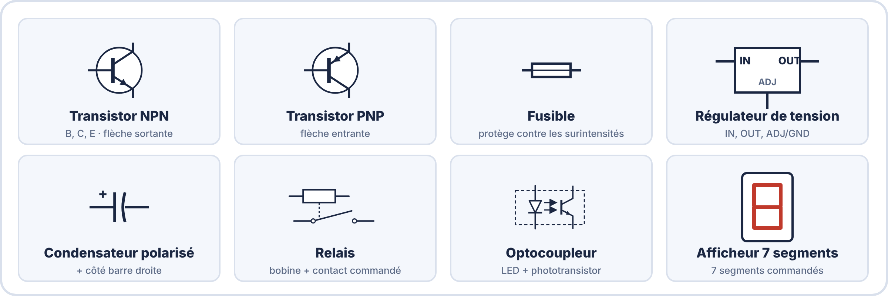
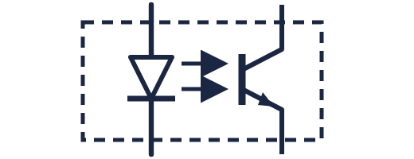
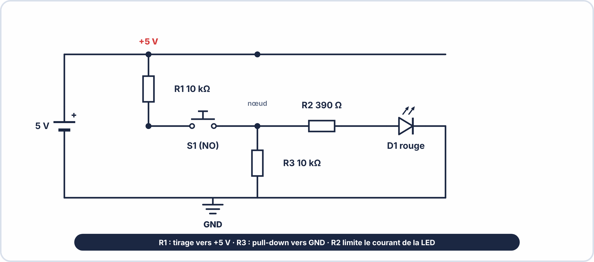
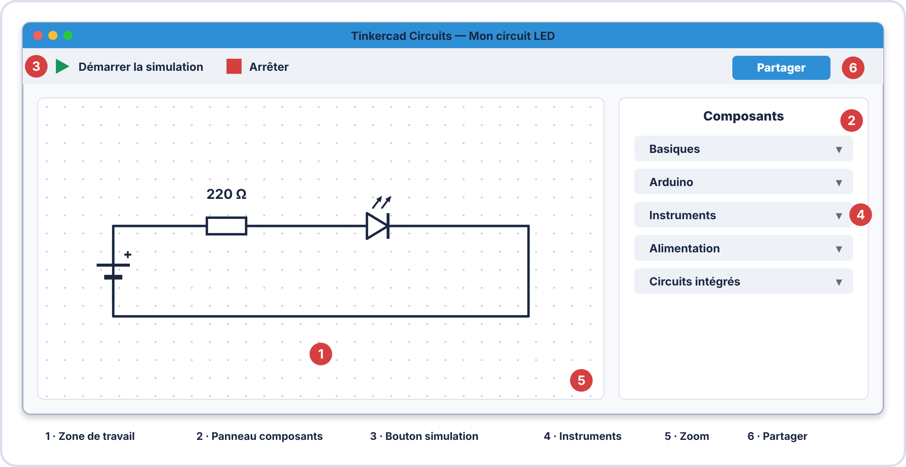
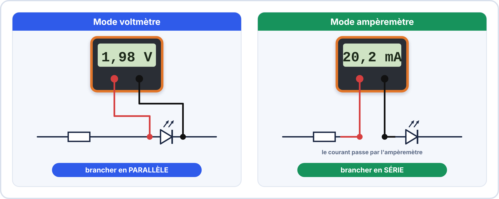

# 📘 FICHE DE COURS — S6 / Module E2
## Schémas Électriques Normés · Tinkercad · Lecture de Datasheet

---

## 🗝️ Vocabulaire clé à maîtriser pour l'examen

| Terme | Définition à retenir |
|---|---|
| **Schéma électrique normé** | Représentation graphique standardisée d'un circuit électrique utilisant les symboles IEC 60617 et respectant des conventions de dessin strictes |
| **CAO** | Conception Assistée par Ordinateur — utilisation d'un logiciel pour dessiner des schémas ou concevoir des PCB |
| **Simulateur de circuit** | Logiciel calculant le comportement d'un circuit électronique sans câblage physique (ex : Tinkercad, LTSpice) |
| **Netlist** | Liste des connexions entre composants générée par un logiciel de schématique — utilisée pour fabriquer le PCB |
| **Datasheet** | Document technique officiel du fabricant décrivant les caractéristiques électriques, mécaniques et thermiques d'un composant |
| **Absolute Maximum Ratings** | Valeurs limites absolues à ne JAMAIS dépasser — dépassement = destruction irréversible du composant |
| **Typical Operating Conditions** | Valeurs de fonctionnement recommandées pour des performances optimales (différentes des limites absolues) |
| **$h_{\mathrm{FE}}$ (β)** | Gain en courant d'un transistor bipolaire : rapport $I_{C}$ / $I_{B}$ — caractérise l'amplification |
| **$V_{\mathrm{CEO}}$** | Tension maximale collecteur-émetteur (base ouverte) d'un transistor — valeur à ne pas dépasser |
| **Pull-down** | Résistance connectée entre un nœud et la masse pour forcer le niveau logique à 0 V quand aucun signal n'est appliqué |
| **Pull-up** | Résistance connectée entre un nœud et VCC pour forcer le niveau logique à VCC quand aucun signal n'est appliqué |
| **Modèle idéal** | Représentation simplifiée d'un composant utilisée par les simulateurs — les valeurs réelles peuvent légèrement différer |

### 🤔 À ton avis ?

Un ingénieur veut tester son circuit avant de le fabriquer. Peut-il le faire sans acheter un seul composant ?

??? question "Voir une réponse possible"
    Oui, grâce à un **simulateur** comme **Tinkercad Circuits** : on construit et on teste le montage **à l'écran**, sans risque de griller un composant.
    
    Mais attention : la simulation n'est pas la réalité. Dans cette séance, tu apprends à **dessiner un schéma normalisé**, à **simuler** dans Tinkercad, à **lire une datasheet** et à **dimensionner** un circuit, puis à comprendre les **limites** de la simulation.

---

## 1. Schémas électriques normés — Approfondissement

### 1.1 Les 7 règles de dessin — Rappel et approfondissement

Ces règles ne sont pas optionnelles. Un schéma professionnel non conforme peut conduire à des erreurs de fabrication et engage la responsabilité du dessinateur.

| N° | Règle | Bonne pratique | Erreur fréquente |
|---|---|---|---|
| 1 | **Fils horizontaux et verticaux** | Tous les fils à 0° ou 90° | Fils à 45° ou courbes |
| 2 | **Source de tension à gauche** | Pile / alimentation en position gauche | Source au centre ou à droite |
| 3 | **GND en bas** | Référence masse toujours en partie basse du schéma | GND en haut ou en position aléatoire |
| 4 | **Sens de lecture** | Courant conventionnel circule de gauche (+ ) vers droite puis vers GND | Circuit "en escargot" illisible |
| 5 | **Point noir obligatoire sur jonction** | Tout croisement connecté porte un point noir rempli • | Jonction sans point → ambiguïté fatale |
| 6 | **Étiquette sur chaque composant** | R1 = 390 Ω · C2 = 100µF · D1 = LED rouge | Composant sans repère ni valeur → schéma inutilisable |
| 7 | **Symboles normalisés IEC** | Symboles de la norme IEC 60617 uniquement | Symboles US (résistance en zigzag) non conformes en Europe |

### 1.2 Symboles avancés à maîtriser en S6

| Composant | Symbole IEC | Repère | Usage typique |
|---|---|---|---|
| **Transistor NPN** | { width="210" } | Q ou T | Commutateur, amplificateur |
| **Transistor PNP** | { width="210" } | Q ou T | Commutateur côté positif |
| **Fusible** | { width="210" } | F | Protection contre les surintensités |
| **Régulateur de tension** | { width="210" } | U ou VR | Stabiliser une tension (ex : 7805 → 5V fixe) |
| **Condensateur polarisé** | { width="210" } | C | Filtrage, découplage (électrolytique) |
| **Relais** | { width="210" } | K ou RLY | Commander un circuit de puissance par un signal faible |
| **Optocoupleur** | { width="210" } | OK ou OC | Isoler galvaniquement deux circuits |

### 1.3 Exemple de schéma normé complet avec les nouvelles conventions

> [!TIP] 💡 En clair
> Un schéma sert à **communiquer**. Plus le circuit est grand, plus il faut respecter les **conventions** : fils droits (horizontaux ou verticaux), **alimentation en haut**, **masse en bas**, **signal de gauche à droite**, **points** sur les jonctions, **noms et valeurs** sur chaque composant.
>
> Tu rencontres aussi de **nouveaux symboles** : transistor, fusible, régulateur, relais, optocoupleur.

### ✅ Vérifie que tu as compris

**Q1.** Où place-t-on l'alimentation et la masse sur un schéma ?

??? success "Réponse"
    L'**alimentation en haut**, la **masse en bas**.

**Q2.** À quoi sert le symbole du fusible ?

??? success "Réponse"
    À **protéger** le circuit : il **coupe** le courant en cas de surintensité.

**Q3.** Pourquoi note-t-on la valeur à côté de chaque composant ?

??? success "Réponse"
    Pour que le schéma soit **complet** : on peut monter ou dépanner le circuit sans autre document.

> [!SUCCESS] 🧠 À retenir
> - Un bon schéma est **lisible** : fils droits, jonctions marquées, noms et valeurs.

---

## 2. Tinkercad Circuits — Prise en main

### 2.1 Présentation de Tinkercad

**Tinkercad Circuits** est un simulateur de circuit électronique **gratuit, en ligne et sans installation**, développé par Autodesk. Il permet de :

- Dessiner des circuits avec des composants virtuels
- **Simuler le fonctionnement** avant tout câblage physique
- Utiliser des instruments virtuels (voltmètre, ampèremètre, oscilloscope)
- **Programmer et simuler un Arduino** dans le même environnement

| Zone de l'interface | Description | Comment l'utiliser |
|---|---|---|
| **Canvas (zone de travail)** | Surface blanche où on pose les composants | Glisser-déposer depuis le panneau droit |
| **Panneau Composants** | Bibliothèque de composants classés par catégories | Chercher par nom ou parcourir les catégories |
| **Bouton Démarrer simulation** | Lance le calcul du circuit | Cliquer pour voir les LEDs s'allumer, les courants circuler |
| **Instruments** | Voltmètre, ampèremètre, oscilloscope virtuels | Placer dans le circuit comme un composant réel |
| **Partager** | Génère un lien URL partageable | Utiliser pour remettre au formateur |

### 2.2 Procédure de création d'un circuit — 5 étapes

> [!NOTE] CRÉER UN CIRCUIT SUR TINKERCAD — Procédure standard
>
> 1. Créer un nouveau projet : "Circuits" → "+ Nouveau circuit"  
> 2. Nommer le projet : NOM_Prenom_S6_TP1 (convention classe)  
> 3. Glisser les composants depuis le panneau droit sur le canvas  
> 4. Connecter les composants en cliquant sur une broche et en tirant  
>   un fil jusqu'à la broche suivante (le fil passe auto en H/V)  
> 5. Régler les valeurs des composants (double-clic → modifier valeur)  
> 6. Cliquer "Démarrer la simulation" pour tester  
> 7. Sauvegarder (Ctrl+S ou auto-save)  

### 2.3 Composants disponibles dans Tinkercad — Les essentiels

| Composant | Nom dans Tinkercad | Catégorie |
|---|---|---|
| Résistance | Résistance | Basiques |
| LED | DEL (Diode électroluminescente) | Basiques |
| Condensateur | Condensateur | Basiques |
| Pile / Alimentation | Pile (9V) ou Alimentation | Basiques |
| Bouton-poussoir | Bouton-poussoir | Basiques |
| Voltmètre | Multimètre (mode tension) | Instruments |
| Ampèremètre | Multimètre (mode courant) | Instruments |
| Arduino Uno | Arduino Uno R3 | Microcontrôleurs |

### 2.4 Les instruments de mesure virtuels

| Mode | Symbole sur la face | Branchement | Ce qu'il affiche |
|---|---|---|---|
| **Voltmètre** | V | **En parallèle** avec l'élément à mesurer | Tension aux bornes en Volts |
| **Ampèremètre** | A | **En série** dans le circuit | Courant traversant en Ampères ou mA |

> [!TIP] 💡 En clair
> Tinkercad Circuits est un **atelier virtuel**. Le travail se fait toujours en **quatre temps** :
>
> 1. **Poser** les composants sur la zone de travail.
> 2. **Les relier** avec des fils.
> 3. **Régler** leurs valeurs (résistance, tension de l'alimentation).
> 4. **Démarrer la simulation** (le triangle vert) et **observer**.
>
> Tu peux aussi placer un **multimètre virtuel** pour mesurer : **en parallèle** pour la tension, **en série** pour le courant, comme dans la réalité.

### ✅ Vérifie que tu as compris

**Q1.** Comment mesure-t-on la tension aux bornes d'une LED dans Tinkercad ?

??? success "Réponse"
    Avec le multimètre en **mode voltmètre**, branché **en parallèle** de la LED.

**Q2.** Que se passe-t-il si on oublie de démarrer la simulation ?

??? success "Réponse"
    Rien ne s'anime : il faut cliquer sur **« Démarrer la simulation »**.

**Q3.** Un composant simulé peut-il « griller » ?

??? success "Réponse"
    Oui, Tinkercad signale certaines erreurs (LED sans résistance), mais pas toutes les pannes de la vraie vie.

> [!SUCCESS] 🧠 À retenir
> - Poser, relier, régler, simuler, observer.

---

## 3. Lecture d'une datasheet — Méthode professionnelle

### 3.1 Structure type d'une datasheet

Une datasheet de composant électronique suit toujours une structure similaire :

| Section | Titre anglais type | Ce qu'on y trouve |
|---|---|---|
| **En-tête** | Part Number / Product Description | Référence, famille, application principale |
| **Description** | General Description | Fonctionnalité principale en 2–3 phrases |
| **Caractéristiques clés** | Features | Points forts du composant (listes) |
| **⚠️ Limites absolues** | **Absolute Maximum Ratings** | **Valeurs à NE JAMAIS dépasser** |
| **Caractéristiques typiques** | Electrical Characteristics | Valeurs de fonctionnement normal |
| **Brochage** | Pin Configuration / Package | Quelle broche est quoi (B, C, E pour transistor) |
| **Courbes** | Characteristic Curves | Graphiques comportement selon conditions |

### 3.2 La section "Absolute Maximum Ratings" — La plus importante

> ⚠️ **Règle absolue** : Ces valeurs sont des **seuils de destruction irréversible**. Les dépasser, même une fraction de seconde, peut détruire le composant instantanément. On ne travaille **jamais** à ces valeurs — on les utilise pour vérifier qu'on en est bien loin.

### 3.3 Les 6 paramètres essentiels à extraire systématiquement

Pour tout composant actif, extraire ces 6 paramètres avant de l'utiliser dans un circuit :

| N° | Paramètre | Symbole type | Ce que ça signifie | Pour quoi faire |
|---|---|---|---|---|
| 1 | **Tension maximale** | $V_{\mathrm{CEO}}$, $V_{\mathrm{DS}}$, $V_{R}$ | Tension qu'on ne peut pas dépasser aux bornes | Choisir une alimentation compatible |
| 2 | **Courant maximal** | $I_{C}$, $I_{D}$, $I_{F}$ | Courant maximum supporté | Dimensionner les résistances de protection |
| 3 | **Puissance maximale** | $P_{D}$, $P_{\mathrm{TOT}}$ | Puissance dissipée maximale | Vérifier si un radiateur est nécessaire |
| 4 | **Tension de fonctionnement typique** | $V_{F}$, $V_{\mathrm{CE}}$(sat) | Tension à prévoir dans les calculs | Calculer les résistances du circuit |
| 5 | **Courant de fonctionnement typique** | $I_{F}$, $I_{C}$(typ) | Courant dans les conditions normales | Vérifier l'autonomie de la batterie |
| 6 | **Brochage (Pinout)** | Schéma de boîtier | Quelle broche est quelle fonction | Câbler correctement sans inverser |

### 3.4 Anglais technique essentiel de la datasheet

| Terme anglais | Traduction | Contexte |
|---|---|---|
| **Maximum** | Maximum (ne pas dépasser) | Absolute Maximum Ratings |
| **Typical** (typ.) | Valeur typique (la plus fréquente) | Electrical Characteristics |
| **Minimum** (min.) | Valeur minimale garantie | Electrical Characteristics |
| **Maximum** (max.) | Valeur maximale garantie | Electrical Characteristics |
| **Collector** | Collecteur | Transistor bipolaire |
| **Emitter** | Émetteur | Transistor bipolaire |
| **Base** | Base | Transistor bipolaire |
| **Forward** | Direct (sens direct de la diode) | $V_{F}$, $I_{F}$ |
| **Reverse** | Inverse (sens bloquant de la diode) | $V_{R}$ |
| **Power Dissipation** | Puissance dissipée | $P_{D}$ |
| **Junction Temperature** | Température de jonction | $T_{J}$ |
| **Gain** | Gain (amplification) | $h_{\mathrm{FE}}$, β |
| **Operating Conditions** | Conditions de fonctionnement | $T_{C}$ = 25°C standard |

> [!TIP] 💡 En clair
> Une datasheet est un **document technique** de plusieurs pages. Pas besoin de tout lire : on suit toujours **le même parcours** :
>
> 1. la **première page** : à quoi sert le composant ;
> 2. le tableau **« Absolute Maximum Ratings »** : les limites à **ne jamais dépasser** ;
> 3. les **caractéristiques électriques** : les valeurs de **fonctionnement** ;
> 4. le **brochage** : à quoi correspond chaque patte.

### ✅ Vérifie que tu as compris

**Q1.** Que signifient les « Absolute Maximum Ratings » ?

??? success "Réponse"
    Les **valeurs limites absolues** : au-delà, le composant peut être **détruit**.

**Q2.** Pour un transistor BC547, que veut dire $I_C = 100\,\mathrm{mA}$ dans ce tableau ?

??? success "Réponse"
    Le **courant maximal** que peut supporter le collecteur : on reste **très en dessous** en fonctionnement normal.

**Q3.** Où trouve-t-on la correspondance entre les pattes et leur rôle ?

??? success "Réponse"
    Dans le **brochage** (« pinout »), souvent dessiné sur la première page.

> [!SUCCESS] 🧠 À retenir
> - Limites absolues = à ne jamais dépasser ; valeurs typiques = pour calculer.

---

## 4. Application : Dimensionner un circuit avec la datasheet

### 4.1 Exemple guidé — LED commandée par transistor BC547

**Problème** : On veut commander une LED rouge ($V_{F}$ = 2V, $I_{F}$ = 20mA) avec un transistor BC547 piloté par une sortie Arduino ($V_{\mathrm{out}}$ = 5V, $I_{\mathrm{out}}$ max = 40mA).

**Données extraites de la datasheet BC547 :**

- $h_{\mathrm{FE}}$ minimum (gain) = 110 (à $I_{C}$ = 2mA), typ = 200
- $V_{\mathrm{CE}}$(sat) ≈ 0,2 V (transistor saturé)
- $V_{\mathrm{BE}}$ ≈ 0,6 V (jonction base-émetteur)
- $I_{C}$ maximum = 100 mA — on reste bien en-dessous

**Calculs :**

| Étape | Calcul | Résultat |
|---|---|---|
| Résistance LED (côté collecteur) | $R_{\mathrm{C}} = \dfrac{V_{\mathrm{CC}} - V_{\mathrm{F}} - V_{\mathrm{CE\_sat}}}{I_{\mathrm{F}}} = \dfrac{5 - 2 - 0{,}2}{0{,}02}$ | **$R_{C}$ = 140 Ω → choisir 150 Ω** |
| Courant de base nécessaire | $I_{\mathrm{B}} = \dfrac{I_{\mathrm{C}}}{h_{\mathrm{FE}}}_min = \dfrac{20\,\mathrm{mA}}{110}$ | $I_{\mathrm{B}} = 0{,}18\,\mathrm{mA}$ |
| Résistance de base | $R_{\mathrm{B}} = \dfrac{V_{\mathrm{out}} - V_{\mathrm{BE}}}{I_{\mathrm{B}}} = \dfrac{5 - 0{,}6}{0{,}00018}$ | **$R_{B}$ ≈ 24 kΩ → prendre 10 kΩ** (surpilotage pour saturation assurée) |

> [!TIP] 💡 En clair
> On veut allumer une LED (20 mA) depuis une sortie Arduino qui ne peut donner que **peu de courant**. On intercale un **transistor** qui joue le rôle d'**interrupteur commandé** : un **petit courant de base** pilote un **plus gros courant de collecteur**.
>
> Deux résistances, deux calculs :
>
> 1. **$R_C$** (côté LED) protège la LED : $R_C = \dfrac{V_{CC} - V_F - V_{CE_{sat}}}{I_F}$.
> 2. **$R_B$** (côté base) limite le courant de base : on calcule d'abord $I_B = \dfrac{I_C}{h_{FE}}$.
>
> Pour que le transistor soit bien **saturé**, on choisit un $R_B$ **plus petit** que la valeur calculée (sécurité).

### ✅ Vérifie que tu as compris

**Q1.** Pourquoi utilise-t-on un transistor entre l'Arduino et une charge puissante ?

??? success "Réponse"
    Parce qu'une sortie Arduino fournit **peu de courant** : le transistor permet de commander un **courant plus important**.

**Q2.** À quoi sert la résistance de base ?

??? success "Réponse"
    À **limiter le courant de base** pour ne pas endommager le transistor ni la sortie de l'Arduino.

**Q3.** Pourquoi prend-on le $h_{FE}$ **minimum** de la datasheet pour calculer ?

??? success "Réponse"
    Pour être sûr que le transistor est **bien saturé** même avec un composant moins performant.

> [!SUCCESS] 🧠 À retenir
> - Le transistor commande un fort courant avec un petit.
> - Deux résistances : $R_C$ protège la charge, $R_B$ limite le courant de base.

---

## 5. Simulation vs réalité — Comprendre les limites de Tinkercad

| Aspect | Tinkercad (simulation) | Circuit réel |
|---|---|---|
| **Temps de réalisation** | Quelques minutes | 30 min à plusieurs heures |
| **Coût** | Gratuit | Coût des composants + matériel |
| **Précision** | Modèles idéaux ($V_{F}$ LED = 2,000 V exactement) | Tolérances réelles ($V_{F}$ ± 0,2V selon lot) |
| **Risques** | Aucun | Composants grillés, courts-circuits |
| **Pannes simulées** | Limitées (pas de défaut thermique, ESD...) | Toutes les pannes réelles possibles |
| **Utilité principale** | Valider la logique + pré-dimensionnement | Valider en conditions réelles |

> 📌 **Conclusion** : La simulation est une étape de **pré-validation**, pas un remplacement de l'expérimentation réelle. On simule pour s'assurer de la logique et du dimensionnement, puis on câble pour valider dans les conditions réelles.

> [!TIP] 💡 En clair
> La simulation sert à **vérifier la logique** et à **pré-dimensionner**. Elle ne remplace pas la réalité : les composants simulés sont **idéaux** (une LED a exactement 2 V), alors que les vrais composants ont des **tolérances**, chauffent, et peuvent tomber en panne.

### ✅ Vérifie que tu as compris

**Q1.** Cite une limite de la simulation.

??? success "Réponse"
    Les modèles sont **idéaux** : tolérances, chaleur, parasites et pannes réelles ne sont pas toutes reproduites.

**Q2.** À quoi sert alors la simulation ?

??? success "Réponse"
    À **valider la logique** et pré-dimensionner avant le montage réel.

> [!SUCCESS] 🧠 À retenir
> - On simule pour préparer ; on mesure pour valider.

---

## ✅ Compétences RNCP travaillées

| Code | Compétence | Niveau |
|---|---|---|
| C1.1 | Analyser un système à partir de documents techniques | ⭐⭐⭐ Maîtrise |
| C1.2 | Extraire les informations pertinentes d'une datasheet | ⭐⭐⭐ Maîtrise |
| C2.1 | Préparer une réalisation à partir d'un schéma et simulation | ⭐⭐⭐ Maîtrise |
| C2.6 | Utiliser des outils numériques de conception | ⭐⭐ Application |
| C3.1 | Rendre compte par écrit et par schéma normé | ⭐⭐⭐ Maîtrise |
| S3 | Schémas électriques, symboles IEC | ⭐⭐⭐ Maîtrise |
| S8 | Outils numériques de conception et simulation | ⭐⭐ Application |
| S9 | Documentation technique, datasheet | ⭐⭐⭐ Maîtrise |

---

## 📝 Mémo rapide — À garder dans le portfolio

| Je dois... | Je retiens... |
|---|---|
| Respecter les règles de schéma | Fils H/V · Source à gauche · GND en bas · Point noir sur jonction · Étiquettes obligatoires |
| Simuler un circuit | Tinkercad → Circuits → Nouveau → Glisser composants → Connecter → Simuler |
| Mesurer en simulation | Voltmètre EN PARALLÈLE · Ampèremètre EN SÉRIE |
| Lire une datasheet | 6 paramètres : $V_{\mathrm{max}}$ · $I_{\mathrm{max}}$ · $P_{\mathrm{max}}$ · $V_{\mathrm{typ}}$ · $I_{\mathrm{typ}}$ · Brochage |
| Utiliser les limites absolues | Jamais dépasser les "Absolute Maximum Ratings" |
| Comprendre un transistor NPN | B = Base (commande) · C = Collecteur (charge) · E = Émetteur (GND) |

---

*BAC Pro CIEL — S6 Module E2 | MFR de Pontonx | © Yahn LE PRETTRE*
