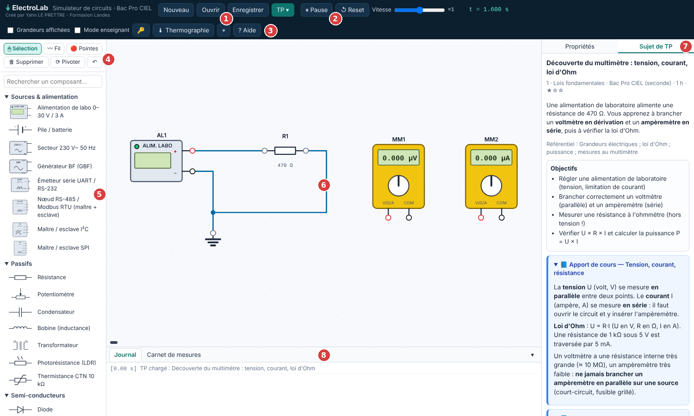
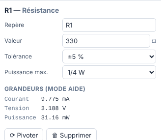
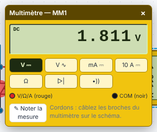

# 🖥️ GUIDE PAS À PAS — Simuler un circuit
## ElectroLab (en premier), puis Tinkercad Circuits

---

> **Document élève — À garder dans le portfolio numérique**

> [!NOTE] Quel simulateur utiliser ?
> - **ElectroLab** : le simulateur de la formation. Sans compte, schémas normalisés, instruments de labo (multimètre, oscilloscope…), composants qui **peuvent être détruits**. **Commence par lui.**
> - **Tinkercad Circuits** : second simulateur, utile surtout pour **programmer un Arduino**. Voir la [partie B](#partie-b-tinkercad-circuits).

---

# PARTIE A — ElectroLab

## 📌 Ouvrir ElectroLab

```
1. Ouvrir Chrome ou Firefox
2. Aller sur : https://yahnlp.github.io/ElectroLab/
3. L'écran s'ouvre avec un TP déjà chargé (c'est normal)
4. Cliquer sur « Nouveau » pour obtenir une zone de travail vide
   (confirmer « Effacer le schéma actuel ? »)
```

> 💡 Pas de compte, pas de mot de passe. Le fichier unique `electrolab.html` fonctionne aussi **hors ligne** (demander au formateur).



| N° | Zone | Rôle |
|---|---|---|
| 1 | Nouveau · Ouvrir · Enregistrer · **TP ▾** | Gérer ses fichiers, charger un TP |
| 2 | ⏸ Pause · ↺ Reset · Vitesse | Contrôler la simulation |
| 3 | Grandeurs affichées · Thermographie · ? Aide | Options d'affichage |
| 4 | Sélection · Fil · Pointes · Supprimer · Pivoter | Outils de la souris |
| 5 | Palette | Bibliothèque de composants |
| 6 | Zone de travail | Le schéma |
| 7 | Propriétés / Sujet de TP | Régler un composant / lire la consigne |
| 8 | Journal / Carnet de mesures | Messages et mesures notées |

---

## PARTIE A1 — Construire le circuit « LED + résistance »

> **Objectif** : alimenter une LED rouge sous 5 V avec une résistance de 330 Ω, puis mesurer la tension aux bornes de la LED.

### Étape A1 — Poser un composant

```
  1. Dans la palette (colonne de gauche), cliquer sur le composant
     → une image du composant suit la souris
  2. (Facultatif) Appuyer sur R pour le pivoter avant de le poser
  3. Cliquer dans la zone de travail pour le déposer
     (il s'accroche à la grille)
  4. Échap ou clic droit : arrêter de poser
```

Composants du circuit et où les trouver :

| Composant | Où ? |
|---|---|
| Alimentation de labo 0–30 V / 3 A | Sources & alimentation |
| Résistance | Passifs |
| LED | Semi-conducteurs |
| Masse (0 V) | **Divers** (catégorie repliée : cliquer sur son titre) |
| Multimètre numérique | **Instruments** (catégorie repliée) |

> 💡 Un champ **« Rechercher un composant… »** est disponible en haut de la palette.

### Étape A2 — Régler les valeurs

```
  1. Cliquer UNE FOIS sur le composant → il est entouré en pointillés bleus
  2. Ouvrir l'onglet « Propriétés » (panneau de droite)
  3. Modifier le champ, puis appuyer sur Entrée
```



| Composant | Champ | Valeur à régler |
|---|---|---|
| Alimentation de labo | Tension réglée | 5 (V) |
| Alimentation de labo | Limitation de courant | laisser 500 mA (ou régler selon le TP) |
| Résistance | Valeur | 330 (Ω) |
| Résistance | Tolérance | ±5 % (la valeur réelle varie un peu !) |
| LED | Référence | LED rouge |

### Étape A3 — Tracer les fils

```
  1. Placer la souris sur une broche (petit rond) du composant
  2. Maintenir le clic et GLISSER jusqu'à la broche de destination
  3. Relâcher : le fil se trace avec des angles droits
```

Câblage à réaliser (la **flèche du symbole de la LED** va de l'anode vers la cathode) :

```
  + de l'alimentation  →  R1 (broche gauche)
  R1 (broche droite)   →  anode (A) de la LED
  cathode (K) de la LED →  − de l'alimentation
  − de l'alimentation  →  Masse (0 V)
```

> ⚠️ **Masse obligatoire.** Sans symbole « Masse », un bandeau orange apparaît : *« Aucune masse (0 V) dans le montage »*.

| Action | Geste |
|---|---|
| Déplacer un segment de fil | Glisser le fil |
| Retracer un fil proprement | **Double-clic** sur le fil |
| Supprimer un fil ou un composant | Le sélectionner, touche **Suppr** |
| Annuler | **Ctrl + Z** |
| Zoom / déplacer la vue / recentrer | Molette · glisser le fond · bouton **⌖** |

> 🧼 **Pistes lisibles** : choisis la position des composants pour que les fils soient **courts, droits et sans chevauchement** ; un fil ne doit pas passer **sous un composant ni sous une étiquette**.

### Étape A4 — La simulation est déjà en marche

```
  → Pas de bouton « Démarrer » : le circuit est calculé en continu
  → La LED s'allume dès que le circuit est complet
  → ⏸ Pause (ou barre d'espace) : figer le circuit
  → ↺ Reset : remettre le temps à zéro
  → Le curseur « Vitesse » ralentit ou accélère le temps simulé
```

> 💡 On peut **modifier le circuit pendant que la simulation tourne**, contrairement à Tinkercad.

---

## PARTIE A2 — Mesurer avec le multimètre

### Étape A5 — Brancher le multimètre

```
  1. Poser un « Multimètre numérique » (catégorie Instruments)
  2. Broche V/Ω/A (ROUGE)  → côté « + » (ici l'anode de la LED)
  3. Broche COM   (NOIRE)  → côté « − » (ici la cathode de la LED)
  4. Double-clic sur le multimètre → la fenêtre de réglage s'ouvre
  5. Choisir le mode : V ⎓ pour une tension continue
```



| Je veux mesurer… | Mode | Branchement |
|---|---|---|
| Une tension continue | **V ⎓** | **En parallèle** du composant |
| Une tension alternative | V ∿ | En parallèle |
| Un courant (petit) | **mA ⎓** | **En série** : ouvrir le circuit et insérer l'appareil |
| Un courant (grand) | 10 A ⎓ | En série |
| Une résistance | **Ω** | **Circuit hors tension**, composant isolé |
| Une diode | ▷\| | Hors tension |
| Une continuité | •)) | Hors tension |

> ⚠️ **Ampèremètre jamais en parallèle d'une source** : le fusible interne grille (message « Fusible grillé ! » → bouton **Remplacer le fusible**).

> 📝 Le bouton **✎ Noter la mesure** enregistre la valeur dans le **Carnet de mesures** (onglet en bas).

**Valeurs attendues (à toi de vérifier)** : tension aux bornes de la LED entre **1,7 V et 2 V** ; courant dans le circuit de l'ordre de **10 mA** (calcul : $I = \dfrac{5 - U_{LED}}{330}$). Les valeurs affichées diffèrent un peu du calcul : la résistance réelle de 330 Ω a une **tolérance**.

### Étape A6 — Lire les grandeurs sans instrument (aide)

```
  1. Cocher « Grandeurs affichées » (en haut)
  2. Cliquer sur un composant
  3. Le panneau « Propriétés » affiche Courant · Tension · Puissance
```

> 🎯 En TP, cette case est souvent **décochée** : il faut alors mesurer avec les instruments.

**Pointes de touche (outil « Pointes »)** : sélectionner l'outil **🔴 Pointes** (ou touche **P**), cliquer sur une broche (pointe **rouge**), puis sur une autre broche (pointe **noire**) : ce sont les pointes de touche du multimètre.

---

## PARTIE A3 — Aller plus loin et sauvegarder

| Fonction | Utilité |
|---|---|
| **🌡 Thermographie** | Affiche la température estimée de chaque composant : repérer un composant qui chauffe |
| **TP ▾** | Charge un TP avec sujet, vérification du câblage et correction automatique |
| **Journal** | Signale les événements : *« composant détruit »*, surcharge… |
| **Enregistrer** | Télécharge le schéma dans un fichier `schema-electrolab.json` : **le renommer** `NOM_Prenom_S6_ElectroLab_TP1.json` |
| **Ouvrir** | Recharge un fichier `.json` enregistré |

## 🔑 Raccourcis ElectroLab

| Touche | Action |
|---|---|
| **R** | Pivoter le composant (en cours de pose ou sélectionné) |
| **V** · **C** · **P** · **X** | Outil Sélection · Fil · Pointes · Supprimer |
| **Suppr** | Supprimer l'élément sélectionné |
| **Ctrl + Z** | Annuler |
| **Espace** | Pause / lecture de la simulation |
| **Échap** | Arrêter la pose / le tracé en cours |

## 🛠️ Problèmes fréquents dans ElectroLab

| Problème | Cause probable | Solution |
|---|---|---|
| Bandeau orange « Aucune masse » | Pas de symbole Masse | Ajouter **Masse (0 V)** (Divers) sur le « − » |
| La LED ne s'allume pas | LED à l'envers ou circuit ouvert | La flèche du symbole va de l'**anode (A)** vers la **cathode (K)** ; vérifier que chaque broche est reliée (rond plein) |
| Le multimètre affiche 0 | Fils non branchés ou mauvais mode | Vérifier V/Ω/A et COM ; choisir **V ⎓** |
| LED ou composant « détruit » | Courant trop fort (LED sans résistance…) | Lire le journal ; supprimer le composant, en poser un neuf et ajouter la résistance |
| Fusible du multimètre grillé | Ampèremètre branché en parallèle | **Remplacer le fusible**, puis rebrancher **en série** |
| Un composant ne se pose pas | Aucun composant armé | Cliquer d'abord sur le composant dans la palette |
| Je ne trouve pas Masse / Multimètre | Catégorie repliée | Cliquer sur **Divers** / **Instruments** |

---

# PARTIE B — Tinkercad Circuits

## 📌 Accès et création de compte

### Étape 0 — Accéder à Tinkercad

```
1. Ouvrir Chrome ou Firefox
2. Aller sur : www.tinkercad.com
3. Cliquer sur "Se connecter" (haut droite)
4. Cliquer sur "Créer un compte personnel"
5. Renseigner : adresse email + mot de passe
6. Valider l'email de confirmation
7. → Vous êtes sur le tableau de bord Tinkercad
```

> 💡 **Si vous n'avez pas d'email** : Utiliser un compte de classe fourni par le formateur.

---

## PARTIE 1 — Créer un nouveau circuit

### Étape 1 — Accéder au module Circuits

```
Dans le tableau de bord :
  → Cliquer sur l'onglet "Circuits" dans le menu gauche ou en haut
  → Cliquer sur le bouton vert "+ Créer un nouveau circuit"
  → L'éditeur de circuit s'ouvre
```

### Étape 2 — Nommer le projet

```
  → Cliquer sur "Nouveau Circuit" en haut au centre
  → Taper le nom selon la convention : NOM_Prenom_S6_TP1
  → Appuyer sur Entrée pour valider
```

---

## PARTIE 2 — Ajouter des composants

### Étape 3 — Panneau Composants

Pour trouver un composant :
Option A → Taper son nom dans la barre de recherche
Option B → Dérouler la catégorie correspondante

Composants à connaître et leur emplacement :
| Composant | Catégorie |
|---|---|
| Résistance | Basiques |
| DEL (LED) | Basiques |
| Condensateur | Basiques |
| Pile (9V) | Basiques |
| Bouton-poussoir | Basiques |
| Multimètre | Instruments |
| Arduino Uno R3 | Microcontrôleurs |

### Étape 4 — Poser un composant sur le canvas

```
  1. Cliquer sur le composant voulu dans le panneau
  2. Il s'accroche au curseur de la souris
  3. Cliquer sur le canvas pour le déposer à l'endroit voulu
  4. Appuyer sur Échap pour désélectionner
```

### Étape 5 — Modifier la valeur d'un composant

1. Cliquer UNE FOIS sur le composant → il est sélectionné (bordure bleue)
2. Un encadré de propriétés apparaît (en haut ou en bas selon la version)
3. Modifier la valeur dans le champ "Résistance" ou "Tension" selon le composant
4. Valider en cliquant ailleurs

Exemples de valeurs à connaître :
| Composant | Champ | Valeur à taper |
|---|---|---|
| Résistance | Résistance | 390 (la valeur est en Ohms) |
| Pile | Tension | 9 (volts) |
| Condensateur | Capacitance | 100µ (microfarads) |
| DEL | Couleur | Choisir : rouge, vert, bleu… |

---

## PARTIE 3 — Connecter les composants

### Étape 6 — Tracer un fil de connexion

```
Pour tracer un fil :
  1. Positionner la souris sur une broche d'un composant
     → Un point VERT apparaît → c'est le signal de connexion disponible
  2. CLIQUER sur ce point vert
  3. Déplacer la souris vers la broche de destination
     → Le fil se trace automatiquement en angles droits (H/V)
  4. CLIQUER sur la broche de destination pour terminer le fil

Pour supprimer un fil :
  → Cliquer sur le fil pour le sélectionner → Touche Suppr
```

### Étape 7 — Changer la couleur d'un fil (optionnel mais recommandé)

```
  1. Cliquer sur le fil pour le sélectionner
  2. Choisir la couleur dans l'encadré de propriétés
  Convention recommandée :
    → Rouge = alimentation (+)
    → Noir = masse (GND, −)
    → Autres couleurs = liaisons signal
```

---

## PARTIE 4 — Simuler le circuit

### Étape 8 — Lancer la simulation

```
  → Cliquer sur le triangle vert "Démarrer la simulation"
  → Les composants s'animent : les LEDs s'allument, les multimètres affichent des valeurs
  → Si rien ne se passe : vérifier les connexions (fils complets ?)
  → Cliquer sur "Arrêter" pour modifier le circuit
  ATTENTION : on ne peut pas modifier le circuit pendant la simulation
```

### Étape 9 — Utiliser le multimètre virtuel

```
Pour mesurer une TENSION (voltmètre) :
  1. Poser un multimètre depuis le panneau Instruments
  2. Brancher la broche "+" du multimètre au point A (tension à mesurer)
  3. Brancher la broche "−" du multimètre au point B (référence, souvent GND)
  4. Sur le multimètre : sélectionner le mode Tension (V) et DCC (courant continu)
  5. Lancer la simulation → lire la valeur affichée

Pour mesurer un COURANT (ampèremètre) :
  1. Poser un multimètre
  2. L'insérer EN SÉRIE (interrompre un fil et insérer le multimètre dans la coupure)
  3. Sélectionner le mode Courant (A) et DCC
  4. Lancer la simulation → lire la valeur en A ou mA
```

---

## PARTIE 5 — Sauvegarder et partager

### Étape 10 — Sauvegarder

```
  → Tinkercad sauvegarde automatiquement dans le cloud
  → Forcer une sauvegarde : Ctrl + S
  → Vérifier que le nom du projet est correct (NOM_Prenom_S6_TP1)
```

### Étape 11 — Partager le circuit (pour remettre au formateur)

```
  → Cliquer sur l'icône "Partager" (flèche ou lien en haut à droite)
  → Dans la fenêtre qui s'ouvre : cliquer "Copier le lien"
  → Coller ce lien dans votre fiche portfolio ou l'envoyer au formateur
  → Vérifier que le projet est en "Public" ou "Partagé" (pas "Privé")
```

---

## 🔑 Raccourcis clavier utiles

| Raccourci | Action |
|---|---|
| **Ctrl + Z** | Annuler la dernière action |
| **Ctrl + S** | Sauvegarder manuellement |
| **Molette souris** | Zoom avant / arrière |
| **Clic droit + glisser** | Déplacer la vue |
| **Suppr** | Supprimer l'élément sélectionné |
| **Ctrl + D** | Dupliquer un composant |
| **Échap** | Désélectionner / annuler en cours |

---

## 🛠️ Problèmes fréquents et solutions

| Problème | Cause probable | Solution |
|---|---|---|
| La LED ne s'allume pas | Polarité inversée ou fil non connecté | Vérifier anode/cathode + vérifier les fils (point vert à chaque extrémité) |
| Le multimètre affiche "---" ou rien | Mode ou câblage incorrect | Vérifier le mode (V ou A) + vérifier le branchement parallèle/série |
| Je ne peux pas modifier le circuit | Simulation en cours | Cliquer "Arrêter la simulation" d'abord |
| Le fil ne se trace pas correctement | Mauvaise broche de départ | Vérifier qu'un point vert apparaît avant de cliquer |
| La valeur de résistance ne change pas | Mauvais composant sélectionné | Cliquer UNE FOIS sur la résistance (pas double-clic) |
| "Erreur de connexion" au chargement | Problème réseau | Recharger la page (F5) + vérifier connexion internet |

---

## 📏 Convention de nommage des projets S6

Tous vos projets Tinkercad de cette séance doivent être nommés selon cette convention :

```
  TP1 : NOM_Prenom_S6_TP1_LEDsimple
  TP2 : NOM_Prenom_S6_TP2_BoutonLED
  TP_Arduino (avancé) : NOM_Prenom_S6_Arduino_Blink
```

---

*Guide ElectroLab et Tinkercad pas à pas — BAC Pro CIEL S6 Module E2 | MFR de Pontonx*
*Tinkercad est un produit Autodesk — tinkercad.com — Gratuit et sans installation*
