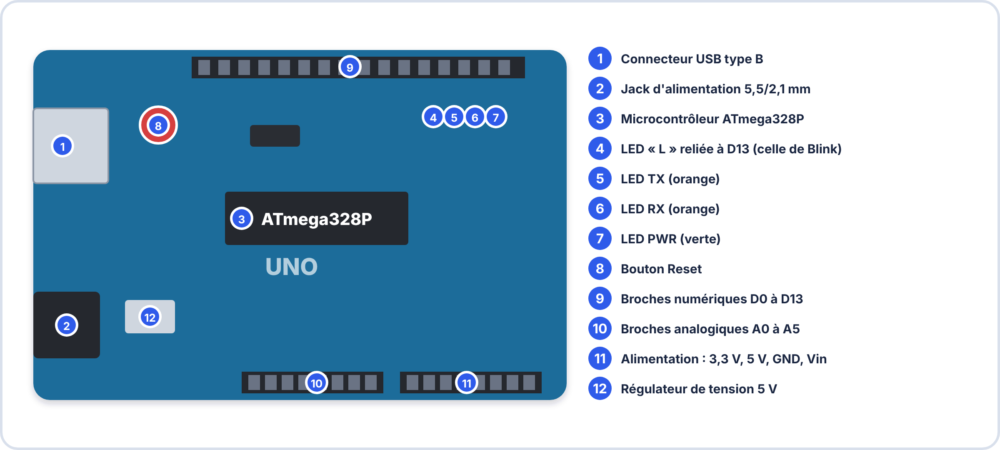
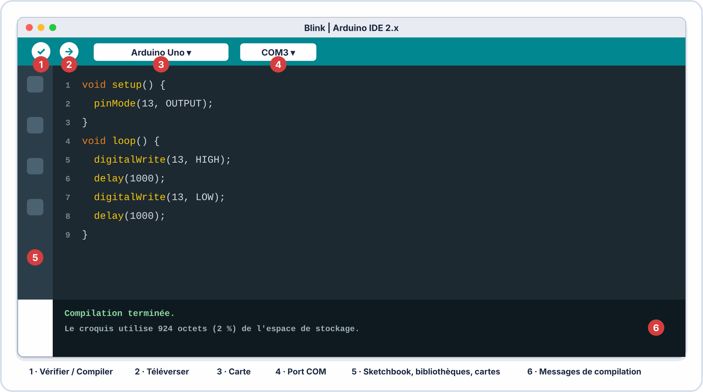
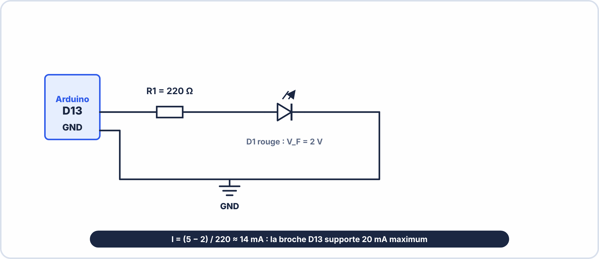
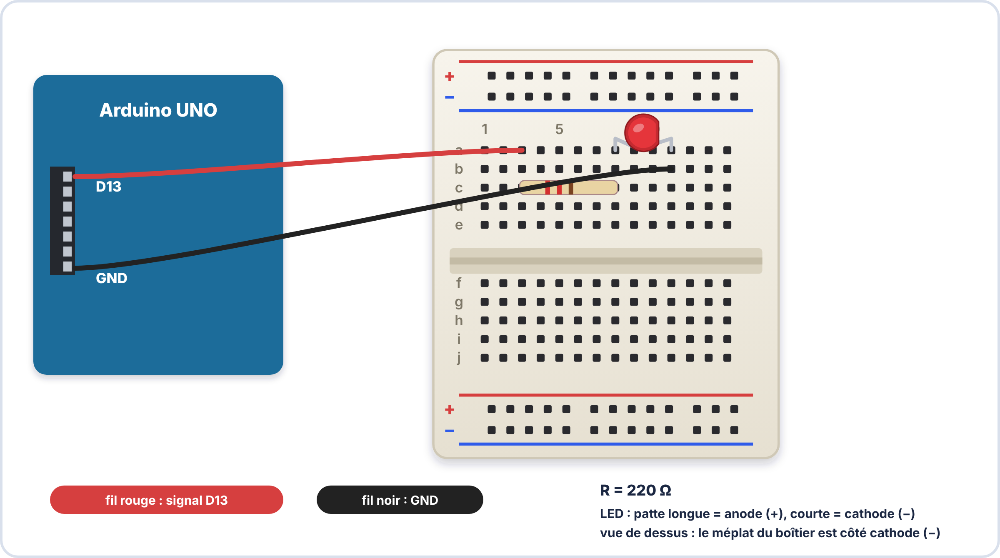

# 📘 FICHE DE COURS — S7 / Module E2
## Arduino IDE · Structure du Sketch · LED Clignotante · Serial Monitor

---

## 🗝️ Vocabulaire clé

| Terme | Définition |
|---|---|
| **Arduino** | Microcontrôleur open source sur une carte de développement avec ses broches d'E/S, son alimentation et son interface USB |
| **Sketch** | Nom donné au programme Arduino (fichier `.ino`) |
| **IDE** | Integrated Development Environment — logiciel permettant d'écrire, compiler et téléverser un sketch |
| **Téléverser (upload)** | Envoyer le programme compilé depuis l'ordinateur vers la mémoire flash de l'Arduino via USB |
| **setup()** | Fonction exécutée **une seule fois** au démarrage de l'Arduino (configuration initiale) |
| **loop()** | Fonction exécutée **en boucle infinie** tant que l'Arduino est alimenté (comportement permanent) |
| **pinMode()** | Configurer une broche en entrée (`INPUT`) ou en sortie (`OUTPUT`) |
| **digitalWrite()** | Mettre une broche numérique à l'état haut (`HIGH` = 5V) ou bas (`LOW` = 0V) |
| **delay()** | Mettre le programme en pause pendant un nombre de millisecondes |
| **Serial Monitor** | Fenêtre de l'IDE affichant les messages envoyés par l'Arduino via le port USB |
| **Serial.begin()** | Initialiser la communication série à une vitesse donnée (bauds) |
| **Serial.println()** | Envoyer une ligne de texte vers le Serial Monitor |
| **Commentaire** | Texte dans le code ignoré par le compilateur — sert à expliquer le code à l'humain |
| **Compilateur** | Outil qui traduit le code C++ lisible par un humain en code machine exécutable par l'Arduino |
| **Broche numérique** | Broche de l'Arduino pouvant être en état HIGH (5V) ou LOW (0V) — broches D0 à D13 |

---

## 1. L'Arduino Uno — Anatomie de la carte



| Zone | Broches / Éléments | Rôle |
|---|---|---|
| **Numériques** | D0 à D13 | Entrée ou sortie logique (0V / 5V) |
| **Analogiques** | A0 à A5 | Lecture de tensions 0–5 V sur 10 bits (0–1023) |
| **Alimentation** | 5V · 3,3V · GND · Vin | Fournir l'alimentation aux composants externes |
| **LED onboard "L"** | Reliée à D13 | LED de test directement sur la carte |
| **USB** | Connecteur type B | Alimentation + communication série avec le PC |
| **Reset** | Bouton | Redémarre le sketch depuis le début |

---

## 2. L'Arduino IDE — Interface et configuration

### 2.1 Interface de l'IDE 2.x



| Élément de l'interface | Rôle |
|---|---|
| **Bouton Vérifier ✓** | Compile le sketch pour vérifier les erreurs sans téléverser |
| **Bouton Téléverser →** | Compile + envoie le programme vers l'Arduino |
| **Sélecteur de carte** | Choisir le modèle d'Arduino (Uno, Mega, Nano…) |
| **Sélecteur de port** | Choisir le port COM auquel l'Arduino est branché |
| **Zone de code** | Éditeur avec coloration syntaxique et auto-complétion |
| **Zone de messages** | Affiche les erreurs de compilation et les infos de téléversement |
| **Serial Monitor** | Icône loupe en haut à droite — ouvre la fenêtre série |

### 2.2 Configuration avant tout téléversement

```
ÉTAPE 1 → Brancher l'Arduino avec le câble USB
ÉTAPE 2 → Outils → Type de carte → Arduino AVR Boards → Arduino Uno
ÉTAPE 3 → Outils → Port → sélectionner COMx (Windows) ou /dev/ttyACMx (Linux/Mac)
           (Sur Windows, vérifier dans le Gestionnaire de périphériques si incertain)
ÉTAPE 4 → Écrire ou charger le sketch
ÉTAPE 5 → Cliquer Téléverser → les LEDs TX/RX clignotent pendant le transfert
ÉTAPE 6 → "Téléversement terminé" dans la zone de messages = succès
```

---

## 3. Structure d'un sketch Arduino

### 3.1 Les deux fonctions obligatoires


Tout sketch Arduino doit contenir exactement ces deux fonctions :

```cpp
// Ceci est un commentaire sur une ligne

/*
 * Ceci est un commentaire
 * sur plusieurs lignes
 */

void setup() {
  // Code exécuté UNE SEULE FOIS au démarrage
  // → Configuration des broches, initialisation des capteurs, etc.
}

void loop() {
  // Code exécuté EN BOUCLE INFINIE tant que l'Arduino est alimenté
  // → Comportement permanent du système
}
```

### 3.2 Le sketch Blink — Analyse ligne par ligne

```cpp
/*
  Blink — sketch exemple de base Arduino
  Allume et éteint la LED reliée à la broche 13
  pendant 1 seconde chacune en boucle.
*/

// La broche 13 est la broche de la LED onboard sur la plupart des Arduinos.
// On peut aussi utiliser la constante LED_BUILTIN.

void setup() {
  // Configurer la broche 13 comme SORTIE numérique
  pinMode(13, OUTPUT);
  // ou : pinMode(LED_BUILTIN, OUTPUT);
}

void loop() {
  digitalWrite(13, HIGH);  // Allume la LED (5V sur la broche 13)
  delay(1000);             // Attend 1000 ms = 1 seconde
  digitalWrite(13, LOW);   // Éteint la LED (0V sur la broche 13)
  delay(1000);             // Attend 1000 ms = 1 seconde
  // → Puis loop() recommence depuis le début
}
```

### 3.3 Anatomie des fonctions clés

#### `pinMode(broche, mode)`

| Paramètre | Valeurs possibles | Description |
|---|---|---|
| `broche` | 0 à 13 (D0–D13) ou A0–A5 | Numéro de la broche à configurer |
| `mode` | `OUTPUT` | Broche en sortie — peut fournir 5V ou 0V |
| `mode` | `INPUT` | Broche en entrée — lit un état extérieur |
| `mode` | `INPUT_PULLUP` | Entrée avec résistance pull-up interne activée |

#### `digitalWrite(broche, etat)`

| Paramètre | Valeurs | Description |
|---|---|---|
| `broche` | 0 à 13 | Broche à commander |
| `etat` | `HIGH` | Met la broche à 5V → LED allumée, relais activé |
| `etat` | `LOW` | Met la broche à 0V → LED éteinte, relais relâché |

#### `delay(duree_ms)`

| Paramètre | Description |
|---|---|
| `duree_ms` | Durée de pause en **millisecondes** (1 seconde = 1000 ms) |

> ⚠️ **Limitation de `delay()`** : Pendant un `delay()`, le programme est totalement **bloqué** — il ne peut rien faire d'autre (ni lire un capteur, ni répondre à un bouton). Pour les systèmes réactifs, on utilisera `millis()` (voir niveau avancé).

```
TABLE DE CORRESPONDANCE delay() :

  delay(100)  = 0,1 seconde   (100 ms)  → clignotement rapide
  delay(500)  = 0,5 seconde   (500 ms)  → 1 clignotement par seconde
  delay(1000) = 1 seconde    (1000 ms)  → rythme lent
  delay(2000) = 2 secondes   (2000 ms)  → très lent
  delay(50)   = 0,05 seconde   (50 ms)  → quasi-invisible à l'œil
```

---

## 4. Câblage d'une LED externe sur Arduino

### 4.1 Calcul de la résistance de protection

L'Arduino Uno fournit **5 V** sur ses broches numériques. La LED externe ($V_{F}$ = 2V, $I_{F}$ nominal = 20 mA) nécessite une résistance de limitation comme en S2 :

$$R = \dfrac{V_{\mathrm{alim}} - V_{\mathrm{F}}}{I_{\mathrm{F}}}$$

$$R = \dfrac{5 - 2{,}0}{0{,}020} = \dfrac{3}{0{,}020} = 150\,\mathrm{\Omega }$$

→ Valeur E24 : 150 Ω (valeur exacte dans la série)  
ou 220 Ω (si on veut une LED moins brillante — $I_{F}$ = 13,6 mA)  

> 📌 Sur l'Arduino, on utilise souvent **220 Ω** par convention car c'est la valeur E24 la plus proche couramment disponible dans les kits, et elle offre une bonne marge de sécurité pour la broche.

### 4.2 Schéma de câblage





### 4.3 Règles de câblage LED + Arduino

| Règle | Pourquoi |
|---|---|
| **Toujours une résistance entre la broche et la LED** | Courant max broche = 40 mA absolu → sans résistance, risque de dégradation du microcontrôleur |
| **LED avec anode côté broche Arduino** | Le courant sort de la broche (HIGH = 5V) et entre dans l'anode |
| **Câble noir sur GND** | Convention de câblage — facilite le débogage visuel |
| **Ne pas dépasser 200 mA total sur toutes les broches** | Limite du régulateur interne de l'Arduino Uno |

---

## 5. Le Serial Monitor — Communication avec l'ordinateur

### 5.1 Principe de la communication série

L'Arduino peut envoyer des **messages texte** vers l'ordinateur via le câble USB. Ces messages s'affichent dans le **Serial Monitor** de l'IDE. C'est l'outil de débogage fondamental de tout développeur Arduino.

### 5.2 Fonctions de communication série

```cpp
void setup() {
  Serial.begin(9600);  // Initialiser la comm. série à 9600 bauds
                       // OBLIGATOIRE avant tout Serial.print()
}

void loop() {
  Serial.print("LED : ");      // Affiche texte SANS retour à la ligne
  Serial.println("ALLUMEE");   // Affiche texte AVEC retour à la ligne
  Serial.println(42);          // Affiche un nombre
  Serial.println(3.14);        // Affiche un flottant
  delay(1000);
}
```

| Fonction | Retour à la ligne | Exemple de sortie |
|---|---|---|
| `Serial.print("texte")` | NON | `texte` (suite directement) |
| `Serial.println("texte")` | OUI | `texte` puis curseur suivante ligne |
| `Serial.print(valeur)` | NON | `42` ou `3.14` |
| `Serial.println(valeur)` | OUI | `42` ou `3.14` puis ligne suivante |

### 5.3 Vitesse de communication (bauds)


La vitesse doit être **identique** dans le code (`Serial.begin()`) ET dans le menu déroulant du Serial Monitor. Si les vitesses diffèrent → caractères illisibles (charabia).

| Vitesse | Usage habituel |
|---|---|
| **9600 bauds** | Standard Arduino — suffisant pour débogage |
| 115200 bauds | Débogage rapide, streaming de données |

> ⚠️ **Ouvrir le Serial Monitor APRÈS le téléversement**. L'ouvrir pendant le téléversement peut provoquer une erreur de port.

---

## 6. Sketch complet — LED rythmée avec Serial Monitor

Voici un exemple de sketch complet et commenté produisant un rythme personnalisé :

```cpp
/*
 * SKETCH : LED Rythmée avec Serial Monitor
 * Auteur  : [Votre Nom]
 * Date    : [Date]
 * Module  : BAC Pro CIEL S7 Module E2
 *
 * Description : LED sur broche D13 clignotant selon 3 rythmes différents
 *               avec messages de débogage via Serial Monitor
 */

// ── CONSTANTES ─────────────────────────────────────────────────
const int BROCHE_LED = 13;   // Numéro de broche de la LED
const int RAPIDE     = 100;  // Durée flash rapide (ms)
const int NORMAL     = 500;  // Durée flash normal (ms)
const int LENT       = 1500; // Durée flash lent (ms)
int numeroCycle      = 0;    // Compteur de cycles

// ── SETUP ──────────────────────────────────────────────────────
void setup() {
  pinMode(BROCHE_LED, OUTPUT);    // Configurer D13 en sortie
  Serial.begin(9600);             // Démarrer la communication série
  Serial.println("=== LED RYTHMEE démarrée ===");
}

// ── LOOP ───────────────────────────────────────────────────────
void loop() {
  numeroCycle++;
  Serial.print("Cycle n° ");
  Serial.println(numeroCycle);

  // Séquence 1 : 3 flashs rapides
  Serial.println("  → 3 flashs RAPIDES");
  for (int i = 0; i < 3; i++) {
    digitalWrite(BROCHE_LED, HIGH);
    delay(RAPIDE);
    digitalWrite(BROCHE_LED, LOW);
    delay(RAPIDE);
  }

  // Séquence 2 : 2 flashs normaux
  Serial.println("  → 2 flashs NORMAUX");
  for (int i = 0; i < 2; i++) {
    digitalWrite(BROCHE_LED, HIGH);
    delay(NORMAL);
    digitalWrite(BROCHE_LED, LOW);
    delay(NORMAL);
  }

  // Séquence 3 : 1 flash long
  Serial.println("  → 1 flash LENT");
  digitalWrite(BROCHE_LED, HIGH);
  delay(LENT);
  digitalWrite(BROCHE_LED, LOW);
  delay(LENT);

  Serial.println("--- Fin du cycle ---");
}
```

### Analyse du sketch complet

| Élément | Rôle |
|---|---|
| `const int RAPIDE = 100` | Variable constante — centralise la valeur, facile à modifier |
| `int numeroCycle = 0` | Variable entière — compte le nombre de cycles |
| $`for (int i = 0; i < 3; i++)`$ | Boucle `for` — répète le bloc 3 fois |
| `Serial.print("Cycle n° ")` | Affiche le texte sans saut de ligne |
| `Serial.println(numeroCycle)` | Affiche la valeur de la variable puis retour à la ligne |

---

## 7. Les erreurs de compilation courantes

| Message d'erreur | Cause probable | Correction |
|---|---|---|
| `was not declared in this scope` | Variable ou fonction utilisée avant d'être définie | Déclarer la variable en haut du sketch |
| `expected ';' before '}'` | Point-virgule manquant à la fin d'une instruction | Ajouter `;` à la fin de la ligne concernée |
| `'setup' was not declared` | Nom de fonction mal orthographié | Vérifier : `void setup()` et `void loop()` |
| `stray '\' in program` | Caractère spécial (accent, guillemet courbe) dans le code | Vérifier les commentaires — ne jamais mettre d'accents dans le code |
| Port COM introuvable | Arduino non reconnu ou port mal sélectionné | Vérifier Outils → Port + driver CH340 si clone |

> 💡 **Astuce de débogage** : Lire le message d'erreur de bas en haut — la première erreur listée est souvent la plus importante. Les erreurs suivantes sont souvent des conséquences de la première.

---

## ✅ Compétences RNCP travaillées

| Code | Compétence | Niveau |
|---|---|---|
| C2.1 | Préparer les ressources logicielles et matérielles | ⭐⭐⭐ Maîtrise |
| C2.2 | Réaliser un montage (LED + Arduino) | ⭐⭐⭐ Maîtrise |
| C2.6 | Utiliser Arduino IDE (CAO / programmation) | ⭐⭐⭐ Maîtrise |
| C2.7 | Écrire, charger et tester un programme embarqué | ⭐⭐ Application |
| C3.1 | Documenter son activité (commentaires code) | ⭐⭐ Application |
| S10 | Programmation embarquée : setup/loop/delay | ⭐⭐⭐ Maîtrise |
| S11 | Interface série : Serial Monitor | ⭐⭐ Application |

---

## 📝 Mémo rapide — À garder dans le portfolio

| Je dois... | Je retiens... |
|---|---|
| Configurer l'IDE | Outils → Carte → Arduino Uno + Port → COMx |
| Structure sketch | `void setup()` une fois · `void loop()` boucle infinie |
| Allumer la LED D13 | `digitalWrite(13, HIGH);` |
| Éteindre la LED D13 | `digitalWrite(13, LOW);` |
| Attendre 1 seconde | `delay(1000);` |
| Envoyer un message | `Serial.println("message");` (après `Serial.begin(9600)` dans setup) |
| Calculer R pour LED externe | R = (5 − $V_{F}$) / $I_{F}$ → 220 Ω pour LED standard |
| Protéger la broche | **Toujours une résistance** entre la broche Arduino et la LED |

---

*BAC Pro CIEL — S7 Module E2 | MFR de Pontonx | © Yahn LE PRETTRE*
