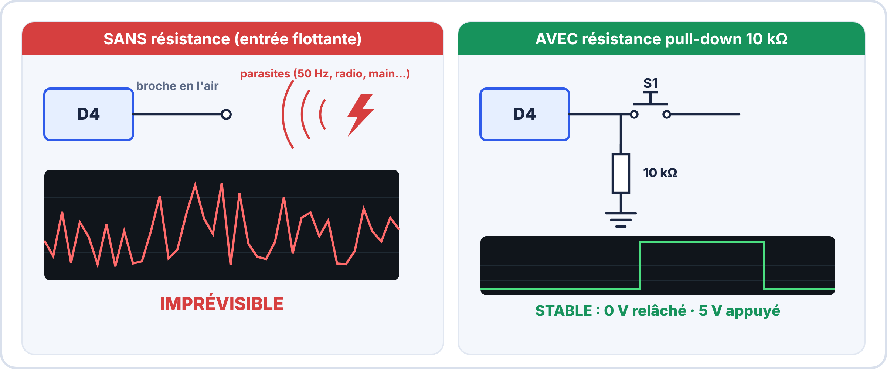
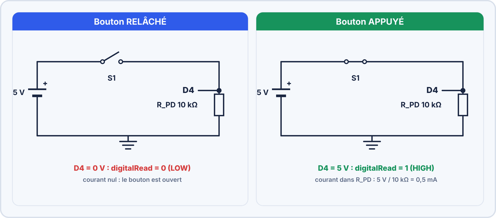
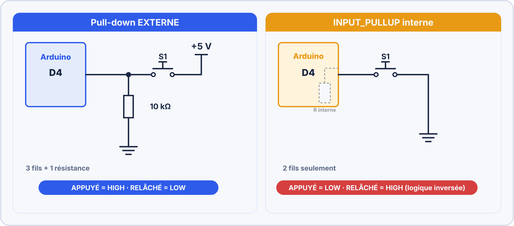
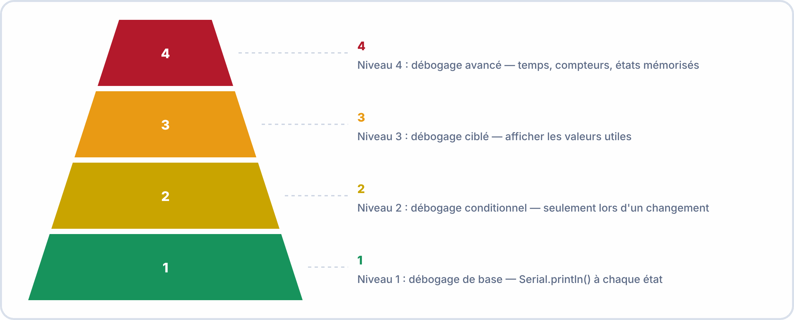
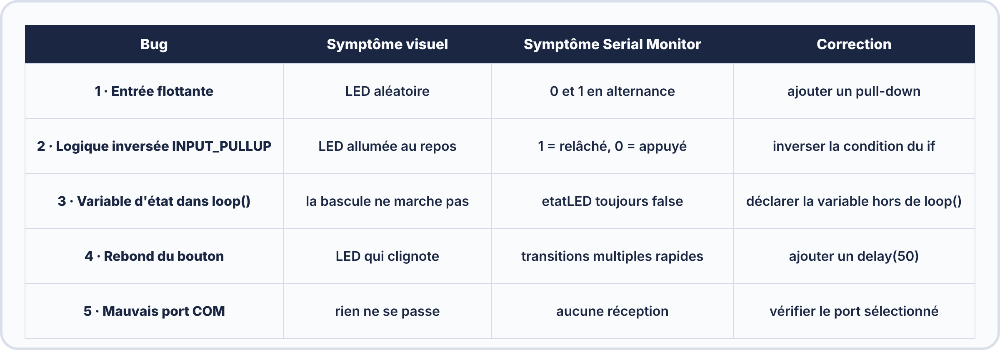

# 📘 FICHE DE COURS — S8 / Module E2
## E/S Numériques : Bouton & LED · Pull-up / Pull-down · Débogage Serial

---

## 🗝️ Vocabulaire clé

| Terme | Définition |
|---|---|
| **Entrée numérique** | Broche Arduino lisant un état logique : 0 (< 0,8V) ou 1 (> 2,0V) |
| **`digitalRead()`** | Fonction Arduino lisant l'état logique d'une broche configurée en `INPUT` |
| **Entrée flottante** | Broche en entrée non connectée à un niveau de tension défini — lit des valeurs aléatoires sous l'influence des champs environnants |
| **Pull-down** | Résistance reliant la broche à GND pour forcer l'état à 0 quand aucun signal n'est appliqué |
| **Pull-up** | Résistance reliant la broche à VCC (5V) pour forcer l'état à 1 quand aucun signal n'est appliqué |
| **`INPUT_PULLUP`** | Mode de broche Arduino activant la résistance pull-up interne (~20-50 kΩ) — **logique inversée** |
| **Logique inversée** | Avec `INPUT_PULLUP` : bouton relâché = HIGH (1), bouton appuyé = LOW (0) |
| **`if / else`** | Structure de contrôle conditionnelle : exécute un bloc si la condition est vraie, un autre bloc sinon |
| **`bool`** | Type de variable booléenne ne pouvant valoir que `true` (1) ou `false` (0) |
| **Variable d'état** | Variable mémorisant la condition actuelle d'un système (LED allumée/éteinte, bouton appuyé/relâché) |
| **Rebond (bouncing)** | Phénomène mécanique : à l'appui d'un bouton, les contacts rebondissent et génèrent plusieurs transitions rapides (quelques ms, parfois jusqu'à une vingtaine) |
| **Anti-rebond (debounce)** | Technique logicielle ou matérielle éliminant les transitions parasites dues aux rebonds |
| **Débogage (debug)** | Processus d'identification et de correction des erreurs dans un programme |
| **Variable globale** | Variable déclarée en dehors de toute fonction — conserve sa valeur entre les appels à `loop()` |


### 🤔 À ton avis ?

Un bouton relié à l'Arduino ne marche pas : parfois la LED s'allume toute seule, parfois non. D'où peut venir le problème, à ton avis ?

??? question "Voir une réponse possible"
    Quand une entrée n'est **reliée à rien** (ni au + ni au −), elle « flotte » : elle capte les **parasites** et se met à **0 ou à 1 au hasard**. Il faut **forcer** l'entrée à un niveau connu avec une **résistance** : c'est le rôle des résistances **pull-down** et **pull-up**.
    
    Dans cette séance, tu apprends à **lire un bouton** proprement et à **déboguer** avec le Serial Monitor.

---

## 1. L'entrée numérique Arduino — `digitalRead()`

### 1.1 Niveaux logiques


L'Arduino Uno fonctionne en logique **5V TTL compatible**. Une broche en entrée interprète :

| Zone de tension | Valeur logique lue | Signification |
|---|---|---|
| 0 à 0,8 V | **0 (LOW)** | État bas garanti |
| 0,8 à 2,0 V | **Indéterminé** | Zone interdite — comportement imprévisible |
| 2,0 à 5,0 V | **1 (HIGH)** | État haut garanti |

### 1.2 La fonction `digitalRead()`

```cpp
int valeur = digitalRead(numeroBroche);
// valeur vaut 0 (LOW) ou 1 (HIGH)

// Exemple : lire l'état du bouton sur la broche 4
int etatBouton = digitalRead(4);
```

> 📌 **Avant tout `digitalRead()`** : la broche doit être configurée en `INPUT` ou `INPUT_PULLUP` dans `setup()`.

### 1.3 Le problème de l'entrée flottante



**Pourquoi une broche flottante est-elle imprévisible ?**

Une broche en `INPUT` sans résistance de rappel présente une impédance très élevée (> 100 MΩ). À cette impédance, le moindre champ électromagnétique (téléphone, éclairage fluorescent, courants de convection, votre propre corps à travers l'air) suffit à faire varier la tension lue entre les seuils 0V et 5V de façon totalement aléatoire.


> [!TIP] 💡 En clair
> Une entrée numérique ne comprend que **deux états** : **HIGH (1)** et **LOW (0)**. Pour l'Arduino Uno :
>
> - de 0 à environ **0,8 V** : le niveau est **LOW** (0) ;
> - au-dessus d'environ **2 V** : le niveau est **HIGH** (1) ;
> - **entre les deux** : zone **interdite**, le résultat est **imprévisible**.
>
> Une entrée **flottante** (reliée à rien) se retrouve **n'importe où** : c'est le piège à éviter.

### ✅ Vérifie que tu as compris

**Q1.** Quelle valeur lit l'Arduino pour une tension de 4,5 V ?

??? success "Réponse"
    **HIGH (1)**, car c'est bien au-dessus du seuil haut.

**Q2.** Pourquoi une entrée flottante est-elle problématique ?

??? success "Réponse"
    Elle capte des **parasites** et prend une valeur **aléatoire** : le programme réagit n'importe comment.

**Q3.** Que renvoie `digitalRead()` ?

??? success "Réponse"
    **1** (HIGH) ou **0** (LOW).

> [!SUCCESS] 🧠 À retenir
> - Une entrée numérique doit toujours être **franchement** à 0 ou à 1.

---

## 2. La résistance pull-down

### 2.1 Principe et schéma



La résistance pull-down est connectée entre la **broche Arduino** et **GND**. Elle "tire" en permanence la broche vers 0V avec un courant faible.

| État du bouton | Tension sur broche | `digitalRead()` renvoie |
|---|---|---|
| **Relâché** | 0 V (tiré vers GND par $R_{\mathrm{PD}}$) | **0 (LOW)** |
| **Appuyé** | 5 V (imposé par VCC via le bouton) | **1 (HIGH)** |

### 2.2 Calcul de la valeur de pull-down

La résistance pull-down doit être suffisamment grande pour ne pas consommer trop de courant quand le bouton est appuyé, mais suffisamment petite pour "gagner" contre les perturbations :

```
Valeur typique : 10 kΩ

Courant consommé quand bouton appuyé :
  I = V_CC / R_PD = 5 / 10 000 = 0,5 mA  → négligeable

Valeurs acceptables : 4,7 kΩ à 47 kΩ
Valeur universelle du kit : 10 kΩ
```


> [!TIP] 💡 En clair
> La résistance **pull-down** (« tire vers le bas ») relie l'entrée à **GND**. Quand le bouton est **relâché**, l'entrée est tirée à **0 V** : **LOW**. Quand on **appuie**, le bouton envoie le **5 V** sur l'entrée : **HIGH**.
>
> Avec une résistance de 10 kΩ, le courant qui passe quand le bouton est appuyé est très faible : $I = \dfrac{5}{10\,000} = 0{,}5\,\mathrm{mA}$, donc **sans danger**.

### ✅ Vérifie que tu as compris

**Q1.** Avec un pull-down, quel niveau lit-on bouton relâché ?

??? success "Réponse"
    **LOW (0)**.

**Q2.** Avec un pull-down, quel niveau lit-on bouton appuyé ?

??? success "Réponse"
    **HIGH (1)**.

**Q3.** Pourquoi choisit-on une valeur élevée (10 kΩ) pour la résistance pull-down ?

??? success "Réponse"
    Pour que le courant dans la résistance reste **très faible** ($0{,}5\,\mathrm{mA}$) quand on appuie.

> [!SUCCESS] 🧠 À retenir
> - Pull-down : relâché = 0, appuyé = 1.

---

## 3. La résistance pull-up et `INPUT_PULLUP`

### 3.1 Pull-up externe

La résistance pull-up est connectée entre la **broche Arduino** et **VCC (5V)**. Elle tire la broche vers 5V en permanence.

| État du bouton (câblé vers GND) | Tension sur broche | `digitalRead()` renvoie |
|---|---|---|
| **Relâché** | 5 V (tiré vers VCC par $R_{\mathrm{PU}}$) | **1 (HIGH)** |
| **Appuyé** | 0 V (tiré vers GND par le bouton) | **0 (LOW)** |

> ⚠️ **Logique inversée** : avec un pull-up, appuyer donne 0 et relâcher donne 1. C'est l'inverse du pull-down. Ajuster le `if()` en conséquence.

### 3.2 `INPUT_PULLUP` — La résistance intégrée Arduino



Arduino possède une résistance pull-up **interne** de 20 à 50 kΩ sur chaque broche numérique. Elle s'active en une ligne de code :

```cpp
pinMode(4, INPUT_PULLUP);  // Active le pull-up interne sur D4
```

Avec `INPUT_PULLUP`, le câblage du bouton est simplifié :

| Critère | Pull-down externe | Pull-up externe | `INPUT_PULLUP` |
|---|---|---|---|
| Composants supplémentaires | 1 résistance 10 kΩ | 1 résistance 10 kΩ | **Aucun** |
| Nombre de fils | 3 | 3 | **2** |
| Logique | APPUYÉ = 1 | APPUYÉ = 0 | APPUYÉ = 0 *(inversée)* |
| Valeur résistance | 10 kΩ externe | 10 kΩ externe | ~20–50 kΩ (variable) |
| Recommandé pour | Débutants (logique naturelle) | — | Projets avancés |


> [!TIP] 💡 En clair
> La résistance **pull-up** (« tire vers le haut ») relie l'entrée au **5 V**. **Bouton relâché**, l'entrée est à **1** ; **bouton appuyé**, il relie l'entrée à **GND** : elle passe à **0**. Le comportement est donc **inversé**.
>
> L'Arduino possède une résistance pull-up **intégrée** : on l'active avec `pinMode(4, INPUT_PULLUP)`. Il n'y a **plus besoin de résistance externe** : le bouton se branche simplement entre la broche et **GND**.

> [!WARNING] ⚠️ Erreurs fréquentes
> - Oublier que la logique est **inversée** : avec `INPUT_PULLUP`, **appuyé = LOW (0)**.

### ✅ Vérifie que tu as compris

**Q1.** Avec `INPUT_PULLUP`, que lit-on bouton relâché ?

??? success "Réponse"
    **HIGH (1)**.

**Q2.** Que lit-on bouton appuyé ?

??? success "Réponse"
    **LOW (0)** : le bouton relie la broche à GND.

**Q3.** Quel est l'avantage de `INPUT_PULLUP` ?

??? success "Réponse"
    On **supprime la résistance externe** : moins de composants et de fils.

> [!SUCCESS] 🧠 À retenir
> - Pull-up : relâché = 1, appuyé = 0 (logique inversée).

---

## 4. La structure `if / else` et variables d'état

### 4.1 Syntaxe de base

```cpp
if (condition) {
  // Code exécuté si condition est VRAIE
} else {
  // Code exécuté si condition est FAUSSE
}
```

### 4.2 Application : bouton → LED

```cpp
const int BROCHE_BTN = 4;
const int BROCHE_LED = 13;

void setup() {
  pinMode(BROCHE_BTN, INPUT);       // Avec pull-down externe
  pinMode(BROCHE_LED, OUTPUT);
}

void loop() {
  int etatBouton = digitalRead(BROCHE_BTN);

  if (etatBouton == 1) {            // Si bouton appuyé (pull-down → HIGH)
    digitalWrite(BROCHE_LED, HIGH); //   → Allumer la LED
  } else {                          // Sinon (bouton relâché)
    digitalWrite(BROCHE_LED, LOW);  //   → Éteindre la LED
  }
}
```

### 4.3 Application avec `INPUT_PULLUP` (logique inversée)

```cpp
void setup() {
  pinMode(BROCHE_BTN, INPUT_PULLUP);  // Pull-up interne
  pinMode(BROCHE_LED, OUTPUT);
}

void loop() {
  int etatBouton = digitalRead(BROCHE_BTN);

  if (etatBouton == 0) {            // Si bouton appuyé (INPUT_PULLUP → LOW = 0)
    digitalWrite(BROCHE_LED, HIGH);
  } else {                          // Sinon (relâché → HIGH = 1)
    digitalWrite(BROCHE_LED, LOW);
  }
}
```

> ✏️ **Astuce mnémotechnique INPUT_PULLUP** : *"Avec INPUT_PULLUP, le bouton est câblé vers GND. Appuyer = brancher la broche à GND = 0V = LOW = 0. Relâcher = la résistance interne tire vers 5V = HIGH = 1."*

### 4.4 Variable d'état — La bascule (toggle)

Un bouton peut aussi **basculer** l'état d'une LED : premier appui → allume, deuxième appui → éteint. On utilise une **variable d'état** déclarée en dehors de `loop()` :

```cpp
const int BROCHE_BTN = 4;
const int BROCHE_LED = 13;

bool etatLED    = false;  // Variable globale — DOIT être hors de loop()
bool etatPrec   = HIGH;   // État précédent du bouton (pour détecter le front)

void setup() {
  pinMode(BROCHE_BTN, INPUT_PULLUP);
  pinMode(BROCHE_LED, OUTPUT);
  Serial.begin(9600);
}

void loop() {
  bool etatActuel = digitalRead(BROCHE_BTN);

  // Détecter un FRONT DESCENDANT (relâché → appuyé avec INPUT_PULLUP)
  if (etatPrec == HIGH && etatActuel == LOW) {
    etatLED = !etatLED;           // Inverser l'état de la LED
    digitalWrite(BROCHE_LED, etatLED);

    // Afficher l'état dans le Serial Monitor
    Serial.print("Bascule ! LED = ");
    Serial.println(etatLED ? "ALLUMÉE" : "ÉTEINTE");

    delay(50);  // Anti-rebond minimal
  }

  etatPrec = etatActuel;  // Mémoriser l'état actuel pour le prochain cycle
}
```

> ⚠️ **Erreur classique** : Déclarer `bool etatLED = false` DANS `loop()`. À chaque tour de boucle, la variable est réinitialisée à `false` — la bascule ne fonctionne jamais. **La variable d'état DOIT être globale (hors de toute fonction).**


> [!TIP] 💡 En clair
> Un programme **prend des décisions** avec `if / else` : **si** la condition est vraie, on fait une chose, **sinon** une autre. Par exemple : *si le bouton est appuyé, allume la LED ; sinon, éteins-la*.
>
> Pour **mémoriser** un état (LED allumée ou éteinte), on utilise une **variable** : elle doit être déclarée **en dehors de `loop()`**, sinon elle est remise à zéro à chaque tour.

### ✅ Vérifie que tu as compris

**Q1.** À quoi sert `if / else` ?

??? success "Réponse"
    À **choisir** entre deux actions selon une condition.

**Q2.** Pourquoi déclare-t-on une variable d'état en dehors de `loop()` ?

??? success "Réponse"
    Parce que sinon elle est **réinitialisée** à chaque exécution de `loop()` et ne mémorise plus rien.

**Q3.** Un bouton fait clignoter la LED au lieu de la basculer. Quelle est la cause possible ?

??? success "Réponse"
    Le **rebond** du bouton : on ajoute un petit `delay(50)` pour l'ignorer. (Les autres solutions, dont `millis()` et le filtre RC, sont vues en S09, §1.3.)

> [!SUCCESS] 🧠 À retenir
> - `if / else` décide ; une variable d'état mémorise ; on la déclare hors de `loop()`.

---

## 5. Débogage Serial systématique

### 5.1 Pourquoi déboguer avec Serial ?

L'Arduino n'a pas d'écran ni de fenêtre d'inspection. Sans Serial Monitor :

- On ne sait pas si `digitalRead()` retourne ce qu'on attend
- On ne peut pas distinguer "le bouton ne répond pas" de "le code est faux"
- Les bugs logiques (logique inversée, variable non initialisée…) sont invisibles

### 5.2 Les 4 niveaux de débogage Serial



### 5.3 Niveau 1 — Affichage brut (pour démarrer)

```cpp
void loop() {
  int etat = digitalRead(4);
  Serial.print("Broche D4 = ");
  Serial.println(etat);
  delay(200);  // Sans ce délai → milliers de lignes par seconde
}
```

> ⚠️ **Problème** : Sans `delay()`, le Serial Monitor est inondé de lignes → illisible. Toujours ajouter un délai ou utiliser le niveau 2.

### 5.4 Niveau 2 — Affichage conditionnel (recommandé)

N'afficher que lors d'un **changement d'état** — évite l'inondation :

```cpp
int etatPrec = -1;  // Valeur initiale impossible → force le 1er affichage

void loop() {
  int etatActuel = digitalRead(4);

  if (etatActuel != etatPrec) {  // Seulement si l'état a changé
    Serial.print("[CHANGEMENT] Bouton D4 = ");
    Serial.println(etatActuel == 1 ? "APPUYÉ" : "RELÂCHÉ");
    etatPrec = etatActuel;       // Mémoriser le nouvel état
  }
}
```

### 5.5 Niveau 3 — Affichage avec timestamp

Ajouter `millis()` pour chronométrer les événements :

```cpp
void loop() {
  int etatActuel = digitalRead(4);

  if (etatActuel != etatPrec) {
    Serial.print(millis());      // Temps en ms depuis le démarrage
    Serial.print(" ms — Bouton : ");
    Serial.println(etatActuel == 1 ? "APPUYÉ" : "RELÂCHÉ");
    etatPrec = etatActuel;
  }
}
```

**Exemple de sortie :**
```
345 ms — Bouton : APPUYÉ
389 ms — Bouton : RELÂCHÉ
1204 ms — Bouton : APPUYÉ
1251 ms — Bouton : RELÂCHÉ
```
*On peut ainsi mesurer la durée d'appui : 389 − 345 = 44 ms*

### 5.6 Les 5 bugs les plus fréquents en S8 et comment les détecter



| Bug | Symptôme Serial Monitor | Correction |
|---|---|---|
| **Entrée flottante** | 0 et 1 s'alternent sans logique, même sans toucher le bouton | Ajouter résistance pull-down 10 kΩ |
| **Logique inversée** | Serial affiche 1 quand on pense appuyer, 0 quand relâché | Inverser la condition : `== 0` au lieu de `== 1` |
| **Variable d'état dans `loop()`** | Serial montre que la variable revient toujours à sa valeur initiale | Déclarer la variable **hors** de `loop()` (globale) |
| **Rebond bouton** | Serial montre 5 ou 10 transitions très rapides à chaque appui | Ajouter `delay(50)` après la détection du front |
| **`Serial.begin()` absent** | Rien ne s'affiche dans le Serial Monitor | Ajouter `Serial.begin(9600)` dans `setup()` |


> [!TIP] 💡 En clair
> Quand ça ne marche pas, **affiche ce que lit l'Arduino** avec `Serial.println()`. Tu vois alors si le problème vient du **câblage** (valeur incorrecte) ou du **programme** (la valeur est bonne mais la réaction est mauvaise). Pour ne pas inonder l'écran, on affiche **seulement lors d'un changement**.

### ✅ Vérifie que tu as compris

**Q1.** Que permet de voir `Serial.println(etatBouton)` ?

??? success "Réponse"
    La **valeur lue** sur l'entrée (0 ou 1) : on vérifie ainsi le câblage.

**Q2.** Pourquoi n'affiche-t-on qu'en cas de changement ?

??? success "Réponse"
    Pour **éviter des milliers de lignes** illisibles dans le moniteur.

> [!SUCCESS] 🧠 À retenir
> - Quand ça ne marche pas : afficher les valeurs avec le Serial Monitor.

---

## 6. Récapitulatif des configurations d'entrée

> [!NOTE] GUIDE DE CHOIX — Configuration d'entrée pour bouton-poussoir
>
> Je suis débutant / logique naturelle souhaitable :  
>  → Pull-down externe 10 kΩ  
>  → APPUYÉ = HIGH = 1  /  RELÂCHÉ = LOW = 0  
>  → if (digitalRead(btn) == 1) { ... appuyé ... }  
>
> Je veux minimiser le câblage :  
>  → INPUT_PULLUP interne  
>  → APPUYÉ = LOW = 0  /  RELÂCHÉ = HIGH = 1  (INVERSÉ !)  
>  → if (digitalRead(btn) == 0) { ... appuyé ... }  
>
> Règle d'or : Choisir l'une des deux et RESTER COHÉRENT dans tout  
> le sketch. Mélanger les deux = bugs impossibles à diagnostiquer.  


> [!TIP] 💡 En clair
> Pour choisir ton montage : **pull-down externe** = résistance + 5 V sur le bouton (appuyé = 1) ; **pull-up externe** = résistance + GND sur le bouton (appuyé = 0) ; **INPUT_PULLUP** = **aucun composant en plus**, bouton vers GND (appuyé = 0). Le plus simple est **INPUT_PULLUP**.

### ✅ Vérifie que tu as compris

**Q1.** Quelle configuration demande le moins de composants ?

??? success "Réponse"
    **INPUT_PULLUP** : le bouton est relié directement entre la broche et GND.

**Q2.** Avec quelle configuration lit-on 1 quand on appuie ?

??? success "Réponse"
    Avec le **pull-down** (bouton relié au 5 V).

---

## ✅ Compétences RNCP travaillées

| Code | Compétence | Niveau |
|---|---|---|
| C2.2 | Réaliser un montage bouton + LED + Arduino | ⭐⭐⭐ Maîtrise |
| C2.7 | Écrire un programme embarqué avec `digitalRead()` | ⭐⭐⭐ Maîtrise |
| C2.8 | Tester et déboguer avec Serial Monitor | ⭐⭐⭐ Maîtrise |
| C3.1 | Documenter : commentaires code + fiche portfolio | ⭐⭐ Application |
| S10 | `digitalRead()`, `if/else`, variables d'état | ⭐⭐⭐ Maîtrise |
| S11 | Débogage Serial conditionnel et avec timestamp | ⭐⭐ Application |

---

## 📝 Mémo rapide

| Je dois... | Je retiens... |
|---|---|
| Configurer bouton pull-down | `pinMode(btn, INPUT)` + R 10 kΩ entre broche et GND + bouton vers 5V |
| Configurer bouton pull-up interne | `pinMode(btn, INPUT_PULLUP)` + bouton vers GND uniquement |
| Lire un bouton | `int etat = digitalRead(numeroBroche);` |
| Tester si appuyé (pull-down) | `if (etat == 1) { ... }` |
| Tester si appuyé (INPUT_PULLUP) | `if (etat == 0) { ... }` — logique inversée ! |
| Faire une bascule | Variable `bool etatLED` **globale** + `etatLED = !etatLED;` |
| Déboguer proprement | Afficher uniquement lors des changements d'état |
| Anti-rebond simple | `delay(50)` après détection de front |

---

*BAC Pro CIEL — S8 Module E2 | MFR de Pontonx | © Yahn LE PRETTRE*
