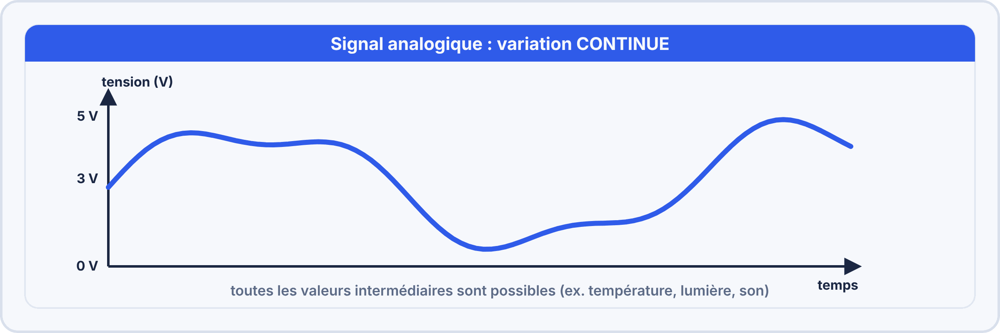

# FICHE DE COURS ÉLÈVE - U2 Électronique et Réseaux
## Semaine 9 - Capteur LM35 : AnalogRead et Conversion ADC

---

**Nom :** _________________________ **Prénom :** _________________________

**Classe :** Bac Pro CIEL - Année 1 **Date :** ___/___/______

---

## 🎯 OBJECTIFS DE LA SÉANCE

À la fin de ce cours, tu seras capable de :

- ✅ Différencier un signal analogique et un signal numérique
- ✅ Expliquer le rôle d'un convertisseur ADC
- ✅ Câbler un capteur LM35 (3 broches)
- ✅ Programmer la lecture analogique avec `analogRead()`
- ✅ Convertir une valeur ADC en tension puis en température
- ✅ Créer un thermomètre fonctionnel avec Arduino

---

## 📚 PARTIE 1 : SIGNAL ANALOGIQUE VS NUMÉRIQUE

### 1.1 Qu'est-ce qu'un signal analogique ?

**Définition :**

> Un signal **analogique** est un signal qui varie de manière **continue** dans le temps. Il peut prendre une **infinité de valeurs** entre deux bornes.

**Exemples de signaux analogiques :**

- **Température** : 15°C, 15.1°C, 15.15°C, 15.153°C...
- **Tension électrique** : 2.3V, 2.35V, 2.351V, 2.3512V...
- **Son** : Onde sonore (voix, musique)
- **Lumière** : Intensité lumineuse (0 à 100% et toutes les valeurs intermédiaires)

---

**Représentation graphique :**



**💡 Point clé :** Entre 2.3V et 2.4V, il existe une **infinité de valeurs** (2.31V, 2.311V, 2.3111V...).

---

### 1.2 Qu'est-ce qu'un signal numérique ?

**Définition :**

> Un signal **numérique** est un signal qui ne peut prendre que des **valeurs discrètes** (séparées). Nombre fini de valeurs possibles.

**Exemples de signaux numériques :**

- **États logiques** : 0 ou 1, HIGH ou LOW (2 valeurs)
- **Compteur** : 0, 1, 2, 3, 4... (pas de 1.5 ou 2.7)
- **Feu tricolore** : Vert, Orange, Rouge (3 valeurs)
- **Température affichée** : 15°C, 16°C, 17°C (pas de 15.5°C si l'affichage est limité)

---

**Représentation graphique :**


**💡 Point clé :** On ne peut avoir que certaines valeurs prédéfinies (0V ou 5V dans l'exemple).

---

### 1.3 Tableau comparatif

| **Critère** | **Analogique** | **Numérique** |
|-------------|----------------|---------------|
| **Variation** | Continue (fluide) | Discrète (par paliers) |
| **Nombre de valeurs** | Infini (théorique) | Fini (dépend de la résolution) |
| **Précision** | Très élevée | Limitée par le nombre de paliers |
| **Sensibilité au bruit** | Élevée (perturbations) | Faible (robuste) |
| **Stockage** | Difficile | Facile (mémoire, fichiers) |
| **Exemple** | Température réelle | Température affichée |

---

### 1.4 Le problème : Arduino est numérique, les capteurs sont souvent analogiques

**Situation :**

- Le **capteur LM35** produit une tension **analogique** (0.000V, 0.250V, 0.251V...)
- L'**Arduino** ne comprend que des nombres **numériques** (0, 1, 2, 3...)

**Question :** Comment faire communiquer les deux ?

**Réponse :** Utiliser un **convertisseur ADC** (Analogique vers Digital)

---

## 📚 PARTIE 2 : LE CONVERTISSEUR ADC

### 2.1 Qu'est-ce qu'un ADC ?

**ADC** = **A**nalog to **D**igital **C**onverter (Convertisseur Analogique-Numérique)

> Un **ADC** convertit un signal analogique (tension continue) en une valeur numérique (nombre discret).

**Schéma de principe :**


---

### 2.2 Caractéristiques de l'ADC Arduino Uno

| **Paramètre** | **Valeur** |
|--------------|-----------|
| **Résolution** | 10 bits (2^10 = 1024 valeurs) |
| **Plage d'entrée** | 0V à 5V |
| **Valeurs de sortie** | 0 à 1023 |
| **Précision** | 5V / 1024 = 4.88 mV par niveau |
| **Nombre de ports** | 6 (A0, A1, A2, A3, A4, A5) |

**💡 Résolution 10 bits :**

- 2^10 = 1024 valeurs possibles
- Chaque niveau représente : 5V / 1024 = **0.00488 V ≈ 4.88 mV**

---

### 2.3 Formule de conversion ADC → Tension

**Formule :**

```
Tension (V) = Valeur_ADC × (5.0 / 1023)
```

**💡 Pourquoi 1023 et pas 1024 ?**

Car on compte de 0 à 1023 (1024 valeurs au total : 0, 1, 2... 1023).

---

**Exemples de conversion :**

| **Valeur ADC** | **Calcul** | **Tension (V)** |
|---------------|-----------|----------------|
| 0 | 0 × (5/1023) | 0.000 V |
| 204 | 204 × (5/1023) | 0.998 V ≈ 1.0 V |
| 512 | 512 × (5/1023) | 2.502 V ≈ 2.5 V |
| 1023 | 1023 × (5/1023) | 5.000 V |

**Exercice :** Si ADC = 307, quelle est la tension ?

```
Tension = 307 × (5/1023) = ______ V
```

**Réponse :** 1.502 V ≈ 1.5 V

---

### 2.4 Fonction Arduino : analogRead()

**Syntaxe :**

```cpp
int valeur = analogRead(broche);
```

**Paramètres :**
- `broche` : Numéro du port analogique (A0, A1, A2, A3, A4, A5)

**Retour :**
- Valeur entière entre **0** et **1023**

---

**Exemple de code :**

```cpp
int valeurADC = analogRead(A0);  // Lit la tension sur A0
Serial.println(valeurADC);        // Affiche la valeur (ex: 512)
```

---

## 📚 PARTIE 3 : LE CAPTEUR LM35

### 3.1 Présentation du LM35

Le **LM35** est un capteur de température analogique de précision.

**Photo et boîtier :**

```
   LM35DZ (TO-92)
   Vue de face (face plate vers toi)

      ┌─────┐
      │ LM35│
      │     │
      └──┬──┘
    1  2  3
```

---

**Caractéristiques techniques :**

| **Paramètre** | **Valeur** |
|--------------|-----------|
| **Plage de mesure** | -55°C à +150°C |
| **Précision** | ±0.5°C (à 25°C) |
| **Sensibilité** | **10 mV/°C** |
| **Tension d'alimentation** | 4V à 30V (idéal : 5V) |
| **Courant consommé** | < 60 µA (très faible) |
| **Boîtier** | TO-92 (3 broches) |

**💡 Point clé :** Sensibilité de **10 mV par degré Celsius** (facile à retenir !).

---

### 3.2 Brochage du LM35DZ

**Vue de face (face plate vers soi) :**

```
      ┌─────┐
      │ LM35│
      │     │
      └──┬──┘
    1  2  3
    │  │  │
    │  │  └──── 3. OUT (Signal analogique)
    │  └──────── 2. GND (Masse / 0V)
    └──────────── 1. VCC (Alimentation +5V)
```

**⚠️ IMPORTANT :**

- **Ne JAMAIS inverser** VCC et GND → le composant chauffe et peut être détruit !
- Vérifier le brochage **avant** de brancher l'alimentation.

---

### 3.3 Principe de fonctionnement

Le LM35 délivre une **tension proportionnelle à la température**.

**Formule du fabricant :**

```
Tension_OUT (mV) = Température (°C) × 10 mV/°C
```

**Ou en volts :**

```
Tension_OUT (V) = Température (°C) × 0.01 V/°C
```

---

**Exemples de conversion Température → Tension :**

| **Température** | **Calcul** | **Tension OUT** |
|----------------|-----------|----------------|
| 0°C | 0 × 10 mV | 0 mV = 0.000 V |
| 10°C | 10 × 10 mV | 100 mV = 0.100 V |
| 25°C | 25 × 10 mV | 250 mV = 0.250 V |
| 50°C | 50 × 10 mV | 500 mV = 0.500 V |
| 100°C | 100 × 10 mV | 1000 mV = 1.000 V |

**💡 Astuce :** Pour trouver la température, il suffit de diviser la tension (en mV) par 10 !

---

### 3.4 Câblage avec Arduino

**Schéma de connexion :**

```
      LM35                    Arduino Uno
    (TO-92)
    1  2  3
    │  │  │
    │  │  └───────────────> A0 (Lecture analogique)
    │  └──────────────────> GND
    └─────────────────────> 5V
```

**Sur breadboard :**

```
   Arduino              Breadboard
     5V ─────────┬────── LM35 broche 1 (VCC)
                 │
    GND ─────────┼────── LM35 broche 2 (GND)
                 │
     A0 ─────────┘────── LM35 broche 3 (OUT)
```

---

## 📚 PARTIE 4 : CONVERSION COMPLÈTE (LM35 → TEMPÉRATURE)

### 4.1 Les 3 étapes de conversion

**Étape 1 : Lecture ADC** (0 à 1023)

```cpp
int valeurADC = analogRead(A0);
// Exemple : valeurADC = 51
```

---

**Étape 2 : Conversion ADC → Tension (V)**

```cpp
float tension = valeurADC * (5.0 / 1023.0);
// Exemple : 51 × (5/1023) = 0.249 V
```

---

**Étape 3 : Conversion Tension → Température (°C)**

Sachant que : `Tension (V) = Température (°C) × 0.01`

Donc : `Température (°C) = Tension (V) / 0.01`

```cpp
float temperature = tension / 0.01;
// Exemple : 0.249 V / 0.01 = 24.9°C
```

**Ou simplifié :**

```cpp
float temperature = tension * 100.0;
// Car diviser par 0.01 = multiplier par 100
```

---

### 4.2 Formule complète en une ligne

**Version développée :**

```cpp
int valeurADC = analogRead(A0);
float tension = valeurADC * (5.0 / 1023.0);
float temperature = tension * 100.0;
```

**Version condensée (en une seule ligne) :**

```cpp
float temperature = analogRead(A0) * (5.0 / 1023.0) * 100.0;
```

**💡 Explication du calcul :**

- `analogRead(A0)` → Lit la valeur ADC (ex: 51)
- `* (5.0 / 1023.0)` → Convertit en tension (ex: 0.249 V)
- `* 100.0` → Convertit en température (ex: 24.9°C)

---

### 4.3 Exemple complet de calcul

**Situation :** Le capteur LM35 mesure une température ambiante de **22°C**.

**Étape 1 :** Tension produite par le LM35

```
Tension = 22°C × 10 mV/°C = 220 mV = 0.22 V
```

**Étape 2 :** Valeur ADC lue par Arduino

```
Valeur ADC = 0.22 V × (1023 / 5 V) = 45
```

**Étape 3 :** Arduino reconvertit en tension

```
Tension = 45 × (5 / 1023) = 0.220 V
```

**Étape 4 :** Calcul de la température

```
Température = 0.220 V × 100 = 22.0°C
```

**✅ Résultat cohérent !**

---

## 📚 PARTIE 5 : PROGRAMMATION ARDUINO

### 5.1 Code minimal (affichage Serial Monitor)

```cpp
// Thermomètre LM35 simple

const int PIN_LM35 = A0;  // Broche de lecture

void setup() {
  Serial.begin(9600);  // Initialiser communication série
  Serial.println("=== Thermomètre LM35 ===");
}

void loop() {
  // Lire la valeur ADC
  int valeurADC = analogRead(PIN_LM35);
  
  // Convertir en tension (V)
  float tension = valeurADC * (5.0 / 1023.0);
  
  // Convertir en température (°C)
  float temperature = tension * 100.0;
  
  // Afficher sur Serial Monitor
  Serial.print("ADC: ");
  Serial.print(valeurADC);
  Serial.print(" | Tension: ");
  Serial.print(tension, 3);  // 3 décimales
  Serial.print(" V | Temp: ");
  Serial.print(temperature, 1);  // 1 décimale
  Serial.println(" °C");
  
  delay(1000);  // Attendre 1 seconde
}
```

---

### 5.2 Code avec moyenne (plus précis)

**Problème :** Les mesures fluctuent à cause du **bruit électrique**.

**Solution :** Calculer une **moyenne** sur 10 mesures.

```cpp
const int PIN_LM35 = A0;
const int NB_MESURES = 10;

float lireTemperature() {
  float somme = 0;
  
  // Prendre 10 mesures
  for (int i = 0; i < NB_MESURES; i++) {
    int adc = analogRead(PIN_LM35);
    float tension = adc * (5.0 / 1023.0);
    somme += tension;
    delay(10);  // Pause entre mesures
  }
  
  // Calculer la moyenne
  float tensionMoyenne = somme / NB_MESURES;
  return tensionMoyenne * 100.0;  // Retourne température
}

void loop() {
  float temperature = lireTemperature();
  
  Serial.print("Température: ");
  Serial.print(temperature, 2);
  Serial.println(" °C");
  
  delay(1000);
}
```

---

### 5.3 Code avec alertes température

```cpp
const int PIN_LM35 = A0;
const float TEMP_MIN = 18.0;  // Température minimale confortable
const float TEMP_MAX = 28.0;  // Température maximale confortable

void loop() {
  // Lire température
  float temperature = analogRead(PIN_LM35) * (5.0 / 1023.0) * 100.0;
  
  // Affichage
  Serial.print("Temp: ");
  Serial.print(temperature, 1);
  Serial.print(" °C | ");
  
  // Alertes
  if (temperature < TEMP_MIN) {
    Serial.println("⚠️ TROP FROID !");
  } else if (temperature > TEMP_MAX) {
    Serial.println("⚠️ TROP CHAUD !");
  } else {
    Serial.println("✅ Température OK");
  }
  
  delay(1000);
}
```

---

## 📚 PARTIE 6 : AMÉLIORATION POSSIBLE (LED RGB)

### 6.1 Ajouter un indicateur visuel

**Objectif :** LED change de couleur selon la température.

- **Vert** : 18-28°C (confortable)
- **Jaune** : 15-18°C ou 28-32°C (attention)
- **Rouge** : <15°C ou >32°C (alerte)

**Câblage :**

- LED Rouge → Pin 11 (+ résistance 220Ω)
- LED Verte → Pin 10 (+ résistance 220Ω)
- LED Bleue → Pin 9 (+ résistance 220Ω)

---

**Code :**

```cpp
const int LED_ROUGE = 11;
const int LED_VERTE = 10;
const int LED_BLEUE = 9;

void setup() {
  pinMode(LED_ROUGE, OUTPUT);
  pinMode(LED_VERTE, OUTPUT);
  pinMode(LED_BLEUE, OUTPUT);
}

void afficherCouleur(float temp) {
  // Éteindre toutes les LEDs
  digitalWrite(LED_ROUGE, LOW);
  digitalWrite(LED_VERTE, LOW);
  digitalWrite(LED_BLEUE, LOW);
  
  // Allumer selon température
  if (temp >= 18 && temp <= 28) {
    digitalWrite(LED_VERTE, HIGH);  // Vert
  } else if ((temp >= 15 && temp < 18) || (temp > 28 && temp <= 32)) {
    digitalWrite(LED_ROUGE, HIGH);
    digitalWrite(LED_VERTE, HIGH);  // Jaune (Rouge + Vert)
  } else {
    digitalWrite(LED_ROUGE, HIGH);  // Rouge
  }
}

void loop() {
  float temperature = analogRead(A0) * (5.0 / 1023.0) * 100.0;
  afficherCouleur(temperature);
  delay(1000);
}
```

---

## 📝 VOCABULAIRE TECHNIQUE À MAÎTRISER

| **Terme** | **Définition** | **Exemple** |
|-----------|----------------|-------------|
| **Analogique** | Signal continu (infinité de valeurs) | Température réelle |
| **Numérique** | Signal discret (valeurs finies) | Compteur (1, 2, 3...) |
| **ADC** | Convertisseur Analogique-Digital | Arduino Uno (10 bits) |
| **Résolution** | Nombre de niveaux (2^n) | 10 bits = 1024 niveaux |
| **LM35** | Capteur température analogique | 10 mV/°C |
| **Sensibilité** | Variation de sortie par unité | 10 mV/°C |
| **analogRead()** | Fonction Arduino lire port analogique | analogRead(A0) |
| **Serial Monitor** | Affichage console Arduino IDE | Déboguer le code |
| **Moyenne** | Calcul pour réduire le bruit | Moyenne sur 10 mesures |

---

## ✅ POINTS CLÉS À RETENIR

### Les essentiels (à connaître par cœur)

1. **Analogique** = variation **continue** (infini de valeurs)

2. **Numérique** = variation **discrète** (valeurs finies)

3. **ADC Arduino** : 10 bits = **0 à 1023** pour **0V à 5V**

4. **Formule ADC → Tension** :
   ```
   Tension (V) = Valeur_ADC × (5.0 / 1023)
   ```

5. **LM35** : **10 mV/°C** (ou 0.01 V/°C)

6. **Formule Tension → Température** :
   ```
   Température (°C) = Tension (V) × 100
   ```

7. **Brochage LM35** (face plate vers soi) :
   - Broche 1 : **VCC** (5V)
   - Broche 2 : **GND** (masse)
   - Broche 3 : **OUT** (signal → A0)

8. **Code minimal** :
   ```cpp
   float temp = analogRead(A0) * (5.0 / 1023.0) * 100.0;
   ```

---

## 🎯 POUR ALLER PLUS LOIN

### Questions de réflexion

1. Pourquoi l'ADC a-t-il une résolution de 10 bits et pas 8 ou 12 ?
2. Quelle est la température minimale mesurable avec le LM35 et Arduino 5V ?
3. Comment améliorer la précision du thermomètre ?
4. Peut-on utiliser plusieurs LM35 sur le même Arduino ?
5. Quelle différence entre LM35DZ et LM335 ?

### Défis pratiques

- Créer un **datalogger** : enregistrer les températures dans un fichier
- Ajouter un **écran LCD 16×2** pour afficher sans PC
- Créer une **alarme** avec buzzer si température > 30°C
- Comparer avec un **thermomètre numérique** (DHT22)
- Afficher un **graphique en temps réel** (Processing)

---

## 📋 AUTOÉVALUATION

**Entoure le niveau que tu penses avoir atteint :**

| **Compétence** | **Niveau** |
|----------------|------------|
| Différencier analogique/numérique | 😐 Fragile  🙂 Acquis  😃 Maîtrisé |
| Expliquer le rôle de l'ADC | 😐 Fragile  🙂 Acquis  😃 Maîtrisé |
| Câbler le LM35 correctement | 😐 Fragile  🙂 Acquis  😃 Maîtrisé |
| Utiliser analogRead() | 😐 Fragile  🙂 Acquis  😃 Maîtrisé |
| Convertir ADC → Tension → Température | 😐 Fragile  🙂 Acquis  😃 Maîtrisé |
| Afficher sur Serial Monitor | 😐 Fragile  🙂 Acquis  😃 Maîtrisé |
| Créer un thermomètre DIY | 😐 Fragile  🙂 Acquis  😃 Maîtrisé |

**Questions pour toi :**
- Qu'est-ce qui t'a semblé le plus difficile aujourd'hui ?
- As-tu réussi à afficher la température ?
- Te sens-tu capable de refaire un thermomètre seul(e) ?

---

**📚 Document à conserver dans ton classeur pour révisions et examens !**

**Date de création :** 24/02/2026  
**Version :** 1.0  
**Auteur :** Équipe pédagogique CFA
