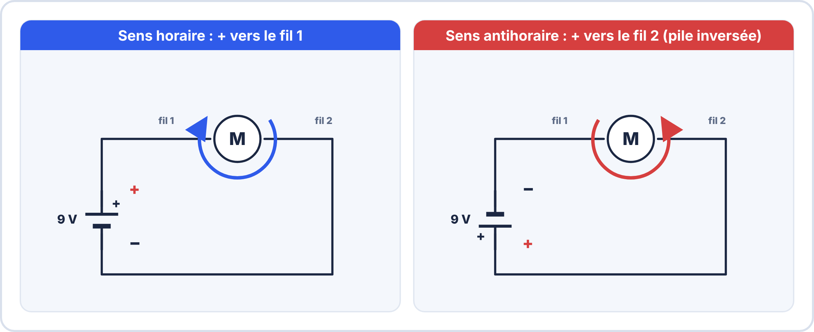
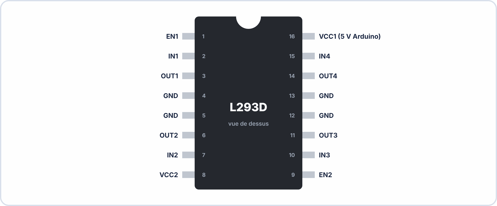
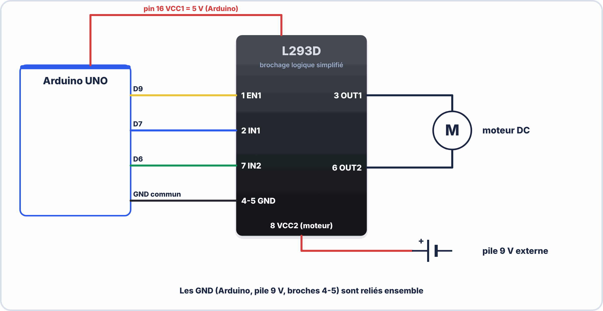

# 📘 FICHE DE COURS ÉLÈVE - U2 ÉLECTRONIQUE - SEMAINE 10

## 🤖 MOTEUR DC, PWM ET PONT H L293D

---

## 📋 INFORMATIONS

| **Élément** | **Détail** |
|-------------|------------|
| **Bloc** | U2 - Réalisation et maintenance de systèmes électroniques |
| **Semaine** | S10 / Année 1 |
| **Thématique** | Moteur DC, PWM, Pont H L293D, Contrôle Arduino |
| **Durée cours** | 55 minutes |

---

## 🎯 OBJECTIFS D'APPRENTISSAGE

À la fin de ce cours, je serai capable de :

✅ Expliquer le fonctionnement d'un moteur DC  
✅ Comprendre le principe du PWM (modulation de largeur d'impulsion)  
✅ Câbler un pont H L293D avec Arduino  
✅ Programmer Arduino pour contrôler un moteur  
✅ Varier la vitesse d'un moteur avec PWM  
✅ Inverser le sens de rotation d'un moteur  

---

## 1️⃣ LE MOTEUR À COURANT CONTINU (DC)

### 📖 Définition

Un **moteur DC** (Direct Current = Courant Continu) est un **actionneur** qui transforme l'énergie électrique en énergie mécanique (rotation).

**Analogie :** Le moteur DC, c'est comme un **ventilateur** : on lui envoie du courant électrique, et il tourne.

### ⚙️ Principe de fonctionnement

```
Énergie ÉLECTRIQUE  →  Moteur DC  →  Énergie MÉCANIQUE
     (Volts)                            (Rotation)
```

**Points clés :**
- Plus on augmente la **tension**, plus le moteur tourne **vite**
- Si on inverse la **polarité** (+ et -), le moteur tourne dans l'**autre sens**
- Le moteur consomme du **courant** (généralement 100 à 500 mA)

### 📊 Caractéristiques principales

| **Caractéristique** | **Valeur typique** | **Signification** |
|--------------------|-------------------|------------------|
| **Tension nominale** | 6V, 9V, 12V | Tension de fonctionnement optimale |
| **Courant nominal** | 100-300 mA | Courant consommé en fonctionnement normal |
| **Vitesse à vide** | 3000-6000 tr/min | Vitesse sans charge (tours par minute) |
| **Couple** | Variable | Force de rotation (en N·m) |

### 🔌 Symbole électrique


### 🔄 Inversion du sens de rotation

Pour inverser le sens de rotation d'un moteur DC, il suffit d'**inverser la polarité** :

| **Connexion** | **Sens** |
|--------------|---------|
| + sur fil 1, - sur fil 2 | ⟳ Sens horaire |
| + sur fil 2, - sur fil 1 | ⟲ Sens antihoraire |



---

## 2️⃣ LE PWM (PULSE WIDTH MODULATION)

### 📖 Définition

Le **PWM** (Modulation de Largeur d'Impulsion) est une technique qui permet de **contrôler la puissance moyenne** envoyée à un composant en l'allumant et l'éteignant très rapidement.

**Analogie :** Le PWM, c'est comme **appuyer sur un interrupteur très rapidement** :
- Si on l'allume 10% du temps → Faible puissance
- Si on l'allume 50% du temps → Puissance moyenne
- Si on l'allume 100% du temps → Puissance maximale

### 📊 Signaux PWM

Un signal PWM est caractérisé par son **Duty Cycle** (rapport cyclique) :

```
Duty Cycle (%) = (Temps ON / Période totale) × 100
```

**Exemples de signaux PWM :**


### ⏱️ Fréquence du PWM

La **fréquence** du PWM détermine la rapidité des alternances ON/OFF.

**Sur Arduino :**
- Fréquence : **490 Hz** (490 fois par seconde sur la plupart des pins)
- Le moteur ne voit pas les coupures (trop rapide pour lui)
- Résultat : Vitesse stable et contrôlée

### 🎚️ Contrôle de la vitesse

**Relation PWM ↔ Vitesse :**

| **Duty Cycle** | **Valeur Arduino** | **Vitesse moteur** |
|---------------|-------------------|-------------------|
| 0% | 0 | Arrêté |
| 25% | 64 | Lent |
| 50% | 128 | Moyen |
| 75% | 192 | Rapide |
| 100% | 255 | Maximum |

### 💻 Code Arduino pour PWM

**Fonction Arduino :**
```cpp
analogWrite(pin, valeur);
```

**Paramètres :**
- `pin` : Numéro de la broche PWM (doit avoir le symbole ~ : 3, 5, 6, 9, 10, 11)
- `valeur` : Entre 0 (0%) et 255 (100%)

**Exemple :**
```cpp
int motorPin = 9;  // Broche PWM

void setup() {
  pinMode(motorPin, OUTPUT);
}

void loop() {
  // Vitesse 50%
  analogWrite(motorPin, 128);
}
```

---

## 3️⃣ POURQUOI UN PONT H EST NÉCESSAIRE

### ❌ Problème : Arduino ne peut pas alimenter directement un moteur

**Limites d'Arduino :**

| **Paramètre** | **Arduino** | **Moteur typique** | **Problème** |
|--------------|------------|-------------------|--------------|
| Courant max par pin | 40 mA | 100-300 mA | ⚠️ Pas assez ! |
| Tension de sortie | 5V | 6-12V | ⚠️ Peut être insuffisant |
| Inversion de sens | ❌ Difficile | ✅ Nécessaire | ⚠️ Complexe |

**Conséquence :** Si on branche un moteur directement sur Arduino :
- ❌ Le moteur ne tournera pas (courant insuffisant)
- ❌ Ou Arduino sera endommagé (surconsommation)

### ✅ Solution : Utiliser un driver de moteur (Pont H)

Un **pont H** est un circuit électronique qui permet de :
1. **Amplifier le courant** (Arduino commande, mais ne fournit pas le courant)
2. **Contrôler le sens** de rotation facilement
3. **Protéger** Arduino

---

## 4️⃣ LE PONT H L293D

### 📖 Présentation

Le **L293D** est un circuit intégré (CI) contenant **deux ponts H** :
- Peut contrôler **2 moteurs DC** indépendamment
- Ou 1 moteur pas-à-pas

**Caractéristiques :**

| **Paramètre** | **Valeur** |
|--------------|-----------|
| Tension d'alimentation moteur | 4,5V à 36V |
| Courant max par canal | 600 mA |
| Courant de pointe | 1,2 A |
| Nombre de broches | 16 |
| Nombre de moteurs DC | 2 |

### 📌 Brochage du L293D



**Description des broches :**

| **Broche** | **Nom** | **Fonction** |
|-----------|---------|-------------|
| 1, 9 | EN1, EN2 | Enable (activation) - Connecter à une pin PWM Arduino |
| 2, 7 | IN1, IN2 | Entrées de commande pour Moteur 1 |
| 10, 15 | IN3, IN4 | Entrées de commande pour Moteur 2 |
| 3, 6 | OUT1, OUT2 | Sorties vers Moteur 1 |
| 14, 11 | OUT3, OUT4 | Sorties vers Moteur 2 |
| 16 | VCC1 | Alimentation logique (5V Arduino) |
| 8 | VCC2 | Alimentation moteur (6-12V pile externe) |
| 4, 5, 12, 13 | GND | Masse commune |

### 🔌 Schéma de câblage complet

**Connexions pour 1 moteur DC :**



**⚠️ IMPORTANT :** Les GND doivent être **communs** (Arduino GND et Pile GND reliés ensemble).


---

## 5️⃣ TABLE DE VÉRITÉ DU PONT H

### 📊 Contrôle du sens de rotation

Le sens de rotation dépend des valeurs de **IN1** et **IN2** :

| **IN1** | **IN2** | **EN (PWM)** | **Résultat** |
|---------|---------|-------------|--------------|
| LOW | LOW | X | ⏸️ Arrêt (roue libre) |
| HIGH | LOW | 0-255 | ⟳ Rotation sens 1 (vitesse variable) |
| LOW | HIGH | 0-255 | ⟲ Rotation sens 2 (vitesse variable) |
| HIGH | HIGH | X | 🛑 Frein électrique |

**Explications :**

- **Arrêt (roue libre)** : Le moteur n'est pas alimenté, il peut tourner librement
- **Rotation sens 1** : Le courant passe de OUT1 vers OUT2
- **Rotation sens 2** : Le courant passe de OUT2 vers OUT1
- **Frein** : Court-circuit interne, le moteur freine rapidement (ne pas maintenir longtemps)

---

## 6️⃣ PROGRAMMATION ARDUINO

### 📝 Code de base - Faire tourner le moteur

```cpp
// Définition des broches
int IN1 = 7;
int IN2 = 6;
int ENABLE = 9;  // Broche PWM

void setup() {
  // Configuration des broches en sortie
  pinMode(IN1, OUTPUT);
  pinMode(IN2, OUTPUT);
  pinMode(ENABLE, OUTPUT);
}

void loop() {
  // Faire tourner le moteur dans le sens 1 à 100%
  digitalWrite(IN1, HIGH);
  digitalWrite(IN2, LOW);
  analogWrite(ENABLE, 255);
}
```

---

### 📝 Code - Varier la vitesse

```cpp
void loop() {
  // Vitesse croissante
  for (int vitesse = 0; vitesse <= 255; vitesse += 5) {
    digitalWrite(IN1, HIGH);
    digitalWrite(IN2, LOW);
    analogWrite(ENABLE, vitesse);
    delay(50);  // Attendre 50ms entre chaque incrément
  }
  
  // Vitesse décroissante
  for (int vitesse = 255; vitesse >= 0; vitesse -= 5) {
    analogWrite(ENABLE, vitesse);
    delay(50);
  }
}
```

**Résultat :** Le moteur accélère progressivement puis décélère.

---

### 📝 Code - Inverser le sens

```cpp
void loop() {
  // Sens 1 pendant 3 secondes
  digitalWrite(IN1, HIGH);
  digitalWrite(IN2, LOW);
  analogWrite(ENABLE, 200);
  delay(3000);
  
  // Arrêt 1 seconde
  digitalWrite(IN1, LOW);
  digitalWrite(IN2, LOW);
  delay(1000);
  
  // Sens 2 pendant 3 secondes
  digitalWrite(IN1, LOW);
  digitalWrite(IN2, HIGH);
  analogWrite(ENABLE, 200);
  delay(3000);
  
  // Arrêt 1 seconde
  digitalWrite(IN1, LOW);
  digitalWrite(IN2, LOW);
  delay(1000);
}
```

**Résultat :** Le moteur alterne entre les deux sens avec des pauses.

---

### 📝 Code - Fonctions réutilisables

```cpp
// Fonction pour avancer
void avancer(int vitesse) {
  digitalWrite(IN1, HIGH);
  digitalWrite(IN2, LOW);
  analogWrite(ENABLE, vitesse);
}

// Fonction pour reculer
void reculer(int vitesse) {
  digitalWrite(IN1, LOW);
  digitalWrite(IN2, HIGH);
  analogWrite(ENABLE, vitesse);
}

// Fonction pour arrêter
void arreter() {
  digitalWrite(IN1, LOW);
  digitalWrite(IN2, LOW);
  analogWrite(ENABLE, 0);
}

void loop() {
  avancer(200);
  delay(2000);
  
  arreter();
  delay(500);
  
  reculer(150);
  delay(2000);
  
  arreter();
  delay(500);
}
```

**Avantage :** Code plus lisible et réutilisable.

---

### 📝 Code - Commande série (bonus)

```cpp
void setup() {
  pinMode(IN1, OUTPUT);
  pinMode(IN2, OUTPUT);
  pinMode(ENABLE, OUTPUT);
  
  Serial.begin(9600);
  Serial.println("=== Contrôle Moteur ===");
  Serial.println("Commandes :");
  Serial.println("0-9 : Vitesse (0=arrêt, 9=max)");
  Serial.println("A : Sens 1, B : Sens 2");
  Serial.println("S : Stop");
}

void loop() {
  if (Serial.available() > 0) {
    char commande = Serial.read();
    
    // Contrôle de vitesse (0-9)
    if (commande >= '0' && commande <= '9') {
      int vitesse = map(commande - '0', 0, 9, 0, 255);
      analogWrite(ENABLE, vitesse);
      Serial.print("Vitesse: ");
      Serial.println(vitesse);
    }
    
    // Sens 1
    else if (commande == 'A' || commande == 'a') {
      digitalWrite(IN1, HIGH);
      digitalWrite(IN2, LOW);
      Serial.println("Sens 1");
    }
    
    // Sens 2
    else if (commande == 'B' || commande == 'b') {
      digitalWrite(IN1, LOW);
      digitalWrite(IN2, HIGH);
      Serial.println("Sens 2");
    }
    
    // Stop
    else if (commande == 'S' || commande == 's') {
      digitalWrite(IN1, LOW);
      digitalWrite(IN2, LOW);
      Serial.println("Moteur arrêté");
    }
  }
}
```

**Utilisation :** Ouvrir le Serial Monitor et envoyer des commandes (A, 5, B, 9, S...)

---

## 7️⃣ DÉPANNAGE ET PROBLÈMES COURANTS

### 🔧 Le moteur ne tourne pas

| **Cause possible** | **Vérification** | **Solution** |
|-------------------|------------------|-------------|
| Pile déchargée | Mesurer la tension pile | Remplacer la pile |
| Mauvais câblage | Vérifier toutes les connexions | Suivre le schéma |
| GND non communs | Vérifier Arduino GND ↔ Pile GND | Relier les GND |
| Moteur défectueux | Tester moteur avec pile directe | Remplacer moteur |
| L293D mal inséré | Vérifier l'orientation (repère •) | Réinsérer correctement |

---

### 🔧 Le moteur tourne dans le mauvais sens

| **Solution 1** | **Solution 2** |
|---------------|---------------|
| Inverser les fils du moteur (OUT1 ↔ OUT2) | Inverser IN1 et IN2 dans le code |

---

### 🔧 Le moteur tourne lentement

| **Cause** | **Solution** |
|----------|-------------|
| Vitesse PWM trop faible | Augmenter la valeur dans `analogWrite()` |
| Pile faible | Vérifier tension pile (doit être ≥ 7V) |
| Moteur sous-alimenté | Utiliser une pile de tension adaptée au moteur |

---

### 🔧 Le L293D chauffe

**⚠️ C'est normal !** Le L293D dissipe de la chaleur.

**Si trop chaud :**
- ✅ Réduire la charge du moteur
- ✅ Ne pas bloquer le moteur
- ✅ Ajouter un dissipateur thermique (optionnel)

---

## 📝 VOCABULAIRE CLÉ À MAÎTRISER

| **Terme** | **Définition** |
|-----------|----------------|
| **Moteur DC** | Moteur à courant continu |
| **Actionneur** | Composant qui produit un mouvement |
| **PWM** | Modulation de largeur d'impulsion |
| **Duty Cycle** | Rapport cyclique (% du temps ON) |
| **Pont H** | Circuit pour contrôler un moteur (sens + vitesse) |
| **L293D** | Circuit intégré driver de moteur (2 canaux) |
| **Enable (EN)** | Broche d'activation (PWM pour vitesse) |
| **IN1, IN2** | Broches de commande de sens |
| **OUT1, OUT2** | Sorties vers le moteur |
| **VCC1** | Alimentation logique (5V Arduino) |
| **VCC2** | Alimentation moteur (pile externe) |
| **Roue libre** | Moteur non alimenté, tourne librement |
| **Frein électrique** | Court-circuit interne, freine le moteur |

---

## ✅ AUTO-ÉVALUATION : AI-JE COMPRIS ?

Cochez les affirmations vraies :

- [ ] Un moteur DC transforme l'énergie électrique en rotation
- [ ] Arduino peut alimenter directement un moteur de 200 mA
- [ ] Le PWM permet de contrôler la vitesse d'un moteur
- [ ] Le L293D peut contrôler 2 moteurs DC
- [ ] Pour inverser le sens, on inverse IN1 et IN2
- [ ] La valeur 255 dans analogWrite() correspond à 0%
- [ ] VCC1 et VCC2 sont la même alimentation
- [ ] Les GND doivent être communs (Arduino + Pile)

**Réponses :**
✅ Vrai : 1, 3, 4, 5, 8  
❌ Faux : 2 (40 mA max par pin), 6 (255 = 100%), 7 (VCC1 = 5V logique, VCC2 = alimentation moteur)

---

## 🔗 POUR ALLER PLUS LOIN

### 📚 Ressources complémentaires

- 🎥 **Vidéo** : "Contrôler un moteur avec Arduino" - Électroniciens.fr
- 🎥 **Vidéo** : "Le pont H expliqué" - Geek Tutos
- 📄 **Datasheet** : L293D Texas Instruments
- 🛠️ **Simulateur** : Tinkercad Circuits
- 📖 **Livre** : "Arduino pour la robotique" - Michael Margolis

### 🎯 Exercices pratiques

1. Créer un programme qui fait varier la vitesse de 0 à 100% en 5 secondes
2. Ajouter un potentiomètre pour contrôler la vitesse en temps réel
3. Contrôler 2 moteurs simultanément (voiture robot)

---

## 🏢 APPLICATION EN ENTREPRISE

**Situations professionnelles :**

✅ **Robotique industrielle** : Robots mobiles, bras articulés  
✅ **Machines automatisées** : Convoyeurs, portes automatiques  
✅ **Prototypage** : Création rapide de démonstrateurs  
✅ **Maintenance** : Remplacement de drivers de moteurs défectueux  
✅ **Domotique** : Volets roulants, portails automatiques  

---

**📅 Fiche rédigée le :** 26/02/2026  
**✍️ Auteur :** Équipe pédagogique CFA  
**📧 Questions :** formation@cfa-exemple.fr  
**🔄 Prochaine mise à jour :** Juin 2026

---

**💡 ASTUCE RÉVISION :** Le PWM + le pont H = la base du contrôle moteur ! Gardez cette fiche et entraînez-vous à câbler le L293D les yeux fermés. C'est une compétence que vous utiliserez tout au long de votre carrière en robotique ! 🤖⚡**
