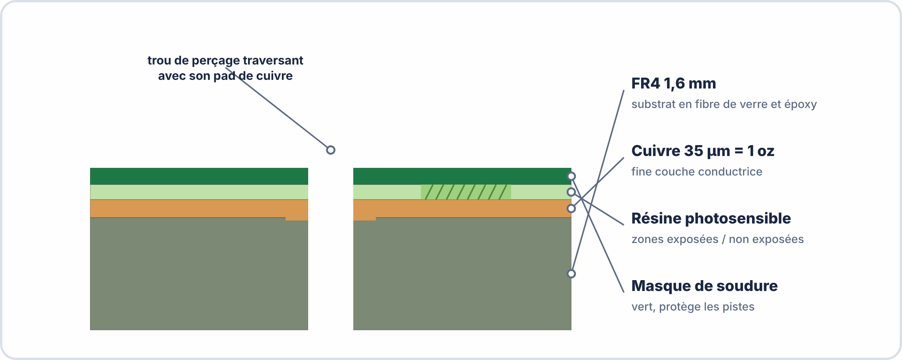
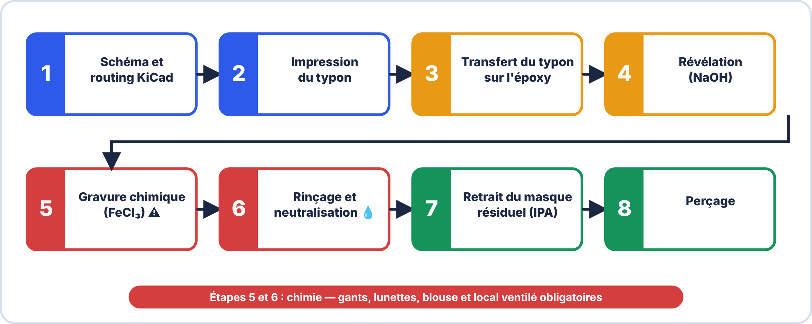
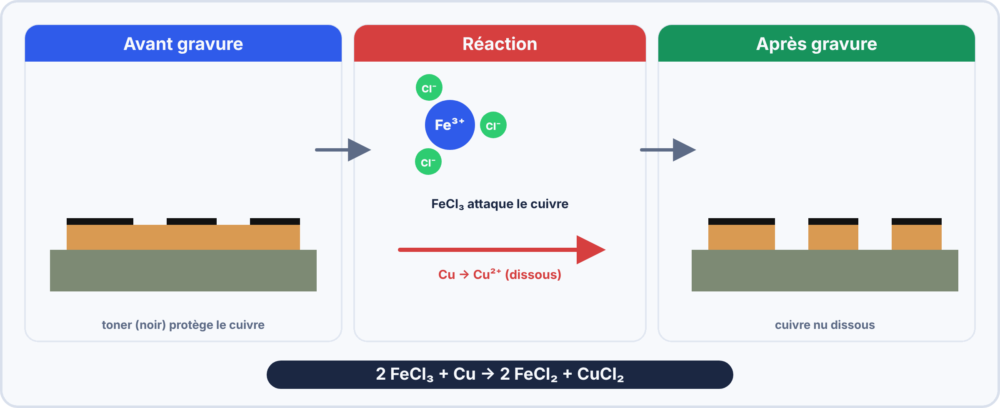
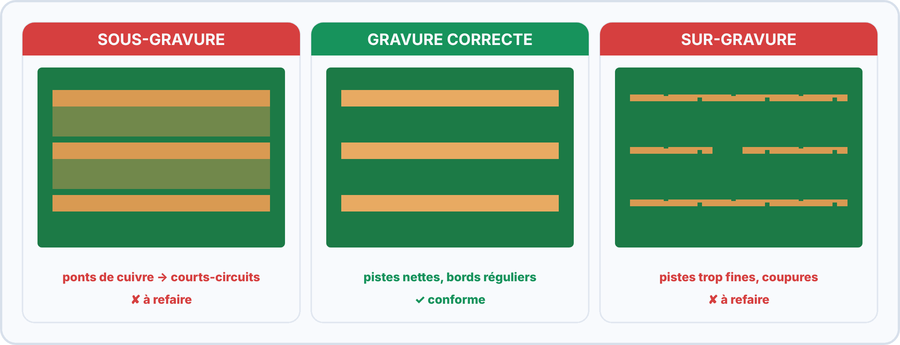
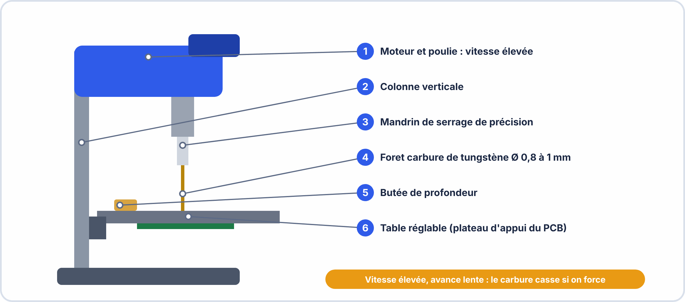
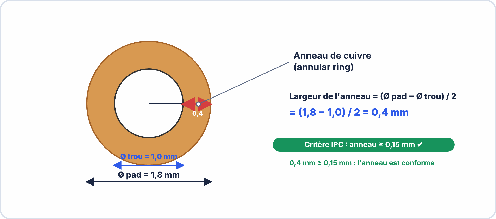
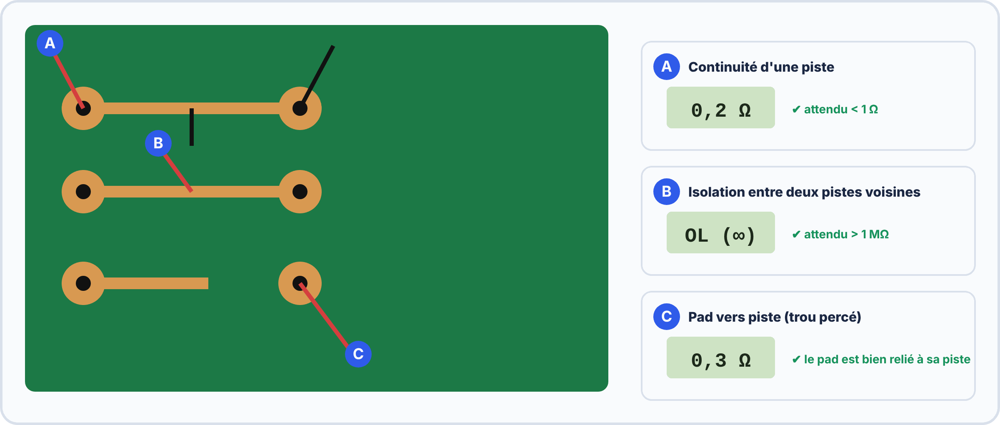

# 📘 FICHE DE COURS — S11 / Module E2
## PCB Simple Face : Gravure Chimique & Perçage · Contrôle Qualité IPC-A-600

---

> **BAC Pro CIEL — 1ère année** | MFR de Pontonx
> Nom : _________________________ Prénom : _________________________ Date : _________

---

## 🗝️ Vocabulaire clé

| Terme | Définition |
|---|---|
| **PCB** (Printed Circuit Board) | Circuit imprimé — support en résine époxy recouvert de cuivre sur lequel les composants sont connectés par des pistes conductrices |
| **Simple face** | PCB avec cuivre uniquement sur une face (face cuivre). La face opposée est le substrat nu. |
| **Substrat FR4** | Matériau d'isolation du PCB : tissu de fibre de verre imprégné de résine époxy ignifugée. FR4 = Flame Retardant 4. |
| **Couche de cuivre** | Film de cuivre électrolytique déposé sur le substrat (épaisseur standard : 35 µm = 1 oz/ft²) |
| **Typon** | Masque de la piste : film transparent (ou calque) avec les pistes imprimées en noir — protège le cuivre à conserver lors de la gravure |
| **Insolation UV** | Exposition de la couche photosensible du PCB à la lumière UV à travers le typon — durcit les zones exposées |
| **Révélateur** | Solution chimique (NaOH 10 g/L) éliminant la résine photosensible non durcie (zones non exposées) |
| **Gravure (étching)** | Dissolution chimique du cuivre non protégé par le masque de résine |
| **Perchlorure de fer (FeCl₃)** | Solution de chlorure ferrique utilisée pour graver le cuivre : FeCl₃ + Cu → FeCl₂ + CuCl |
| **Persulfate d'ammonium** | Alternative au FeCl₃ : moins de taches, régénérable, mais plus lent |
| **Pad (pastille)** | Zone de cuivre circulaire ou rectangulaire destinée à recevoir la broche d'un composant |
| **Via** | Trou métallisé reliant deux couches de cuivre (uniquement sur PCB double face ou multicouches) |
| **PTH** (Plated Through Hole) | Trou traversant métallisé — utilisé pour les composants THT |
| **NPTH** (Non-Plated Through Hole) | Trou non métallisé — utilisé pour les fixations mécaniques |
| **Anneau de cuivre** (annular ring) | Couronne de cuivre autour du trou de perçage — doit respecter une largeur minimale IPC |
| **Masque de soudure** | Vernis isolant coloré (vert, rouge, bleu…) protégeant les pistes et ne couvrant que les pads |
| **Sérigraphie** | Impression des références et positions des composants sur le PCB |
| **Gerber** | Format de fichier standard pour la fabrication PCB (extension .gbr) — contient les données de chaque couche |
| **IPC-A-600** | Norme internationale de critères d'acceptabilité des circuits imprimés |

---

## 1. Structure d'un PCB simple face

### 1.1 Les couches




| Couche | Matériau | Épaisseur standard | Rôle |
|---|---|---|---|
| **Substrat** | FR4 (fibre de verre + époxy) | 1,6 mm | Support mécanique et isolation électrique |
| **Cuivre** | Cu électrolytique | 35 µm (1 oz/ft²) | Conducteur électrique — forme les pistes et pads |
| **Masque de soudure** | Vernis époxy teint | 25 µm | Protection des pistes, guidage de la soudure |
| **Sérigraphie** | Encre époxy blanche | 15 µm | Références composants, indicateurs de polarité |

### 1.2 Caractéristiques du cuivre standard

35 µm de cuivre sur FR4 :  
Résistivité : ρ = 1,72 × 10⁻⁸ Ω·m  
Résistance d'une piste de 100 mm × 1 mm × 35 µm :  

$$R = ρ \times \dfrac{L}{l \times e} = 1{,}72 \times 10⁻⁸ \times \dfrac{0{,}1}{0{,}001 \times 35 \times 10⁻⁶} = 0{,}049\,\mathrm{\Omega } \approx 50 m\Omega$$

→ Négligeable pour la plupart des signaux, mais significatif pour les forts courants  

---

## 2. Procédé de fabrication — Gravure chimique

### 2.1 Vue d'ensemble du procédé




### 2.2 Méthode 1 : Transfert toner (fer à repasser)

Méthode accessible, sans équipement UV, adaptée à un atelier scolaire.

| Étape | Procédure | Durée | Contrôle |
|---|---|---|---|
| **1. Impression** | Imprimer le typon en noir haute densité sur papier glacé (magazine ou papier de transfert thermique) | — | Vérifier le noircissement complet des pistes |
| **2. Nettoyage épitaxiale** | Abraser légèrement la face cuivre avec laine d'acier fine, puis nettoyer à l'IPA | 5 min | Surface uniforme et brillante, pas de traces grasses |
| **3. Transfert** | Poser le typon face encre sur le cuivre, recouvrir d'un papier kraft, repasser à fer 180°C pendant 2–3 min | 3 min | Pression constante, déplacements réguliers |
| **4. Démoulage** | Tremper dans l'eau froide 30 s, décoller délicatement le papier | 2 min | Le toner reste collé au cuivre |
| **5. Retouche** | Corriger les interruptions avec un marqueur indélébile permanent noir (encre résistante à FeCl₃) | Variable | Toutes les pistes continues |

### 2.3 Méthode 2 : Insolation UV (professionnelle)

Méthode plus précise, nécessite un poste insolateur.

| Étape | Procédure | Durée |
|---|---|---|
| **1. Épitaxiale photosensible** | Utiliser une épitaxiale avec résine photosensible positive déjà déposée (stocker à l'abri de la lumière) | — |
| **2. Insolation** | Poser le typon (zones pistes = noir, fond = transparent) sur la résine, exposer aux UV pendant 90–120 s | 2 min |
| **3. Révélation** | Tremper dans NaOH 10 g/L à 25°C avec agitation légère — la résine non exposée se dissout | 45–90 s |
| **4. Rinçage** | Rincer à l'eau courante | 30 s |

> 📌 **Typon inversé selon méthode** : 
> - Méthode toner : pistes imprimées en noir directement
> - Méthode UV positive : fond transparent + pistes noires (identique)
> - Méthode UV négative (certains matériaux) : fond noir + pistes transparentes — VÉRIFIER le type de résine

### 2.4 La gravure au perchlorure de fer (FeCl₃)

#### Réaction chimique




```
2 FeCl₃  +  Cu  →  2 FeCl₂  +  CuCl₂

Lecture : Le fer trivalent (Fe³⁺) oxyde le cuivre (Cu) en cuivre divalent (Cu²⁺)
Le bain devient progressivement vert-brun (CuCl₂ + FeCl₂ accumulés) → bain épuisé
```


#### Paramètres de gravure

| Paramètre | Valeur optimale | Conséquence si non respecté |
|---|---|---|
| **Température** | 35–40°C | Trop froid → gravure lente, sous-gravure. Trop chaud → sur-gravure rapide, difficile à contrôler |
| **Concentration FeCl₃** | 400–500 g/L | Bain trop dilué → gravure très lente. Bain saturé → cristallisation |
| **Agitation** | Douce et régulière (30 s entre agitations) | Sans agitation → film de CuCl₂ en surface ralentit la réaction |
| **Durée typique** | 5–15 min selon température et bain | Surveiller toutes les 2 min — arrêter dès que tout le cuivre nu est dissous |

#### Procédure de gravure étape par étape

> [!NOTE] PROCÉDURE GRAVURE FeCl₃ — 8 étapes
>
> EPI AVANT TOUT : gants nitrile + lunettes + tablier  
>
> 1. Vérifier la température du bain : 35–40°C  
> 2. Vérifier la complétude du typon sur l'épitaxiale (pas de  
>   trou dans les pistes)  
> 3. Immerger le PCB FACE CUIVRE VERS LE BAS dans le bac  
>   (la gravure est plus homogène, le CuCl₂ tombe par gravité)  
> 4. Agiter légèrement le bac toutes les 30 secondes  
> 5. Contrôler toutes les 2 min en sortant le PCB brièvement :  
>   → Le cuivre nu doit disparaître progressivement  
>   → Les pistes sous le toner restent cuivrées  
> 6. ARRÊTER dès que tout le cuivre nu est dissous  
>   (ne pas over-graver les pistes !)  
> 7. Rincer abondamment sous l'eau froide 30 secondes  
> 8. Tremper 10 s dans bain bicarbonate (neutralisation)  
>   puis rincer à l'eau claire  

#### Anomalies de gravure — Causes et prévention




| Anomalie | Cause | Conséquence | Prévention |
|---|---|---|---|
| **Sous-gravure** (ponts cuivre) | Temps trop court, bain froid, bain épuisé | Courts-circuits entre pistes | Respecter la durée, maintenir 35–40°C |
| **Sur-gravure** (pistes fines/rompues) | Temps trop long, bain trop chaud | Coupures de pistes, résistance augmentée | Surveiller toutes les 2 min, arrêter dès que net |
| **Sous-gravure locale** | Agitation insuffisante | Points de court-circuit locaux | Agitation régulière, face cuivre vers le bas |
| **Pistes décollées** | Mauvais transfert toner, surface grasse | Pistes arrachées | Bien dégraisser avant transfert, appuyer suffisamment |

---

## 3. Le perçage des PCB

### 3.1 Outillage et paramètres




| Paramètre | Valeur | Raison |
|---|---|---|
| **Vitesse de rotation** | 3 000 à 8 000 tr/min | Vitesse élevée → coupe nette sans délaminer le FR4 |
| **Avance** | Lente et contrôlée | Avance trop rapide → brise le foret ou déforme les bords |
| **Lubrifiant** | À sec (PCB) | Le FR4 ne nécessite pas de lubrification — l'eau crée un risque électrique |
| **Type de foret** | Carbure de tungstène (WC) | Le FR4 est très abrasif — les forets acier HSS s'émoussent rapidement |
| **Appui arrière** | Planche de bois sacrificielle | Évite l'éclatement du substrat à la sortie du foret |

### 3.2 Diamètres de perçage selon les composants

| Type de composant | Diamètre broche | Diamètre perçage | Foret recommandé |
|---|---|---|---|
| Résistance 1/4 W, condensateur céramique | 0,6 mm | **0,8 mm** | Ø 0,8 mm |
| Condensateur électrolytique standard | 0,6–0,8 mm | **1,0 mm** | Ø 1,0 mm |
| LED 5 mm standard | 0,5 mm | **0,8 mm** | Ø 0,8 mm |
| Transistor TO-92 | 0,4–0,5 mm | **0,8 mm** | Ø 0,8 mm |
| CI DIP (support IC) | 0,4–0,5 mm (pins) | **0,8 mm** | Ø 0,8 mm |
| Connecteur 2,54 mm (pin header) | 0,6–0,7 mm | **1,0 mm** | Ø 1,0 mm |
| Bornier à vis 5 mm pas | 0,8–1,0 mm | **1,2 mm** | Ø 1,2 mm |
| Trou de montage M3 | — | **3,2 mm** | Ø 3,2 mm |

> 📌 **Règle générale** : Diamètre de perçage = diamètre de la broche + 0,2 à 0,4 mm de jeu. Trop juste → impossible d'enfiler le composant. Trop large → anneau de cuivre insuffisant, soudure fragilisée.

### 3.3 Procédure de perçage

```
1. Placer le PCB face cuivre VERS LE HAUT sur la planche sacrificielle
2. Centrer le foret sur le centre du pad (pastille de cuivre)
3. Vérifier la perpendicularité : la colonne doit être parfaitement verticale
4. Descendre doucement sans forcer — le carbure coupe le FR4 sans effort
5. Traverser jusqu'à la planche sacrificielle (ne pas s'arrêter dans le PCB)
6. Remonter immédiatement après la traversée
7. Souffler les poussières avec de l'air comprimé (lunettes obligatoires)
8. Vérifier le trou à la loupe : bords nets, pas d'éclatement, centré sur le pad
```

---

## 4. Normes de qualité PCB — IPC-A-600

### 4.1 Présentation de la norme IPC-A-600

La norme **IPC-A-600** (Acceptability of Printed Boards) définit les critères d'acceptabilité des circuits imprimés en 3 classes :

| Classe | Application | Niveau d'exigence |
|---|---|---|
| **Classe 1** | Électronique grand public, jouets | Minimum — quelques défauts acceptés si fonctionnel |
| **Classe 2** | Électronique industrielle, communication | Standard — défauts mineurs tolérés selon limites définies |
| **Classe 3** | Médical, militaire, spatial | Maximum — zéro défaut critique, tolérances strictes |

> 📌 **En BAC Pro CIEL : nous visons la Classe 2.** C'est le niveau standard de l'industrie électronique généraliste.

### 4.2 Les 5 critères visuels principaux IPC-A-600 Classe 2


#### Critère 1 — Largeur de piste

| Classe | Réduction maximale acceptée | Explication |
|---|---|---|
| Classe 1 | Jusqu'à 30% de réduction localisée | Large tolérance |
| **Classe 2** | **Maximum 20% de réduction** sur toute la longueur | Valeur de travail en BAC Pro CIEL |
| Classe 3 | Aucune réduction détectable | Tolérance quasi nulle |

> **Exemple** : Piste nominale de 0,5 mm → réduction max acceptable = 0,5 × 20% = 0,1 mm → largeur minimale = **0,4 mm**

#### Critère 2 — Espacement entre pistes

| Paramètre | Valeur IPC-A-600 Classe 2 |
|---|---|
| Espacement minimum entre deux pistes | **≥ 0,13 mm** (5 mil) |
| Espacement recommandé en atelier | **≥ 0,25 mm** (10 mil) |
| Valeur typique travaux pratiques | **0,5 mm** (tolérance de fabrication à main) |

> 📌 **Règle pratique en atelier** : Concevoir avec 0,5 mm d'espacement minimum. La précision du toner/UV artisanal ne garantit pas moins que 0,3 mm.

#### Critère 3 — Anneau de cuivre (annular ring)




L'anneau de cuivre est la couronne de cuivre qui entoure le trou de perçage. Il doit rester suffisamment large après perçage pour assurer une bonne soudure.


| Paramètre | Valeur minimale Classe 2 |
|---|---|
| Anneau de cuivre minimum | **0,15 mm** (6 mil) |
| Recommandé en atelier | **0,3 mm** minimum |
| Calcul | `Anneau = (Ø_pad − Ø_trou) / 2` |

> **Exemple** : Pad Ø 1,8 mm, trou Ø 1,0 mm → anneau = (1,8 − 1,0) / 2 = **0,4 mm** ✓

#### Critère 4 — Surface et intégrité des pistes

| Défaut | Limite Classe 2 |
|---|---|
| Piqûres (pits) dans le cuivre | ≤ 20% de la largeur de piste |
| Inclusions non conductrices | Aucune si > 20% de la largeur |
| Délaminage du substrat | Aucun acceptable |
| Bulles sous le masque de soudure | ≤ 1% de la surface de la carte |

#### Critère 5 — Trou de perçage

| Paramètre | Limite Classe 2 |
|---|---|
| Tolérance de diamètre | ± 0,1 mm |
| Décalage du trou par rapport au centre du pad | ≤ 25% de l'anneau de cuivre |
| Rugosité des bords du trou | Absence de fibres saillantes > 0,08 mm |
| Perpendiculaire au substrat | < 0,5° d'inclinaison |

---

## 5. Vérification multimètre du PCB

### 5.1 Protocole de test en 3 étapes




**Étape 1 — Test de continuité des pistes :**
```
Mode multimètre : ))) continuité sonore
Procédure : Poser une pointe à chaque extrémité de chaque piste
Attendu    : BZZZT (buzzer) ou résistance < 1 Ω pour chaque piste
Si silence : Piste interrompue → localiser la coupure à la loupe
```

**Étape 2 — Test d'isolation entre pistes :**
```
Mode multimètre : MΩ (mégaohmmètre) ou ))) continuité
Procédure : Tester entre chaque paire de pistes voisines non connectées
Attendu    : OL / ∞ (circuit ouvert) — résistance >> 1 MΩ
Si buzzer  : Court-circuit entre les deux pistes → localiser le pont cuivre
```

**Étape 3 — Test pad-piste :**
```
Mode multimètre : ))) continuité
Procédure : Poser une pointe sur le pad du trou percé, l'autre sur la piste correspondante
Attendu    : BZZZT (buzzer) — l'anneau de cuivre doit toujours conduire après perçage
Si silence : L'anneau de cuivre a été sectionné par le foret (trou trop décalé)
```

### 5.2 Tableau de résultats normalisé

| N° test | Piste / Nets testés | Mode multimètre | Valeur mesurée | Valeur attendue | Résultat |
|---|---|---|---|---|---|
| 1 | | ))) | Ω | < 1 Ω | ☐ ✓ ☐ ✗ |
| 2 | | ))) | Ω | < 1 Ω | ☐ ✓ ☐ ✗ |
| 3 | | MΩ | MΩ | > 1 MΩ | ☐ ✓ ☐ ✗ |
| 4 | | MΩ | MΩ | > 1 MΩ | ☐ ✓ ☐ ✗ |
| 5 | Pad – piste | ))) | Ω | < 1 Ω | ☐ ✓ ☐ ✗ |

---

## ✅ Compétences RNCP

| Code | Compétence | Niveau |
|---|---|---|
| C2.2 | Réaliser un PCB simple face | ⭐⭐⭐ Maîtrise |
| C2.3 | Vérifier la conformité du PCB | ⭐⭐⭐ Maîtrise |
| C2.5 | Sécurité chimique (EPI, FDS, neutralisation) | ⭐⭐⭐ Maîtrise |
| C3.2 | Normes qualité IPC-A-600 Classe 2 | ⭐⭐ Application |

---

## 📝 Mémo rapide

| Je dois... | Je retiens... |
|---|---|
| Graver proprement | FeCl₃ à 35–40°C · Face cuivre vers le bas · Agiter toutes les 30s · Surveiller toutes les 2 min |
| Percer proprement | Carbure de tungstène · 3000-8000 tr/min · Bois sacrificiel · Avance lente |
| Diamètre de perçage | Ø broche + 0,2 à 0,4 mm · Standard : 0,8 mm pour THT courant |
| Contrôler la qualité | 5 critères IPC : largeur piste (-20% max) · espacement (≥0,25mm) · anneau (≥0,15mm) · surface · trou |
| Tester au multimètre | Continuité piste < 1Ω · Isolation inter-piste > 1MΩ · Pad-piste < 1Ω |
| Gérer les déchets | FeCl₃ usagé = déchet dangereux · Jamais dans le réseau d'égout |

---

*BAC Pro CIEL — S11 Module E2 | MFR de Pontonx | © Yahn LE PRETTRE*
