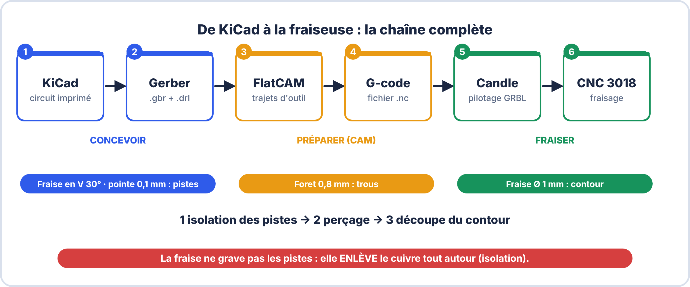
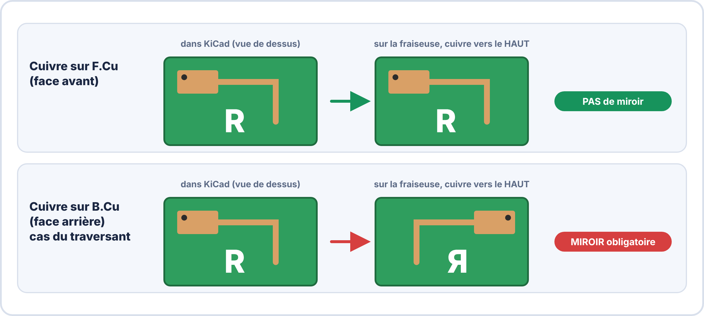
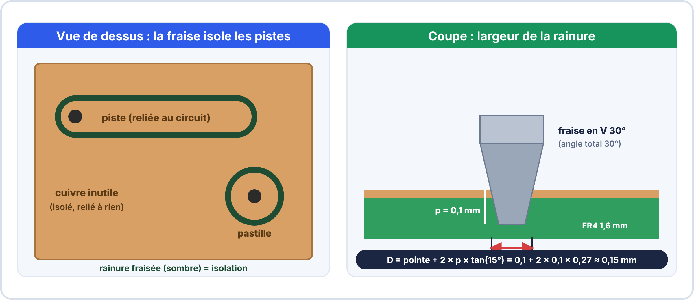

# 🛠️ FICHE PAS À PAS — De KiCad à la fraiseuse CNC 3018

## Réaliser un circuit imprimé simple face par fraisage

---

> **Document élève — À garder dans le portfolio numérique**

> [!NOTE] À compléter avec le formateur
> Cette fiche donne une **méthode** et des **valeurs de départ**. Les réglages exacts dépendent de **votre machine** : à valider par un **essai** et à noter dans le tableau de la [partie 9](#9-reglages-retenus-sur-notre-machine).
> - Logiciel de pilotage installé : ……………… (ex. Candle)
> - Fraises et forets disponibles : ………………
> - Sonde Z / mesure de la planéité : ……………… oui / non

---

## 1. Le principe : on isole, on ne grave pas

> [!TIP] 💡 En clair
> Avec le **perchlorure de fer**, on **dissout** le cuivre qui n'est pas protégé. Avec la **fraiseuse CNC**, on **creuse une fine rainure** dans le cuivre **tout autour des pistes**. Le cuivre restant, entre les rainures, est inutile mais **isolé électriquement** : on appelle cela l'**isolation** (*isolation routing*).
>
> La machine suit un **fichier de trajectoires** (le **G-code**) fabriqué à partir de ton circuit KiCad.



| Étape | Outil logiciel / machine | Ce qu'on obtient |
|---|---|---|
| 1 | **KiCad** (éditeur de circuit imprimé) | Le dessin des pistes, pastilles et trous |
| 2 | **KiCad** → *Tracer* et *Fichiers de perçage* | Fichiers **Gerber** (cuivre, contour) et **perçage** |
| 3 | **FlatCAM** (logiciel de CAO/FAO) | Trajectoires d'outil pour chaque opération |
| 4 | Export | Fichiers **G-code** (`.nc`) |
| 5 | **Candle** (ou autre logiciel GRBL) | Pilotage de la machine |
| 6 | **CNC 3018** | La carte fraisée |

---

## 2. Matériel et outils

| Opération | Outil | Valeur de départ | Remarque |
|---|---|---|---|
| **Isolation des pistes** | **Fraise en V** (gravure) | angle **30°** (ou 20°), **pointe 0,1 mm** | L'outil le plus fragile : le manipuler par la queue |
| **Perçage** | **Foret carbure** | **0,8 mm** (courant), 1,0 mm (supports, barrettes) | Voir le tableau des diamètres du [cours](01-cours.md#32-diametres-de-percage-selon-les-composants) |
| **Découpe du contour** | **Fraise 2 dents** | **Ø 1 mm** | Découpe la carte dans la plaque |
| **Plaque** | Époxy cuivrée **simple face**, **1,6 mm** | découpée à la taille utile | Face cuivre **vers le haut** |
| **Fixation** | Ruban **adhésif double face** sur une **plaque sacrificielle** (MDF) | surface bien plane | La plaque doit rester **parfaitement plane et immobile** |
| **Zéro en hauteur** | Sonde Z (ou feuille d'aluminium) | | Réglage au **centième de mm** |

> [!WARNING] ⚠️ Sécurité
> - **Lunettes** de protection pendant toute l'usinage.
> - La **poussière de fibre de verre** est irritante et dangereuse : **aspirateur** ou **masque FFP2**, **jamais d'air comprimé**.
> - On ne met **jamais** les mains près de la fraise en rotation. **Arrêt d'urgence** repéré avant de lancer.
> - Le **formateur** valide l'installation avant le premier lancement.

---

## 3. Étape 1 — Dessiner le circuit dans KiCad pour la fraiseuse

Un circuit fraisé n'a pas les mêmes contraintes qu'un circuit gravé chimiquement : la fraise a une **largeur**, et la machine est **précise à quelques dixièmes de mm**.

| Règle de conception | Valeur de départ | Pourquoi |
|---|---|---|
| **Simple face** | Pistes sur **une seule couche** (B.Cu pour des composants traversants) | Un seul côté à fraiser |
| **Largeur de piste** | **0,6 à 1 mm** (signal), plus large pour la puissance | Une piste fine se décolle ou se coupe |
| **Isolation entre cuivres** | **≥ 0,4 mm**, idéalement **0,5 mm** | Plus large que la rainure de la fraise (≈ 0,15 mm) |
| **Pastilles** | **≥ 2 mm** de diamètre pour un trou de 0,8 mm | Il doit rester du cuivre autour du trou (voir IPC-A-600) |
| **Composants** | **Traversants** et boîtiers à pas 2,54 mm | Les composants très fins sont trop délicats à fraiser |
| **Vias** | Aucun (simple face) : on utilise des **straps** (fils) si besoin | Pas de métallisation des trous |
| **Contour** | Tracé sur la couche **Edge.Cuts** (rectangle fermé) | La machine découpe la carte suivant ce tracé |
| **Origine** | Placer l'**origine auxiliaire** (*Place > Drill and Place File Origin*) dans un **coin** de la carte | Tous les fichiers partent de la **même origine** |

> [!NOTE] Vérifier avant d'exporter
> Lancer le **DRC** (*Inspecter > Contrôle des règles de conception*) : **0 erreur** avant de continuer.

---

## 4. Étape 2 — Exporter les fichiers depuis KiCad

### 4.1 Les fichiers Gerber (cuivre et contour)

```
  Fichier > Tracer
  1. Format : Gerber
  2. Dossier de sortie : un dossier dédié (ex. NOM_Prenom_S11/fabrication)
  3. Couches à tracer :
       → la couche de cuivre utilisée (B.Cu, ou F.Cu)
       → Edge.Cuts (contour)
  4. Options :
       ☑ Utiliser l'origine auxiliaire (« Use auxiliary axis as origin »)
       ☐ Ne PAS cocher les options « miroir » : le miroir se fait ensuite (partie 5)
  5. Cliquer sur « Tracer »
```

### 4.2 Le fichier de perçage

```
  Dans la même fenêtre : « Générer les fichiers de perçage »
  1. Format : Excellon
  2. Unités : millimètres
  3. Origine du perçage : « Origine auxiliaire »  ← la MÊME que pour les Gerber
  4. Cliquer sur « Générer le fichier de perçage »
```

> [!WARNING] ⚠️ Même origine partout
> Si l'origine n'est pas la même dans les Gerber et dans le fichier de perçage, **les trous tombent à côté des pastilles**. C'est l'erreur la plus fréquente.

---

## 5. Étape 3 — Miroir ou pas ?

> [!TIP] 💡 En clair
> Sur la fraiseuse, la face **cuivre est toujours tournée vers le haut**. KiCad dessine chaque couche **vue de dessus**.
> - Si le cuivre est sur la couche **du dessus (F.Cu)** : le dessin est **déjà dans le bon sens**.
> - Si le cuivre est sur la couche **du dessous (B.Cu)** (cas habituel avec des composants traversants montés côté « dessus » et soudés côté cuivre) : il faut **retourner** la plaque, donc **inverser le dessin** : c'est le **miroir**.



| Couche de cuivre | Miroir du cuivre | Miroir du perçage et du contour |
|---|---|---|
| **F.Cu** (face avant) | **Non** | **Non** |
| **B.Cu** (face arrière) | **Oui**, par rapport à l'axe **vertical** de la carte (gauche ↔ droite) | **Oui**, **autour du même axe** |

> [!WARNING] ⚠️ Le piège
> Cuivre, perçage et contour doivent être **miroités autour du même axe** (le centre de la carte). Si on retourne seulement le cuivre, **les trous ne correspondent plus aux pastilles**.

**Vérification rapide avant de fraiser** : repérer un détail **asymétrique** (une lettre, la broche 1 d'un circuit intégré) dans FlatCAM et comparer avec le côté cuivre d'une carte de référence ou d'une impression papier **vue côté cuivre**.

---

## 6. Étape 4 — Fabriquer les trajectoires dans FlatCAM

### 6.1 Importer les fichiers

```
  1. Fichier > Ouvrir Gerber :  la couche de cuivre
  2. Fichier > Ouvrir Gerber :  Edge.Cuts (contour)
  3. Fichier > Ouvrir Excellon : le fichier de perçage
  4. Unités : millimètres
  5. Si B.Cu : appliquer le MIROIR aux trois objets, autour du même axe
```

### 6.2 La largeur de la rainure

Une fraise en V creuse une rainure **plus large que sa pointe**, d'autant plus que l'on **descend profond**. FlatCAM a besoin de la **largeur réelle** de la rainure (« diamètre d'outil »).

$$D = d_{\text{pointe}} + 2 \times p \times \tan\left(\dfrac{\alpha}{2}\right)$$



**Exemple** : pointe $0{,}1$ mm, angle $\alpha = 30^\circ$, profondeur $p = 0{,}1$ mm.

??? success "Calcul"
    $D = 0{,}1 + 2 \times 0{,}1 \times \tan(15^\circ) = 0{,}1 + 2 \times 0{,}1 \times 0{,}268 \approx$ **0,15 mm**

> 📌 Une profondeur de 0,05 mm donne une rainure plus étroite (≈ 0,13 mm), 0,15 mm une rainure plus large (≈ 0,18 mm). Une **erreur de quelques centièmes** sur la profondeur change la largeur : d'où l'importance de la **planéité**.

### 6.3 Paramètres de départ (à valider par un essai)

| Opération | Outil | Profondeur de passe | Avance | Autres réglages |
|---|---|---|---|---|
| **Isolation** | V 30°, pointe 0,1 mm | **−0,1 mm** (à tester entre −0,05 et −0,15) | **60 à 100 mm/min** (plus lent au début) | **2 passes**, broche **à la vitesse maximale**, hauteur de déplacement **2 mm** |
| **Perçage** | Foret 0,8 mm | **−1,8 mm** (plaque de 1,6 mm + marge dans la plaque sacrificielle) | **plongée lente, ≈ 60 mm/min** | Un fichier **par diamètre** de foret |
| **Contour** | Fraise Ø 1 mm | **−1,8 mm**, **en plusieurs passes de 0,2 à 0,3 mm** | **100 à 200 mm/min** | Ajouter des **languettes** (*gaps*) pour que la carte ne se détache pas pendant la découpe |

> [!TIP] 💡 En clair
> Sur une petite machine comme la 3018, **lent et peu profond** vaut mieux que rapide et profond : la fraise de 0,1 mm **casse** si on la brusque. Une fraise en V aime tourner **vite** (broche au maximum) et avancer **doucement**.

### 6.4 Exporter

```
  Pour chaque opération : « Générer le travail CNC » puis « Enregistrer le G-code »
  Noms clairs, par exemple :
    NOM_S11_1_isolation_V30.nc
    NOM_S11_2_percage_0-8mm.nc
    NOM_S11_3_contour_1mm.nc
```

> 📌 Les fichiers sont **numérotés dans l'ordre d'exécution** et **portent le nom de l'outil** : on évite de lancer le programme du foret avec la fraise en V montée.

---

## 7. Étape 5 — Préparer la machine

```
  1. Coller la plaque cuivrée sur la plaque sacrificielle (double face), cuivre vers le HAUT
  2. Monter la fraise en V dans la pince (ER11), enfoncée de façon repérée
  3. Allumer la machine, connecter Candle, vérifier les déplacements à vide
  4. Définir l'origine XY : au coin de la carte (même coin que l'origine KiCad)
  5. Définir le zéro Z : au contact du cuivre (sonde Z ou feuille d'aluminium)
  6. Mesurer la planéité de la plaque (« height map » / auto-level), si le logiciel le permet
  7. ESSAI À VIDE : lancer le programme avec le zéro Z relevé de 2 mm (ou un feutre à la place de la fraise)
     → vérifier le sens, la position et l'absence de collision
  8. Redescendre le zéro Z à sa valeur et lancer le vrai fraisage
```

> [!WARNING] ⚠️ À chaque changement d'outil
> **Le zéro Z doit être refait** : une fraise en V, un foret et une fraise de 1 mm n'ont pas la même longueur. L'**origine XY** ne bouge **pas** : on ne déplace **pas** la plaque entre les opérations.

---

## 8. Étape 6 — Fraiser, dans cet ordre

| Ordre | Opération | Outil | Pourquoi dans cet ordre |
|---|---|---|---|
| **1** | **Isolation** des pistes | Fraise en V | Le cuivre est intact et la plaque encore solide |
| **2** | **Perçage** | Foret | Les trous sont positionnés avant que la carte ne soit libre |
| **3** | **Découpe du contour** | Fraise Ø 1 mm | En dernier : une fois découpée, la carte bouge |

**Pendant le fraisage** : rester devant la machine, la main près de l'arrêt, l'aspirateur en marche. Au moindre bruit anormal : **pause**, puis diagnostic.

### 8.1 Contrôle de la carte fraisée

| Contrôle | Comment | Critère |
|---|---|---|
| Aspect des pistes | Loupe | Pistes entières, bords nets |
| Cuivre restant dans les rainures | Loupe | Aucune bavure de cuivre qui fait pont |
| **Court-circuit** entre pistes voisines | Multimètre en **continuité** | Pas de continuité entre deux pistes qui ne doivent pas se toucher |
| **Continuité** d'une piste | Multimètre en **continuité** | Continuité d'un bout à l'autre |
| Trous | Loupe | Centrés sur les pastilles |

> 📌 Un **ponçage très léger** (papier très fin) puis un **nettoyage** à l'alcool éliminent les bavures de cuivre. Les critères détaillés sont dans le [cours (IPC-A-600)](01-cours.md#4-normes-de-qualite-pcb-ipc-a-600).

---

## 9. Réglages retenus sur notre machine

À remplir **après les essais**, avec le formateur :

| Paramètre | Valeur de départ | **Notre valeur** |
|---|---|---|
| Fraise en V : angle / pointe | 30° / 0,1 mm | |
| Profondeur d'isolation | −0,1 mm | |
| Avance d'isolation | 60–100 mm/min | |
| Nombre de passes | 2 | |
| Diamètre d'outil saisi dans FlatCAM | ≈ 0,15 mm | |
| Foret courant | 0,8 mm | |
| Profondeur de perçage | −1,8 mm | |
| Fraise de contour | Ø 1 mm | |
| Axe de miroir (si B.Cu) | vertical (gauche ↔ droite) | |

---

## 🛠️ Problèmes fréquents

| Problème | Cause probable | Solution |
|---|---|---|
| Du cuivre reste dans les rainures (pistes en court-circuit) | Rainure **trop peu profonde** ou plaque **non plane** | Mesurer la planéité, descendre de **0,02 à 0,03 mm**, refaire une **2ᵉ passe** |
| Pistes **trop fines**, **coupées** ou rainure trop large | Trop **profond** : la rainure s'élargit | Remonter la profondeur, recalculer le diamètre d'outil |
| La **fraise en V casse** | Avance trop rapide, plongée brutale, plaque mal collée | Avance plus lente, vérifier la fixation, **changer de fraise** |
| **Trous décalés** par rapport aux pastilles | Origine différente, ou **miroir** appliqué au cuivre seulement | Refaire l'export avec la **même origine** et miroiter **tous** les fichiers autour du **même axe** |
| Carte **à l'envers** (dessin en miroir) | Miroir oublié (cuivre sur B.Cu) ou fait deux fois | Revoir la [partie 5](#5-etape-3-miroir-ou-pas) |
| La carte **bouge** pendant la découpe | Pas de **languettes** ou mauvais collage | Ajouter des languettes, recoller, ralentir |
| Une moitié de la carte est mieux fraisée que l'autre | **Plaque penchée** (mauvaise planéité) | Remesurer, refaire le collage sur surface plane |
| Fraisage décalé après un changement d'outil | Zéro Z non refait, ou plaque déplacée | Refaire le **zéro Z** uniquement ; ne **jamais** bouger la plaque |

---

### ✅ Vérifie que tu as compris

**Q1.** Quelle différence entre graver au perchlorure et fraiser avec la CNC ?

??? success "Réponse"
    Au perchlorure, le **cuivre non protégé est dissous**. À la CNC, la fraise **creuse une rainure autour des pistes** pour les **isoler** : le reste du cuivre demeure, mais n'est relié à rien.

**Q2.** Ton cuivre est sur la couche **B.Cu**. Faut-il appliquer un miroir ? Sur quels fichiers ?

??? success "Réponse"
    **Oui**, car on retourne la plaque (cuivre vers le haut). Le miroir s'applique au **cuivre**, au **perçage** et au **contour**, **autour du même axe**.

**Q3.** Pourquoi rédiger le **diamètre d'outil** à 0,15 mm dans FlatCAM alors que la pointe fait 0,1 mm ?

??? success "Réponse"
    Parce que la fraise en V **s'élargit avec la profondeur** : à 0,1 mm de profondeur, la rainure fait environ $0{,}1 + 2 \times 0{,}1 \times \tan 15^\circ \approx 0{,}15$ mm.

**Q4.** Pourquoi l'**isolation** passe-t-elle **avant** la découpe du contour ?

??? success "Réponse"
    Tant que la carte n'est pas découpée, elle est **solidaire de la plaque** et ne bouge pas. Une fois découpée, elle risque de se déplacer.

**Q5.** Tu viens de changer la fraise en V pour le foret. Que dois-tu refaire, et que ne dois-tu **pas** déplacer ?

??? success "Réponse"
    Refaire le **zéro Z** (les outils n'ont pas la même longueur). Ne **pas** déplacer la **plaque** ni l'**origine XY**.

> [!SUCCESS] 🧠 À retenir
> - **Isolation** : la fraise en V creuse autour des pistes ; sa largeur dépend de la **profondeur**.
> - **Miroir** si le cuivre est sur **B.Cu**, pour **tous** les fichiers et autour du **même axe**.
> - **Ordre** : isolation → perçage → contour ; **zéro Z refait à chaque outil**.
> - **Essai à vide** avant le vrai fraisage.

---

*Fiche CNC 3018 — BAC Pro CIEL S11 Module E2 | MFR de Pontonx | Valeurs de départ à valider sur la machine de l'établissement*
