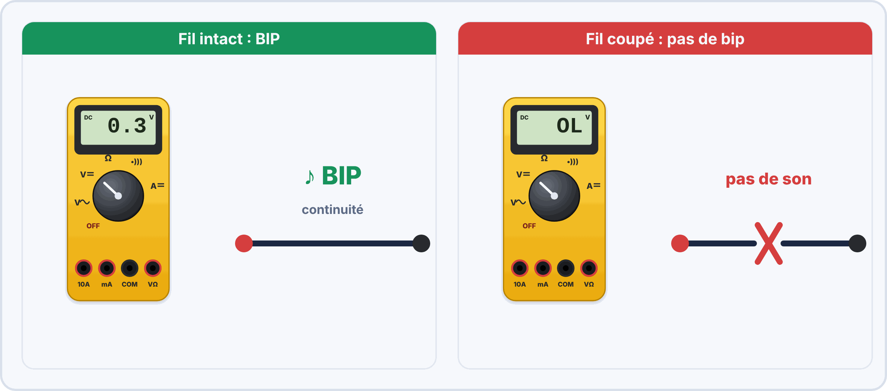

# 📘 FICHE DE COURS ÉLÈVE - U2 ÉLECTRONIQUE - SEMAINE 12

> [!TIP] 🖥️ TP virtuel ElectroLab : pour t'entraîner
> Ouvre [ElectroLab](https://yahnlp.github.io/ElectroLab/), menu **TP ▾**, puis choisis :
> - **Tester les composants hors tension (ohmmètre, diode, continuité)** (1 h, seconde)
> - **Découverte du multimètre : tension, courant, loi d'Ohm** (1 h, seconde)
> - **Lire un signal à l'oscilloscope : régler, mesurer T, f, Umax, Upp… (6 signaux)** (1 h 15, seconde / première)
> 
> Le simulateur corrige automatiquement et ne risque pas d'abîmer le matériel : **réussis d'abord le TP virtuel, puis refais la manipulation sur le matériel réel.** Mode d'emploi : [Utiliser ElectroLab](../../ressources/electrolab.md).


## 🔍 TESTS MULTIMÈTRE ET CONTRÔLE QUALITÉ PCB

---

## 📋 INFORMATIONS

| **Élément** | **Détail** |
|-------------|------------|
| **Bloc** | U2 - Réalisation et maintenance de systèmes électroniques |
| **Semaine** | S12 / Année 1 |
| **Thématique** | Tests multimètre, Contrôle qualité PCB, Rédaction PV |
| **Durée cours** | 50 minutes |

---

## 🎯 OBJECTIFS D'APPRENTISSAGE

À la fin de ce cours, je serai capable de :

✅ Utiliser le multimètre en mode continuité  
✅ Détecter une piste coupée sur une carte PCB  
✅ Détecter un court-circuit  
✅ Identifier les défauts de fabrication courants  
✅ Suivre une procédure de contrôle qualité  
✅ Rédiger un PV (Procès-Verbal) de contrôle professionnel  


### 🤔 À ton avis ?

Une carte vient d'être fabriquée. Comment savoir, **avant de l'alimenter**, qu'elle est sans défaut ?

??? question "Voir une réponse possible"
    On la **teste méthodiquement avec un multimètre** : continuité des pistes, absence de court-circuit entre l'alimentation et la masse, et vérification des soudures. On **note** les résultats dans un **procès-verbal (PV)**.
    
    C'est ce que tu fais dans cette séance : **tester, contrôler, rédiger**.

---

## 1️⃣ LE MULTIMÈTRE EN MODE CONTINUITÉ

### 📖 Définition

Le **mode continuité** du multimètre permet de vérifier si un **chemin électrique existe** entre deux points, sans avoir à lire une valeur de résistance.

**Analogie :** Le mode continuité, c'est comme vérifier si un tuyau est **bouché ou non**. Si l'eau passe → Tuyau OK. Si l'eau ne passe pas → Tuyau bouché.

### 🔊 Principe de fonctionnement

Le multimètre en mode continuité :

- Envoie un **petit courant** entre les deux pointes
- Si le courant passe : **BIP sonore** + affichage valeur faible
- Si le courant ne passe pas : **Pas de BIP** + affichage "OL" (Open Line)

### 🔘 Symbole du mode continuité

Sur le multimètre, le mode continuité est représenté par :


### 📊 Interprétation des résultats

| **Résultat** | **Affichage** | **Son** | **Signification** |
|--------------|--------------|---------|-------------------|
| **Continuité OK** | 0 à ~50 Ω | BIP 🔊 | Connexion présente |
| **Continuité NOK** | OL ou 1 | Silence 🔇 | Connexion coupée |

### 🎚️ Seuil de continuité

Le multimètre considère qu'il y a continuité si la résistance est **inférieure à ~50 Ω** (dépend des modèles).

**Exemples :**

- Fil de cuivre : 0,1 Ω → **BIP** ✅
- Résistance 10 Ω : **BIP** ✅
- Résistance 100 Ω : **Pas de BIP** ❌
- Air (circuit ouvert) : ∞ Ω → **Pas de BIP** ❌

### 🔌 Utilisation pratique

**Procédure :**

1. Sélectionner le mode continuité sur le multimètre (symbole ──▷|─── )))
2. Toucher les deux pointes ensemble → Doit faire **BIP** (test du multimètre)
3. Placer les pointes sur les deux points à tester
4. Écouter : **BIP** = OK, **Pas de BIP** = Problème

**⚠️ IMPORTANT :** Ne JAMAIS tester avec une alimentation branchée (débrancher la carte avant tout test).




> [!TIP] 💡 En clair
> En **mode continuité**, le multimètre envoie un très petit courant entre ses deux pointes. **S'il passe**, il fait **BIP** : le chemin est fermé. **S'il ne passe pas**, silence : le chemin est coupé.
>
> On teste **toujours hors tension**.

### ✅ Vérifie que tu as compris

**Q1.** Que signifie un BIP en mode continuité ?

??? success "Réponse"
    Le chemin entre les deux pointes est **fermé** (continuité).

**Q2.** Pourquoi teste-t-on hors tension ?

??? success "Réponse"
    Pour ne pas fausser la mesure et ne pas **endommager** le multimètre.

**Q3.** Quelle différence entre « pas de bip » et « BIP » sur un fil ?

??? success "Réponse"
    Pas de bip : le fil est **coupé** ; bip : il est **continu**.

> [!SUCCESS] 🧠 À retenir
> - BIP = chemin fermé ; silence = chemin coupé ; toujours hors tension.

---

## 2️⃣ TESTS SUR CARTE PCB

### 🔍 Test 1 : Continuité des pistes

**Objectif :** Vérifier que les pistes conductrices ne sont pas coupées.

**Principe :**
Une piste sur un PCB doit relier deux points (composant A → composant B). Si la piste est coupée, le courant ne peut pas passer.

**Méthode :**

1. Identifier sur le **schéma** les deux extrémités de la piste
2. Placer les pointes du multimètre sur ces deux points
3. Résultat attendu : **BIP** ✅

**Exemple :**
```
Schéma : Piste +5V va de l'entrée d'alimentation jusqu'au pin 1 du circuit intégré

Test :
  Pointe rouge → Entrée +5V
  Pointe noire → Pin 1 CI
  
Résultat attendu : BIP
Si pas de BIP → Piste coupée !
```

**Causes possibles d'une piste coupée :**

- Gravure trop agressive (piste trop fine disparue)
- Rayure mécanique pendant la manipulation
- Piste mal conçue (trop fine dès le départ)


> [!TIP] 💡 En clair
> Sur une carte, on enchaîne **trois tests** :
>
> 1. **Continuité** de chaque piste importante (alimentation, masse, signaux) ;
> 2. **Absence de court-circuit** entre le **+** et le **−** (en mode ohmmètre : une valeur **grande** est bon signe) ;
> 3. **Vérification des soudures** (un bip peut disparaître si une soudure est froide).
>
> On avance **dans l'ordre**, on **note** chaque résultat.

### ✅ Vérifie que tu as compris

**Q1.** Le multimètre bipe entre le + et le − de l'alimentation. Que faut-il en conclure ?

??? success "Réponse"
    Il y a un **court-circuit** : il ne faut **pas** alimenter la carte avant de l'avoir cherché.

**Q2.** Quel test fait-on en premier ?

??? success "Réponse"
    La **continuité des pistes** d'alimentation et de masse, puis l'**absence de court-circuit**.

**Q3.** Pourquoi note-t-on chaque résultat ?

??? success "Réponse"
    Pour **garder une trace** et rédiger le PV, et pour repérer plus vite la cause d'un défaut.

> [!SUCCESS] 🧠 À retenir
> - Continuité, court-circuit, soudures, dans cet ordre.

---

### ⚡ Test 2 : Détection de court-circuit

**Objectif :** Vérifier qu'il n'y a pas de connexion non voulue entre deux pistes.

**Principe :**
Un court-circuit, c'est quand deux pistes qui ne devraient PAS se toucher sont reliées. C'est très dangereux car cela peut :

- Créer un chemin de courant non prévu
- Détruire les composants
- Créer une surchauffe

**Méthode :**

1. Identifier sur le schéma deux pistes qui doivent être **séparées** (+5V et GND par exemple)
2. Placer les pointes sur ces deux pistes
3. Résultat attendu : **PAS DE BIP** ✅

**Tests critiques :**

| **Test** | **Résultat attendu** | **Si BIP** |
|---------|---------------------|-----------|
| +5V ↔ GND | **PAS DE BIP** | ⚠️ Court-circuit ! |
| Piste 1 ↔ Piste 2 | **PAS DE BIP** | ⚠️ Court-circuit ! |
| Signal A ↔ Signal B | **PAS DE BIP** | ⚠️ Court-circuit ! |

**Causes possibles d'un court-circuit :**

- Pont de soudure entre deux pistes
- Fil de soudure qui dépasse et touche une autre piste
- Pistes trop proches lors de la conception
- Résidu métallique sur la carte

---

### 🔧 Test 3 : Vérification des soudures

**Objectif :** S'assurer que tous les composants sont bien soudés.

**Types de soudures :**

| **Type** | **Aspect** | **Continuité** | **Statut** |
|---------|-----------|----------------|-----------|
| **Soudure parfaite** | Brillante, forme de volcan | BIP ✅ | OK |
| **Soudure froide** | Terne, granuleuse | BIP intermittent ⚠️ | NOK |
| **Soudure insuffisante** | Composant pas fixé | Pas de BIP ❌ | NOK |

**Test :**

1. Placer une pointe sur la patte du composant
2. Placer l'autre pointe sur la piste correspondante
3. Résultat attendu : **BIP stable** ✅

**Si le BIP est intermittent :**

- Bouger légèrement le composant
- Si le BIP change → **Soudure froide** → Refaire la soudure

---

## 3️⃣ LES DÉFAUTS DE FABRICATION COURANTS

### 📊 Top 5 des défauts

| **Défaut** | **Cause** | **Détection** | **Réparation** |
|-----------|----------|---------------|---------------|
| **1. Piste coupée** | Gravure excessive | Test continuité : Pas de BIP | Pont de soudure (fil volant) |
| **2. Court-circuit** | Pistes trop proches | Test + ↔ GND : BIP | Couper le pont avec lame |
| **3. Soudure froide** | Fer pas assez chaud | BIP intermittent | Refaire la soudure |
| **4. Composant mal orienté** | Erreur d'assemblage | Visuel (repères) | Dessouder et retourner |
| **5. Trou non percé** | Oubli perçage | Visuel (composant ne rentre pas) | Percer le trou |

### 🔎 Inspection visuelle : Checklist

**Avant tout test électrique, inspecter visuellement :**

| **Point de contrôle** | **OK** | **NOK** |
|----------------------|--------|---------|
| Toutes les pistes sont continues (pas de coupure visible) | ☐ | ☐ |
| Aucune piste ne se touche (pas de pont) | ☐ | ☐ |
| Tous les composants sont soudés | ☐ | ☐ |
| Les soudures sont brillantes (aspect "volcan") | ☐ | ☐ |
| Composants polarisés dans le bon sens (diode, LED, condo) | ☐ | ☐ |
| Pas de résidu de flux ou de saleté | ☐ | ☐ |
| Pas de rayure sur les pistes | ☐ | ☐ |


> [!TIP] 💡 En clair
> Les défauts de fabrication **les plus fréquents** : **piste coupée** (pas de bip là où il en faut un), **court-circuit** entre pistes (bip là où il n'en faut pas), **soudure froide** (contact intermittent), **composant à l'envers** (polarité), **pastille décollée**.

### ✅ Vérifie que tu as compris

**Q1.** Une piste ne bipe pas d'un bout à l'autre. Quel défaut ?

??? success "Réponse"
    Une **piste coupée**.

**Q2.** Une LED ne s'allume pas mais le circuit est complet. Que peut-on suspecter ?

??? success "Réponse"
    Une LED **à l'envers** ou une **soudure froide**.

---

## 4️⃣ PROCÉDURE DE CONTRÔLE QUALITÉ

### 📋 Méthode systématique

**Un bon contrôle qualité suit toujours le même ordre :**

```
1. INSPECTION VISUELLE
   ↓
2. TEST DE CONTINUITÉ (pistes principales)
   ↓
3. TEST DE COURT-CIRCUIT (+ ↔ GND)
   ↓
4. TEST DES COMPOSANTS (un par un si nécessaire)
   ↓
5. CONCLUSION : Conforme / Non conforme
```

### ⚠️ Règle d'or : Jamais alimenter sans tester !

**Pourquoi ?**

| **Défaut non détecté** | **Conséquence si on alimente** |
|-----------------------|-------------------------------|
| Piste coupée | Le circuit ne fonctionne pas (inoffensif) |
| Court-circuit +/- | Destruction des composants, fumée, risque incendie 🔥 |
| Soudure froide | Fonctionnement aléatoire, panne intermittente |
| Composant à l'envers | Destruction du composant (LED, diode, CI) |

**Séquence correcte :**
```
Fabrication → Test (sans alim) → Réparation → Re-test → Mise sous tension
```


> [!TIP] 💡 En clair
> Une **procédure de contrôle** est une **liste d'étapes toujours identiques** : ainsi, **deux personnes différentes** trouvent les **mêmes défauts**. Elle va du **simple** (inspection visuelle) au **plus précis** (tests électriques).

### ✅ Vérifie que tu as compris

**Q1.** Pourquoi suit-on toujours la même procédure ?

??? success "Réponse"
    Pour que le contrôle soit **reproductible** : le résultat ne dépend pas de la personne qui le fait.

---

## 5️⃣ RÉDACTION D'UN PV DE CONTRÔLE

### 📖 Qu'est-ce qu'un PV ?

Un **PV (Procès-Verbal)** est un **document officiel** qui atteste qu'un contrôle a été effectué.

**Analogie :** Le PV de contrôle, c'est comme le **contrôle technique** d'une voiture : on documente ce qui a été vérifié et si c'est OK ou pas OK.

### 🎯 Objectifs du PV

| **Objectif** | **Explication** |
|--------------|----------------|
| **Traçabilité** | Prouver que le contrôle a été fait |
| **Responsabilité** | Identifier qui a fait le contrôle |
| **Conformité** | Valider que le produit respecte les normes |
| **Historique** | Conserver un historique en cas de problème futur |

### 📝 Structure d'un PV de contrôle

**Un PV professionnel contient toujours :**

#### 1. EN-TÊTE
- Nom de l'entreprise / CFA
- Titre : "PROCÈS-VERBAL DE CONTRÔLE"
- Référence du document : PV-U2-S12-001
- Date

#### 2. IDENTIFICATION
- Produit testé : Carte PCB XYZ
- Numéro de série : 001234
- Opérateur : Nom Prénom
- Date de contrôle : JJ/MM/AAAA

#### 3. RÉFÉRENTIEL
- Schéma de référence : Schema_v1.2.pdf
- Norme appliquée : IPC-A-610 (si applicable)

#### 4. RÉSULTATS DES TESTS

**Tableau récapitulatif :**

| **Test** | **Résultat** | **Conforme** | **Remarques** |
|---------|-------------|--------------|---------------|
| Inspection visuelle | OK | ☑ Oui ☐ Non | RAS |
| Continuité piste +5V | BIP | ☑ Oui ☐ Non | RAS |
| Continuité piste GND | BIP | ☑ Oui ☐ Non | RAS |
| Court-circuit +/- | Pas de BIP | ☑ Oui ☐ Non | RAS |
| Soudures composants | Toutes OK | ☑ Oui ☐ Non | RAS |

#### 5. DÉFAUTS DÉTECTÉS

Si non-conformités :

| **N°** | **Défaut** | **Localisation** | **Gravité** | **Action** |
|--------|-----------|------------------|-------------|------------|
| 1 | Piste coupée | Piste +5V entre R1-IC1 | Critique | Pont soudure réalisé |
| 2 | Soudure froide | Résistance R3 | Mineure | Soudure refaite |

#### 6. ACTIONS CORRECTIVES

"Les défauts 1 et 2 ont été corrigés le JJ/MM/AAAA. Un nouveau contrôle a été effectué avec résultat conforme."

#### 7. CONCLUSION

**Carte PCB N° 001234**

☐ **CONFORME** - Peut être mise en service  
☑ **NON CONFORME** - Réparation nécessaire  
☐ **REBUT** - Carte irréparable  

#### 8. SIGNATURE

**Contrôleur :** Nom Prénom  
**Date :** JJ/MM/AAAA  
**Signature :** \_\_\_\_\_\_\_\_\_\_\_\_\_\_\_\_\_

**Validé par :** (Responsable qualité)  
**Date :** JJ/MM/AAAA  
**Signature :** \_\_\_\_\_\_\_\_\_\_\_\_\_\_\_\_\_


> [!TIP] 💡 En clair
> Le **procès-verbal (PV)** est la **preuve écrite** du contrôle. Il contient : la **référence** de la carte, la **date**, les **tests réalisés**, les **résultats mesurés**, la **conclusion** (conforme ou non) et la **signature**. Un PV doit être **clair** : quelqu'un d'autre doit comprendre ce que tu as fait.

### ✅ Vérifie que tu as compris

**Q1.** Cite trois éléments d'un PV.

??? success "Réponse"
    Par exemple : la **référence de la carte**, la **date**, les **résultats des mesures**, la **conclusion**, la **signature**.

**Q2.** Pourquoi écrit-on la conclusion « conforme » ou « non conforme » ?

??? success "Réponse"
    Pour que la **décision** soit claire (la carte peut-elle être utilisée ?).

> [!SUCCESS] 🧠 À retenir
> - Un PV = preuve écrite : tests, résultats, conclusion, signature.

---

### ✍️ Conseils de rédaction

**DO (À faire) :**
✅ Être **précis** : "Piste coupée entre R1 et IC1" (pas juste "problème")  
✅ Être **factuel** : Décrire ce qui est observé, pas interpréter  
✅ Être **complet** : Remplir toutes les sections  
✅ Utiliser un **vocabulaire technique** correct  
✅ Soigner l'**orthographe** et la **présentation**  

**DON'T (À éviter) :**
❌ Écrire "ça marche pas" → Écrire "Absence de continuité"  
❌ Laisser des cases vides → Écrire "RAS" (Rien À Signaler) ou "Non applicable"  
❌ Oublier de dater et signer  
❌ Utiliser du langage familier  
❌ Rendre un document sale ou raturé  

---

## 📝 VOCABULAIRE CLÉ À MAÎTRISER

| **Terme** | **Définition** |
|-----------|----------------|
| **Continuité** | Chemin électrique continu entre deux points |
| **Court-circuit** | Connexion non voulue entre deux pistes |
| **Piste** | Chemin conducteur en cuivre sur un PCB |
| **Soudure froide** | Soudure mal réalisée (terne, contact faible) |
| **Pont de soudure** | Excès de soudure reliant 2 pistes par erreur |
| **Fil volant** | Fil utilisé pour réparer une piste coupée |
| **OL (Open Line)** | Affichage multimètre = circuit ouvert (∞ Ω) |
| **BIP** | Signal sonore du multimètre = continuité OK |
| **PV (Procès-Verbal)** | Document officiel de contrôle |
| **Conformité** | Respect des spécifications et normes |
| **Non-conformité** | Défaut détecté, ne respecte pas les normes |
| **Traçabilité** | Capacité à retracer l'historique d'un produit |
| **IPC-A-610** | Norme internationale pour l'acceptabilité des assemblages électroniques |

---

## ✅ AUTO-ÉVALUATION : AI-JE COMPRIS ?

Cochez les affirmations vraies :

- [ ] Le mode continuité fait BIP si la connexion est OK
- [ ] On peut tester une carte avec l'alimentation branchée
- [ ] Un court-circuit entre + et - fait BIP (alors qu'il ne devrait pas)
- [ ] Une piste coupée ne fait pas BIP
- [ ] Une soudure froide se voit toujours à l'œil nu
- [ ] Le PV de contrôle documente les tests effectués
- [ ] Il faut toujours tester AVANT d'alimenter
- [ ] OL sur le multimètre signifie circuit ouvert

??? success "Réponses"
    ✅ Vrai : 1, 3, 4, 6, 7, 8  
    ❌ Faux : 2 (JAMAIS tester sous tension), 5 (pas toujours visible)

---

## 🔗 POUR ALLER PLUS LOIN

### 📚 Ressources complémentaires

- 🎥 **Vidéo** : "Utiliser le mode continuité" - Électroniciens.fr
- 📄 **Norme** : IPC-A-610 (Critères d'acceptabilité)
- 🛠️ **Outil** : Fiche mémo "Défauts PCB" (photos de défauts réels)
- 📖 **Livre** : "Contrôle qualité en électronique" - Éditions Dunod

### 🎯 Exercices pratiques

1. Tester tous les câbles de la maison (rallonge, chargeur...)
2. Identifier 5 défauts sur des photos de cartes PCB
3. Rédiger un PV fictif pour un appareil simple (lampe)

---

## 🏢 APPLICATION EN ENTREPRISE

**Situations professionnelles :**

✅ **Contrôle qualité en production** : Vérifier les cartes en sortie de chaîne  
✅ **Diagnostic de panne** : Identifier pourquoi un appareil ne fonctionne pas  
✅ **Réception de matériel** : Contrôler les cartes livrées par un fournisseur  
✅ **Documentation** : Rédiger des PV pour la traçabilité  
✅ **Certification** : Respecter les normes qualité (ISO 9001, IPC)  

**Missions possibles en entreprise :**

- Participer à un contrôle qualité sur une carte
- Observer la procédure de test de l'entreprise
- Rédiger un compte-rendu d'intervention

---

## 🔧 TABLEAU DE DÉPANNAGE

| **Symptôme** | **Cause probable** | **Test** | **Solution** |
|-------------|-------------------|----------|-------------|
| Composant ne fonctionne pas | Piste coupée | Continuité : Pas de BIP | Pont de soudure |
| Fumée / composant chauffe | Court-circuit | + ↔ - : BIP | Couper le pont |
| Fonctionnement aléatoire | Soudure froide | BIP intermittent | Refaire soudure |
| LED ne s'allume pas | LED à l'envers | Visuel | Dessouder et retourner |

---

**💡 ASTUCE RÉVISION :** Le contrôle qualité, c'est comme un détective : chercher méthodiquement les indices (défauts). Utilisez toujours le mode continuité AVANT d'alimenter. Un BIP vous sauve des composants ! 🔍⚡**
