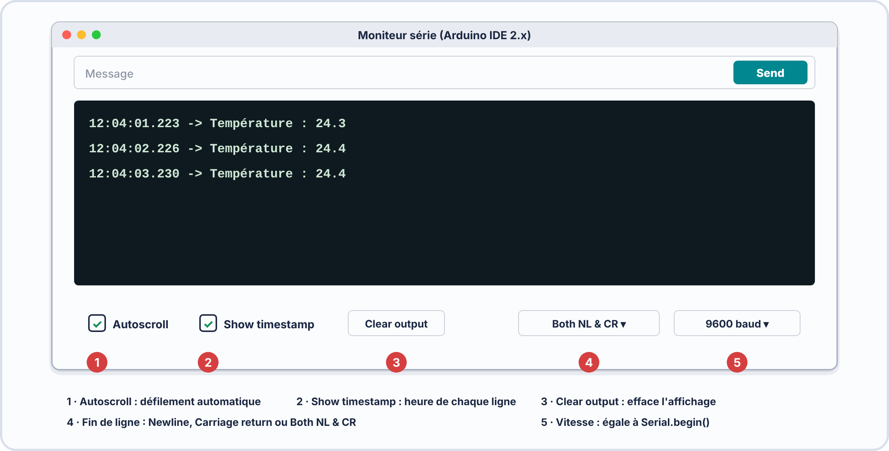
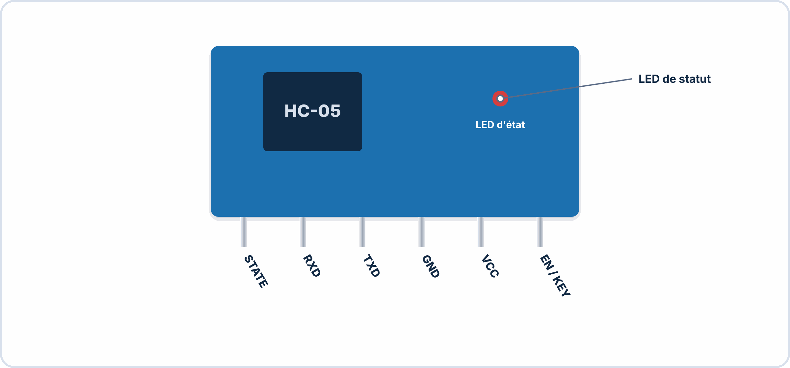
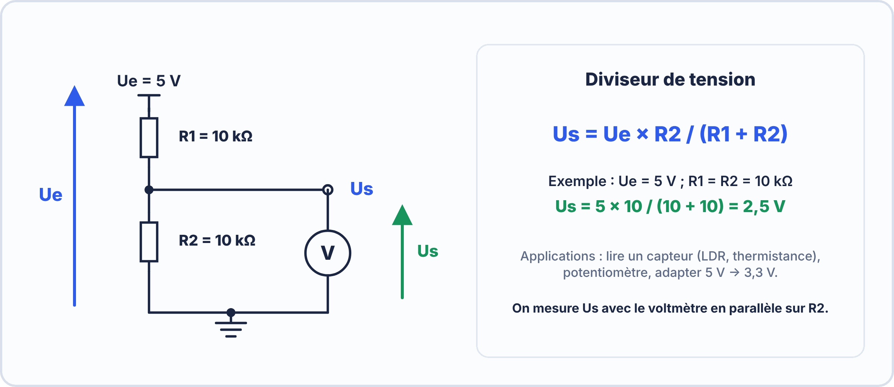

# 📘 FICHE DE COURS — S13 / Module E2
## Communication Série UART · Protocol & Timing · Serial Monitor Avancé · HC-05 Bluetooth

---

## 🗝️ Vocabulaire clé

| Terme | Définition |
|---|---|
| **UART** | Universal Asynchronous Receiver-Transmitter — protocole de communication série asynchrone |
| **Asynchrone** | Pas d'horloge partagée entre émetteur et récepteur — chacun génère sa propre horloge à la même fréquence |
| **Baud rate** | Vitesse de transmission en **symboles par seconde**. En UART binaire : 1 baud = 1 bit/s. 9600 bauds = 9600 bits/s. |
| **Trame UART** | Séquence de bits constituant la transmission d'un octet : start bit + data bits + parité (optionnelle) + stop bit(s) |
| **Start bit** | Bit de valeur **0** (LOW) signalant le début d'une trame — le seul moyen pour le récepteur de savoir qu'une trame commence |
| **Stop bit** | Bit de valeur **1** (HIGH) terminant la trame et garantissant un retour à l'état de repos |
| **Parité** | Bit optionnel de vérification d'erreur — pair (E) ou impair (O). Détecte les erreurs sur 1 bit uniquement. |
| **8N1** | Configuration standard : 8 bits de données, N = No parity (pas de parité), 1 stop bit |
| **LSB first** | En UART, le bit de poids faible (Least Significant Bit) est transmis en premier |
| **TX / RX** | Transmit (émission) / Receive (réception). **TX d'un appareil se connecte au RX de l'autre.** |
| **`Serial.available()`** | Retourne le nombre d'octets disponibles dans le tampon de réception UART de l'Arduino |
| **`Serial.read()`** | Lit UN octet depuis le tampon de réception |
| **`Serial.parseInt()`** | Lit un entier signé depuis le flux série (ignore les non-numériques en tête) |
| **`Serial.readStringUntil()`** | Lit une chaîne de caractères jusqu'au délimiteur indiqué (ex : `'\n'`) |
| **SoftwareSerial** | Bibliothèque Arduino simulant un port UART sur des broches numériques quelconques (D2–D13) |
| **HC-05** | Module Bluetooth série classique (SPP — Serial Port Profile) fonctionnant en 3,3V logique |
| **Mode AT** | Mode de configuration du HC-05 via commandes texte AT (type "AT+NAME=MonArduino") |
| **Diviseur de tension** | Réseau de deux résistances en série permettant d'abaisser une tension (ex : 5V → 3,3V) pour protéger la broche RX du HC-05 |
| **SPP** | Serial Port Profile — profil Bluetooth émulant une liaison série RS-232 sans fil |

---

## 1. Le protocole UART — Principe et structure de trame

### 1.1 Communication asynchrone : pas d'horloge commune


**Règle fondamentale :** TX d'un côté se branche sur RX de l'autre côté. Jamais TX sur TX.

L'Arduino Uno intègre un convertisseur USB-UART (ATmega16U2 ou CH340) qui gère automatiquement cette liaison quand on branche le câble USB. Le Serial Monitor s'y connecte directement.

### 1.2 Structure d'une trame UART 8N1


| Élément | Valeur logique | Durée à 9600 bauds | Rôle |
|---|---|---|---|
| **Repos** | 1 (HIGH) | Indéterminé | État de la ligne au repos |
| **Start bit** | 0 (LOW) | **104 µs** | Signale le début de la trame |
| **D0 à D7** | 0 ou 1 | 104 µs chacun | Les 8 bits de données (LSB en premier) |
| **Stop bit** | 1 (HIGH) | **104 µs** | Termine la trame, retour au repos |
| **Total 8N1** | — | $10 \times 104\,\mathrm{\mu s} = 1{,}04\,\mathrm{ms}$ | Durée de transmission d'un octet |

> ✏️ **Calcul de la durée d'un bit :** `T_bit = 1 / baud_rate`
> À 9600 bauds : `T_bit = 1 / 9600 = 104,2 µs`
> À 115200 bauds : `T_bit = 1 / 115200 = 8,7 µs`

### 1.3 Les 5 paramètres UART

> [!NOTE] Les 5 paramètres UART — TOUS doivent correspondre des deux côtés
>
> 1. BAUD RATE    : 300 / 1200 / 4800 / 9600 / 19200 / 38400 /  
>                  57600 / 115200 / 230400 / 921600 bauds  
>   → Standard Arduino : 9600 (débogage) ou 115200 (débit élevé)  
>
> 2. BITS DE DONNÉES : 5 / 6 / 7 / 8 (standard = 8)  
>
> 3. PARITÉ       : N (aucune) / E (paire) / O (impaire)  
>   → Standard Arduino : N (aucune parité)  
>
> 4. BITS DE STOP : 1 / 2 (standard = 1)  
>
> 5. CONTRÔLE DE FLUX : None / XON-XOFF (logiciel) / RTS-CTS (matériel)  
>   → Standard Arduino : None  
>
> Configuration résumée : 8N1 = [8 data][No parity][1 stop]  

### 1.4 Que se passe-t-il avec un mauvais baud rate ?

Si l'émetteur envoie à 57600 bauds mais le récepteur écoute à 9600 bauds : le récepteur découpe chaque bit 6× trop lentement. Là où l'émetteur a envoyé 10 bits (1 trame), le récepteur n'en a "vu" qu'à peine 2 — il reconstruit des octets qui ne correspondent à rien → **charabia**.

```
Tableau des baud rates communs et durées d'un octet (8N1) :

  9 600 bauds → T_bit = 104,2 µs → T_octet = 1,042 ms → débit utile = 960 octets/s
 19 200 bauds → T_bit =  52,1 µs → T_octet = 0,521 ms → débit utile = 1 920 octets/s
 57 600 bauds → T_bit =  17,4 µs → T_octet = 0,174 ms → débit utile = 5 760 octets/s
115 200 bauds → T_bit =   8,68 µs → T_octet = 0,087 ms → débit utile = 11 520 octets/s
```

---

## 2. Réception de données — Les fonctions Arduino

### 2.1 Le tampon de réception (buffer)

L'Arduino possède un tampon circulaire de **64 octets** pour stocker les données reçues avant que le programme les lise. Si ce tampon se remplit (programme trop lent), les nouvelles données sont perdues.

```cpp
// Vérifier s'il y a des données disponibles AVANT de lire
if (Serial.available() > 0) {
  // Des données sont dans le tampon — on peut lire
}
```

### 2.2 Fonctions de lecture — Tableau comparatif

| Fonction | Ce qu'elle lit | Délimiteur | Cas d'usage typique |
|---|---|---|---|
| `Serial.read()` | 1 seul octet (char) | — | Lire caractère par caractère |
| `Serial.parseInt()` | Entier signé (int) | Tout non-numérique | Lire un nombre envoyé depuis le terminal |
| `Serial.parseFloat()` | Flottant | Tout non-numérique | Lire une valeur décimale |
| `Serial.readStringUntil('\n')` | Chaîne jusqu'au saut de ligne | `'\n'` | Lire une commande texte complète |
| `Serial.readString()` | Toute la chaîne disponible | Timeout 1s | Lire un bloc complet |

### 2.3 Sketch de référence — Écho et interprétation de commandes

```cpp
/*
 * ÉCHO ET COMMANDES SÉRIE — S13 TP1+TP2
 * Renvoie tout ce qui est reçu ET interprète des commandes
 */
const int LED = 13;
String commande = "";

void setup() {
  pinMode(LED, OUTPUT);
  Serial.begin(9600);
  Serial.println("=== Système prêt. Commandes : LED_ON / LED_OFF / STATUS ===");
}

void loop() {
  // Lire une ligne complète si disponible
  if (Serial.available() > 0) {
    commande = Serial.readStringUntil('\n');  // Lire jusqu'au \n
    commande.trim();  // Supprimer espaces et \r résiduels

    // Interpréter la commande
    if (commande == "LED_ON") {
      digitalWrite(LED, HIGH);
      Serial.println("[OK] LED allumée");

    } else if (commande == "LED_OFF") {
      digitalWrite(LED, LOW);
      Serial.println("[OK] LED éteinte");

    } else if (commande == "STATUS") {
      Serial.print("[INFO] LED = ");
      Serial.println(digitalRead(LED) ? "ON" : "OFF");
      Serial.print("[INFO] Uptime = ");
      Serial.print(millis() / 1000);
      Serial.println(" secondes");

    } else {
      Serial.print("[ERREUR] Commande inconnue : '");
      Serial.print(commande);
      Serial.println("'");
    }

    commande = "";  // Réinitialiser pour la prochaine commande
  }
}
```

> ⚠️ **`commande.trim()`** est essentiel. Sur Windows, les sauts de ligne sont `\r\n` (CRLF). Sans `trim()`, la commande reçue est `"LED_ON\r"` — la comparaison avec `"LED_ON"` échoue silencieusement. C'est l'un des bugs les plus fréquents en communication série.

### 2.4 Sketch TP3 — Parser numérique avec PWM

```cpp
/*
 * PARSER NUMÉRIQUE + PWM — S13 TP3
 * Envoyer un nombre 0-255 via Serial Monitor
 * → la LED s'allume à cette luminosité via PWM (D~9)
 */
const int LED_PWM = 9;  // Broche PWM (~ obligatoire)

void setup() {
  pinMode(LED_PWM, OUTPUT);
  Serial.begin(9600);
  Serial.println("Envoyer un nombre 0-255 pour régler la luminosité :");
}

void loop() {
  if (Serial.available() > 0) {
    int valeur = Serial.parseInt();   // Lit l'entier envoyé

    // Valider et appliquer
    valeur = constrain(valeur, 0, 255);   // Borner entre 0 et 255
    analogWrite(LED_PWM, valeur);

    Serial.print("[PWM] Valeur appliquée : ");
    Serial.print(valeur);
    Serial.print(" / 255  (");
    Serial.print(valeur * 100 / 255);
    Serial.println("%)");
  }
}
```

---

## 3. Le Serial Monitor avancé

### 3.1 Paramètres du Serial Monitor Arduino IDE



| Contrôle | Options | Impact sur la réception |
|---|---|---|
| **Newline selector** | "No line ending" / "Newline" / "Carriage return" / "Both NL & CR" | Détermine quel(s) caractère(s) sont ajoutés à la fin du texte envoyé. Avec `readStringUntil('\n')` → choisir **"Newline"** |
| **Baud rate** | 300 à 921600 | Doit correspondre à `Serial.begin()` dans le code |
| **Show timestamp** | ON/OFF | Affiche l'heure de réception — utile pour mesurer les intervalles |
| **Autoscroll** | ON/OFF | Fait défiler vers le bas automatiquement — désactiver pour analyser des trames passées |

> ⚠️ **Newline selector et `readStringUntil('\n')`** : Si le Serial Monitor n'envoie pas de `'\n'` (option "No line ending"), `readStringUntil('\n')` attend indéfiniment → le programme semble gelé. Toujours vérifier ce paramètre en premier lors d'un bug de réception.

### 3.2 Outils tiers — PuTTY et autres terminaux série

Pour les tests avancés (mode AT du HC-05, protocoles industriels), utiliser un terminal série dédié :

| Logiciel | Plateforme | Avantages |
|---|---|---|
| **PuTTY** | Windows | Gratuit, léger, connexion directe sur port COM |
| **CoolTerm** | Win/Mac | Interface graphique, log vers fichier, hex view |
| **minicom** | Linux/Mac | Ligne de commande, scriptable |
| **Tera Term** | Windows | Macro intégrée, protocoles TELNET/SSH aussi |

**Configuration PuTTY pour UART :**
```
Connection type : Serial
Serial line     : COMx (vérifier dans le Gestionnaire de périphériques)
Speed           : 9600 (ou baud rate de votre sketch)
Data bits       : 8
Stop bits       : 1
Parity          : None
Flow control    : None
```

---

## 4. Le module HC-05 — Bluetooth série (préparation S14)

### 4.1 Présentation et caractéristiques



| Broche HC-05 | Connexion Arduino | Remarque |
|---|---|---|
| VCC | 5V Arduino | Alimentation (régulateur interne 3,3V intégré) |
| GND | GND | Masse commune |
| **TXD** | **RX Arduino (D10 avec SoftwareSerial)** | Sortie 3,3V — compatible entrée 5V Arduino |
| **RXD** | **TX Arduino (D11) via diviseur !** | **Entrée 3,3V MAX — protéger avec diviseur** |
| KEY | GND ou bouton vers GND | Maintenir à GND pour forcer le mode AT |
| STATE | Optionnel | Indicateur d'état connexion Bluetooth |

### 4.2 Le diviseur de tension 5V → 3,3V (protection RXD)



Calcul du diviseur :  

$$V_{\mathrm{out}} = V_{\mathrm{in}} \times \dfrac{R_{2}}{R_{1} + R_{2}}$$

$$V_{\mathrm{out}} = 5 \times \dfrac{2000}{1000 + 2000} = 5 \times \dfrac{2}{3} = 3{,}33\,\mathrm{V} \;\checkmark$$

### 4.3 SoftwareSerial — Utiliser des broches alternatives pour UART

```cpp
#include <SoftwareSerial.h>

// Créer un port série logiciel sur D10 (RX) et D11 (TX)
SoftwareSerial btSerial(10, 11);  // RX=D10, TX=D11

void setup() {
  Serial.begin(9600);        // Port série matériel (USB ↔ PC)
  btSerial.begin(38400);     // Port série logiciel (Arduino ↔ HC-05 mode AT)
  Serial.println("HC-05 prêt. Envoyer des commandes AT :");
}

void loop() {
  // Relayer du PC vers le HC-05
  if (Serial.available()) {
    btSerial.write(Serial.read());
  }

  // Relayer du HC-05 vers le PC
  if (btSerial.available()) {
    Serial.write(btSerial.read());
  }
}
```

> 📌 Ce sketch "passerelle" relaie tout entre le Serial Monitor et le HC-05 — permettant de taper des commandes AT dans le Serial Monitor et de voir les réponses du module.

### 4.4 Commandes AT du HC-05

En **mode AT** (broche KEY maintenue à GND ou niveau bas au démarrage), le HC-05 répond à des commandes texte à **38400 bauds** :

| Commande | Réponse attendue | Utilité |
|---|---|---|
| `AT` | `OK` | Test de communication — vérifier que le mode AT est actif |
| `AT+NAME?` | `+NAME:HC-05` | Lire le nom Bluetooth actuel |
| `AT+NAME=MonArduino` | `OK` | Changer le nom Bluetooth visible |
| `AT+BAUD?` | `+BAUD:4` | Lire le baud rate (4 = 9600) |
| `AT+BAUD8` | `OK` | Passer le baud rate à 115200 (code 8) |
| `AT+PSWD?` | `+PSWD:1234` | Lire le code PIN d'appairage |
| `AT+PSWD=0000` | `OK` | Changer le code PIN |
| `AT+ROLE?` | `+ROLE:0` | Lire le rôle (0=esclave, 1=maître) |
| `AT+RESET` | `OK` | Redémarrer le module |
| `AT+VERSION?` | `+VERSION:x.x-xx` | Lire la version du firmware |

**Tableau des codes baud rate HC-05 :**

| Code AT | Baud rate | Usage |
|---|---|---|
| 1 | 1200 | — |
| 2 | 2400 | — |
| 3 | 4800 | — |
| **4** | **9600** | **Standard Arduino** |
| 5 | 19200 | — |
| 6 | 38400 | Mode AT |
| 7 | 57600 | — |
| **8** | **115200** | **Haut débit** |

### 4.5 Schéma de câblage complet Arduino + HC-05


---

## 5. Débogage d'une liaison série — Méthode systématique

### 5.1 Checklist de débogage UART en 6 points

> [!NOTE] CHECKLIST DÉBOGAGE UART — À consulter en cas de problème
>
> □ 1. BAUD RATE identique des deux côtés ?  
>     → Serial.begin(X) == baud rate du terminal  
>
> □ 2. TX et RX bien croisés ?  
>     → TX Arduino ↔ RX autre appareil (jamais TX-TX)  
>
> □ 3. Newline selector correct dans le Serial Monitor ?  
>     → "Newline" si readStringUntil('\n'), "No line ending" si read()  
>
> □ 4. commande.trim() appelé après readStringUntil() ?  
>     → Élimine les \r résiduels (Windows CRLF)  
>
> □ 5. Serial.available() vérifié avant toute lecture ?  
>     → Évite le blocage sur une attente de données inexistantes  
>
> □ 6. Pour HC-05 : diviseur de tension sur RXD et mode AT correct ?  
>     → Vérifier que KEY est bien à GND et baud rate = 38400 en AT  

### 5.2 Tableau des symptômes et diagnostics

| Symptôme | Cause probable | Correction |
|---|---|---|
| Charabia dans le Serial Monitor | Mauvais baud rate | Vérifier `Serial.begin()` et baud rate terminal |
| Rien ne s'affiche | Serial Monitor ouvert pendant téléversement / mauvais port COM | Fermer SM avant téléversement, rouvrir après |
| Commande non reconnue (String) | `\r` résiduel (Windows) | Ajouter `commande.trim()` |
| `readStringUntil()` bloque | Pas de `\n` envoyé | Régler Newline selector sur "Newline" |
| `Serial.parseInt()` renvoie 0 | Tampon vide ou données non numériques | Vérifier `Serial.available()` + données envoyées |
| HC-05 ne répond pas aux AT | Baud rate incorrect ou mode AT non actif | Vérifier KEY=GND + baud rate = 38400 |
| HC-05 reçoit des données corrompues | Absence de diviseur de tension | Ajouter diviseur 1kΩ/2kΩ sur RXD |

---

## ✅ Compétences RNCP travaillées

| Code | Compétence | Niveau |
|---|---|---|
| C2.7 | Programme embarqué avec communication série | ⭐⭐⭐ Maîtrise |
| C2.8 | Tester et déboguer une liaison UART | ⭐⭐⭐ Maîtrise |
| C2.9 | Configurer un module Bluetooth HC-05 | ⭐⭐ Application |
| C3.1 | Documenter chronogrammes et trames | ⭐⭐ Application |

---

## 📝 Mémo rapide

| Je dois... | Je retiens... |
|---|---|
| Calculer la durée d'un bit | $T_{\mathrm{bit}}$ = 1 / baud_rate (en secondes) |
| Structure trame 8N1 | Start(0) + D0..D7 + Stop(1) = 10 bits au total |
| Lire une commande texte | `readStringUntil('\n')` + `.trim()` + vérifier "Newline" dans le SM |
| Lire un entier | `Serial.parseInt()` après `Serial.available() > 0` |
| Configurer HC-05 | `btSerial.begin(38400)` en mode AT, KEY à GND |
| Protéger le HC-05 | Diviseur 1kΩ/2kΩ sur RXD : V = 5 × 2/3 = 3,33V |
| Commandes AT essentielles | `AT` → OK · `AT+NAME?` · `AT+BAUD?` · `AT+RESET` |

---

*BAC Pro CIEL — S13 Module E2 | MFR de Pontonx | © Yahn LE PRETTRE*
