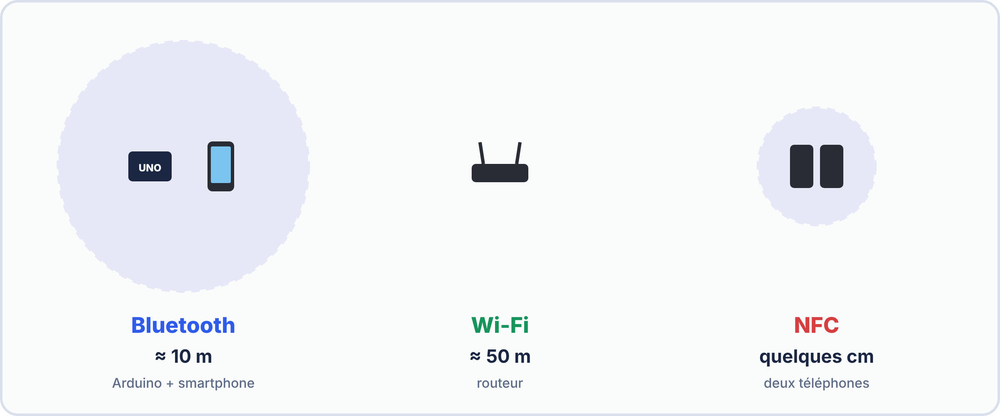
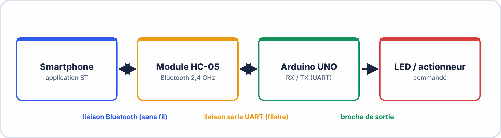
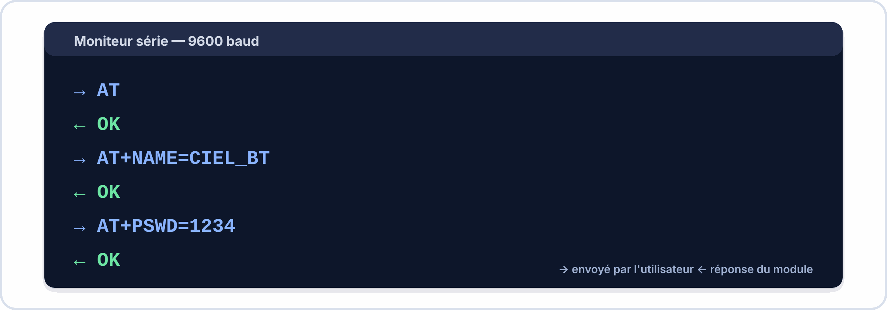
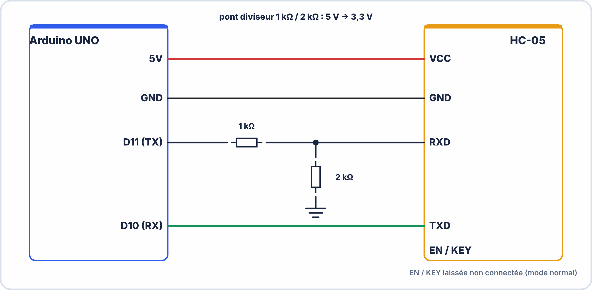
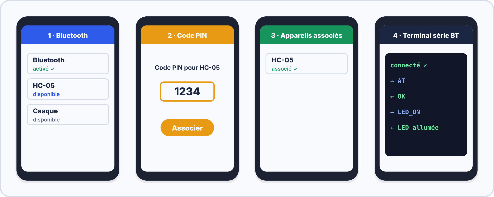

# 📘 FICHE DE COURS ÉLÈVE — S14
## Bluetooth HC-05 : AT commands, appairage & communication Arduino ↔ Smartphone

---

> **Compétences travaillées** : C2.3 – C3.1 – C3.2  
> **Durée de lecture guidée** : ~45 minutes  
> **Prérequis** : Communication série UART (S10-S12)

---

## 🗂️ Sommaire

1. Le Bluetooth — rappels essentiels
2. Le module HC-05 — description et broches
3. Le protocole série sans fil
4. Le mode AT — configurer le HC-05
5. Câblage Arduino + HC-05
6. Sketch Arduino commenté
7. L'appairage avec un smartphone
8. Vocabulaire clé à maîtriser


### 🤔 À ton avis ?

Ton casque sans fil reçoit la musique de ton téléphone sans aucun câble. Comment l'Arduino pourrait-il, lui aussi, **échanger avec un smartphone** ?

??? question "Voir une réponse possible"
    Avec un **module Bluetooth** comme le **HC-05** : il se comporte comme un **câble série sans fil**. L'Arduino lui envoie des caractères par ses broches TX/RX, et le module les transmet par radio au téléphone.
    
    Dans cette séance, tu apprends à **configurer** le HC-05 (commandes AT), à le **câbler** sans l'abîmer et à l'**appairer** avec ton smartphone.

---

## 1. Le Bluetooth — Rappels essentiels

Le **Bluetooth** est une technologie de communication **sans fil à courte portée** (généralement jusqu'à **10 mètres** pour le HC-05, parfois jusqu'à 30 m en environnement dégagé).

Il fonctionne sur la bande de fréquences **2,4 GHz** (comme le Wi-Fi, mais avec une consommation bien plus faible).

| Caractéristique | Valeur HC-05 |
|---|---|
| Fréquence | 2,4 GHz |
| Portée typique | 10 m (classe 2) |
| Débit max | ~3 Mbps (Bluetooth 2.0) |
| Tension d'alimentation | **3,3 V à 5 V** (VCC) |
| Tension logique TX/RX | **3,3 V** ⚠️ |
| Version Bluetooth | 2.0 + EDR |

> 💡 **Analogie** : Le Bluetooth, c'est comme une "prise USB invisible". Tu branches deux appareils sans câble, et ils échangent des données comme s'ils étaient reliés directement.


> [!TIP] 💡 En clair
> Le **Bluetooth** est une liaison radio **courte portée** (une dizaine de mètres), qui consomme peu. Deux appareils doivent d'abord être **appairés** (ils se reconnaissent avec un code), puis ils peuvent échanger des données.

### ✅ Vérifie que tu as compris

**Q1.** Que signifie « appairer » deux appareils ?

??? success "Réponse"
    Les faire **se reconnaître** (avec un code PIN) pour qu'ils puissent communiquer.

**Q2.** Quelle est la portée typique du Bluetooth ?

??? success "Réponse"
    Une **dizaine de mètres**.

---



---

## 2. Le module HC-05 — Description et broches

Le **HC-05** est un module Bluetooth **esclave/maître** (configurable). Il est très utilisé dans les projets Arduino car il simule une liaison série classique, mais sans fil.

### 2.1 Vue du module


### 2.2 Description des broches

| Broche | Nom complet | Rôle |
|---|---|---|
| **VCC** | Voltage Common Collector | Alimentation +3,3V ou +5V |
| **GND** | Ground | Masse (0V) |
| **TXD** | Transmit Data | Émission de données vers l'Arduino |
| **RXD** | Receive Data | Réception de données depuis l'Arduino (**3,3V max !**) |
| **STATE** | État | Indique si une connexion Bluetooth est établie (HIGH = connecté) |
| **EN / KEY** | Enable / Key | Mettre à HIGH pour entrer en **mode AT** (configuration) |

> ⚠️ **ATTENTION** : La broche **RXD** du HC-05 supporte **3,3 V maximum**. Si l'Arduino envoie du 5 V directement, tu risques d'endommager le module. Il faut utiliser un **pont diviseur de tension**.


> [!TIP] 💡 En clair
> Le HC-05 possède **6 broches** : **VCC**, **GND**, **TXD**, **RXD**, **STATE** et **EN/KEY**. Retiens surtout : **TXD** (il envoie) va vers **RX** de l'Arduino ; **RXD** (il reçoit) va vers **TX** de l'Arduino, **avec un diviseur de tension** car RXD ne supporte que **3,3 V**.

> [!WARNING] ⚠️ Erreurs fréquentes
> - Brancher RXD directement sur le 5 V de l'Arduino : le module peut être **endommagé**.

### ✅ Vérifie que tu as compris

**Q1.** Où branche-t-on la broche TXD du HC-05 ?

??? success "Réponse"
    Sur la broche **RX** de l'Arduino.

**Q2.** Quelle broche demande un diviseur de tension ?

??? success "Réponse"
    **RXD**, car elle ne supporte que **3,3 V**.

> [!SUCCESS] 🧠 À retenir
> - TXD → RX ; RXD → TX (avec diviseur).

---

## 3. Le protocole série sans fil

### 3.1 Comment fonctionne l'échange de données ?

Le HC-05 utilise en interne le protocole **SPP (Serial Port Profile)** du Bluetooth. Pour l'Arduino (et pour toi), c'est **transparent** : tu envoies des octets sur la liaison série, et le HC-05 les transmet sans fil.



### 3.2 Comparaison : liaison série filaire vs sans fil

| Critère | UART filaire (USB) | UART sans fil (HC-05) |
|---|---|---|
| Support physique | Câble USB / fils Dupont | Ondes radio 2,4 GHz |
| Distance max | Quelques mètres (câble) | ~10 m |
| Programmation Arduino | `Serial.begin()` | `SoftwareSerial.begin()` |
| Débit typique | 9600 à 115200 bauds | 9600 à 115200 bauds |
| Protocole applicatif | UART brut | UART via SPP Bluetooth |


> [!TIP] 💡 En clair
> Le HC-05 **transmet en radio** ce que tu lui envoies en série. Pour l'Arduino, **parler au HC-05 ou au PC, c'est la même chose** : on utilise `Serial` ou `SoftwareSerial`, avec les mêmes fonctions qu'en S13.

### ✅ Vérifie que tu as compris

**Q1.** Pourquoi utilise-t-on `SoftwareSerial` avec le HC-05 ?

??? success "Réponse"
    Pour garder le port série matériel (USB) libre pour le **PC** pendant que le HC-05 utilise **deux autres broches**.

---

## 4. Le mode AT — Configurer le HC-05

### 4.1 Qu'est-ce que le mode AT ?

Les **commandes AT** (du mot « ATtention ») sont un langage de configuration inventé dans les années 1980 pour les modems. Le HC-05 les utilise pour être configuré.

> 💡 **Analogie** : Imagine que ton module HC-05 est un téléphone portable neuf. Avant de pouvoir appeler, tu dois configurer le nom du réseau, le mot de passe... Le mode AT, c'est l'accès au menu de configuration caché du module.

### 4.2 Comment entrer en mode AT ?

**Méthode 1 – Bouton EN/KEY avant la mise sous tension :**

1. Maintenir la broche **EN/KEY à HIGH** (relier à 3,3V)
2. Puis alimenter le module (brancher VCC)
3. La LED clignote **lentement** (2 secondes par flash) → mode AT activé ✅

**Méthode 2 – Connexion directe PC (via adaptateur USB-TTL) :**

1. Relier HC-05 directement à un adaptateur USB-TTL 3,3V
2. Ouvrir le moniteur série à **38400 bauds** avec "Pas de terminateur de ligne" → "Les deux, NL & CR"

> 📌 **Règle importante** : En mode AT normal, la liaison fonctionne à **38400 bauds**. Une fois configuré et en mode communication, le module utilise le baudrate que tu as défini (par défaut **9600 bauds**).

### 4.3 Tableau des commandes AT essentielles

| Commande | Description | Exemple | Réponse attendue |
|---|---|---|---|
| `AT` | Test de communication | `AT` | `OK` |
| `AT+NAME?` | Lire le nom actuel | `AT+NAME?` | `+NAME:HC-05` |
| `AT+NAME=XXXXX` | Changer le nom | `AT+NAME=CIEL_BT` | `OK` |
| `AT+PSWD?` | Lire le code PIN | `AT+PSWD?` | `+PSWD:1234` |
| `AT+PSWD=XXXX` | Changer le PIN | `AT+PSWD=5678` | `OK` |
| `AT+UART?` | Lire le baudrate | `AT+UART?` | `+UART:9600,0,0` |
| `AT+UART=9600,0,0` | Définir le baudrate | `AT+UART=9600,0,0` | `OK` |
| `AT+ROLE?` | Lire le rôle (0=esclave, 1=maître) | `AT+ROLE?` | `+ROLE:0` |
| `AT+RESET` | Redémarrer le module | `AT+RESET` | `OK` |
| `AT+VERSION?` | Lire la version du firmware | `AT+VERSION?` | `+VERSION:2.0-20100601` |




> [!TIP] 💡 En clair
> Les **commandes AT** servent à **configurer** le module (nom, code PIN, vitesse). On les envoie **en mode AT** : on met la broche **EN/KEY à l'état haut** au moment de l'alimentation, et la LED clignote **lentement** (environ toutes les 2 secondes). La vitesse du mode AT est de **38 400 bauds**. Chaque commande se termine par **retour à la ligne** : règle le moniteur sur « NL & CR ».

> [!WARNING] ⚠️ Erreurs fréquentes
> - Rester à 9600 bauds dans le moniteur : le module **ne répond pas**.
> - Oublier « NL & CR » : la commande n'est pas validée.

### ✅ Vérifie que tu as compris

**Q1.** Comment reconnaît-on que le HC-05 est en mode AT ?

??? success "Réponse"
    La LED clignote **lentement** (environ toutes les 2 s).

**Q2.** À quelle vitesse communique-t-on avec le HC-05 en mode AT ?

??? success "Réponse"
    **38 400 bauds**.

**Q3.** Que répond le module à la commande `AT` ?

??? success "Réponse"
    `OK`.

> [!SUCCESS] 🧠 À retenir
> - Mode AT : KEY à l'état haut, LED lente, 38 400 bauds, « NL & CR ».

---

## 5. Câblage Arduino UNO + HC-05

### 5.1 Schéma de câblage (mode communication, SoftwareSerial)



### 5.2 Table de câblage

| Broche Arduino UNO | Connexion | Broche HC-05 |
|---|---|---|
| **5V** | Fil rouge direct | **VCC** |
| **GND** | Fil noir direct | **GND** |
| **Pin 11 (TX soft)** | Via pont diviseur (**1kΩ + 2kΩ**) | **RXD** |
| **Pin 10 (RX soft)** | Fil direct (3,3 V logique OK) | **TXD** |
| **3,3V** | Optionnel – si mode AT activé | **EN/KEY** |

> 🧮 **Calcul du pont diviseur** :
> On veut réduire 5V à 3,3V avec R1 = 1kΩ et R2 = 2kΩ :
> 
> `V_sortie = 5V × R2 / (R1 + R2) = 5 × 2000 / 3000 = 3,33 V ✅`


> [!TIP] 💡 En clair
> Avant d'alimenter, **vérifie ton câblage** : alimentation, **masse commune**, TX/RX **croisés**, diviseur de tension sur RXD. Un câblage vérifié évite de détruire un module.

### ✅ Vérifie que tu as compris

**Q1.** Quelles sont les trois vérifications avant d'alimenter ?

??? success "Réponse"
    **Alimentation correcte**, **masse commune**, **TX/RX croisés** (avec diviseur sur RXD).

---

## 6. Sketch Arduino commenté

```cpp
// ============================================
// S14 – Bluetooth HC-05 ↔ Arduino ↔ Smartphone
// Auteur : [Ton nom]    Date : [Date]
// ============================================


> [!TIP] 💡 En clair
> Dans le sketch, on **lit** ce qui arrive du HC-05 pour **commander** quelque chose (par exemple une LED), et on **renvoie** une réponse au téléphone. Teste chaque partie **séparément** avant de les assembler.

### ✅ Vérifie que tu as compris

**Q1.** Pourquoi teste-t-on le sketch par morceaux ?

??? success "Réponse"
    Pour **localiser** facilement l'erreur si ça ne marche pas.

#include <SoftwareSerial.h>      // Bibliothèque pour créer un port série logiciel

// Déclaration du port série logiciel
// Pin 10 = RX Arduino (reçoit les données du HC-05)
// Pin 11 = TX Arduino (envoie les données vers HC-05 via pont diviseur)
SoftwareSerial bluetooth(10, 11);

void setup() {
  // Démarrage de la liaison série matérielle (pour le moniteur PC)
  Serial.begin(9600);

  // Démarrage de la liaison Bluetooth (doit correspondre au baudrate AT configuré)
  bluetooth.begin(9600);

  // Message de démarrage visible dans le moniteur série du PC
  Serial.println("=== Système Bluetooth prêt ===");
  Serial.println("Envoyez '1' pour allumer la LED, '0' pour l'éteindre.");

  // La LED intégrée de l'Arduino (pin 13) sera notre actionneur de test
  pinMode(13, OUTPUT);
  digitalWrite(13, LOW);
}

void loop() {
  
  // ---- RÉCEPTION depuis le smartphone ----
  if (bluetooth.available()) {               // Si des données arrivent du HC-05
    char recu = bluetooth.read();            // On lit le caractère reçu
    
    Serial.print("📱 Reçu du smartphone : "); // Affichage moniteur PC
    Serial.println(recu);

    if (recu == '1') {
      digitalWrite(13, HIGH);               // Allume la LED
      bluetooth.println("LED allumée !");   // Confirmation vers le smartphone
    }
    if (recu == '0') {
      digitalWrite(13, LOW);                // Éteint la LED
      bluetooth.println("LED éteinte !");   // Confirmation vers le smartphone
    }
  }

  // ---- ÉMISSION depuis le moniteur PC vers le smartphone ----
  if (Serial.available()) {                  // Si tu tapes dans le moniteur PC
    bluetooth.write(Serial.read());          // On transmet au smartphone
  }
}
```

---

## 7. L'appairage avec un smartphone

L'**appairage** (ou *pairing* en anglais) est le processus par lequel deux appareils Bluetooth se reconnaissent et s'autorisent mutuellement à communiquer.

### Étapes d'appairage Android (Serial Bluetooth Terminal)



| Étape | Action à réaliser | Résultat attendu |
|---|---|---|
| **1** | Activer le Bluetooth sur le smartphone | Icône Bluetooth visible dans la barre |
| **2** | Ouvrir *Serial Bluetooth Terminal* → Menu → Devices | Liste des appareils disponibles |
| **3** | Sélectionner **HC-05** (ou le nom que tu as configuré) | Demande de PIN |
| **4** | Saisir le PIN : **1234** (ou celui que tu as configuré) | "Appareil jumelé" |
| **5** | Dans l'app, appuyer sur **Connect** | LED du HC-05 : clignotement lent → allumée fixe |
| **6** | Taper `1` puis **Envoyer** | La LED 13 de l'Arduino s'allume |
| **7** | Taper `0` puis **Envoyer** | La LED 13 s'éteint |


> [!TIP] 💡 En clair
> Pour **appairer** : active le Bluetooth du téléphone, **cherche** « HC-05 », saisis le **code PIN** (par défaut **1234**), puis ouvre une **application de terminal Bluetooth**. Tu peux alors **envoyer et recevoir** des caractères.

### ✅ Vérifie que tu as compris

**Q1.** Quel est le code PIN par défaut d'un HC-05 ?

??? success "Réponse"
    **1234**.

**Q2.** Que faut-il installer sur le smartphone pour échanger des caractères ?

??? success "Réponse"
    Une **application de terminal Bluetooth** (série).

> [!SUCCESS] 🧠 À retenir
> - Appairage : chercher HC-05, PIN 1234, application de terminal.

---

## 8. Vocabulaire clé à maîtriser pour l'examen

| Terme | Définition |
|---|---|
| **Bluetooth** | Protocole de communication sans fil à courte portée (2,4 GHz, ≤ 10 m) |
| **HC-05** | Module Bluetooth économique configurable en maître ou esclave, interface UART |
| **UART** | Universal Asynchronous Receiver-Transmitter — protocole de communication série asynchrone |
| **SoftwareSerial** | Bibliothèque Arduino permettant de créer un port série sur n'importe quelles broches numériques |
| **Commandes AT** | Jeu d'instructions de configuration envoyées en texte au module (ex : `AT+NAME=X`) |
| **Mode AT** | Mode de configuration du HC-05, activé en maintenant la broche EN/KEY à HIGH à la mise sous tension |
| **Appairage (Pairing)** | Processus de reconnaissance et d'authentification entre deux appareils Bluetooth via un PIN |
| **SPP** | Serial Port Profile — profil Bluetooth qui émule une liaison série entre deux appareils |
| **Bauds** | Unité de débit de la liaison série (nombre de symboles par seconde) |
| **Pont diviseur** | Circuit résistif permettant de réduire une tension (ex : 5V → 3,3V) |
| **Master / Slave** | Rôles Bluetooth : le Master initie la connexion, le Slave attend (HC-05 est Slave par défaut) |
| **Portée** | Distance maximale à laquelle la communication reste fonctionnelle |

---

> 📌 **Retiens l'essentiel en 4 points :**
> 1. Le HC-05 **transforme une liaison série en liaison Bluetooth** — c'est tout !
> 2. Il faut **configurer** le module en mode AT avant de l'utiliser (nom, PIN, baudrate)
> 3. La broche RXD du HC-05 ne supporte que **3,3V** → pont diviseur obligatoire avec Arduino 5V
> 4. L'appairage crée un **lien de confiance** entre deux appareils pour qu'ils communiquent

---

*Fiche Cours Élève — BAC PRO CIEL | Module E2 | S14*  
*Compétences : C2.3 – C3.1 – C3.2*
