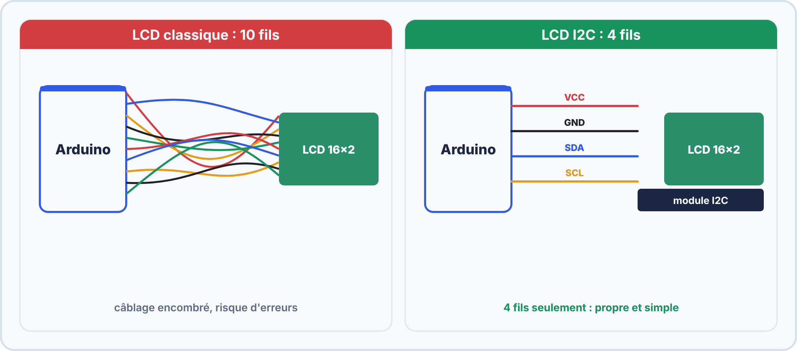
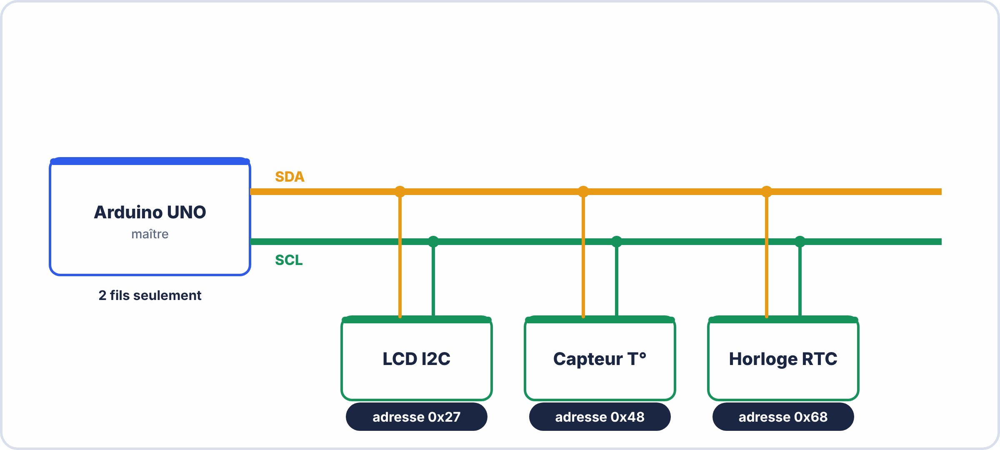
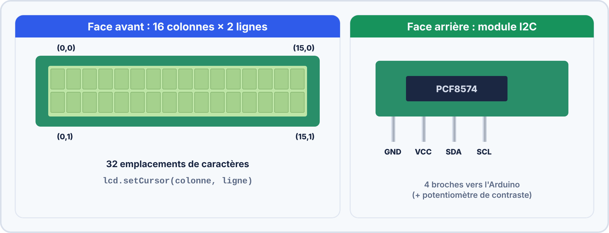
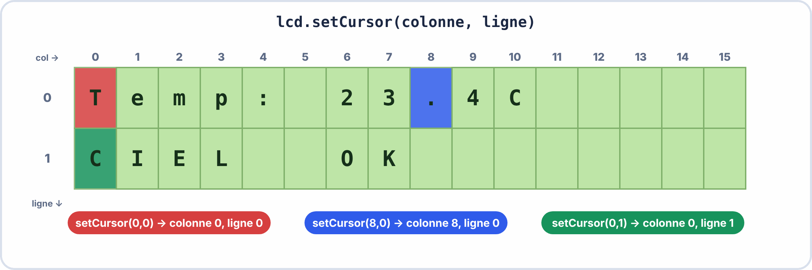
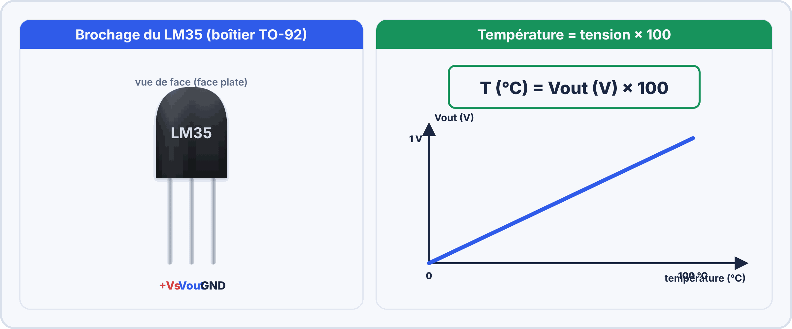
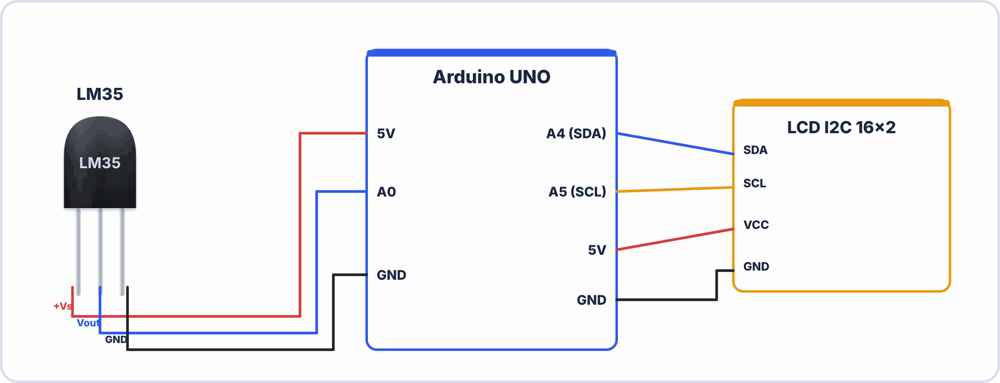
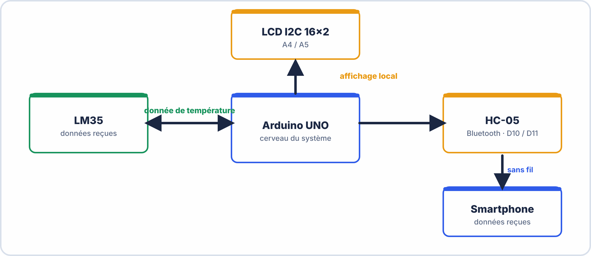

# 📘 FICHE DE COURS ÉLÈVE — S15
## LCD I2C : bibliothèque & affichage · Intégration LM35 · Proto maquette final

---

> **Compétences travaillées** : C2.1 – C3.1 – C3.2 – C4.1
> **Durée de lecture guidée** : ~45 minutes
> **Prérequis** : S9 (capteur LM35, `analogRead`), S14 (HC-05, `SoftwareSerial`)

---

## 🗂️ Sommaire

1. Le protocole I2C — principe et intérêt
2. L'écran LCD 16×2 avec module I2C
3. La bibliothèque LiquidCrystal_I2C — installation et fonctions
4. Rappel : le capteur LM35 (S9)
5. Intégration LM35 → LCD : afficher la température en temps réel
6. Intégration complète : LM35 + LCD + HC-05
7. Structure du proto maquette final
8. Vocabulaire clé à maîtriser


### 🤔 À ton avis ?

Ton Arduino sait calculer une température, mais personne ne la voit… Comment **afficher** le résultat sur un petit écran **sans utiliser une dizaine de broches** ?

??? question "Voir une réponse possible"
    Avec un écran LCD équipé d'un **module I2C** : il ne demande que **deux fils de données** (SDA et SCL) au lieu de plus de dix. Il suffit ensuite de **deux fils d'alimentation**.
    
    Dans cette séance, tu apprends à **comprendre l'I2C**, à **afficher du texte** sur un LCD 16×2 et à y montrer la **température du LM35**.

---

## 1. Le protocole I2C — principe et intérêt

### 1.1 Pourquoi I2C ?

Sans I2C, un écran LCD classique (sans module I2C) nécessite **jusqu'à 10 broches** de l'Arduino. C'est énorme sur un projet avec plusieurs composants !

Le protocole **I2C** (Inter-Integrated Circuit, prononcé "I-deux-C" ou "I-carré-C") réduit cette connexion à **seulement 2 fils**, quel que soit le nombre de composants connectés.



### 1.2 Les deux fils du bus I2C

| Fil | Nom complet | Rôle |
|---|---|---|
| **SDA** | Serial Data | Transmission des données (bidirectionnel) |
| **SCL** | Serial Clock | Signal d'horloge — synchronise les échanges |

> 💡 **Analogie** : Imagine une grande salle de classe. Le professeur (Arduino = **maître**) pose des questions. Chaque élève a un numéro de siège (son **adresse I2C**). Quand le prof dit "numéro 39, réponds", seul l'élève 39 répond. Tous parlent sur le **même micro** (SDA), mais chacun attend d'être appelé. L'horloge (SCL), c'est le rythme imposé par le prof pour que tout le monde soit synchronisé.

### 1.3 Le bus I2C : maître et esclaves



| Rôle | Qui ? | Nombre |
|---|---|---|
| **Maître** | Arduino | 1 seul (en général) |
| **Esclave** | LCD, capteurs, modules… | Jusqu'à 127 par bus |

**Broches I2C sur Arduino UNO :**

| Broche Arduino | Fonction I2C |
|---|---|
| **A4** | SDA |
| **A5** | SCL |

> ⚠️ Sur Arduino UNO, **ne pas utiliser A4 et A5 comme entrées analogiques** si tu utilises I2C — elles sont réservées au bus.


> [!TIP] 💡 En clair
> L'**I2C** est un protocole à **deux fils** : **SDA** (les données) et **SCL** (l'horloge). Plusieurs appareils peuvent partager **les mêmes deux fils**, chacun étant repéré par une **adresse** (souvent `0x27` ou `0x3F` pour un écran LCD). Sur l'Arduino Uno : **SDA = A4**, **SCL = A5**.

### ✅ Vérifie que tu as compris

**Q1.** Quels sont les deux fils de l'I2C ?

??? success "Réponse"
    **SDA** (données) et **SCL** (horloge).

**Q2.** À quoi sert l'adresse I2C ?

??? success "Réponse"
    À **repérer** chaque appareil sur les mêmes deux fils.

**Q3.** Sur quelles broches de l'Arduino Uno trouve-t-on SDA et SCL ?

??? success "Réponse"
    **SDA = A4** et **SCL = A5**.

> [!WARNING] ⚠️ Erreurs fréquentes
> - Se tromper d'adresse (`0x27` ou `0x3F`) : l'écran reste éteint ou vide.
> - Intervertir SDA et SCL.

> [!SUCCESS] 🧠 À retenir
> - I2C = 2 fils (SDA, SCL) + une adresse par appareil.

---

## 2. L'écran LCD 16×2 avec module I2C

### 2.1 Description du composant



| Caractéristique | Valeur |
|---|---|
| Format d'affichage | 16 colonnes × 2 lignes = 32 caractères |
| Tension d'alimentation | 5V (VCC) |
| Protocole de communication | I2C via module PCF8574 |
| Adresse I2C typique | **0x27** ou **0x3F** (selon le fabricant) |
| Rétroéclairage | Contrôlable via bibliothèque |
| Contraste | Réglable par potentiomètre au dos |

### 2.2 Câblage LCD I2C → Arduino UNO

| Broche LCD I2C | → | Broche Arduino UNO |
|---|---|---|
| **VCC** | Fil rouge | **5V** |
| **GND** | Fil noir | **GND** |
| **SDA** | Fil bleu | **A4** |
| **SCL** | Fil jaune | **A5** |


> [!TIP] 💡 En clair
> L'écran **16×2** affiche **2 lignes de 16 caractères**. Sa position s'exprime avec **(colonne, ligne)** et la numérotation commence à **0** : `lcd.setCursor(0, 1)` place le curseur au **début de la deuxième ligne**.

### ✅ Vérifie que tu as compris

**Q1.** Combien de caractères au maximum sur l'écran ?

??? success "Réponse"
    $16 \times 2 = 32$ caractères.

**Q2.** Que fait `lcd.setCursor(0, 1)` ?

??? success "Réponse"
    Il place le curseur au **début de la 2ᵉ ligne** (numérotation à partir de 0).

---

## 3. La bibliothèque LiquidCrystal_I2C

### 3.1 Installation

1. Dans l'IDE Arduino : **Outils → Gérer les bibliothèques**
2. Recherche : `LiquidCrystal I2C`
3. Installer la version de **Frank de Brabander** (la plus répandue)

### 3.2 Initialisation dans le sketch

```cpp

> [!TIP] 💡 En clair
> Une **bibliothèque** est du code **déjà écrit** que tu réutilises. Avec `LiquidCrystal_I2C`, trois instructions suffisent : `lcd.init()` pour démarrer, `lcd.backlight()` pour allumer le rétro-éclairage, `lcd.print()` pour écrire.

### ✅ Vérifie que tu as compris

**Q1.** À quoi sert une bibliothèque ?

??? success "Réponse"
    À **réutiliser du code déjà écrit** au lieu de tout reprogrammer.

**Q2.** Quelle instruction affiche du texte ?

??? success "Réponse"
    `lcd.print()`.

> [!SUCCESS] 🧠 À retenir
> - `init()` démarre, `backlight()` allume, `print()` écrit.

#include <LiquidCrystal_I2C.h>

// LiquidCrystal_I2C(adresse, colonnes, lignes)
LiquidCrystal_I2C lcd(0x27, 16, 2);
//                     ^^^^   ^^  ^
//                     adresse  colonnes  lignes

void setup() {
  lcd.init();         // Initialise le LCD
  lcd.backlight();    // Active le rétroéclairage
}
```

> ⚠️ Si rien ne s'affiche : remplace `0x27` par `0x3F` et retente.

### 3.3 Fonctions essentielles à maîtriser

| Fonction | Syntaxe | Description |
|---|---|---|
| `init()` | `lcd.init();` | Initialise le contrôleur I2C |
| `backlight()` | `lcd.backlight();` | Allume le rétroéclairage |
| `noBacklight()` | `lcd.noBacklight();` | Éteint le rétroéclairage |
| `setCursor()` | `lcd.setCursor(col, ligne);` | Place le curseur à la position donnée (col 0-15, ligne 0-1) |
| `print()` | `lcd.print("Texte");` | Affiche une chaîne de caractères |
| `print()` | `lcd.print(valeur);` | Affiche une valeur numérique |
| `clear()` | `lcd.clear();` | Efface tout l'écran et replace le curseur en (0,0) |
| `home()` | `lcd.home();` | Ramène le curseur en (0,0) sans effacer |

### 3.4 Le système de coordonnées du LCD



> 📌 **Règle à retenir** :
> - `setCursor(colonne, ligne)` — **d'abord la colonne**, ensuite la ligne
> - La ligne **0** est en **haut**, la ligne **1** est en **bas**
> - La colonne **0** est à **gauche**, la colonne **15** est à **droite**

### 3.5 Astuce : afficher une valeur avec unité sur le LCD

```cpp
// Problème courant : la valeur et l'unité doivent être envoyées en deux appels
float temperature = 23.4;

lcd.setCursor(0, 0);
lcd.print("Temp: ");      // Affiche le texte fixe
lcd.print(temperature);   // Affiche la valeur numérique
lcd.print(" C");          // Affiche l'unité

// Résultat à l'écran : "Temp: 23.40 C"
```

> ⚠️ **Artefact fréquent** : Si la valeur change de longueur (ex : passe de 23.4 à 9.8), les anciens caractères restent visibles. Solution : appeler `lcd.clear()` avant de réécrire, **ou** forcer un effacement de la ligne avec des espaces.

---

## 4. Rappel — Le capteur LM35 (S9)



### Rappel de la formule de conversion

```cpp
int valeurBrute = analogRead(A0);          // Lecture 0-1023

float tension = valeurBrute * (5.0 / 1023.0);  // Conversion en Volts (0 à 5V)

float temperature = tension * 100.0;            // Conversion en °C
// (Le LM35 produit 10 mV par degré Celsius → 1°C = 0.01V → T = V × 100)
```

| Valeur brute | Tension (V) | Température (°C) |
|---|---|---|
| 0 | 0,00 V | 0°C |
| 102 | 0,50 V | 50°C |
| 204 | 1,00 V | 100°C |
| 1023 | 5,00 V | 500°C (hors plage LM35) |

> 📌 Le LM35 mesure entre **−55°C et +150°C**. En usage normal (température ambiante), on obtient des valeurs entre 150 et 250 sur `analogRead()`.


> [!TIP] 💡 En clair
> Rappel de S09 : le LM35 donne **10 mV par °C**, et $T = \text{valeur} \times \dfrac{5}{1023} \times 100$.

---

## 5. Intégration LM35 → LCD : afficher la température en temps réel

### 5.1 Schéma d'intégration



### 5.2 Sketch d'affichage température sur LCD

```cpp
// ============================================
// S15 – LM35 + LCD I2C
// Affichage de la température en temps réel
// ============================================


> [!TIP] 💡 En clair
> On **assemble** deux briques que tu connais : **mesurer** la température (S09) puis l'**afficher** (LCD). Pour éviter que d'anciens caractères restent à l'écran, on **efface** la ligne ou on réécrit des **espaces** avant d'afficher la nouvelle valeur.

### ✅ Vérifie que tu as compris

**Q1.** Pourquoi efface-t-on l'écran avant d'écrire une nouvelle valeur ?

??? success "Réponse"
    Pour ne pas garder d'**anciens caractères** (par exemple « 100 » devenant « 99 » laisserait un « 0 »).

#include <LiquidCrystal_I2C.h>

LiquidCrystal_I2C lcd(0x27, 16, 2);   // ← adapter l'adresse si nécessaire

const int BROCHE_LM35 = A0;            // Broche de lecture du LM35

void setup() {
  Serial.begin(9600);
  lcd.init();
  lcd.backlight();

  // Message d'accueil (affiché 2 secondes)
  lcd.setCursor(0, 0);
  lcd.print("BAC PRO CIEL");
  lcd.setCursor(0, 1);
  lcd.print("  Station Meteo");
  delay(2000);
  lcd.clear();
}

void loop() {
  // --- Lecture et conversion LM35 ---
  int valeurBrute   = analogRead(BROCHE_LM35);
  float tension     = valeurBrute * (5.0 / 1023.0);
  float temperature = tension * 100.0;

  // --- Affichage sur LCD ---
  lcd.setCursor(0, 0);
  lcd.print("Temperature :   ");   // Les espaces finaux écrasent les anciens caractères

  lcd.setCursor(0, 1);
  lcd.print(temperature, 1);       // 1 = 1 décimale
  lcd.print(" C          ");       // Espaces pour nettoyer les résidus

  // --- Affichage moniteur série (debug) ---
  Serial.print("Temp brute : ");   Serial.print(valeurBrute);
  Serial.print(" | Tension : ");   Serial.print(tension, 3);
  Serial.print(" V | Temp : ");    Serial.print(temperature, 1);
  Serial.println(" degC");

  delay(1000);    // Rafraîchissement toutes les secondes
}
```

---

## 6. Intégration complète : LM35 + LCD + HC-05

### 6.1 Architecture du proto maquette final



### 6.2 Sketch du proto maquette final (intégration complète)

```cpp
// ================================================
// S15 – Proto Maquette Final
// LM35 + LCD I2C + HC-05 Bluetooth
// Auteur : [Ton nom]   Date : [Date S15]
// ================================================


> [!TIP] 💡 En clair
> Quand on assemble **LM35 + LCD + HC-05**, la règle d'or est **d'ajouter un élément à la fois** et de **tester** à chaque étape : si tout est branché d'un coup et que ça ne marche pas, on ne sait plus où chercher.

### ✅ Vérifie que tu as compris

**Q1.** Pourquoi ajoute-t-on les modules un par un ?

??? success "Réponse"
    Pour **localiser** facilement la cause d'un problème.

> [!SUCCESS] 🧠 À retenir
> - Assembler = un module à la fois, test à chaque étape.

#include <LiquidCrystal_I2C.h>
#include <SoftwareSerial.h>

// ---- Déclarations des objets ----
LiquidCrystal_I2C lcd(0x27, 16, 2);     // LCD I2C (adresse à adapter)
SoftwareSerial bluetooth(10, 11);        // HC-05 : RX=10, TX=11

// ---- Constantes ----
const int BROCHE_LM35     = A0;         // Capteur LM35
const int INTERVALLE_MS   = 2000;       // Envoi toutes les 2 secondes

// ---- Variables globales ----
float temperature = 0.0;
unsigned long dernierEnvoi = 0;

// ================================================
void setup() {
  Serial.begin(9600);
  bluetooth.begin(9600);

  // Initialisation LCD
  lcd.init();
  lcd.backlight();
  lcd.setCursor(0, 0);
  lcd.print("Station Meteo");
  lcd.setCursor(0, 1);
  lcd.print("Initialisation..");
  delay(1500);
  lcd.clear();

  // Message de démarrage
  Serial.println("=== Proto Maquette S15 prêt ===");
  bluetooth.println("=== Station Meteo BT ready ===");
}

// ================================================
void loop() {

  // ---- 1. Lecture et calcul de la température ----
  int brut        = analogRead(BROCHE_LM35);
  float tension   = brut * (5.0 / 1023.0);
  temperature     = tension * 100.0;

  // ---- 2. Affichage sur le LCD ----
  lcd.setCursor(0, 0);
  lcd.print("Temp:           ");   // Efface la ligne
  lcd.setCursor(6, 0);
  lcd.print(temperature, 1);
  lcd.print((char)223);            // Caractère degré °
  lcd.print("C");

  lcd.setCursor(0, 1);
  lcd.print("BT: ");
  lcd.print(bluetooth ? "OK  " : "---");   // Indicateur BT (statique ici)

  // ---- 3. Envoi via Bluetooth (toutes les 2 secondes) ----
  if (millis() - dernierEnvoi >= INTERVALLE_MS) {
    bluetooth.print("Temperature: ");
    bluetooth.print(temperature, 1);
    bluetooth.println(" degC");
    dernierEnvoi = millis();
  }

  // ---- 4. Commandes reçues depuis le smartphone ----
  if (bluetooth.available()) {
    String cmd = "";
    while (bluetooth.available()) {
      cmd += (char)bluetooth.read();
      delay(5);
    }
    cmd.trim();

    if (cmd == "TEMP") {
      bluetooth.print("Temp actuelle: ");
      bluetooth.print(temperature, 1);
      bluetooth.println(" degC");
    }
    else if (cmd == "STOP") {
      bluetooth.println("Envoi automatique stoppe.");
      dernierEnvoi = millis() + 999999UL;    // Bloque l'envoi auto
    }
    else if (cmd == "START") {
      dernierEnvoi = 0;
      bluetooth.println("Envoi automatique repris.");
    }
  }

  // ---- 5. Debug moniteur série ----
  Serial.print("T="); Serial.print(temperature, 1); Serial.println("°C");

  delay(500);
}
```

### 6.3 Tableau de câblage complet du proto maquette

| Composant | Broche composant | → | Broche Arduino |
|---|---|---|---|
| **LM35** | +Vs | → | 5V |
| **LM35** | GND | → | GND |
| **LM35** | Vout | → | A0 |
| **LCD I2C** | VCC | → | 5V |
| **LCD I2C** | GND | → | GND |
| **LCD I2C** | SDA | → | A4 |
| **LCD I2C** | SCL | → | A5 |
| **HC-05** | VCC | → | 5V |
| **HC-05** | GND | → | GND |
| **HC-05** | TXD | → | Pin 10 (direct) |
| **HC-05** | RXD | → | Pin 11 (via pont diviseur 1kΩ+2kΩ) |

---

## 7. Structure du proto maquette final

### Fonctionnalités du proto A1

| N° | Fonctionnalité | Composant | Statut |
|---|---|---|---|
| F1 | Mesure de température en continu | LM35 | À valider |
| F2 | Affichage local temps réel sur LCD | LCD I2C | À valider |
| F3 | Envoi automatique de la température via BT | HC-05 | À valider |
| F4 | Commande manuelle `TEMP` depuis smartphone | HC-05 | À valider |
| F5 | Commandes `START` / `STOP` de l'envoi auto | HC-05 | À valider |
| F6 | Message d'accueil au démarrage | LCD | À valider |

> 📌 Ce tableau sera le point de départ de ton **protocole de tests en S17**.

---

## 8. Vocabulaire clé à maîtriser pour l'examen

| Terme | Définition |
|---|---|
| **I2C** | Inter-Integrated Circuit — protocole série synchrone à 2 fils (SDA + SCL) permettant de connecter plusieurs périphériques sur le même bus |
| **SDA** | Serial Data — fil de transmission des données I2C (bidirectionnel) |
| **SCL** | Serial Clock — fil d'horloge I2C, impose le rythme des échanges |
| **Adresse I2C** | Numéro hexadécimal unique identifiant un périphérique sur le bus (ex : 0x27) |
| **Maître / Esclave** | Le maître (Arduino) initie les communications ; les esclaves (LCD, capteurs) répondent quand ils sont appelés |
| **Bus** | Liaison partagée sur laquelle plusieurs composants communiquent selon des règles d'adressage |
| **LiquidCrystal_I2C** | Bibliothèque Arduino pour piloter un écran LCD via le protocole I2C |
| **`setCursor(col, ligne)`** | Positionne le curseur d'écriture sur le LCD (col = 0 à 15, ligne = 0 ou 1) |
| **Bibliothèque** | Ensemble de fonctions prêtes à l'emploi que l'on inclut dans un sketch pour ne pas tout reprogrammer |
| **LM35** | Capteur de température analogique produisant 10 mV par degré Celsius |
| **`millis()`** | Fonction Arduino retournant le nombre de millisecondes écoulées depuis le démarrage — utilisée pour les temporisations non bloquantes |
| **Proto maquette** | Prototype fonctionnel, souvent sur breadboard, permettant de valider un concept avant la version finale |

---

> 📌 **Retiens l'essentiel en 4 points :**
> 1. I2C connecte de nombreux composants avec seulement **2 fils + alimentation**
> 2. Chaque composant I2C a une **adresse unique** — toujours commencer par un scan
> 3. `setCursor(colonne, ligne)` — **colonne d'abord**, ligne ensuite (0 = haut, 1 = bas)
> 4. Le proto maquette final combine **3 modules** : LM35 (mesure) + LCD (affichage local) + HC-05 (affichage déporté)

---

*Fiche Cours Élève — BAC PRO CIEL | Module E2 | S15*
*Compétences : C2.1 – C3.1 – C3.2 – C4.1*
