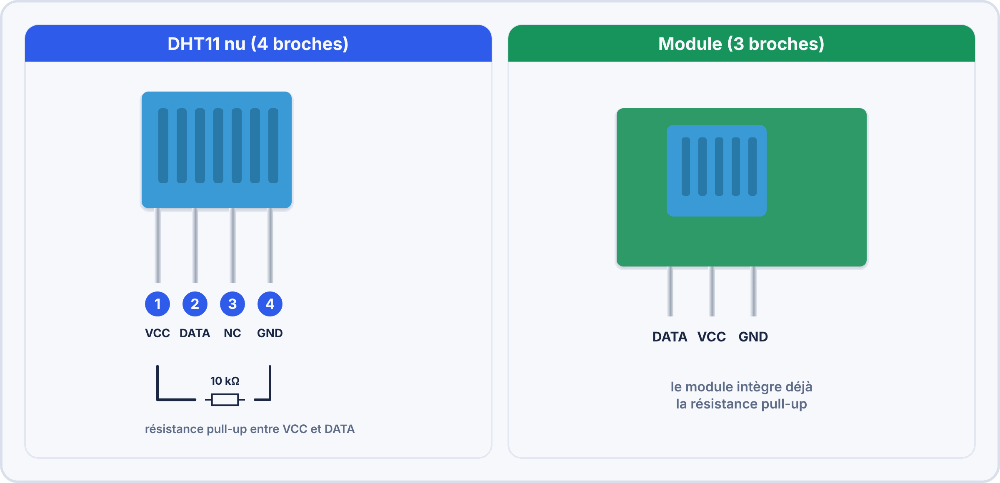
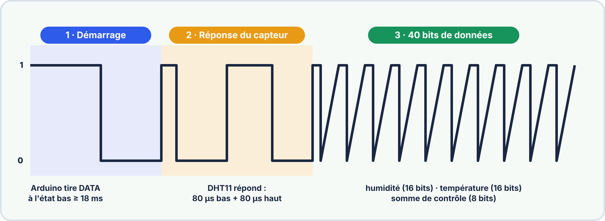
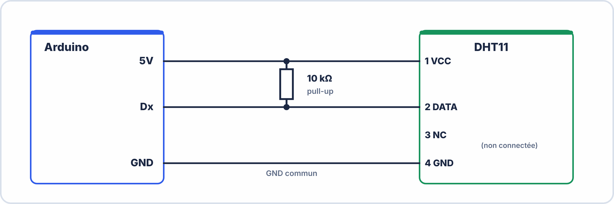
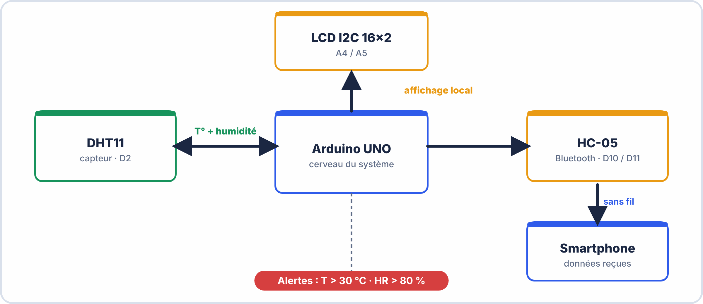
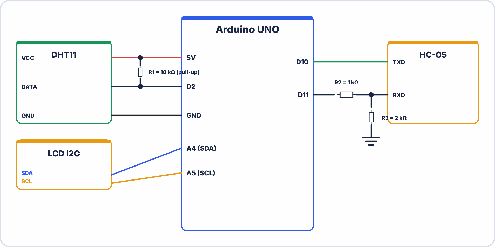

# 📘 FICHE DE COURS ÉLÈVE — S16
## Projet A1 : Système domotique · Capteur DHT11 T°/Humidité · Schéma électronique complet

---

> **Compétences travaillées** : C1.1 – C1.2 – C2.1 – C3.1 – C3.2 – C4.1
> **Durée de lecture guidée** : ~45 minutes
> **Prérequis** : S9 (LM35, analogRead), S14 (HC-05), S15 (LCD I2C, proto maquette)

---

## 🗂️ Sommaire

1. Le capteur DHT11 — description et fonctionnement
2. Le protocole 1-Wire du DHT11
3. La bibliothèque Adafruit DHT — installation et fonctions
4. Câblage du DHT11
5. Affichage T° et humidité sur le LCD I2C
6. Le système domotique complet : architecture et sketch
7. Produire un schéma électronique professionnel
8. Vocabulaire clé à maîtriser


### 🤔 À ton avis ?

Une maison « intelligente » **ouvre les volets** quand il fait chaud et **affiche l'humidité** dans le salon. Quel capteur mesure à la fois **température et humidité** ?

??? question "Voir une réponse possible"
    Le **DHT11** : un petit capteur à **trois ou quatre broches** qui mesure la **température** et l'**humidité**, puis envoie les deux valeurs sous forme de **données numériques** sur **un seul fil**.
    
    Dans ce projet, tu réalises un **système domotique complet** : **mesurer, afficher, communiquer**, puis tu rédiges le **schéma électrique** correspondant.

---

## 1. Le capteur DHT11 — description et fonctionnement

### 1.1 Présentation

Le **DHT11** est un capteur **numérique** qui mesure simultanément deux grandeurs physiques :

- La **température** de l'air (de 0°C à 50°C, précision ±2°C)
- L'**humidité relative** de l'air (de 20% à 90%, précision ±5%)

Il utilise un protocole de communication **numérique** propriétaire, à la différence du LM35 qui produit une tension analogique.



### 1.2 Comparaison DHT11 vs LM35

| Critère | LM35 | DHT11 |
|---|---|---|
| **Grandeurs mesurées** | Température seule | Température + Humidité |
| **Type de signal** | Analogique (tension) | Numérique (protocole 1-Wire) |
| **Broche Arduino** | Entrée analogique (A0-A5) | Broche numérique (D2-D12) |
| **Bibliothèque** | Aucune — calcul direct | `DHT sensor library` (Adafruit) |
| **Résistance externe** | Non requise | 10kΩ pull-up (si boîtier nu) |
| **Précision température** | ±0,5°C | ±2°C |
| **Précision humidité** | — | ±5% |
| **Fréquence de lecture max** | En continu | **1 fois toutes les 2 secondes minimum** |
| **Tension alimentation** | 5V | 3,3V à 5V |

> ⚠️ **Limitation importante du DHT11** : Il ne peut pas être interrogé plus d'une fois toutes les **2 secondes**. Si tu tentes une lecture plus fréquente, le capteur retourne `NaN` (Not a Number). C'est pour cela que le sketch utilise `delay(2000)` ou `millis()` pour espacer les lectures.


> [!TIP] 💡 En clair
> Le **DHT11** mesure la **température** (de 0 à 50 °C, précision environ ±2 °C) et l'**humidité** (de 20 à 80 %, précision environ ±5 %). Il est **lent** : **une mesure par seconde au maximum**. Contrairement au LM35, il envoie **directement des valeurs numériques**.

### ✅ Vérifie que tu as compris

**Q1.** Quelles grandeurs mesure le DHT11 ?

??? success "Réponse"
    La **température** et l'**humidité**.

**Q2.** Peut-on lire le DHT11 100 fois par seconde ?

??? success "Réponse"
    **Non** : une mesure par seconde au maximum.

**Q3.** Quelle différence avec le LM35 ?

??? success "Réponse"
    Le DHT11 envoie des **données numériques** ; le LM35 une **tension analogique**.

> [!SUCCESS] 🧠 À retenir
> - DHT11 : température + humidité, numérique, 1 mesure/s au maximum.

---

## 2. Le protocole 1-Wire du DHT11

### 2.1 Qu'est-ce que le protocole 1-Wire ?

Le DHT11 utilise un protocole de communication **numérique série** propriétaire (parfois appelé **"Single Wire"** ou "1-Wire simplifié") qui passe par **un seul fil de données bidirectionnel**.

> 💡 **Analogie** : Imagine un morse entre deux personnes avec une seule corde tendue. Alternativement, l'un tire (envoie) et l'autre écoute (reçoit), en suivant un code précis de signaux courts et longs. Le DHT11, c'est la même chose : l'Arduino envoie d'abord un signal de "réveil", puis écoute la réponse du capteur qui encode température et humidité en impulsions.



**Dans la pratique**, tu n'as pas à gérer ce protocole toi-même : la bibliothèque Adafruit s'en charge entièrement. Tu appelles juste `dht.readTemperature()` et `dht.readHumidity()`.


> [!TIP] 💡 En clair
> Le DHT11 envoie ses données sur **un seul fil** (bus « 1-Wire » simplifié). Le **microcontrôleur demande** la mesure, puis le capteur **répond** avec **40 bits** : l'humidité, la température et un **contrôle d'erreur**.

### ✅ Vérifie que tu as compris

**Q1.** Combien de fils de données faut-il pour le DHT11 ?

??? success "Réponse"
    **Un seul**.

**Q2.** À quoi sert le contrôle d'erreur ?

??? success "Réponse"
    À **vérifier** que les données reçues sont correctes.

---

## 3. La bibliothèque Adafruit DHT

### 3.1 Installation

> ⚠️ Deux bibliothèques sont **obligatoires** — l'une dépend de l'autre :

| Ordre | Bibliothèque | Auteur | À installer en premier ? |
|---|---|---|---|
| 1 | **Adafruit Unified Sensor** | Adafruit | ✅ Oui |
| 2 | **DHT sensor library** | Adafruit | ✅ Ensuite |

**Procédure :**

1. `Outils → Gérer les bibliothèques`
2. Recherche : `DHT sensor library`
3. Installer `DHT sensor library` par **Adafruit** → accepter l'installation des dépendances si proposé

### 3.2 Initialisation dans le sketch

```cpp
#include <DHT.h>

#define BROCHE_DHT  2       // Broche numérique connectée à DATA du DHT11
#define TYPE_DHT    DHT11   // Type de capteur : DHT11 ou DHT22

DHT dht(BROCHE_DHT, TYPE_DHT);   // Création de l'objet DHT

void setup() {
  dht.begin();    // Initialisation du capteur
}
```


> [!TIP] 💡 En clair
> La bibliothèque **s'occupe du protocole** à ta place : toi, tu appelles simplement `dht.readTemperature()` et `dht.readHumidity()`. **Teste** toujours si le résultat est valide (`isnan`) avant de l'afficher.

### ✅ Vérifie que tu as compris

**Q1.** Pourquoi teste-t-on avec `isnan` ?

??? success "Réponse"
    Pour **détecter une lecture ratée** et ne pas afficher une valeur absurde.

### 3.3 Fonctions essentielles

| Fonction | Retour | Description |
|---|---|---|
| `dht.begin()` | void | Initialise le capteur — à appeler dans `setup()` |
| `dht.readTemperature()` | float (°C) | Retourne la température en Celsius |
| `dht.readTemperature(true)` | float (°F) | Retourne la température en Fahrenheit |
| `dht.readHumidity()` | float (%) | Retourne l'humidité relative en % |
| `dht.computeHeatIndex(T, HR)` | float | Calcule l'indice de chaleur ressenti (Heat Index) |
| `isnan(valeur)` | bool | Vérifie si la lecture a échoué (retourne `true` si erreur) |

### 3.4 Gestion des erreurs de lecture

```cpp
float humidite    = dht.readHumidity();
float temperature = dht.readTemperature();

// Vérification : si la lecture échoue, isnan() retourne true
if (isnan(humidite) || isnan(temperature)) {
  Serial.println("Erreur DHT11 - Verifiez le câblage !");
  return;    // Sort de loop() sans aller plus loin
}

// Si on arrive ici, les valeurs sont valides
Serial.print("T="); Serial.print(temperature); Serial.print("°C  ");
Serial.print("HR="); Serial.print(humidite); Serial.println("%");
```

> 📌 **Toujours vérifier avec `isnan()`** avant d'utiliser les valeurs lues. Une valeur `NaN` non détectée peut provoquer des affichages aberrants sur le LCD ou des transmissions erronées via Bluetooth.

---

## 4. Câblage du DHT11

### 4.1 Version boîtier nu (4 broches)



| Broche DHT11 (boîtier nu) | → | Connexion |
|---|---|---|
| **1 – VCC** | Fil rouge | 5V Arduino |
| **2 – DATA** | Fil jaune | Pin 2 Arduino **+ résistance pull-up 10kΩ vers VCC** |
| **3 – NC** | — | Non connectée |
| **4 – GND** | Fil noir | GND Arduino |

### 4.2 Version module breakout (3 broches)

| Broche Module | → | Connexion |
|---|---|---|
| **VCC (+)** | Fil rouge | 5V Arduino |
| **DATA (out)** | Fil jaune | Pin 2 Arduino (résistance déjà intégrée) |
| **GND (-)** | Fil noir | GND Arduino |

> ✅ **Si tu as le module breakout** : pas besoin d'ajouter la résistance pull-up, elle est déjà soudée sur la carte.


> [!TIP] 💡 En clair
> Le DHT11 se câble avec **trois fils** : **+5 V**, **GND** et la broche de **données**. Une **résistance de 10 kΩ** entre données et +5 V (appelée résistance de **pull-up**) **stabilise** la ligne.

> [!WARNING] ⚠️ Erreurs fréquentes
> - Inverser +5 V et GND : le capteur chauffe et se détruit.
> - Oublier la résistance de pull-up : lectures erratiques.

### ✅ Vérifie que tu as compris

**Q1.** À quoi sert la résistance de pull-up ?

??? success "Réponse"
    À **maintenir la ligne de données au niveau haut** quand personne ne parle.

**Q2.** Combien de fils faut-il brancher sur un DHT11 ?

??? success "Réponse"
    Trois : **+5 V**, **GND** et **données**.

> [!SUCCESS] 🧠 À retenir
> - DHT11 : +5 V, GND, données, avec pull-up de 10 kΩ.

---

## 5. Affichage T° et humidité sur le LCD I2C

### 5.1 Stratégie d'affichage sur 2 lignes

Le LCD 16×2 permet d'afficher **2 lignes de 16 caractères**. Pour afficher T° et humidité simultanément :

> [!NOTE] Temp:  23.5°C  │  ← Ligne 0 : Température
> Humid: 55.0 %  │  ← Ligne 1 : Humidité  

### 5.2 Sketch d'affichage DHT11 + LCD

```cpp
#include <LiquidCrystal_I2C.h>
#include <DHT.h>

#define BROCHE_DHT 2
#define TYPE_DHT   DHT11

LiquidCrystal_I2C lcd(0x27, 16, 2);
DHT dht(BROCHE_DHT, TYPE_DHT);

void setup() {
  Serial.begin(9600);
  dht.begin();

  lcd.init();
  lcd.backlight();
  lcd.setCursor(0, 0);
  lcd.print("Station Meteo");
  lcd.setCursor(0, 1);
  lcd.print("  Demarrage...");
  delay(2000);
  lcd.clear();
}

void loop() {
  delay(2000);   // Attente obligatoire entre deux lectures DHT11

  float humidite    = dht.readHumidity();
  float temperature = dht.readTemperature();

  // Vérification des valeurs
  if (isnan(humidite) || isnan(temperature)) {
    lcd.setCursor(0, 0);
    lcd.print("ERREUR CAPTEUR  ");
    lcd.setCursor(0, 1);
    lcd.print("Verif câblage!  ");
    return;
  }

  // --- Affichage LCD ---
  lcd.setCursor(0, 0);
  lcd.print("Temp:");
  lcd.print(temperature, 1);
  lcd.print((char)223);      // Symbole °
  lcd.print("C       ");     // Espaces pour nettoyer

  lcd.setCursor(0, 1);
  lcd.print("Humid:");
  lcd.print(humidite, 1);
  lcd.print("%        ");

  // --- Debug moniteur série ---
  Serial.print("T="); Serial.print(temperature, 1);
  Serial.print("C  HR="); Serial.print(humidite, 1);
  Serial.println("%");
}
```


> [!TIP] 💡 En clair
> Pour afficher **deux grandeurs** sur un écran 16×2, on utilise **une ligne par grandeur** : la température sur la ligne 0, l'humidité sur la ligne 1.

---

## 6. Le système domotique complet : architecture et sketch

### 6.1 Architecture du système domotique A1



### 6.2 Sketch du système domotique complet

```cpp
// ================================================
// S16 – PROJET A1 : Station Domotique Connectée
// DHT11 + LCD I2C + HC-05 Bluetooth
// Auteur : [Ton nom]   Date : [Date S16]
// ================================================

#include <LiquidCrystal_I2C.h>
#include <SoftwareSerial.h>
#include <DHT.h>

// ---- Déclarations des objets ----
LiquidCrystal_I2C lcd(0x27, 16, 2);
SoftwareSerial bluetooth(10, 11);          // RX=10, TX=11

// ---- Capteur DHT11 ----
#define BROCHE_DHT  2
#define TYPE_DHT    DHT11
DHT dht(BROCHE_DHT, TYPE_DHT);

// ---- Seuils d'alerte ----
const float SEUIL_TEMP     = 30.0;    // Alerte si T > 30°C
const float SEUIL_HUMIDITE = 80.0;    // Alerte si HR > 80%

// ---- Paramètres de temporisation ----
const long  INTERVALLE_LECTURE = 2000;   // DHT11 : 2s minimum entre lectures
const long  INTERVALLE_ENVOI   = 10000;  // Envoi BT toutes les 10s

// ---- Variables d'état ----
float temperature = 0.0;
float humidite    = 0.0;
bool  envoiAuto   = true;
bool  alerteActive = false;
unsigned long tDerniereL = 0;
unsigned long tDernierE  = 0;

// ================================================
void setup() {
  Serial.begin(9600);
  bluetooth.begin(9600);
  dht.begin();

  // Initialisation LCD
  lcd.init();
  lcd.backlight();
  afficherAccueil();

  bluetooth.println("=== Station Domotique prete ===");
  bluetooth.println("Cmds: DATA / START / STOP");
  Serial.println("=== Systeme domotique S16 pret ===");
}

// ================================================
void loop() {
  unsigned long maintenant = millis();

  // ---- 1. Lecture DHT11 (toutes les 2s minimum) ----
  if (maintenant - tDerniereL >= INTERVALLE_LECTURE) {
    lireCapteur();
    tDerniereL = maintenant;
  }

  // ---- 2. Affichage LCD (mis à jour à chaque lecture) ----
  afficherLCD();

  // ---- 3. Gestion des alertes ----
  gererAlertes();

  // ---- 4. Envoi automatique Bluetooth ----
  if (envoiAuto && (maintenant - tDernierE >= INTERVALLE_ENVOI)) {
    envoyerDonnees();
    tDernierE = maintenant;
  }

  // ---- 5. Traitement des commandes Bluetooth ----
  traiterCommandes();
}

// ================================================
// Fonctions auxiliaires
// ================================================

void lireCapteur() {
  float h = dht.readHumidity();
  float t = dht.readTemperature();

  if (!isnan(h) && !isnan(t)) {
    humidite    = h;
    temperature = t;
  } else {
    Serial.println("Erreur lecture DHT11 !");
  }
}

void afficherLCD() {
  if (alerteActive) {
    lcd.setCursor(0, 0);
    lcd.print("!!! ALERTE !!!  ");
    lcd.setCursor(0, 1);
    if (temperature > SEUIL_TEMP)
      lcd.print("T trop haute!   ");
    else
      lcd.print("Humid trop elev!");
    return;
  }

  // Affichage normal
  lcd.setCursor(0, 0);
  lcd.print("T:");
  lcd.print(temperature, 1);
  lcd.print((char)223);
  lcd.print("C         ");

  lcd.setCursor(0, 1);
  lcd.print("HR:");
  lcd.print(humidite, 1);
  lcd.print("%         ");
}

void gererAlertes() {
  bool nouvelleAlerte = (temperature > SEUIL_TEMP || humidite > SEUIL_HUMIDITE);

  // Déclenchement alerte
  if (nouvelleAlerte && !alerteActive) {
    alerteActive = true;
    bluetooth.println("!!! ALERTE !!!");
    if (temperature > SEUIL_TEMP) {
      bluetooth.print("T > "); bluetooth.print(SEUIL_TEMP); bluetooth.println("°C");
    }
    if (humidite > SEUIL_HUMIDITE) {
      bluetooth.print("HR > "); bluetooth.print(SEUIL_HUMIDITE); bluetooth.println("%");
    }
  }

  // Levée d'alerte
  if (!nouvelleAlerte && alerteActive) {
    alerteActive = false;
    bluetooth.println("Alerte levee - Retour normal.");
  }
}

void envoyerDonnees() {
  bluetooth.print("T:");
  bluetooth.print(temperature, 1);
  bluetooth.print("C | HR:");
  bluetooth.print(humidite, 1);
  bluetooth.println("%");
}

void traiterCommandes() {
  if (!bluetooth.available()) return;

  String cmd = "";
  while (bluetooth.available()) {
    cmd += (char)bluetooth.read();
    delay(5);
  }
  cmd.trim();
  cmd.toUpperCase();

  if (cmd == "DATA") {
    envoyerDonnees();
  }
  else if (cmd == "STOP") {
    envoiAuto = false;
    bluetooth.println("Envoi auto desactive.");
  }
  else if (cmd == "START") {
    envoiAuto = true;
    tDernierE = 0;
    bluetooth.println("Envoi auto active.");
  }
  else {
    bluetooth.print("Commande inconnue: "); bluetooth.println(cmd);
  }
}

void afficherAccueil() {
  lcd.clear();
  lcd.setCursor(0, 0);
  lcd.print("STATION DOMOTIQ.");
  lcd.setCursor(0, 1);
  lcd.print("  BAC PRO CIEL  ");
  delay(2500);
  lcd.clear();
}
```

> [!TIP] 💡 En clair
> Un système domotique complet suit une **chaîne** : **capteur → Arduino → affichage / Bluetooth**. Découpe-le en **blocs** : tu programmes et tu testes **chaque bloc séparément**, puis tu les assembles.

### ✅ Vérifie que tu as compris

**Q1.** Cite les trois blocs d'un système domotique simple.

??? success "Réponse"
    **Acquisition** (capteur), **traitement** (Arduino), **communication / affichage**.

> [!SUCCESS] 🧠 À retenir
> - Un système = des blocs testés séparément, puis assemblés.


---

## 7. Produire un schéma électronique professionnel

### 7.1 Pourquoi le schéma est une pièce maîtresse du projet

Le **schéma électronique** est le document qui permet à n'importe quel technicien — même sans avoir vu le montage — de le comprendre, le reproduire et le dépanner. C'est la **carte d'identité technique** de ton système.

> 💡 **Dans l'industrie**, aucun projet ne passe en production sans un schéma électronique validé. C'est aussi la première pièce que demande un jury lors de l'épreuve E5.

### 7.2 Les éléments obligatoires d'un schéma de projet

  
Components as blocks: U1=Arduino UNO (with labeled pins D2, D10, D11, A4, A5, 5V, GND),  
DHT1=DHT11 sensor (with R1=10kΩ pull-up between VCC and DATA),  

LCD1=LCD I2C 16x2 (SDA to A4, SCL to A5),

BT1=HC-05 (with voltage divider R2=1kΩ + R3=2kΩ on RXD pin).  
Power rails +5V and GND labeled. Title block bottom-right with project title, author, date, version.  
All component references labeled. Professional schematic style, IEC symbols, French labels."  

### 7.3 Checklist du schéma complet

| Élément | Présent ? |
|---|---|
| Arduino UNO avec **toutes les broches utilisées** identifiées | ☐ |
| DHT11 avec ses 3 connexions et la résistance pull-up R1=10kΩ | ☐ |
| LCD I2C avec SDA/SCL/VCC/GND | ☐ |
| HC-05 avec pont diviseur R2+R3 (valeurs indiquées) | ☐ |
| Lignes d'alimentation **+5V** repérées | ☐ |
| Lignes de **GND** repérées | ☐ |
| **Références** de tous les composants (R1, R2, R3, DHT1, LCD1, BT1, U1) | ☐ |
| **Valeurs** de toutes les résistances indiquées | ☐ |
| **Cartouche** complet (titre, auteur, date, version, feuille) | ☐ |
| Schéma **lisible** (fils droits, pas de croisements inutiles) | ☐ |

### 7.4 Le cartouche standard

| Champ | Contenu |
|---|---|
| **Titre** | Station Domotique Connectée – Projet A1 |
| **Auteur** | Ton Prénom NOM |
| **Date** | [Date de la séance] |
| **Établissement** | LP [Nom] |
| **Version** | V1.0 |
| **Révision** | Laisser vide pour V1.0 |
| **Feuille** | 1/1 |


> [!TIP] 💡 En clair
> Un **schéma professionnel** doit se lire **sans explication** : **symboles normalisés**, fils **droits** (angles à 90°), croisements **sans point** si les fils ne sont pas reliés, **points de connexion** marqués, **composants repérés** (R1, C1…) et **valeurs indiquées**.

### ✅ Vérifie que tu as compris

**Q1.** Deux fils se croisent sans point de connexion. Sont-ils reliés ?

??? success "Réponse"
    **Non** : seul un **point** indique une connexion.

**Q2.** Que doit-on indiquer à côté de chaque composant ?

??? success "Réponse"
    Son **repère** (R1, C1…) et sa **valeur**.

> [!SUCCESS] 🧠 À retenir
> - Schéma pro : symboles normalisés, repères, valeurs, points de connexion.

---

## 8. Vocabulaire clé à maîtriser pour l'examen

| Terme | Définition |
|---|---|
| **DHT11** | Capteur numérique mesurant simultanément la température (0-50°C ±2°C) et l'humidité relative (20-90% ±5%) |
| **Humidité relative (HR)** | Rapport entre la quantité de vapeur d'eau présente dans l'air et la quantité maximale qu'il pourrait contenir à la même température, exprimé en % |
| **Protocole 1-Wire** | Protocole de communication série utilisant un seul fil bidirectionnel pour l'échange de données |
| **Résistance pull-up** | Résistance connectée entre le fil de données et VCC pour maintenir le niveau logique à HIGH en l'absence de signal actif |
| **`isnan()`** | Fonction Arduino vérifiant si une valeur est "Not a Number" — utilisée pour détecter les erreurs de lecture des capteurs |
| **`millis()`** | Fonction Arduino retournant le nombre de millisecondes depuis le démarrage — permet des temporisations sans bloquer le programme (non-bloquant) |
| **Seuil d'alerte** | Valeur limite à partir de laquelle une alarme est déclenchée (ex : T > 30°C) |
| **Indice de confort** | Indicateur combinant T° et HR pour qualifier la sensation thermique ressentie par les occupants |
| **Système domotique** | Ensemble de composants électroniques permettant la mesure, l'affichage et la transmission à distance de données environnementales dans un bâtiment |
| **Schéma électronique** | Représentation graphique normalisée d'un circuit électronique avec les symboles, références et valeurs de tous les composants |
| **Cartouche** | Cadre d'identification d'un schéma technique (titre, auteur, date, version) placé en bas à droite |

---

> 📌 **Retiens l'essentiel en 5 points :**
> 1. Le DHT11 mesure **deux grandeurs** (T° + HR) par un protocole **numérique** sur 1 fil — contrairement au LM35 analogique
> 2. **Toujours attendre 2 secondes** entre deux lectures DHT11, et vérifier avec `isnan()`
> 3. La résistance **pull-up 10kΩ** est obligatoire si tu utilises le boîtier nu
> 4. `millis()` est la bonne façon de gérer plusieurs temporisations **sans bloquer** le programme
> 5. Le schéma électronique avec **cartouche + références + valeurs** est une pièce obligatoire du dossier E5

---

*Fiche Cours Élève — BAC PRO CIEL | Module E2 | S16*
*Compétences : C1.1 – C1.2 – C2.1 – C3.1 – C3.2 – C4.1*
