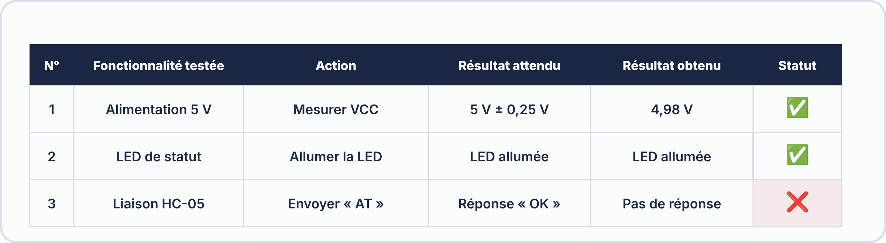
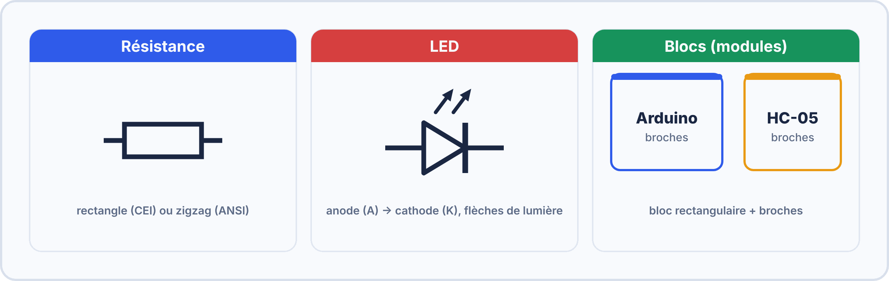
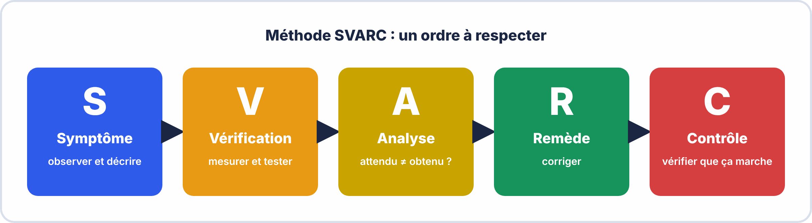
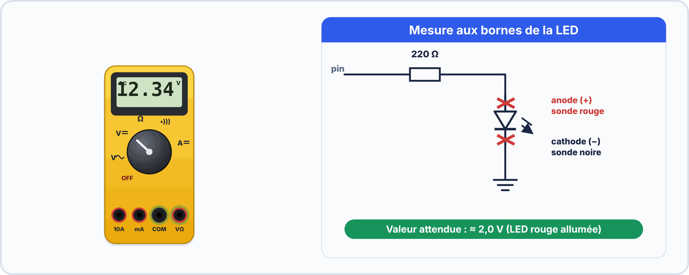

# 📘 FICHE DE COURS ÉLÈVE — S17

> [!TIP] 🖥️ TP virtuel ElectroLab : pour t'entraîner
> Ouvre [ElectroLab](https://yahnlp.github.io/ElectroLab/), menu **TP ▾**, puis choisis :
> - **Dépannage d'une platine transistor + LED (6 pannes)** (1 h 30, première / terminale)
> 
> Le simulateur corrige automatiquement et ne risque pas d'abîmer le matériel : **réussis d'abord le TP virtuel, puis refais la manipulation sur le matériel réel.** Mode d'emploi : [Utiliser ElectroLab](../../ressources/electrolab.md).

## Tests d'intégration · Documentation technique (Schéma + BOM) · Résolution de pannes réelles

---

> **Compétences travaillées** : C1.2 – C3.2 – C4.1 – C4.2
> **Durée de lecture guidée** : ~45 minutes
> **Prérequis** : S14 (Bluetooth HC-05), S15-S16 (projet en cours)

---

## 🗂️ Sommaire

1. Les tests d'intégration — définition et méthode
2. Le protocole de tests — comment le construire
3. La documentation technique : le schéma annoté
4. La BOM (Bill of Materials) — nomenclature des composants
5. Méthodologie de résolution de pannes
6. Les outils du dépannage
7. Vocabulaire clé à maîtriser


### 🤔 À ton avis ?

Ton montage fonctionne **quand tu le regardes**. Mais comment **prouver** à quelqu'un d'autre qu'il fonctionne… et comment le réparer s'il tombe en panne ?

??? question "Voir une réponse possible"
    Avec des **tests écrits**, une **documentation** (schéma, liste des composants) et une **méthode de dépannage**. Ce sont les **preuves** qu'un technicien laisse derrière lui.
    
    Dans cette séance, tu apprends à **tester**, à **documenter** et à **dépanner** ton système.

---

## 1. Les tests d'intégration — définition et méthode

### 1.1 Qu'est-ce qu'un test d'intégration ?

Lorsque tu construis un système électronique (comme ton projet Arduino-Bluetooth), tu as d'abord testé chaque partie **séparément** :

- La communication Bluetooth seule (S14)
- Les DEL seules
- Le sketch Arduino seul

Un **test d'intégration** vérifie que **toutes ces parties fonctionnent correctement ensemble**, comme un seul système complet.

> 💡 **Analogie** : Imagine que tu construises une voiture. Tu testes d'abord le moteur seul, puis les freins seuls, puis les phares seuls. Le test d'intégration, c'est quand tu mets tout ensemble et que tu vérifies que la voiture démarre, freine ET éclaire **en même temps**, dans toutes les conditions.

### 1.2 Les niveaux de tests en électronique


| Niveau | Quoi tester ? | Exemple pour notre projet |
|---|---|---|
| **Test unitaire** | Un seul composant à la fois | Vérifier que la DEL rouge s'allume avec 3,3V |
| **Test d'intégration** | Plusieurs composants ensemble | Vérifier que la commande BT allume bien la DEL |
| **Test système** | Le système complet en situation réelle | Contrôler les 3 DEL depuis 5 m, dans une autre pièce |


> [!TIP] 💡 En clair
> Un **test d'intégration** vérifie que **plusieurs éléments assemblés** fonctionnent **ensemble**. Chaque élément peut marcher seul et pourtant **l'ensemble échouer** (mauvais câblage, conflit de broches, alimentation insuffisante).

### ✅ Vérifie que tu as compris

**Q1.** Pourquoi un test d'intégration est-il utile si chaque module a déjà été testé seul ?

??? success "Réponse"
    Parce que les modules peuvent **mal fonctionner ensemble** (conflits, alimentation, câblage).

**Q2.** Cite un exemple de problème visible seulement à l'assemblage.

??? success "Réponse"
    Deux modules qui utilisent la **même broche**, ou une **alimentation trop faible**.

---

## 2. Le protocole de tests — comment le construire

### 2.1 Pourquoi un protocole ?

Un **protocole de tests** est un document qui décrit, **avant** de tester, exactement :

- **Ce que** l'on va tester (le cas de test)
- **Comment** on va le tester (la procédure)
- **Ce qu'on attend** comme résultat
- **Ce qu'on obtient** réellement

Sans protocole, les tests sont aléatoires et les résultats ne sont pas exploitables ni reproductibles.

### 2.2 Structure d'un cas de test

Chaque ligne du tableau de tests doit contenir :

| Champ | Description |
|---|---|
| **N° de test** | Identifiant unique (ex : T-01) |
| **Fonctionnalité testée** | Ce que le test vérifie |
| **Préconditions** | État du système avant le test |
| **Action** | Ce que l'opérateur fait |
| **Résultat attendu** | Ce qui doit se passer si tout est OK |
| **Résultat obtenu** | Ce qui s'est passé réellement |
| **Statut** | ✅ Conforme / ❌ Non-conforme / ⚠️ Partiel |

### 2.3 Exemple de protocole de tests pour le projet S14-S17



| N° | Fonctionnalité | Précondition | Action | Résultat attendu | Résultat obtenu | Statut |
|---|---|---|---|---|---|---|
| T-01 | Appairage BT | HC-05 alimenté, LED clignote vite | Connecter depuis app | LED HC-05 fixe | | |
| T-02 | Commande R1 | Connecté BT | Envoyer `R1` | DEL rouge allumée + `"DEL rouge allumee"` reçu | | |
| T-03 | Commande R0 | DEL rouge allumée | Envoyer `R0` | DEL rouge éteinte + message reçu | | |
| T-04 | Commande J1 | Connecté BT | Envoyer `J1` | DEL jaune allumée + message reçu | | |
| T-05 | Commande J0 | DEL jaune allumée | Envoyer `J0` | DEL jaune éteinte + message reçu | | |
| T-06 | Commande V1 | Connecté BT | Envoyer `V1` | DEL verte allumée + message reçu | | |
| T-07 | Commande V0 | DEL verte allumée | Envoyer `V0` | DEL verte éteinte + message reçu | | |
| T-08 | Commande ETAT | Au moins 1 DEL allumée | Envoyer `ETAT` | Affichage des 3 états | | |
| T-09 | Commande inconnue | Connecté BT | Envoyer `XYZ` | Message d'erreur reçu | | |
| T-10 | Test de portée 5 m | Connecté BT, 5 m de distance | Envoyer `R1` | Commande exécutée | | |
| T-11 | Test de portée 10 m | Connecté BT, 10 m | Envoyer `R1` | Commande exécutée ou déconnexion | | |


> [!TIP] 💡 En clair
> Un **protocole de test** est un tableau avec : **ce qu'on teste**, **comment**, le **résultat attendu**, le **résultat obtenu** et **OK / NOK**. Écris le **résultat attendu AVANT** de faire le test, sinon tu risques de **trouver « normal »** ce que tu observes.

> [!WARNING] ⚠️ Erreurs fréquentes
> - Remplir « résultat attendu » après avoir fait la mesure.

### ✅ Vérifie que tu as compris

**Q1.** Pourquoi écrit-on le résultat attendu avant le test ?

??? success "Réponse"
    Pour **comparer honnêtement** : sinon on ajuste l'attendu à ce qu'on observe.

**Q2.** Quelles colonnes contient un protocole de test ?

??? success "Réponse"
    Test, méthode, résultat **attendu**, résultat **obtenu**, **OK/NOK**.

> [!SUCCESS] 🧠 À retenir
> - Protocole = attendu écrit avant, obtenu mesuré, verdict OK/NOK.

---

## 3. La documentation technique : le schéma annoté

### 3.1 Pourquoi un schéma annoté ?

Un schéma électrique permet à **n'importe quel technicien** de comprendre, reproduire ou dépanner un montage **sans avoir besoin d'expliquer verbalement**. C'est un langage universel dans le domaine de l'électronique et de l'électrotechnique.

**"Annoté"** signifie que le schéma contient :

- Les **valeurs** de tous les composants (ex : R1 = 220Ω)
- Les **références** des composants (ex : U1 = Arduino UNO, BT1 = HC-05)
- Les **tensions** aux points stratégiques (ex : +5V, +3,3V, GND)
- Un **cartouche** (cadre de titre) avec les informations du projet

### 3.2 Conventions à respecter



| Élément | Convention |
|---|---|
| **Résistance** | Symbole rectangle (norme IEC/européenne) avec valeur en Ω |
| **DEL** | Triangle + barre avec flèches lumière, polarité (+/-) indiquée |
| **Fils** | Lignes droites horizontales/verticales uniquement |
| **Nœuds** | Point noir si deux fils se croisent et sont connectés |
| **Références** | R1, R2… pour résistances ; D1, D2… pour DEL ; U1 pour microcontrôleur ; BT1 pour module BT |
| **Valeurs** | Toujours indiquées à côté du symbole |
| **Alimentation** | Symbole +5V en haut, GND (triangle pointe en bas) en bas |

### 3.3 Le cartouche obligatoire

Le cartouche est le "badge d'identité" du schéma. Il se place en bas à droite de la feuille.

| Champ cartouche | Exemple |
|---|---|
| Titre du projet | Contrôle sans fil Bluetooth – 3 DEL |
| Auteur(s) | DUPONT Martin, MARTIN Sophie |
| Date | 01/03/2026 |
| Version | V1.0 |
| Établissement | LP [Nom de l'établissement] |
| Feuille | 1/1 |


> [!TIP] 💡 En clair
> Le **schéma annoté** est la **carte** de ton système : symboles normalisés, **repères**, **valeurs**, **numéros de broches**. Quelqu'un d'autre doit pouvoir **reconstruire** ton montage avec ce seul document.

### ✅ Vérifie que tu as compris

**Q1.** Quel est le critère d'un bon schéma annoté ?

??? success "Réponse"
    Quelqu'un d'autre peut **reconstruire le montage** à partir du seul schéma.

---

## 4. La BOM (Bill of Materials) — Nomenclature des composants

### 4.1 Définition

La **BOM** (en français : *nomenclature des composants* ou *liste de matériel*) est un document qui recense **tous les composants** utilisés dans un projet, avec leurs caractéristiques et leur coût. C'est un document **indispensable** dans l'industrie pour :

- **Commander** les composants auprès des fournisseurs
- **Calculer** le coût de fabrication d'un produit
- **Reproduire** le montage à l'identique
- **Maintenir** le matériel en cas de panne (avoir les références pour commander les pièces de remplacement)

> 💡 **Analogie** : La BOM, c'est comme la **liste d'ingrédients d'une recette** — mais en version professionnelle, avec les fournisseurs, les quantités exactes et les prix unitaires.

### 4.2 Structure d'une BOM professionnelle


### 4.3 Modèle de BOM à compléter pour le projet

| Réf Projet | Désignation | Qté | Valeur / Type | Réf Fournisseur | Fournisseur | PU HT (€) | Total HT (€) |
|---|---|---|---|---|---|---|---|
| U1 | Microcontrôleur | 1 | Arduino UNO R3 | | | | |
| BT1 | Module Bluetooth | 1 | HC-05 | | | | |
| R1 | Résistance pont diviseur | 1 | 1 kΩ – 1/4W | | | | |
| R2 | Résistance pont diviseur | 1 | 2 kΩ – 1/4W | | | | |
| R3 | Résistance limitation DEL rouge | 1 | 220 Ω – 1/4W | | | | |
| R4 | Résistance limitation DEL jaune | 1 | 220 Ω – 1/4W | | | | |
| R5 | Résistance limitation DEL verte | 1 | 220 Ω – 1/4W | | | | |
| D1 | Diode électroluminescente rouge | 1 | 5mm – rouge | | | | |
| D2 | Diode électroluminescente jaune | 1 | 5mm – jaune | | | | |
| D3 | Diode électroluminescente verte | 1 | 5mm – verte | | | | |
| BB1 | Breadboard | 1 | 830 points | | | | |
| CAB | Câbles de liaison Dupont | 20 | Mâle-Mâle/Femelle | | | | |
| ALI | Câble USB-B | 1 | USB-A vers USB-B | | | | |
| | **TOTAL PROJET** | | | | | | **€ HT** |

### 4.4 Calcul de la résistance de limitation DEL

Pour ne pas griller une DEL, il faut toujours calculer la résistance de limitation :

> **Formule :**
>
> $$R = \dfrac{V_{\mathrm{cc}} - V_{\mathrm{DEL}}}{I_{\mathrm{DEL}}}$$
>
> Avec :
>
> - $V_{\mathrm{cc}}$ = tension d'alimentation = 5 V
> - $V_{\mathrm{DEL}}$ = tension de seuil de la DEL ≈ 2 V (rouge) / 2,1 V (jaune) / 2,2 V (verte)
> - $I_{\mathrm{DEL}}$ = courant nominal ≈ 20 mA = 0,02 A

**Exemple pour la DEL rouge :**

$$R = \dfrac{5 - 2}{0{,}02} = \dfrac{3}{0{,}02} = 150\ \Omega$$

→ on prend **220 Ω** (valeur normalisée supérieure) ✅

**Calcule toi-même pour les DEL jaune et verte :**

| DEL | Vcc (V) | $V_{\mathrm{DEL}}$ (V) | $I_{\mathrm{DEL}}$ (A) | R calculée (Ω) | R choisie (Ω) |
|---|---|---|---|---|---|
| Rouge | 5 | 2,0 | 0,02 | | |
| Jaune | 5 | 2,1 | 0,02 | | |
| Verte | 5 | 2,2 | 0,02 | | |


> [!TIP] 💡 En clair
> La **BOM** (nomenclature) est la **liste des composants** : **repère**, **désignation**, **valeur**, **quantité**. Elle sert à **commander**, à **vérifier** le montage et à **dépanner**.

### ✅ Vérifie que tu as compris

**Q1.** À quoi sert une BOM ?

??? success "Réponse"
    À **lister tous les composants** (repère, valeur, quantité) pour commander, monter et dépanner.

**Q2.** Un schéma contient R1, R2, R3 de même valeur. Quelle quantité écris-tu pour cette valeur ?

??? success "Réponse"
    **3**.

> [!SUCCESS] 🧠 À retenir
> - BOM = repère, désignation, valeur, quantité.

---

## 5. Méthodologie de résolution de pannes

### 5.1 La méthode SVARC

Lorsqu'un système ne fonctionne pas, il existe une méthode structurée que tout technicien doit connaître :



| Étape | Nom | Action concrète |
|---|---|---|
| **S** | **Symptôme** | Décrire précisément ce qui ne marche pas. *"La DEL jaune ne s'allume pas"* et non *"ça marche pas"* |
| **V** | **Vérification** | Mesurer les tensions, vérifier les connexions, tester en isolation |
| **A** | **Analyse** | Comparer ce qu'on mesure avec ce qu'on devrait mesurer |
| **R** | **Remède** | Apporter la correction identifiée |
| **C** | **Contrôle** | Retester le système complet après correction pour s'assurer que le problème est résolu ET qu'aucune nouvelle panne n'a été introduite |

### 5.2 Tableau des pannes fréquentes et leur diagnostic

| Symptôme observé | Cause probable | Vérification | Remède |
|---|---|---|---|
| Aucune communication BT possible | TX/RX inversés | Vérifier le câblage sur SoftwareSerial(rx, tx) | Inverser les broches dans le sketch ou le câblage |
| Caractères illisibles reçus | Baudrate différent entre HC-05 et sketch | En mode AT : `AT+UART?` puis vérifier `bluetooth.begin()` | Synchroniser les baudrates |
| DEL ne s'allume pas | Polarité DEL inversée | Mesurer la tension aux bornes de la DEL | Retourner la DEL |
| DEL ne s'allume pas | Mauvaise broche dans le sketch | `Serial.println(digitalRead(4))` après commande | Corriger le numéro de broche |
| DEL grillée / très chaude | Résistance de limitation absente ou trop faible | Vérifier la résistance en série avec la DEL | Ajouter/remplacer la résistance (220Ω minimum) |
| Module HC-05 ne répond pas aux AT | Pas en mode AT (EN/KEY non activé) | Vérifier que EN/KEY est bien à HIGH à la mise sous tension | Remettre EN/KEY à HIGH et redémarrer |
| La connexion BT s'établit puis se coupe | Alimentation insuffisante | Mesurer la tension VCC du HC-05 sous charge | Utiliser une alimentation plus stable ou condensateur de découplage |
| Le sketch ne se téléverse pas | Port COM occupé par moniteur série | Fermer le moniteur série avant de téléverser | Fermer moniteur série → téléverser → rouvrir |


> [!TIP] 💡 En clair
> Dépanner, c'est **raisonner**, pas essayer au hasard : **1. observer** (qu'est-ce qui ne marche pas exactement ?), **2. supposer** (quelle cause possible ?), **3. mesurer** (vérifier avec le multimètre), **4. corriger**, **5. retester**.

### ✅ Vérifie que tu as compris

**Q1.** Quelle est la première étape d'un dépannage ?

??? success "Réponse"
    **Observer** précisément le symptôme.

**Q2.** Pourquoi retester après la correction ?

??? success "Réponse"
    Pour vérifier que le défaut a **bien disparu** et qu'aucun autre n'est apparu.

> [!SUCCESS] 🧠 À retenir
> - Observer, supposer, mesurer, corriger, retester.

---

## 6. Les outils du dépannage

### 6.1 Le multimètre



| Mode | Mesure | Comment l'utiliser |
|---|---|---|
| **Voltmètre (V~~ ou V=)** | Tension | Sonde rouge sur + , sonde noire sur GND, mesure en **parallèle** |
| **Ohmmètre (Ω)** | Résistance | Circuit **hors tension**, mesure aux bornes de la résistance |
| **Continuité (🔊)** | Liaison électrique | Bip si connexion OK — utile pour vérifier un fil |
| **Ampèremètre (A)** | Courant | En **série** dans le circuit — rarement utilisé en dépannage |

> ⚠️ **Ne jamais mesurer une résistance dans un circuit sous tension** — risque de mesure fausse et de dommage au multimètre.

### 6.2 Le moniteur série comme outil de diagnostic

Le moniteur série de l'IDE Arduino est ton premier outil de diagnostic logiciel. Tu peux l'utiliser pour :

```cpp
// Ajouter des messages de debug dans ton sketch
Serial.print("Commande reçue : ");
Serial.println(commande);
Serial.print("État broche 4 : ");
Serial.println(digitalRead(4));   // Affiche 0 ou 1
Serial.print("Tension fictive : ");
Serial.println(analogRead(A0));   // Pour tester les entrées analogiques
```


> [!TIP] 💡 En clair
> Les **outils** du dépanneur : le **multimètre** (tension, continuité), le **moniteur série** (ce que dit le programme), l'**inspection visuelle** (soudures, composants à l'envers) et la **substitution** (essayer un composant sûr à la place).

### ✅ Vérifie que tu as compris

**Q1.** Quel outil permet de voir ce que « pense » le programme ?

??? success "Réponse"
    Le **moniteur série**.

---

## 7. Vocabulaire clé à maîtriser pour l'examen

| Terme | Définition |
|---|---|
| **Test d'intégration** | Test vérifiant le fonctionnement de plusieurs composants assemblés ensemble |
| **Protocole de tests** | Document décrivant les cas de tests, les actions, les résultats attendus et obtenus |
| **BOM (Bill of Materials)** | Liste exhaustive des composants d'un système avec références, quantités et coûts |
| **Schéma annoté** | Schéma électrique avec les valeurs, références et informations techniques complètes |
| **Cartouche** | Cadre de titre d'un schéma technique contenant les informations d'identification du document |
| **Symptôme** | Manifestation observable d'une panne (ce qu'on voit/entend/mesure) |
| **Cause** | Origine réelle du dysfonctionnement (ce qui provoque le symptôme) |
| **Méthode SVARC** | Méthode de diagnostic : Symptôme → Vérification → Analyse → Remède → Contrôle |
| **Résistance de limitation** | Résistance placée en série avec une DEL pour limiter le courant et protéger le composant |
| **Pont diviseur de tension** | Circuit de deux résistances en série permettant d'obtenir une tension intermédiaire |
| **Référence composant** | Identifiant unique d'un composant dans un schéma (R1, D1, U1, BT1…) |
| **Nomenclature** | Synonyme français de BOM — liste des matériaux et composants d'un projet |

---

> 📌 **Retiens l'essentiel en 4 points :**
> 1. Un test d'intégration ne remplace pas les tests unitaires — il vient **après**
> 2. La BOM est indispensable pour **commander** et **reproduire** un projet
> 3. En dépannage : **symptôme → hypothèse → mesure → remède → contrôle** — dans cet ordre !
> 4. Un schéma technique sans cartouche et sans valeurs n'est **pas exploitable** professionnellement

---

*Fiche Cours Élève — BAC PRO CIEL | Module E2 | S17*
*Compétences : C1.2 – C3.2 – C4.1 – C4.2*
