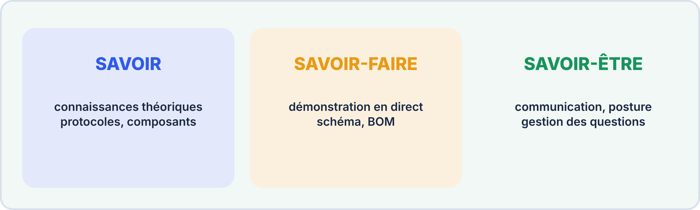
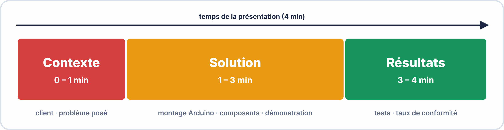
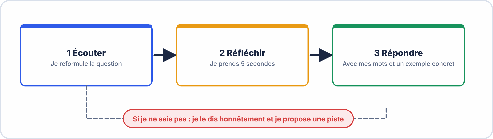
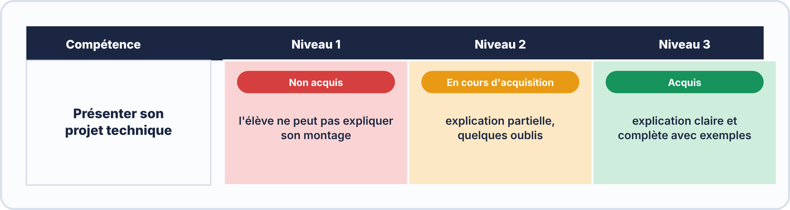

# 📘 FICHE DE COURS ÉLÈVE — S18
## Réussir sa soutenance de projet technique · Évaluation par compétences · Auto-positionnement

---

> **Compétences travaillées** : C1.1 – C1.2 – C3.1 – C3.2 – C4.1 – C4.2
> **Durée de lecture** : ~30 minutes (à lire en amont ou pendant la préparation)
> **Contexte** : Séance de soutenance formative A1 — format identique à l'épreuve E5

---

## 🗂️ Sommaire

1. Qu'est-ce qu'une soutenance de projet technique ?
2. Le format de la soutenance E2-E5
3. Structurer sa présentation
4. Maîtriser la démonstration live
5. Répondre aux questions du jury
6. L'évaluation par compétences — comprendre la grille critériée
7. L'auto-évaluation — pourquoi et comment
8. Vocabulaire clé à maîtriser

---

## 1. Qu'est-ce qu'une soutenance de projet technique ?

Une **soutenance** est une présentation orale devant un jury au cours de laquelle tu **défends** le travail que tu as réalisé.

Elle n'est pas un examen de récitation de cours. Elle évalue **ta capacité à :**
- Expliquer tes choix techniques
- Démontrer que ton système fonctionne
- Analyser ce qui a bien et moins bien fonctionné
- Communiquer de façon professionnelle

> 💡 **Analogie** : Imagine que tu es technicien et que ton chef te demande de lui expliquer pourquoi le système que tu as installé chez un client fonctionne bien. Tu dois lui montrer que ça marche, lui expliquer comment, et lui dire ce que tu ferais différemment la prochaine fois. C'est exactement une soutenance.



---

## 2. Le format de la soutenance E2-E5

### 2.1 Durée et structure

| Phase | Durée | Ce qu'on attend de toi |
|---|---|---|
| **Présentation orale** | 4 min | Présenter le projet, les choix, les résultats |
| **Démonstration live** | 3 min | Faire fonctionner le système devant le jury |
| **Questions** | 3 min | Répondre aux questions techniques du jury |
| **TOTAL** | **10 min** | |

### 2.2 Ce que tu peux utiliser

| Autorisé | Non autorisé |
|---|---|
| ✅ Tes notes manuscrites (guide uniquement) | ❌ Lire un texte rédigé à l'avance mot pour mot |
| ✅ Ton schéma électrique et ta BOM | ❌ Tout support non produit par toi |
| ✅ Ton montage et smartphone | ❌ Faire la démo sans avoir préparé les connexions |
| ✅ Le dossier technique S17 | ❌ Affirmer que ça marche sans démontrer |

---

## 3. Structurer sa présentation

### 3.1 Le plan en 3 blocs (rappel de l'activité de découverte)



### 3.2 Les formules d'accroche et de transition

Utilise ces formules pour paraître professionnel et structuré :

| Moment | Formule recommandée |
|---|---|
| **Ouverture** | *"Mon projet consiste à… Le besoin client était de… J'ai répondu à ce besoin par…"* |
| **Transition vers la solution** | *"Pour répondre à ce besoin, j'ai choisi d'utiliser… car…"* |
| **Pendant la démo** | *"Je vais maintenant vous montrer en direct que… Vous pouvez observer que…"* |
| **Présentation d'un problème** | *"J'ai rencontré un problème sur… Le symptôme était… J'ai diagnostiqué que la cause était… J'ai corrigé en…"* |
| **Conclusion** | *"En conclusion, le système remplit [X/Y] fonctionnalités demandées. Les points à améliorer seraient…"* |

---

## 4. Maîtriser la démonstration live

La démonstration est souvent la partie **la plus impactante** de la soutenance. Un jury qui voit quelque chose fonctionner en direct est bien plus convaincu que par un discours.

### 4.1 Checklist de préparation de la démo

- [ ] Le montage est testé et fonctionnel **la veille**
- [ ] L'Arduino est alimenté et le sketch est chargé
- [ ] Le smartphone est appairé (ou tu sais l'appairer en 30 secondes)
- [ ] Tu as préparé l'ordre des commandes que tu vas envoyer
- [ ] Tu peux **commenter en live** ce que le jury voit

### 4.2 Commenter sa démo comme un professionnel

Ne montre pas en silence. Accompagne chaque action d'un commentaire :

```
❌ Mauvais : [Envoie "R1" sur le smartphone sans rien dire]

✅ Bon : "Je vais maintenant envoyer la commande R1 depuis l'application.
          Vous pouvez voir que la DEL rouge s'allume immédiatement,
          et que le message de confirmation 'DEL rouge allumee'
          apparaît sur l'écran du smartphone."
```

### 4.3 Si ça ne fonctionne pas pendant la démo

> **Ne panique pas.** Un jury professionnel sait que les démos peuvent buguer. Ce qui compte, c'est ta **réaction** :

```
✅ La bonne réaction :
"Je rencontre un problème technique. En S17, j'ai déjà diagnostiqué un cas similaire.
Je vais vérifier [point précis]. Il s'agit probablement de [hypothèse].
Je peux vous montrer dans mon rapport de test que le système a fonctionné
lors des tests documentés en S17."
```

---

## 5. Répondre aux questions du jury

### 5.1 La méthode en 3 temps



| Étape | Ce que tu fais | Exemple |
|---|---|---|
| **Écoute** | Tu laisses le jury finir sa question sans l'interrompre | — |
| **Reformulation** | Tu reformules pour vérifier ta compréhension | *"Si je comprends bien, vous me demandez pourquoi j'ai choisi 220Ω ?"* |
| **Réponse** | Tu réponds avec tes mots, en citant ton projet | *"J'ai calculé qu'avec 5V et une DEL de 2V à 20mA, il faut au moins 150Ω. J'ai choisi 220Ω, valeur normalisée supérieure, pour protéger la DEL."* |

### 5.2 Les phrases à utiliser si tu ne sais pas

> ❌ À éviter absolument : *"Je sais pas"* (silence)

> ✅ Formules professionnelles :
> - *"Je n'ai pas eu l'occasion de tester ce cas précis, mais par raisonnement, je pense que…"*
> - *"Cette question dépasse ce que j'ai implémenté, mais je saurais chercher la réponse dans [la datasheet / le cours]"*
> - *"Je n'en suis pas certain, mais lors de mes tests j'ai observé que…"*

---

## 6. L'évaluation par compétences — comprendre la grille critériée

### 6.1 Qu'est-ce qu'une grille critériée ?

Une **grille critériée** est l'outil d'évaluation utilisé par l'enseignant (et dans les épreuves BAC). Elle remplace la simple note chiffrée par une **évaluation qualitative et objective** de chaque compétence.



### 6.2 Les 4 niveaux de maîtrise utilisés

| Niveau | Notation | Ce que ça signifie concrètement |
|---|---|---|
| **Non acquis** | NA | La compétence n'est pas démontrée ou les erreurs sont rédhibitoires |
| **En cours d'acquisition** | ECA | La compétence est partiellement démontrée, des lacunes subsistent |
| **Acquis** | A | La compétence est démontrée correctement avec quelques imprécisions |
| **Maîtrisé** | M | La compétence est démontrée avec aisance, précision et recul critique |

### 6.3 Pourquoi l'évaluation par compétences est-elle meilleure qu'une simple note ?

| Note chiffrée classique | Évaluation par compétences |
|---|---|
| 12/20 — mais on ne sait pas sur quoi | C3.1 = Acquis / C4.2 = En cours d'acquisition |
| Mélange tout dans un chiffre | Identifie précisément ce qui est maîtrisé et ce qui ne l'est pas |
| Ne permet pas de cibler les révisions | Permet de savoir exactement sur quoi travailler avant A2 |

---

## 7. L'auto-évaluation — pourquoi et comment

### 7.1 Pourquoi s'auto-évaluer ?

S'auto-évaluer ne sert pas à "se noter soi-même" mais à **développer son regard critique professionnel**. Un technicien qui ne sait pas évaluer son propre travail ne progresse pas.

> 💡 **Dans l'industrie**, cette pratique s'appelle la **"revue technique"** ou **"debrief"** — elle est systématique après chaque projet ou intervention.

### 7.2 Comment s'auto-évaluer honnêtement ?

| Erreur classique | Comment l'éviter |
|---|---|
| Se surévaluer pour "bien paraître" | Demande-toi : *"Si un jury voyait cette partie, dirait-il 'Maîtrisé' ?"* |
| Se sous-évaluer par manque de confiance | Appuie-toi sur des faits concrets : *"J'ai réalisé 15/17 tests conformes — c'est Acquis sur C3.2"* |
| Évaluer ses efforts plutôt que ses résultats | L'évaluation porte sur ce que tu **sais faire**, pas sur combien de temps tu as travaillé |

### 7.3 L'écart entre auto-évaluation et évaluation enseignant

Il est **normal** que ton auto-évaluation diffère de celle de l'enseignant. Cet écart est une information précieuse :
- Si tu t'es **surévalué** → tu as une fausse image de ta maîtrise → danger pour l'examen
- Si tu t'es **sous-évalué** → tu manques de confiance en toi → travaille sur la communication
- Si les évaluations **concordent** → tu as un regard professionnel sur ton travail ✅

---

## 8. Vocabulaire clé à maîtriser pour l'examen

| Terme | Définition |
|---|---|
| **Soutenance** | Présentation orale d'un projet devant un jury avec défense des choix réalisés |
| **Évaluation formative** | Évaluation sans enjeu certificatif, destinée à mesurer les acquis et identifier les progrès à faire |
| **Évaluation sommative** | Évaluation certificative qui compte pour l'obtention du diplôme |
| **Grille critériée** | Outil d'évaluation décrivant les niveaux de maîtrise attendus pour chaque compétence |
| **Compétence** | Capacité à mobiliser des connaissances et savoir-faire pour réaliser une tâche professionnelle |
| **Auto-évaluation** | Processus par lequel un apprenant évalue lui-même l'état de ses propres compétences |
| **Portfolio** | Recueil organisé des travaux et preuves de compétences d'un apprenant |
| **Jury** | Ensemble des évaluateurs présents lors d'une soutenance ou d'un examen |
| **Niveau de maîtrise** | Degré d'acquisition d'une compétence (NA → ECA → A → M) |
| **Bilan de compétences** | Document synthétisant l'état d'acquisition des compétences à un moment donné |

---

> 📌 **Retiens l'essentiel en 4 points :**
> 1. Une soutenance évalue **ce que tu sais faire**, pas ce que tu as mémorisé
> 2. La démonstration live est **irremplaçable** — prépare-la comme un technicien pro
> 3. Ne pas savoir répondre à une question n'est pas grave — **comment tu réagis** l'est
> 4. L'auto-évaluation honnête est une **compétence professionnelle** à part entière

---

*Fiche Cours Élève — BAC PRO CIEL | Module E2 | S18*
*Compétences : C1.1 – C1.2 – C3.1 – C3.2 – C4.1 – C4.2*
