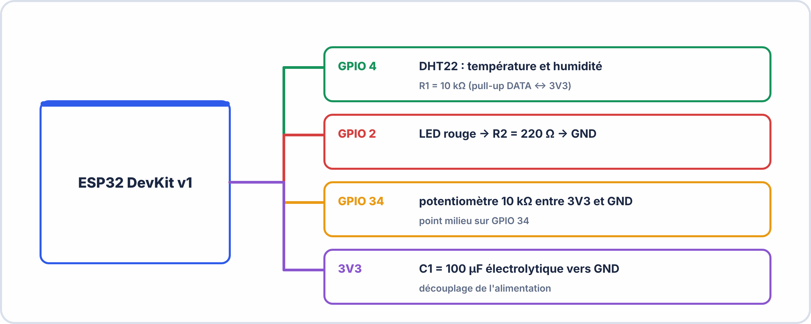

# 🔬 TP MESURE + PV RAPIDE — S1 · 3ᵉ ANNÉE · E2
## Circuit Fourni · Multimètre · Oscilloscope · Remise en Condition Pratique

---

> **Nom** : ___________________________ **Groupe** : ___________________________
> **Date** : ___________________________
> **Durée** : 90 minutes · **Fiche technique DHT22 disponible**
> **Matériel** : Circuit SONDE_E2_A3 · Multimètre · Oscilloscope · PC + Arduino IDE

---

## 🎯 Objectif de ce TP

> Remettre les mains dans le matériel dès le premier jour de Terminale.
> Mesurer des composants réels, lire un capteur, observer un signal.
> Rédiger un mini-PV en fin de séance.

---

## 📋 Description du circuit fourni



```
Composants à mesurer :
  R1 = résistance marquée sur la carte · valeur nominale : 10 kΩ ±5%
  R2 = résistance marquée sur la carte · valeur nominale : 220 Ω ±5%
  C1 = condensateur électrolytique · valeur marquée : 100 µF
  D1 = diode 1N4007 (sur le circuit d'alimentation)
```

---

## 🟢 PARTIE 1 — Mesures avec le multimètre (30 min)

### 1.1 Mesure de résistances

> **Rappel** : toujours mesurer une résistance **hors tension** et si possible **hors circuit** (déconnecter au moins une patte).

```
RÉSISTANCE R1 (10 kΩ) :
  Valeur nominale : 10 000 Ω ± 5%
  Plage acceptable : _______ Ω à _______ Ω

  Mesure 1 : _______ Ω
  Mesure 2 (repositionner les sondes) : _______ Ω
  Moyenne : _______ Ω

  Écart en % par rapport à la valeur nominale :
  Écart% = (|mesure − nominale| / nominale) × 100 = _______ %
  ☐ Dans la tolérance (±5%)  ☐ Hors tolérance

RÉSISTANCE R2 (220 Ω) :
  Mesure : _______ Ω · Écart : _______ % · ☐ Conforme ☐ Non conforme
```

### 1.2 Mesure de tension en circuit

> Relier l'ESP32 à l'USB. Attendre le démarrage (LED clignotante ou fixe).

```
Tension 3V3 (entre pin 3V3 et GND de l'ESP32) :
  Valeur attendue : 3,3 V ± 5% (plage : _______ V à _______ V)
  Mesure : _______ V
  ☐ Dans la tolérance  ☐ Hors tolérance

Tension aux bornes de la LED allumée (si GPIO2 = HIGH) :
  Valeur attendue : environ 1,8 V à 2,2 V (chute directe LED rouge)
  Mesure : _______ V
  Le courant traversant la LED : I = (3,3 − Vled) / R2 = (3,3 − _____) / 220 = _______ mA
```

### 1.3 Test de la diode 1N4007

```
Mode "test diode" du multimètre (symbole ─|►─) :

Sens passant (anode → cathode) :
  Indication attendue : environ 0,5 V à 0,7 V
  Mesure : _______ V   ☐ Diode fonctionnelle

Sens bloqué (cathode → anode) :
  Indication attendue : "OL" ou "1." (circuit ouvert)
  Mesure : _______     ☐ Pas de court-circuit
```

### 1.4 Potentiomètre

```
Mesurer la tension au point milieu du potentiomètre (entre curseur et GND)
pour deux positions extrêmes et une position milieu :

Position min (curseur vers GND) : _______ V  (attendu ≈ 0 V)
Position milieu               : _______ V  (attendu ≈ 1,65 V)
Position max (curseur vers 3V3): _______ V  (attendu ≈ 3,3 V)

La tension varie bien entre 0 et 3,3 V ? ☐ Oui ☐ Non
```

---

## 🟡 PARTIE 2 — Lecture du DHT22 via Arduino (25 min)

### 2.1 Flasher le code de lecture

> Ouvrir Arduino IDE. Créer un nouveau sketch et coller ce code :

```cpp
#include <DHTesp.h>  // bibliothèque DHTesp (déjà installée)

DHTesp dht;
const int PIN_DHT = 4;

void setup() {
  Serial.begin(115200);
  dht.setup(PIN_DHT, DHTesp::DHT22);
  Serial.println("DHT22 initialisé — en attente de mesures...");
}

void loop() {
  delay(2000);  // DHT22 : attendre au moins 2 s entre deux lectures
  
  TempAndHumidity data = dht.getTempAndHumidity();
  
  if (dht.getStatus() == DHTesp::ERROR_NONE) {
    Serial.print("Température : ");
    Serial.print(data.temperature, 1);
    Serial.print(" °C  |  Humidité : ");
    Serial.print(data.humidity, 0);
    Serial.println(" %");
  } else {
    Serial.println("Erreur DHT22 : " + String(dht.getStatusString()));
  }
}
```

### 2.2 Relevé de mesures

> Flasher · ouvrir le Moniteur Série (115200 baud) · noter 5 relevés :

| N° | Température DHT22 (°C) | Humidité DHT22 (%) | Observation |
|---|---|---|---|
| 1 | | | Conditions normales |
| 2 | | | |
| 3 | | | |
| 4 | | | Doigt sur le capteur |
| 5 | | | Après retrait du doigt |

```
Biais apparent (comparé à la T° de référence affichée en salle) :
  T° référence salle : _______ °C
  T° DHT22 moyenne (relevés 1-3) : _______ °C
  Biais estimé : _______ °C
```

### 2.3 Observer l'auto-échauffement

```
Observations :
  Avec le doigt (ajout de chaleur) : T° passe de _____ à _____ °C
  Après retrait : T° revient en _____ secondes environ
  
  Commentaire (ce que ça nous dit sur le temps de réponse du DHT22) :
  _______________________________________________________________________
```

---

## 🟠 PARTIE 3 — Oscilloscope (20 min)

> Si un oscilloscope est disponible.

### 3.1 Observer le signal de la LED (signal PWM GPIO2)

> Modifier le code Arduino pour faire clignoter la LED à 50 Hz :

```cpp
void loop() {
  digitalWrite(2, HIGH); delay(10);  // 10ms HIGH
  digitalWrite(2, LOW);  delay(10);  // 10ms LOW → période = 20ms → 50 Hz
}
```

```
Connecter la sonde oscilloscope sur GPIO 2 (masse sur GND)

Fréquence mesurée : _______ Hz (attendu : 50 Hz)
Période mesurée   : _______ ms (attendu : 20 ms)
Amplitude haute   : _______ V  (attendu : ≈ 3,3 V)
Amplitude basse   : _______ V  (attendu : ≈ 0 V)
Rapport cyclique  : _______ %  (attendu : 50%)
```

### 3.2 Observer le bruit sur l'alimentation 3V3

```
Connecter la sonde sur la broche 3V3 de l'ESP32.
Mode AC-coupling · gain × 10 · time/div = 5 ms

Sans LED qui clignote :
  Amplitude du bruit : _______ mV crête-à-crête

Avec LED qui clignote (50 Hz) :
  Amplitude du bruit : _______ mV crête-à-crête
  
Observation : le bruit ☐ augmente ☐ reste stable quand la LED commute.
Ce phénomène s'explique par : _______________________________________________
```

---

## 🔴 PARTIE 4 — Mini PV de mesure (15 min)

> Rédiger un PV synthétique des mesures effectuées.

```
PROCÈS-VERBAL DE MESURE — Carte SONDE_E2_A3
Opérateur : ___________________  Date : ___________________

RÉSUMÉ DES MESURES :

Composant     | Val. nominale | Val. mesurée | Écart | Conformité
R1 (10kΩ)    | 10 000 Ω      | __________ Ω | ___% | ☐ OK ☐ KO
R2 (220Ω)    | 220 Ω         | __________ Ω | ___% | ☐ OK ☐ KO
Vcc (3V3)    | 3,3 V ±5%     | __________ V |       | ☐ OK ☐ KO
Diode 1N4007 | 0,5-0,7 V     | __________ V |       | ☐ OK ☐ KO
DHT22 (T°)   | T° salle      | __________ °C| ___°C | ☐ OK ☐ KO
Fréq LED     | 50 Hz         | __________ Hz|       | ☐ OK ☐ KO

BILAN DES MESURES :
  Nombre de mesures conformes : _______ / 6
  Non conformités observées : _______________________________________________
  Cause probable des non-conformités (si applicable) : _______________________

CONCLUSION :
  La carte SONDE_E2_A3 est : ☐ Conforme  ☐ Non conforme  ☐ Conforme avec réserve

Signature : ___________________________  Date : _______________
```

---
