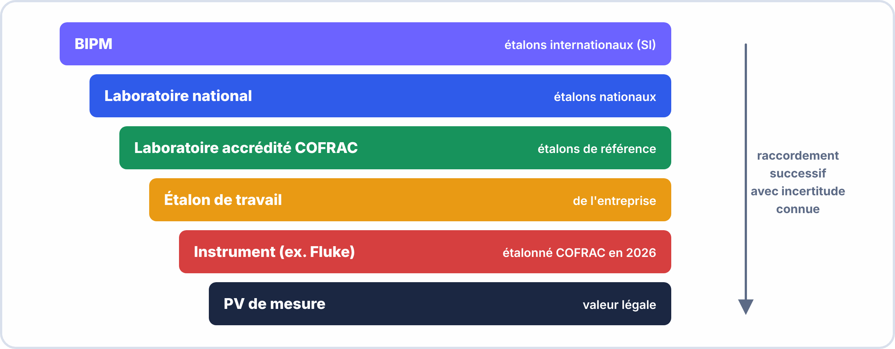
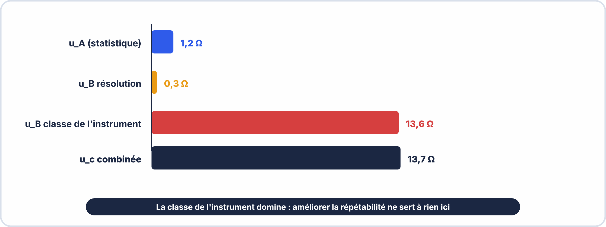

# 📖 FICHE COURS – S2 ANNÉE 3 – E2
## Rapport de Mesures : PV Professionnel, Traçabilité, Incertitudes, Norme IPC

---

## 🎯 OBJECTIFS

- ✅ Rédiger un PV de mesure professionnel (structure, champs, signature)
- ✅ Expliquer la traçabilité métrologique et l'étalonnage
- ✅ Calculer une incertitude de mesure (type A, type B, combinée, élargie)
- ✅ Connaître les critères d'acceptabilité IPC-A-610 par classe
- ✅ Rédiger un rapport de conformité (conforme / non conforme)


### 🤔 À ton avis ?

Tu mesures 5,02 V sur une alimentation. Le client te demande : « Êtes-vous **sûr** de cette valeur ? ». Que peux-tu répondre pour que ta mesure ait de la **valeur professionnelle** ?

??? question "Voir une réponse possible"
    Tu dois pouvoir dire **avec quel instrument** tu as mesuré (et qu'il est vérifié), **comment**, et **avec quelle marge de doute** : « $5{,}02 \pm 0{,}03\,\mathrm{V}$ ». Une valeur sans incertitude ni traçabilité n'est qu'une **opinion**.
    
    Dans cette séance, tu apprends à **rédiger un PV de mesures**, à **calculer l'incertitude** et à **conclure sur la conformité**.

---

## 1️⃣ DE LA MESURE AU PROCÈS-VERBAL

### La limite d'une mesure brute

> Vous lisez `22,4°C` sur votre sonde. Cette valeur seule ne prouve rien :
> - Est-ce que l'instrument est fiable ?
> - Est-ce que vous l'avez lu correctement ?
> - Est-ce que ce chiffre tient compte de l'erreur de l'instrument ?
> - Qui peut confirmer que cette mesure a bien été réalisée ?

> Un **Procès-Verbal (PV) de mesure** transforme une lecture en preuve documentée, opposable, traçable.

### La valeur légale d'un PV

| **Mesure brute** | **PV de mesure professionnel** |
|---|---|
| Valeur lue à l'écran | Valeur + incertitude + unité |
| Instrument inconnu | Instrument identifié (marque, modèle, N° de série) |
| Conditions non précisées | Conditions (T°, hygrométrie, date, lieu) |
| Aucune traçabilité | Certificat d'étalonnage référencé |
| Non signé | Signé par le mesureur et le responsable qualité |
| Non daté | Daté et numéroté |


> [!TIP] 💡 En clair
> Un **mesurage** donne un **nombre**. Un **procès-verbal (PV)** lui donne un **contexte** : qui a mesuré, quand, avec quoi, dans quelles conditions et avec quel résultat. Sans ce contexte, personne ne peut **refaire** ni **vérifier** la mesure.

### ✅ Vérifie que tu as compris

**Q1.** Pourquoi un nombre seul ne suffit-il pas dans un PV ?

??? success "Réponse"
    Parce qu'on ne peut ni **refaire** ni **vérifier** la mesure sans connaître l'instrument, les conditions et la méthode.

**Q2.** Cite trois informations de contexte d'un PV.

??? success "Réponse"
    Par exemple : **date**, **opérateur**, **instrument utilisé**, **conditions**, **méthode**.

---

## 2️⃣ STRUCTURE D'UN PV DE MESURE PROFESSIONNEL

### Les 10 sections d'un PV complet

```
━━━━━━━━━━━━━━━━━━━━━━━━━━━━━━━━━━━━━━━━━━━━━━━━━━━━━━━━━━━━━━
  PROCÈS-VERBAL DE MESURE
━━━━━━━━━━━━━━━━━━━━━━━━━━━━━━━━━━━━━━━━━━━━━━━━━━━━━━━━━━━━━━

1. EN-TÊTE ET IDENTIFICATION
   Référence PV    : PV-2026-ESP32-001
   Date            : 2026-03-20
   Lieu            : Labo électronique – CFA [Ville]
   Donneur d'ordre : INDUSTECH SAS – M. DUBOIS

2. OBJET DE LA MESURE
   Vérification des résistances de pull-up I2C sur carte ESP32

3. ÉQUIPEMENT SOUS TEST (EUT)
   Désignation     : Carte ESP32 IoT AGROSMART
   Référence       : ASM-001-REV2
   N° de série     : SN20260320-03

4. INSTRUMENTS UTILISÉS
   ┌───────────────────────────────────────────────────────┐
   │  Appareil    : Multimètre numérique Fluke 87V        │
   │  N° de série : 7435280                               │
   │  Calibration : 2026-01-15 – Cert. N° LAB-2026-0047  │
   │  Classe      : 0,5                                   │
   │  Validité    : 2027-01-14                            │
   └───────────────────────────────────────────────────────┘

5. CONDITIONS DE MESURE
   Température ambiante : 22°C ± 2°C
   Hygrométrie          : 45% HR ± 10%
   Réseau électrique    : Mesure hors tension (Ω)

6. RÉSULTATS DE MESURE
   (voir tableau section suivante)

7. INCERTITUDES
   (voir calcul section suivante)

8. CONCLUSION / CONFORMITÉ
   ☐ Conforme    ☐ Non conforme    ☐ Sous réserve

9. REMARQUES ET OBSERVATIONS

10. SIGNATURES
    Mesureur : ________________    Responsable qualité : ________________
━━━━━━━━━━━━━━━━━━━━━━━━━━━━━━━━━━━━━━━━━━━━━━━━━━━━━━━━━━━━━━
```


> [!TIP] 💡 En clair
> Un PV professionnel suit **toujours le même plan** : **identification** (qui, quoi, quand), **instruments** (avec leur étalonnage), **méthode**, **résultats** (mesure, incertitude, unité), **conclusion** (conforme ou non) et **signature**. Cette structure permet à n'importe qui de **retrouver** l'information en quelques secondes.

> [!WARNING] ⚠️ Erreurs fréquentes
> - Oublier l'**unité** à côté du résultat.
> - Donner une conclusion (« conforme ») sans **critère** ni **valeur limite** associée.

### ✅ Vérifie que tu as compris

**Q1.** Où indique-t-on la validité de l'étalonnage de l'instrument ?

??? success "Réponse"
    Dans la partie **instruments** du PV.

**Q2.** Un PV peut-il se terminer par « ça marche » ?

??? success "Réponse"
    **Non** : la conclusion doit comparer le résultat à un **critère** chiffré.

> [!SUCCESS] 🧠 À retenir
> - PV = identification, instruments, méthode, résultats, conclusion, signature.

---

## 3️⃣ TRAÇABILITÉ MÉTROLOGIQUE

### La chaîne de raccordement

> La **traçabilité métrologique** garantit qu'une mesure peut être reliée, par une chaîne ininterrompue de comparaisons, aux étalons nationaux et internationaux.

```
BIPM (Bureau International des Poids et Mesures — Sèvres)
  ↓ Définition SI (le métre, l'ampère, le kelvin...)
LNE (Laboratoire National de Métrologie et d'Essais — France)
  ↓ Étalons primaires nationaux
Laboratoire accrédité COFRAC
  ↓ Certificat d'étalonnage ISO/CEI 17025
Votre multimètre étalonné
  ↓ Mesure avec incertitude connue
VOTRE PV DE MESURE
```

> **Sans cette chaîne**, votre mesure ne peut pas être opposée à une norme, un contrat ou un tribunal.

### L'étalonnage d'un instrument

> **Étalonner** un instrument = le comparer à un étalon de référence de niveau supérieur et déterminer son erreur systématique.

> **Certificat d'étalonnage** : document émis par un laboratoire accrédité attestant que l'instrument a été comparé à des étalons raccordés, à une date précise, dans des conditions définies, avec les incertitudes mesurées.

```
Ce que contient un certificat d'étalonnage :
  ✅ Identification de l'instrument (modèle, N° de série)
  ✅ Date d'étalonnage
  ✅ Organisme étalonnant (COFRAC ou équivalent)
  ✅ Résultats : erreur constatée par gamme de mesure
  ✅ Incertitude de mesure de l'étalonnage
  ✅ Validité (durée avant prochain étalonnage)
```

> ⚠️ Un instrument non étalonné ou avec un étalonnage périmé ne peut pas servir à produire un PV opposable.


> [!TIP] 💡 En clair
> La **traçabilité métrologique**, c'est la **chaîne** qui relie ton multimètre à un **étalon de référence** : ton instrument est comparé (**étalonné**) à un instrument plus précis, lui-même comparé à un autre, jusqu'à l'étalon national. Un instrument dont l'**étalonnage est périmé** ne peut plus servir de preuve.

### ✅ Vérifie que tu as compris

**Q1.** Que signifie « étalonner » un instrument ?

??? success "Réponse"
    Le **comparer à un instrument de référence** plus précis et noter l'écart.

**Q2.** Ton multimètre a une date d'étalonnage dépassée. Peux-tu l'utiliser pour un PV ?

??? success "Réponse"
    **Non** : ses mesures ne sont plus garanties, donc **pas valables** dans un PV officiel.

> [!SUCCESS] 🧠 À retenir
> - Traçabilité = chaîne d'étalonnages jusqu'à la référence.

---



---

## 4️⃣ INCERTITUDES DE MESURE

> [!NOTE] 🎚️ Deux niveaux pour cette partie
> **Essentiel** : toute mesure a un doute. On l'estime avec la **précision donnée par le constructeur** de l'instrument, par exemple ±(0,5 % de la lecture + 2 chiffres) pour un multimètre. **Exemple** : lecture 5,02 V ; 0,5 % de 5,02 = 0,025 V ; 2 chiffres de 0,01 V = 0,02 V ; marge ≈ 0,045 V, arrondie à 0,05 V → **(5,02 ± 0,05) V**. On conclut en comparant **toute la plage** « valeur ± marge » à la tolérance.
>
> **🔶 Approfondissement** : le calcul complet (type A, type B, incertitude combinée et élargie) qui suit.


### Pourquoi aucune mesure n'est parfaite

> Toute mesure est affectée d'une incertitude — un doute sur la valeur "vraie". Cette incertitude a deux origines :
> - Les **variations aléatoires** (bruit, instabilité) → Incertitude de **type A**
> - Les **limites connues de l'instrument** (résolution, classe, étalonnage) → Incertitude de **type B**


> [!TIP] 💡 En clair
> **Exemple pas à pas** avec 4 mesures d'une tension : $100{,}2$ ; $99{,}8$ ; $100{,}0$ ; $100{,}4$ (en mV).
>
> 1. **Moyenne** : $\bar{x} = 100{,}1$.
> 2. **Écart-type** : $s \approx 0{,}26$.
> 3. **Type A** : $u_A = \dfrac{s}{\sqrt{n}} = \dfrac{0{,}26}{2} \approx 0{,}13$.
> 4. **Type B (résolution 0,1)** : $\dfrac{0{,}1}{2\sqrt{3}} \approx 0{,}03$.
> 5. **Type B (classe 1 %)** : $\dfrac{1 \times 100{,}1}{100 \times \sqrt{3}} \approx 0{,}58$.
> 6. **Combinée** : $u_c = \sqrt{0{,}13^2 + 0{,}03^2 + 0{,}58^2} \approx 0{,}59$.
> 7. **Élargie** : $U = 2 \times 0{,}59 \approx 1{,}2$.
>
> **Résultat :** $(100{,}1 \pm 1{,}2)\,\mathrm{mV}$ avec 95 % de confiance.

### ✅ Vérifie que tu as compris

**Q1.** Quelle composante domine ici ?

??? success "Réponse"
    La **classe de l'instrument** (0,58) : elle est bien plus grande que les deux autres.

**Q2.** Pourquoi multiplie-t-on par $k = 2$ ?

??? success "Réponse"
    Pour obtenir un **niveau de confiance de 95 %**.

**Q3.** À quoi sert-il de répéter la mesure plusieurs fois ?

??? success "Réponse"
    À réduire la part **aléatoire** : $u_A = \dfrac{s}{\sqrt{n}}$ diminue quand $n$ augmente.

> [!WARNING] ⚠️ Erreurs fréquentes
> - **Additionner** les incertitudes au lieu de les combiner en quadrature (racine de la somme des carrés).
> - Donner trop de **chiffres** : une incertitude s'arrondit à 1 ou 2 chiffres significatifs, **par excès**.

> [!SUCCESS] 🧠 À retenir
> - $u_c = \sqrt{u_A^2 + u_{B,\mathrm{rés}}^2 + u_{B,\mathrm{classe}}^2}$ et $U = k \cdot u_c$ (avec $k = 2$).
> - Résultat = valeur ± U, avec l'unité.

---

### Incertitude de type A — Statistique

> Calculée par répétition de la mesure. Pour n mesures de même grandeur :

$$u_{A} = \frac{s}{\sqrt{n}} \quad \text{où} \quad s = \sqrt{\frac{1}{n-1}\sum_{i=1}^{n}(x_{i} - \bar{x})^2}$$

**Exemple (n=5 mesures de résistance) :**

Mesures : 4 701 Ω / 4 698 Ω / 4 705 Ω / 4 702 Ω / 4 699 Ω  
Moyenne x̄ = 4 701 Ω  
Écart-type s = 2,7 Ω  

$$u_{\mathrm{A}} = 2{,}7 / \sqrt{5} = 1{,}2\,\mathrm{\Omega }$$

---

### Incertitude de type B — Instruments

**Source 1 : résolution de l'affichage numérique**

> L'affichage numérique ne peut donner que des valeurs discrètes. L'erreur maximale est ±½ du dernier chiffre.

$$u_{B,rés} = \frac{\text{résolution}}{2\sqrt{3}}$$

**Exemple :** Multimètre affiche `4 703 Ω`, résolution = 1 Ω

$$u_{B,rés} = \frac{1}{2\sqrt{3}} = \frac{1}{3,46} \approx 0,29 \text{ Ω}$$

**Source 2 : classe de l'instrument**

> La classe est l'erreur maximale exprimée en % de la valeur mesurée.

$$u_{B,classe} = \frac{\text{classe\%} \times \text{valeur lue}}{100 \times \sqrt{3}}$$

**Exemple :** Fluke 87V, classe 0,5%, mesure 4 703 Ω

$$u_{B,classe} = \frac{0,5 \times 4703}{100 \times 1,73} = \frac{23,5}{173} \approx 13,6 \text{ Ω}$$

---

### Incertitude combinée et élargie

$$\boxed{u_c = \sqrt{u_A^2 + u_{B,rés}^2 + u_{B,classe}^2}}$$

$$\boxed{U = k \cdot u_{c} \quad \text{avec } k=2 \text{ pour 95\% de confiance}}$$

**Exemple complet :**

$$u_{\mathrm{A}} = 1{,}2\,\mathrm{\Omega }$$

$$u_{\mathrm{B,rés}} = 0{,}3\,\mathrm{\Omega }$$

$$u_{\mathrm{B,classe}} = 13{,}6\,\mathrm{\Omega }$$

$$u_{\mathrm{c}} = \sqrt{1{,}2^2 + 0{,}3^2 + 13{,}6^2} = \sqrt{1{,}44 + 0{,}09 + 184{,}96} = \sqrt{186{,}49} = 13{,}7\,\mathrm{\Omega }$$

U = 2 × 13,7 = 27,4 Ω  → arrondi à 30 Ω (règle : 1 chiffre significatif sur U)  

Résultat : R = (4 703 ± 30) Ω  [niveau de confiance 95%]  

> **Règle d'arrondi :** L'incertitude élargie s'arrondit **par excès à 1 chiffre significatif** (sauf si commence par 1 ou 2 → 2 chiffres). La valeur mesurée s'arrondit ensuite au même rang décimal que U.

---



---

## 5️⃣ NORME IPC-A-610 — ACCEPTABILITÉ DES ASSEMBLAGES

### Qu'est-ce que la norme IPC-A-610 ?

> La norme **IPC-A-610** (Acceptability of Electronic Assemblies) est le standard international le plus utilisé dans l'industrie électronique pour définir les critères d'acceptabilité des brasures, du placement des composants et des défauts d'assemblage.

### Les 3 classes IPC

| **Classe** | **Usage** | **Exemples** |
|---|---|---|
| **Classe 1** | Produits grand public, tolérance haute aux défauts | Jouets électroniques, appareils ménagers bas de gamme |
| **Classe 2** | Produits industriels et commerciaux | Équipement IoT industriel, automates, systèmes embarqués |
| **Classe 3** | Applications critiques, défaillance inacceptable | Médical, aérospatial, militaire, nucléaire |

> **En BAC PRO CIEL** : votre projet IoT industriel est typiquement **Classe 2**.


> [!TIP] 💡 En clair
> La norme **IPC-A-610** classe la qualité d'un assemblage en **trois classes** selon l'usage du produit (électronique grand public, professionnelle, haute fiabilité). Plus la classe est élevée, plus les critères sont **sévères**. Chaque défaut est jugé : **acceptable**, **défaut** ou **indicateur de processus**.

### ✅ Vérifie que tu as compris

**Q1.** À quoi sert la norme IPC-A-610 ?

??? success "Réponse"
    À **juger la qualité d'un assemblage** (soudures, positionnement) avec des critères précis.

**Q2.** Pourquoi une carte de pacemaker n'est-elle pas jugée comme un jouet ?

??? success "Réponse"
    Parce que sa **classe** est plus élevée : critères plus **stricts**, car la panne serait grave.

---

### Critères d'acceptabilité des brasures (CMS)

| **Critère** | **Conforme** (Target) | **Acceptable** | **Non conforme** |
|---|---|---|---|
| **Mouillage** | Soudure lisse, brillante, bonne extension | Légèrement terne, mouillage partiel | Perle de soudure, non-mouillage |
| **Angle de contact** | < 90° | 90°–120° | > 120° (beurk) |
| **Hauteur de brasure** | 25–75% de la hauteur du composant | ≥ 25% | < 25% |
| **Excès de soudure (bridging)** | Absent | Absent (Cl.1: acceptable) | Non conforme Cl.2/3 |
| **Composant déplacé CMS** | < 25% de la largeur | 25–50% | > 50% |

### Critères pour les trous traversants (PTH)

| **Critère** | **Cl.1** | **Cl.2** | **Cl.3** |
|---|---|---|---|
| Remplissage du trou | ≥ 50% | ≥ 75% | ≥ 75% |
| Void dans la brasure | ≤ 25% | ≤ 10% | ≤ 10% |
| Pointe de soudure (icicle) | Acceptable | Non conforme | Non conforme |

---

## 6️⃣ RAPPORT DE CONFORMITÉ

### Les 3 conclusions possibles

| **Conclusion** | **Définition** | **Formulation** |
|---|---|---|
| **Conforme** | Toutes les exigences sont satisfaites | "L'assemblage est déclaré conforme à la norme IPC-A-610 Classe 2" |
| **Non conforme** | Au moins une exigence n'est pas satisfaite | "L'assemblage présente X défauts non conformes — rejeté" |
| **Sous réserve** | Conforme avec une observation ou une restriction | "Conforme sous réserve de correction du pont de soudure en C3-C4" |


> [!TIP] 💡 En clair
> Pour conclure à la **conformité**, compare **toute la plage** « valeur ± U » à la **limite** : si la plage reste dans la tolérance, c'est **conforme** ; si elle **dépasse** même partiellement, la conclusion est **incertaine** ou **non conforme**.

### ✅ Vérifie que tu as compris

**Q1.** Résultat : $(5{,}02 \pm 0{,}03)\,\mathrm{V}$ ; tolérance : de 4,95 V à 5,05 V. Conforme ?

??? success "Réponse"
    **Oui** : la plage va de 4,99 V à 5,05 V, entièrement dans la tolérance.

**Q2.** Même résultat mais $\pm 0{,}08\,\mathrm{V}$. Conforme ?

??? success "Réponse"
    **Non garanti** : la plage va de 4,94 V à 5,10 V et **dépasse** la tolérance.

> [!SUCCESS] 🧠 À retenir
> - On compare la plage « valeur ± U » à la tolérance, pas seulement la valeur.

---

## ✅ AUTO-ÉVALUATION

- [ ] Je sais nommer les 10 sections d'un PV de mesure professionnel
- [ ] Je comprends la chaîne de traçabilité (BIPM → LNE → COFRAC → instrument)
- [ ] Je sais calculer $u_{A}$ (statistique), $u_{B}$ résolution et $u_{B}$ classe
- [ ] Je sais calculer $u_{c}$ (combinée) et U (élargie avec k=2)
- [ ] Je sais exprimer un résultat : valeur ± U unité [confiance 95%]
- [ ] Je connais les 3 classes IPC et leurs applications
- [ ] Je distingue "conforme", "acceptable" et "non conforme" IPC
- [ ] Je sais rédiger une conclusion de conformité en 1 phrase

---

## 📚 VOCABULAIRE CLEF

| **Terme** | **Définition** |
|---|---|
| **PV de mesure** | Procès-Verbal — document officiel attestant d'une mesure avec traçabilité |
| **Traçabilité** | Propriété d'une mesure reliée aux étalons nationaux/internationaux |
| **Étalonnage** | Comparaison d'un instrument à un étalon de référence plus précis |
| **COFRAC** | Comité Français d'Accréditation — organisme qui accrédite les laboratoires d'étalonnage |
| **LNE** | Laboratoire National de Métrologie et d'Essais — référence nationale française |
| **BIPM** | Bureau International des Poids et Mesures — référence internationale des unités SI |
| **Incertitude type A** | Incertitude évaluée statistiquement par répétition des mesures |
| **Incertitude type B** | Incertitude évaluée à partir de données instruments (résolution, classe) |
| **Incertitude combinée** | $u_{c} = \sqrt{u_A^2 + u_{B}^2}$ |
| **Incertitude élargie** | $U = k \cdot u_{c}$ avec k=2 (~95% confiance) |
| **Classe d'instrument** | Erreur maximale en % de la pleine échelle ou de la valeur lue |
| **Résolution** | Plus petit écart affichable par l'instrument (ex: 0,1°C, 1 Ω) |
| **IPC-A-610** | Norme internationale d'acceptabilité des assemblages électroniques |
| **Classe 2 IPC** | Niveau industriel standard — critères de qualité élevés |
| **Brasure conforme** | Brasure satisfaisant tous les critères IPC (mouillage, angle, hauteur) |

---

## 📌 POINTS-CLÉS À RETENIR

1. Un PV sans date, sans instrument identifié et sans signature est **sans valeur légale**
2. La traçabilité = chaîne **BIPM → LNE → COFRAC → instrument étalonné → PV**
3. `u_A = s/√n` (répétitions) ; `u_B = résolution/(2√3)` ; `u_B = (classe%×valeur)/(100√3)`
4. `U = 2 × u_c` → confiance 95% — **k=2 est la valeur standard**
5. Expression : `R = (4 703 ± 30) Ω [95%]` — **toujours arrondir U par excès à 1 chiffre sig.**
6. IPC Classe 2 = standard IoT industriel — pont de soudure = **non conforme**
7. Rapport de conformité : **conforme / non conforme / sous réserve** — jamais juste "OK" ou "KO"

---

**Document – BAC PRO CIEL – A3 – E2/U22 – Version 1.0 – 2026**
