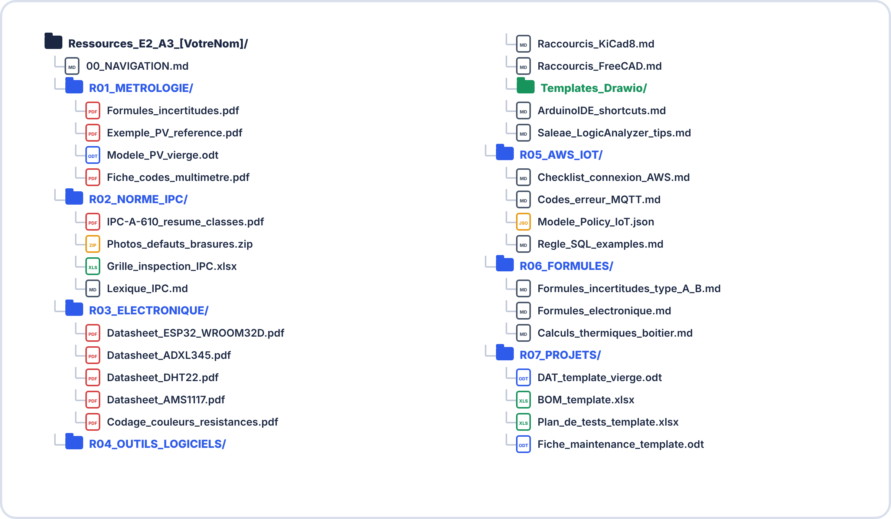

# 📚 DOSSIER DE RESSOURCES E2 — ANNÉE 3
## Métrologie, IPC-A-610, Outils, Références normatives

> [!NOTE] À quoi sert ce document ?
> C'est ta **boîte à outils de consultation rapide** pour les TP de Terminale et pour l'**épreuve pratique** (3 h). Ce n'est **pas un cours** : on y **retrouve vite** une formule, un code d'erreur, un modèle de PV ou un critère de norme, sans avoir à tout apprendre par cœur.
>
> **Quand le consulter ?**
>
> | Situation | Fiche utile |
> |---|---|
> | Rédiger un PV de mesure | **R01** modèle de PV · **R06** formules d'incertitude |
> | Contrôler une carte (soudures) | **R02** grille IPC-A-610 |
> | Dessiner un schéma ou un circuit imprimé | **R04** raccourcis KiCad |
> | Une connexion MQTT ne marche pas | **R05** codes d'erreur MQTT |
> | Calculer (Ohm, puissance, diviseur, filtre RC, thermique) | **R06** formules essentielles |
>
> **Comment l'utiliser à l'examen ?** Les sujets fournissent un **dossier de ressources** (extraits de datasheet, valeurs nominales) : s'entraîner avec cette page apprend à **lire un document technique et à y chercher l'information utile**. Les sujets types sont en [S13](../S13-documents-autorises-tp-complet-2h/README.md) et [S15](../S15-document-autorise-examen-complet-2h/README.md).

> [!TIP] 💡 Les fiches ci-dessous sont **fournies** (R01, R02, R04, R05, R06). Les autres (R03 datasheets, R07 modèles de projet) sont à **télécharger ou à constituer toi-même** au fil de l'année : voir l'arborescence en fin de page.

---

## 📋 R01 — Modèle de PV de mesure vierge

> **Quand l'utiliser ?** Dès qu'on te demande un **procès-verbal** (TP de métrologie, examen). Recopie ces rubriques et complète-les : rien ne doit manquer.

| Rubrique | À renseigner |
|---|---|
| **En-tête** | Réf. PV-[AAAA]-[PROJET]-[NNN] · date · lieu · donneur d'ordre · objet |
| **EUT** (équipement sous test) | désignation · référence · n° de série |
| **Instrument de mesure** | appareil · marque · modèle · n° de série · classe (%) · certificat · date d'étalonnage · validité |
| **Conditions de mesure** | température (°C) · hygrométrie (% HR) |
| **Résultats** | tableau : grandeur · valeur mesurée · incertitude · résultat [95 %] |
| **Spécification appliquée** | la valeur limite ou la norme visée |
| **Conformité** | ☐ Conforme  ☐ Non conforme  ☐ Sous réserve de … |
| **Remarques** | observations utiles |
| **Signatures** | mesureur · responsable qualité · date |

---

## 📋 R02 — Grille d'inspection IPC-A-610 rapide

| **Défaut** | **Cl.1** | **Cl.2** | **Cl.3** |
|---|---|---|---|
| Décalage CMS < 25% largeur | Acc. | Acc. | NC |
| Décalage CMS 25–50% | Acc. | NC | NC |
| Pont de soudure (bridging) | Acc. | NC | NC |
| Pointe soudure (icicle) | Acc. | NC | NC |
| Remplissage PTH < 50% | Acc. | NC | NC |
| Remplissage PTH 50–75% | Acc. | NC | NC |
| Remplissage PTH ≥ 75% | ✅ | ✅ | ✅ |
| Void brasure > 25% | Acc. | NC | NC |
| Résidu flux (colophane) | ✅ | Acc. | Acc. |
| Composant manquant | NC | NC | NC |

**Légende :** ✅ Conforme (target) / Acc. = Acceptable / NC = Non conforme

---

## 🔑 R04 — Raccourcis KiCad 8

| **Action** | **Raccourci** |
|---|---|
| Ajouter symbole | `A` |
| Ajouter fil | `W` |
| Ajouter label réseau | `L` |
| Ajouter alimentation | `P` |
| Propriétés composant | `E` |
| Déplacer (avec connexions) | `G` |
| Annoter schéma | Tools → Annotate Schematic |
| ERC | Inspect → Electrical Rules Checker |
| Générer netlist | File → Export → Netlist |
| Zoom ajusté | `Ctrl+Shift+H` |
| Supprimer | `Del` |
| Annuler | `Ctrl+Z` |

---

## 🌐 R05 — Codes d'erreur MQTT (PubSubClient)

| **Code** | **Constante** | **Cause** | **Action** |
|---|---|---|---|
| **-4** | BAD_PROTOCOL | Version MQTT incompatible | Vérifier bibliothèque |
| **-3** | DISCONNECTED | Déconnecté | Vérifier réseau |
| **-2** | CONNECT_FAILED | TCP impossible | Vérifier IP broker |
| **-1** | DISCONNECTED | Avant connect() | Appeler connect() |
| **0** | CONNECTED | ✅ Connecté | — |
| **5** | UNAUTHORIZED | Auth refusée | Vérifier certificats ou PSK |
| **-8** | UNAUTHORIZED | Policy trop restrictive | Console AWS → Policy |

---

## 📐 R06 — Aide-mémoire : formules essentielles

### Métrologie et incertitudes

$$u_{A} = \frac{s}{\sqrt{n}} \quad \text{avec} \quad s = \sqrt{\frac{\sum(x_{i} - \bar{x})^2}{n-1}}$$

$$u_{B,résolution} = \frac{\text{résolution}}{2\sqrt{3}}$$

$$u_{B,classe} = \frac{\text{classe\%} \times \text{valeur}}{100\sqrt{3}}$$

$$u_{c} = \sqrt{u_A^2 + u_{B1}^2 + u_{B2}^2 + \ldots}$$

$$U = k \cdot u_{c} \quad (k=2 \text{ pour 95\%})$$

$$\text{Expression : } \boxed{X = (\bar{x} \pm U) \text{ unité [95\%]}}$$

### Électronique

$$U = R \times I \quad [\text{V} = \Omega \times \text{A}]$$

$$P = U \times I = \frac{U^2}{R} = R \times I^2 \quad [\text{W}]$$

$$\text{Diviseur de tension : } U_{out} = U_{in} \times \frac{R_2}{R_1 + R_{2}}$$

$$\text{Filtre RC : } f_{c} = \frac{1}{2\pi RC}$$

$$\text{Thermique : } \Delta T = \frac{P}{k \times S} \quad (k \approx 5 \text{ W/m²·K convection naturelle})$$

---

## 🗂️ Arborescence conseillée du dossier complet

> Les dossiers **R03** (datasheets) et **R07** (modèles de projet) ne sont pas fournis ici : tu les **constitues** au fil de l'année.

---

## 🔗 RESSOURCES EN LIGNE (vérifiées 2026)

| **Ressource** | **URL** | **Usage** |
|---|---|---|
| IPC-A-610 description officielle | ipc.org | Référence normative |
| LNE métrologie | lne.fr | Traçabilité française |
| COFRAC accréditations | cofrac.fr | Trouver un labo étalonneur |
| KiCad documentation | docs.kicad.org | Aide KiCad 8 |
| AWS IoT docs | docs.aws.amazon.com/iot | AWS IoT Core |
| Mouser (composants) | fr.mouser.com | BOM et datasheets |
| RS Components | fr.rs-online.com | BOM et datasheets |

---

**Document – BAC PRO CIEL – A3 – E2/U22 – Dossier Ressources – Version 1.0 – 2026**

---

**Document – BAC PRO CIEL – A3 – E2/U22 – Dossier Ressources – Version 1.1 – 2026**
