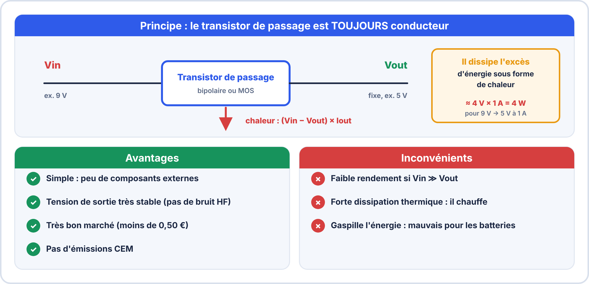
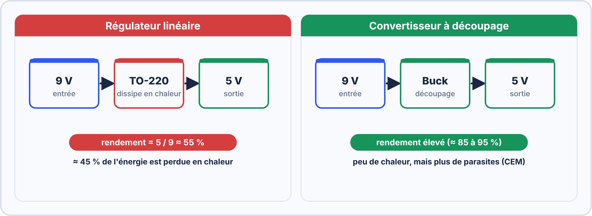
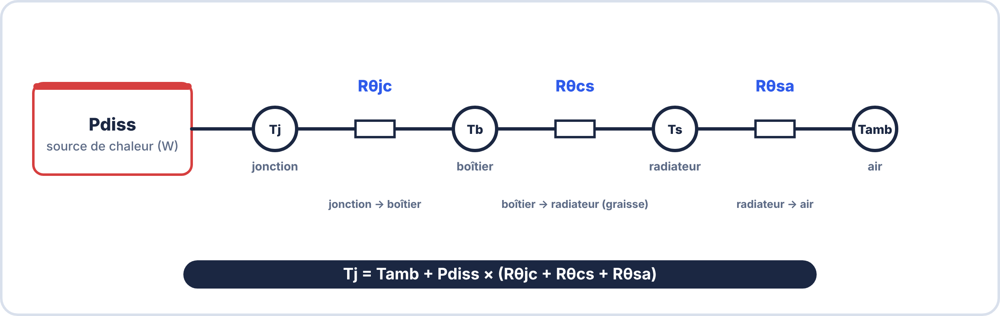
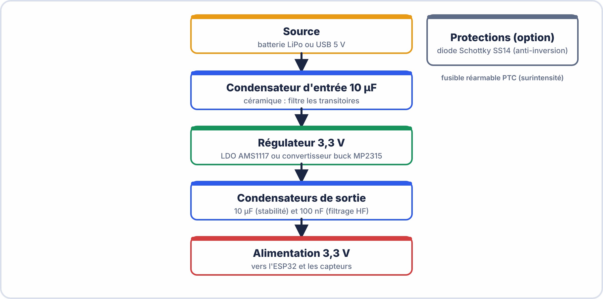

# 📘 FICHE DE COURS — S3 · 3ᵉ ANNÉE · E2

> [!TIP] 🖥️ TP virtuel ElectroLab : pour t'entraîner
> Ouvre [ElectroLab](https://yahnlp.github.io/ElectroLab/), menu **TP ▾**, puis choisis :
> - **Le transformateur : rapport de transformation** (1 h, première)
> - **Redressement simple et double alternance** (1 h 15, première)
> - **Filtrage par condensateur : choix de C** (1 h 15, première)
> - **Régulation linéaire avec un 7805** (1 h 30, terminale)
> 
> Le simulateur corrige automatiquement et ne risque pas d'abîmer le matériel : **réussis d'abord le TP virtuel, puis refais la manipulation sur le matériel réel.** Mode d'emploi : [Utiliser ElectroLab](../../ressources/electrolab.md).

## Dimensionnement d'Alimentation : Bilan de Puissance · Régulateurs · Calcul Thermique

---

> **Nom** : \_\_\_\_\_\_\_\_\_\_\_\_\_\_\_\_\_\_\_\_\_\_\_\_\_\_\_
> **Date** : \_\_\_\_\_\_\_\_\_\_\_\_\_\_\_\_\_\_\_\_\_\_\_\_\_\_\_
> **Compétences** : S2.1 · S2.2 · S2.3 · C2.1

---

## 🔑 Vocabulaire clé

| Terme | Définition | Unité |
|---|---|---|
| **Bilan de puissance** | Tableau listant la puissance consommée par chaque composant | W |
| **Courant de pointe (peak)** | Courant maximal momentané (ex: démarrage WiFi) | A |
| **Courant moyen** | Courant moyen sur un cycle complet | A (mA) |
| **Régulateur linéaire** | Fait chuter la tension en dissipant l'excès en chaleur | — |
| **LDO** | Low Drop-Out : régulateur linéaire à faible chute de tension | — |
| **Régulateur à découpage (SMPS)** | Convertit la tension par commutation rapide · rendement élevé | — |
| **Buck (abaisseur)** | Convertisseur à découpage qui abaisse la tension (Vout < Vin) | — |
| **Boost (élévateur)** | Convertisseur à découpage qui élève la tension (Vout > Vin) | — |
| **Buck-Boost** | Peut abaisser et élever selon les conditions | — |
| **Rendement η** | Rapport puissance utile / puissance absorbée | % |
| **Pdiss** | Puissance dissipée en chaleur | W |
| **Rθja** | Résistance thermique jonction-air (sans radiateur) | °C/W |
| **Rθjc** | Résistance thermique jonction-boîtier | °C/W |
| **Rθsa** | Résistance thermique radiateur-air | °C/W |
| **Tj** | Température de jonction (interne au composant) | °C |
| **Tj max** | Température maximale tolérée par le composant | °C |
| **Marge thermique** | Tj max − Tj calculée | °C |


### 🤔 À ton avis ?

Tu veux faire fonctionner un capteur ESP32 sur pile **pendant un an**. Comment savoir **à l'avance** si c'est possible, et si ton régulateur va **chauffer** ?

??? question "Voir une réponse possible"
    Avec trois calculs : le **bilan de puissance** (combien le système consomme), le **calcul thermique** (le régulateur supporte-t-il la chaleur ?) et l'**autonomie** (combien de temps tient la batterie).
    
    Dans cette séance, tu apprends à **dimensionner une alimentation** avant de la construire.

---

## 1️⃣ — Le bilan de puissance

### Pourquoi établir un bilan ?

```
AVANT de choisir l'alimentation d'un système, il faut savoir :
  → Quelle est la puissance TOTALE consommée ?
  → Quel est le COURANT de POINTE (pour dimensionner la source) ?
  → Quel est le COURANT MOYEN (pour calculer l'autonomie) ?

Un bilan mal fait → régulateur sous-dimensionné → surchauffe → panne
                 → batterie surestimée → autonomie insuffisante
```

### Méthode : tableau de bilan de puissance

Remplir pour chaque composant :

| Composant | Vcc (V) | $I_{\mathrm{pic}}$ (mA) | $I_{\mathrm{moy}}$ (mA) | $P_{\mathrm{moy}}$ (mW) | Mode |
|---|---|---|---|---|---|
| ESP32 WiFi TX | 3,3 | 250 | 80 | 264 | Actif WiFi |
| DHT22 | 3,3 | 2 | 1 | 3 | Actif |
| MQ-2 (chauf.) | 5,0 | 150 | 150 | 750 | Toujours ON |
| LED rouge | 3,3 | 20 | 10 | 33 | 50% duty |
| TOTAL @3,3V | — | 272 | 91 | 300 | — |
| TOTAL @5V | — | 150 | 150 | 750 | — |

Note : Le courant du régulateur 3,3V ≈ I_total_3,3V = 91 mA moyen, 272 mA de pointe
Le courant du régulateur 5V  ≈ I_total_5V  = 150 mA

### Règle de dimensionnement de la source

```
COURANT DE LA SOURCE ≥ I_pic_total × 1,25   (marge de sécurité 25%)

Exemple : I_pic = 272 mA @ 3,3V + 150 mA @ 5V
          → Source 5V : I_requis = 272 mA + 150 mA + (Pdiss régulateur / 5V)
```


> [!TIP] 💡 En clair
> Le **bilan de puissance** consiste à **lister chaque composant** avec sa tension, son **courant de pointe** et son **courant moyen**, puis à **additionner**. Le courant de pointe sert à choisir la **source** ; le courant moyen sert à calculer l'**autonomie**. On prend une **marge de 25 %** : $I_{\mathrm{source}} \geq 1{,}25 \times I_{\mathrm{pic}}$.

### ✅ Vérifie que tu as compris

**Q1.** Pourquoi distingue-t-on courant de pointe et courant moyen ?

??? success "Réponse"
    La **pointe** dimensionne la source ; la **moyenne** détermine l'**autonomie** sur batterie.

**Q2.** Un système a un pic de 400 mA. Quelle source minimale ?

??? success "Réponse"
    $400 \times 1{,}25 = 500\,\mathrm{mA}$.

**Q3.** Un composant 3,3 V consomme 80 mA en moyenne. Quelle puissance moyenne ?

??? success "Réponse"
    $P = U \times I = 3{,}3 \times 0{,}080 \approx 0{,}26\,\mathrm{W} = 264\,\mathrm{mW}$.

> [!SUCCESS] 🧠 À retenir
> - $I_{\mathrm{source}} \geq 1{,}25 \times I_{\mathrm{pic}}$.
> - $P = U \times I$ pour chaque composant, puis on additionne.

---

## 2️⃣ — Les régulateurs de tension

### Régulateur linéaire



> [!NOTE] Formule clé
> $$P_{\mathrm{diss}} = (V_{\mathrm{in}} - V_{\mathrm{out}}) \times I_{\mathrm{out}}$$

> [!NOTE] Rendement
> $$\eta = \dfrac{V_{\mathrm{out}} \times I_{\mathrm{out}}}{V_{\mathrm{in}} \times I_{\mathrm{in}}} \approx \dfrac{V_{\mathrm{out}}}{V_{\mathrm{in}}} \quad (\text{car } I_{\mathrm{in}} \approx I_{\mathrm{out}})$$

**Trois régulateurs courants :**

| Régulateur | Conversion | Courant | Boîtier | $R_{\theta ja}$ |
|---|---|---|---|---|
| LM7805 | 9 V → 5 V | 1 A | TO-220 | 65 °C/W |
| LM1117-3.3 | 5 V → 3,3 V | 0,8 A | SOT-223 | 50 °C/W |
| AMS1117-3.3 | 5 V → 3,3 V | 1 A | SOT-223 | 44 °C/W |

> [!TIP] LDO (Low Drop-Out) : une variante du linéaire
> Un **LDO** accepte une **tension d'entrée à peine supérieure à la sortie** : il suffit que $V_{\mathrm{in}} - V_{\mathrm{out}} \geq 0{,}3$ à $1{,}5\ \mathrm{V}$ selon le modèle, contre environ $2{,}5\ \mathrm{V}$ pour un 78xx classique. On peut donc l'utiliser avec une **batterie Li-ion presque déchargée**.


> [!TIP] 💡 En clair
> Un **régulateur linéaire** (7805, AMS1117…) abaisse la tension en **dissipant l'excès sous forme de chaleur** : $P_{\mathrm{diss}} = (V_{\mathrm{in}} - V_{\mathrm{out}}) \times I_{\mathrm{out}}$. Son rendement vaut environ $\eta \approx \dfrac{V_{\mathrm{out}}}{V_{\mathrm{in}}}$.
>
> **Exemple :** 9 V → 5 V à 100 mA : $P_{\mathrm{diss}} = 4 \times 0{,}1 = 0{,}4\,\mathrm{W}$ et $\eta \approx \dfrac{5}{9} \approx 56\,\%$. Presque la moitié de l'énergie part en **chaleur**.

### ✅ Vérifie que tu as compris

**Q1.** Un régulateur passe de 5 V à 3,3 V avec 300 mA. Quelle puissance dissipe-t-il ?

??? success "Réponse"
    $(5 - 3{,}3) \times 0{,}3 = 0{,}51\,\mathrm{W}$.

**Q2.** Pourquoi un régulateur linéaire est-il peu efficace quand $V_{\mathrm{in}}$ est bien plus grand que $V_{\mathrm{out}}$ ?

??? success "Réponse"
    Parce que la différence $V_{\mathrm{in}} - V_{\mathrm{out}}$ est **perdue en chaleur**.

> [!WARNING] ⚠️ Erreurs fréquentes
> - Alimenter un 5 V depuis une source de 24 V sans calculer l'échauffement : le régulateur **surchauffe**.

> [!SUCCESS] 🧠 À retenir
> - $P_{\mathrm{diss}} = (V_{\mathrm{in}} - V_{\mathrm{out}}) \times I_{\mathrm{out}}$.

---



---

### Régulateur à découpage (SMPS / Buck / Boost)

```
PRINCIPE :
  Un interrupteur (transistor MOS) commute à haute fréquence (100 kHz à 2 MHz).
  Un filtre LC lisse la tension de sortie.
  La bobine stocke et restitue l'énergie → pas de dissipation en chaleur.
  
RENDEMENT :
  η = 80 à 95% typique (vs 30-60% pour le linéaire)

EXEMPLES :
  LM2596 : réglable ou fixe (5V/3,3V), 3A, fréquence 150 kHz, boîtier TO-263
  MP2315 : buck compact, 3A, 500 kHz, SOT-23-8 (PCB très compact)
  TPS54360 : 60V input, 3,5A, 100 kHz-2,5 MHz, TI premium

COMPOSANTS EXTERNES NÉCESSAIRES :
  Bobine (inductance) · Condensateurs d'entrée et sortie · Diode ou synchrone
  → Plus de composants, mais efficacité bien supérieure

AVANTAGES :
  ✓ Rendement élevé → autonomie batterie × 2 à × 3
  ✓ Peu de dissipation thermique → pas ou peu de radiateur
  ✓ Efficace même avec Vin >> Vout

INCONVÉNIENTS :
  ✗ Génère du bruit HF (ripple de tension en sortie)
  ✗ Plus complexe à concevoir (bobine, condensateurs spécifiques)
  ✗ Plus cher (x3 à x10 vs linéaire)
  ✗ Émissions CEM ! → nécessite blindage et filtrage soigneux
```

### Tableau de choix

```
CHOISIR un RÉGULATEUR LINÉAIRE si :
  → Vin − Vout < 2V (faible écart → faible dissipation de toute façon)
  → Courant < 500 mA et alimentation sur secteur (pas sur batterie)
  → Signal analogique sensible à côté (ADC, audio) → pas de bruit HF
  → Contrainte CEM sévère
  → Budget très serré

CHOISIR un RÉGULATEUR À DÉCOUPAGE si :
  → Vin − Vout ≥ 2V ET courant ≥ 200 mA
  → Alimentation sur batterie → autonomie critique
  → Courant > 1A
  → La CEM peut être gérée (filtrage, blindage)
```

---

## 3️⃣ — Calcul thermique

### Le modèle thermique simple

```
Analogie électrique :
  Puissance P (W)     ↔  Courant électrique (A)
  Température T (°C)  ↔  Tension électrique (V)
  Résistance Rθ (°C/W)↔  Résistance électrique (Ω)
  
  ΔT = P × Rθ   (comme ΔV = I × R)
```

### Calcul de Tj sans radiateur

```
Tj = Tamb + Pdiss × Rθja

Tj max (datasheet) = 125°C pour la plupart des régulateurs courants
Tamb typique = 25°C (laboratoire) ou 50-70°C (boîtier industriel en été)

Exemple : LM7805, Vin=9V, Vout=5V, Iout=200mA, Tamb=25°C
  Pdiss = (9−5) × 0,200 = 0,8 W
  Rθja  = 65°C/W (TO-220 sans radiateur)
  Tj    = 25 + 0,8 × 65 = 25 + 52 = 77°C

Marge thermique = 125 − 77 = 48°C ← CORRECT (marge suffisante)

Règle pratique : Tj ne doit pas dépasser Tj_max − 20°C (marge de sécurité)
  → Tj max exploitable = 125 − 20 = 105°C
```

### Calcul de Tj avec radiateur

```
Quand utiliser un radiateur ?
  Si Tj calculé sans radiateur ≥ Tj_max − 20°C → radiateur nécessaire

Avec radiateur :
  Tj = Tamb + Pdiss × (Rθjc + Rθcs + Rθsa)
  
  Rθjc = résistance jonction-boîtier (extrait du datasheet, ex: 5°C/W pour TO-220)
  Rθcs = résistance boîtier-radiateur (avec graisse thermique ≈ 0,5°C/W)
  Rθsa = résistance radiateur-air (extrait du datasheet radiateur)
  
Exemple : Même LM7805, Pdiss=3W, Tamb=40°C
  Sans radiateur : Tj = 40 + 3 × 65 = 40 + 195 = 235°C → DESTRUCTION !
  
  Avec radiateur Rθsa = 15°C/W :
  Tj = 40 + 3 × (5 + 0,5 + 15) = 40 + 3 × 20,5 = 40 + 61,5 = 101,5°C ← OK !
```


> [!TIP] 💡 En clair
> La chaleur produite fait monter la **température de jonction** : $T_j = T_{\mathrm{amb}} + P_{\mathrm{diss}} \times R_{\theta ja}$. On compare à $T_{j,\max}$ (en général **125 °C**) en gardant **20 °C de marge**.
>
> **Exemple :** $P = 0{,}4\,\mathrm{W}$, $R_{\theta ja} = 65\,°\mathrm{C/W}$, $T_{\mathrm{amb}} = 25\,°\mathrm{C}$ → $T_j = 25 + 0{,}4 \times 65 = 51\,°\mathrm{C}$ : **OK**.

### ✅ Vérifie que tu as compris

**Q1.** Un régulateur dissipe 1 W avec $R_{\theta ja} = 50\,°\mathrm{C/W}$ à 25 °C. Quelle est $T_j$ ?

??? success "Réponse"
    $25 + 1 \times 50 = 75\,°\mathrm{C}$.

**Q2.** Quelle est la température maximale à ne pas dépasser si $T_{j,\max} = 125\,°\mathrm{C}$ et marge de 20 °C ?

??? success "Réponse"
    $125 - 20 = 105\,°\mathrm{C}$.

**Q3.** Que fait un radiateur ?

??? success "Réponse"
    Il **diminue la résistance thermique** totale, donc la température de jonction pour une même puissance.

> [!SUCCESS] 🧠 À retenir
> - $T_j = T_{\mathrm{amb}} + P_{\mathrm{diss}} \times R_{\theta}$ ; garder 20 °C de marge sous $T_{j,\max}$.

---



---

## 4️⃣ — Autonomie sur batterie

### Calcul d'autonomie

Autonomie brute :  
t (heures) = Capacité batterie (mAh) / Courant moyen système (mA)  

Autonomie réelle (facteur de dégradation) :  
t_réelle = $t_{\mathrm{brute}}$ × 0,80   (80% de la capacité est utilisable en pratique)  
→ Raisons : décharge non linéaire · vieillissement · température  

Courant moyen si le système a plusieurs modes :  

$$I_{\mathrm{moy}} = \dfrac{I_mode1 \times t1 + I_{\mathrm{mode2}} \times t2 + ...}{t1 + t2 + ...}$$

### Exemple : ESP32 en mode intermittent

Cycle : 5s de mesure WiFi + 55s de deep sleep, répété indéfiniment  

Mode actif WiFi (5s) : I = 150 mA  
Mode deep sleep (55s): I = 0,1 mA  

$$I_{\mathrm{moy}} = \dfrac{150 \times 5 + 0{,}1 \times 55}{5 + 55}$$

$$= \dfrac{750 + 5{,}5}{60}$$

$$= \dfrac{755{,}5}{60}$$

$$= 12{,}6\,\mathrm{mA}$$

Batterie Li-ion 18650 (3000 mAh) :  
t = 3000 / 12,6 = 238 heures = 9,9 jours  
t_réelle ≈ 238 × 0,80 = 190 heures ≈ 8 jours  


> [!TIP] 💡 En clair
> **Autonomie brute :** $t = \dfrac{\text{capacité (mAh)}}{I_{\mathrm{moy}}\,(\mathrm{mA})}$. En pratique, on ne dispose que de **80 %** de la capacité : $t_{\mathrm{réelle}} = 0{,}8 \times t$.
>
> **Exemple :** batterie de 2000 mAh, $I_{\mathrm{moy}} = 12{,}6\,\mathrm{mA}$ → $t = \dfrac{2000}{12{,}6} \approx 159\,\mathrm{h}$, soit $t_{\mathrm{réelle}} \approx 127\,\mathrm{h}$ (environ 5 jours).

### ✅ Vérifie que tu as compris

**Q1.** Batterie 1000 mAh, système à 50 mA. Quelle autonomie réelle ?

??? success "Réponse"
    $\dfrac{1000}{50} = 20\,\mathrm{h}$ puis $\times 0{,}8 = 16\,\mathrm{h}$.

**Q2.** Un ESP32 consomme 150 mA pendant 5 s puis 0,1 mA pendant 55 s. Quel courant moyen ?

??? success "Réponse"
    $\dfrac{150 \times 5 + 0{,}1 \times 55}{60} \approx 12{,}6\,\mathrm{mA}$.

**Q3.** Pourquoi le mode veille profonde est-il si efficace ?

??? success "Réponse"
    Parce que le système passe **presque tout son temps** à une consommation très faible.

> [!WARNING] ⚠️ Erreurs fréquentes
> - Utiliser le courant de **pointe** au lieu du courant **moyen** pour l'autonomie.

> [!SUCCESS] 🧠 À retenir
> - $t = \dfrac{\text{capacité}}{I_{\mathrm{moy}}}$ puis $\times 0{,}8$.

---

## 5️⃣ — Schéma d'alimentation type pour un projet ESP32



```
Protection optionnelle :
   [Diode Schottky SS14] en série en entrée → protection anti-inversion polarité
   [Fusible réarmable (PTC)] en série → protection surintensité
```

---

## 📌 Les essentiels à retenir

> ✅ **Bilan de puissance** = tableau Composant / Vcc / $I_{\mathrm{pic}}$ / $I_{\mathrm{moy}}$ / $P_{\mathrm{moy}}$ — AVANT de choisir l'alimentation
> ✅ **Régulateur linéaire** : Pdiss = **(Vin − Vout) × Iout** — simple mais peu efficace
> ✅ **Régulateur à découpage** : η = 80-95% — obligatoire sur batterie si Vin-Vout ≥ 2V et Iout ≥ 200mA
> ✅ **Calcul thermique** : **Tj = Tamb + Pdiss × Rθja** (sans radiateur)
> ✅ **Radiateur nécessaire** si Tj calculé > Tj_max − 20°C (≥ 105°C en général)
> ✅ **Avec radiateur** : Tj = Tamb + Pdiss × (Rθjc + Rθcs + Rθsa)
> ✅ **Autonomie** = Capacité (mAh) / $I_{\mathrm{moy}}$ (mA) × 0,80 (facteur pratique)
> ✅ **Deep sleep** ESP32 = 10-150 µA → multiplier l'autonomie par ×10 à ×100 !
> ✅ **LDO** = linéaire à faible chute · bon pour Li-ion · bon si signal analogique sensible à côté
> ✅ **Buck** = découpage abaisseur · excellent rendement · génère du bruit HF

---

*Fiche de Cours Alimentation — BAC PRO CIEL | E2 Systèmes Électroniques | 3ᵉ année S3*
*Compétences : S2.1 · S2.2 · S2.3 · C2.1*
