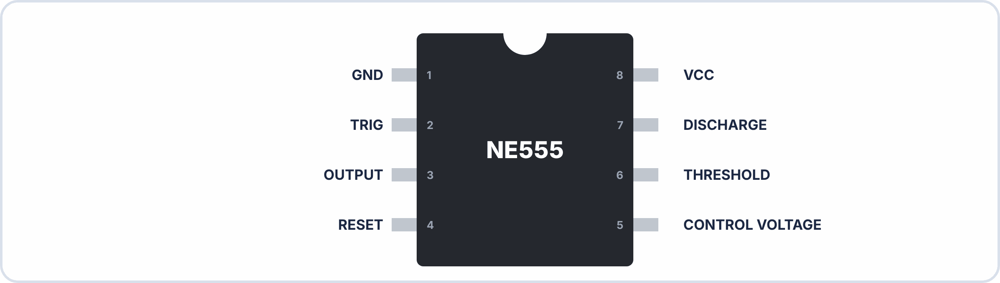
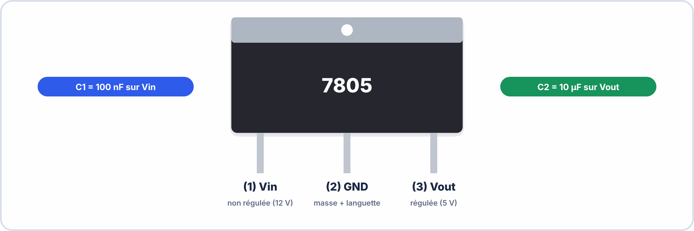

# 📖 RAPPEL COURS – S6 ANNÉE 3 – E2
## Flux KiCad Complet : Schéma → ERC → PCB → DRC → Gerber → BOM

> *Ce document est votre aide-mémoire pour l'exercice certifiant. Durée de lecture : 30 min maximum.*

---

## 1️⃣ LE FLUX KiCad COMPLET

### 🤔 À ton avis ?

Tu dessines un schéma, tu routes une carte… et KiCad t'affiche **40 erreurs**. Comment éviter ça en travaillant **dans le bon ordre** ?

??? question "Voir une réponse possible"
    Le flux KiCad est une **chaîne** : **schéma → ERC** (contrôle électrique) **→ empreintes → PCB → DRC** (contrôle géométrique) **→ fichiers Gerber → BOM**. Chaque étape **vérifie** la précédente : on ne passe pas à la suivante tant que la vérification n'est pas propre.


> [!NOTE] FLUX KICAD 8 COMPLET
>
> 1. EESCHEMA (schéma)  
>   → Placer symboles (A)  
>   → Câbler (W) + Labels (L) + Alim (P) + PWR_FLAG  
>   → Annoter (Tools → Annotate)  
>   → ERC (Inspect → ERC) → 0 erreur obligatoire  
>                ↓  
> 2. ASSOCIATION EMPREINTES  
>   → Tools → Assign Footprints  
>   → Chaque symbole → une empreinte PCB  
>                ↓  
> 3. PCBNEW (routage)  
>   → Importer netlist (ou "Update PCB from Schematic")  
>   → Placer les composants  
>   → Définir le contour (Edge.Cuts)  
>   → Router les pistes  
>   → DRC (Inspect → DRC) → 0 erreur obligatoire  
>                ↓  
> 4. EXPORT GERBER + DRILL  
>   → File → Fabrication Outputs → Gerbers  
>   → File → Fabrication Outputs → Drill Files  
>                ↓  
> 5. BOM  
>   → Tools → Generate BOM (dans Eeschema)  
>   → Compléter avec références fournisseurs et prix  


### ✅ Vérifie que tu as compris

**Q1.** Que contrôle l'ERC ?

??? success "Réponse"
    Les **règles électriques** du schéma (broches non reliées, alimentations non pilotées, doublons de références).

**Q2.** Que contrôle le DRC ?

??? success "Réponse"
    Les **règles géométriques** du circuit imprimé (distances, largeurs, perçages).

**Q3.** Pourquoi corrige-t-on l'ERC avant de passer au PCB ?

??? success "Réponse"
    Une **erreur de schéma** se répercute sur tout le PCB : il est bien plus rapide de la corriger **avant**.

> [!SUCCESS] 🧠 À retenir
> - ERC = schéma ; DRC = circuit imprimé ; on corrige chaque contrôle avant la suite.

---

## 2️⃣ EESCHEMA — POINTS CRITIQUES

### Les 5 oublis qui génèrent des erreurs ERC

| **Oubli** | **Erreur ERC** | **Solution** |
|---|---|---|
| PWR_FLAG manquant sur +VCC | `power_pin_not_driven` | Ajouter PWR_FLAG sur chaque rail positif |
| PWR_FLAG manquant sur GND | `power_pin_not_driven` | Ajouter PWR_FLAG sur GND |
| Broche non connectée (intentionnelle) | `pin_not_connected` | Touche `Q` → No Connect (✗) sur la broche |
| Deux composants avec même référence | `duplicate_reference` | Tools → Annotate Schematic |
| Fil "flottant" (bout de fil orphelin) | `wire_end_unconnected` | Supprimer le fil orphelin (zoom + Del) |

### Raccourcis Eeschema (essentiels)

| `A` | Ajouter symbole | `W` | Tracer fil |
|---|---|---|---|
| `L` | Ajouter net label | `P` | Ajouter alimentation |
| `E` | Propriétés composant | `Q` | No connect |
| `G` | Déplacer (avec connexions) | `Ctrl+Z` | Annuler |


> [!TIP] 💡 En clair
> La plupart des erreurs ERC viennent de **cinq oublis** (voir le tableau). Le plus fréquent : l'absence de **PWR_FLAG**. KiCad doit savoir que **ton alimentation est bien une source** : on pose donc un symbole PWR_FLAG sur chaque rail (+VCC et GND).

### ✅ Vérifie que tu as compris

**Q1.** L'ERC affiche `power_pin_not_driven`. Que faut-il vérifier ?

??? success "Réponse"
    La présence d'un **PWR_FLAG** sur le rail d'alimentation et sur la masse.

**Q2.** Une broche volontairement inutilisée génère `pin_not_connected`. Que faire ?

??? success "Réponse"
    Lui poser un **No Connect** (touche `Q`).

> [!SUCCESS] 🧠 À retenir
> - PWR_FLAG sur +VCC et GND ; No Connect sur les broches inutilisées.

---

## 3️⃣ ASSOCIATION DES EMPREINTES

### Nomenclature des empreintes KiCad

```
Format : [Bibliothèque]:[Nom_Empreinte]

Résistances CMS :   Device:R_0805        (2mm × 1,25mm)
                    Device:R_0603        (1,6mm × 0,8mm)
Condensateurs CMS : Device:C_0805
                    Device:CP_Radial_D5.0mm_P2.50mm  (électro radial)
LEDs traversantes : LED_THT:LED_D5.0mm
Circuits intégrés : Package_DIP:DIP-8_W7.62mm       (NE555 traversant)
                    Package_SO:SOIC-8_3.9x4.9mm      (NE555 SMD)
Régulateurs :       Package_TO_SOT_THT:TO-220-3_Vertical  (7805)
Connecteurs :       Connector_PinHeader_2.54mm:PinHeader_1x02_P2.54mm
```

### Erreurs d'empreinte courantes

```
❌ DIP-8 pour un NE555 SMD (composant ne rentre pas)
❌ TO-220 couché au lieu de vertical (encombrement PCB différent)
❌ Condensateur non polarisé pour une empreinte CP (vice versa)
❌ R_0603 pour une résistance traversante (pastilles trop petites)
```


> [!TIP] 💡 En clair
> Une **empreinte** est le dessin des pastilles sur le PCB. Un même composant peut exister en plusieurs boîtiers (traversant, CMS…) : **choisir la mauvaise empreinte** donne une carte où **le composant ne rentre pas**.

> [!WARNING] ⚠️ Erreurs fréquentes
> - Associer une empreinte sans **vérifier le datasheet** (écartement des broches, boîtier).

### ✅ Vérifie que tu as compris

**Q1.** Pourquoi vérifie-t-on l'empreinte avec le datasheet ?

??? success "Réponse"
    Pour s'assurer que les **cotes des broches** correspondent au vrai composant.

---

## 4️⃣ PCBNEW — ROUTAGE ET DRC

### Paramètres de règles (à configurer avant de router)

```
File → Board Setup → Design Rules :
  Clearance minimum  : 0,25 mm (standard pour fabrication DIY)
  Largeur piste min  : 0,25 mm
  Largeur piste power: 0,5 mm  (recommandé pour alimentation)
  Diamètre via       : 0,8 mm
  Perçage via        : 0,4 mm
```

### Ordre de placement recommandé

```
1. Identifier les contraintes mécaniques (connecteurs → bord du PCB)
2. Placer les composants d'alimentation (7805, condensateurs)
3. Placer le circuit principal (NE555)
4. Placer les composants passifs proches de leurs circuits
5. Tracer le contour Edge.Cuts (rectangle ou forme voulue)
6. Router les pistes d'alimentation en premier (plus larges)
7. Router les pistes de signal ensuite
```

### DRC — Erreurs fréquentes

| **Erreur DRC** | **Cause** | **Solution** |
|---|---|---|
| `Clearance violation` | Deux pistes trop proches | Déplacer l'une ou modifier le tracé |
| `Unconnected net` | Un fil de la netlist non routé | Vérifier le ratsnest (lignes bleues) |
| `Footprint missing courtyard` | Empreinte sans zone de courtyard | Choisir une empreinte complète |
| `No copper` | Piste non connectée au cuivre | Relancer le routage |


> [!TIP] 💡 En clair
> Avant de router, règle les **contraintes** : clearance minimale 0,25 mm, piste 0,25 mm, **pistes d'alimentation plus larges** (0,5 mm, car elles portent plus de courant). On place d'abord l'**alimentation**, puis le circuit principal, puis les passifs ; on **route l'alimentation en premier**, puis les signaux.

### ✅ Vérifie que tu as compris

**Q1.** Pourquoi les pistes d'alimentation sont-elles plus larges ?

??? success "Réponse"
    Parce qu'elles transportent **plus de courant** : trop fines, elles chaufferaient.

**Q2.** Dans quel ordre route-t-on ?

??? success "Réponse"
    **Alimentation d'abord**, puis les signaux.

> [!SUCCESS] 🧠 À retenir
> - Règles avant routage ; alimentation large et routée en premier.

---

## 5️⃣ EXPORT GERBER ET DRILL

### Couches à exporter (7 obligatoires)

```
Dans PCBnew → File → Fabrication Outputs → Gerbers :

☑ F.Cu         (cuivre face avant — pistes)
☑ B.Cu         (cuivre face arrière — si double face)
☑ F.Silkscreen (sérigraphie avant — références composants)
☑ B.Silkscreen (sérigraphie arrière)
☑ F.Mask       (masque de soudure avant — zones non étamées)
☑ B.Mask       (masque de soudure arrière)
☑ Edge.Cuts    (contour du PCB — OBLIGATOIRE pour la découpe)

+ Drill files : File → Fabrication Outputs → Drill Files
  ☑ PTH.drl  (perçages traversants)
  ☑ NPTH.drl (perçages non métallisés — fixation)
```

> ⚠️ **Sans Edge.Cuts**, le fabricant ne sait pas où découper le PCB — votre commande sera rejetée.

### Vérification dans Gerber Viewer

```
PCBnew → View → Gerber Viewer (ou ouvrir KiCad Gerber Viewer)
→ Charger tous les fichiers .gbr
→ Vérifier :
  • Les pistes sont visibles sur F.Cu
  • Les références sont visibles sur F.Silkscreen
  • Le contour est visible sur Edge.Cuts
  • Pas de piste qui dépasse le contour
```


> [!TIP] 💡 En clair
> Les **fichiers Gerber** (un par couche) et le **fichier de perçage** sont ce que le fabricant reçoit. **Vérifie-les dans un visualiseur** avant de les envoyer : c'est ce qui sera réellement fabriqué.

### ✅ Vérifie que tu as compris

**Q1.** Pourquoi ouvre-t-on les Gerber dans un visualiseur ?

??? success "Réponse"
    Pour **voir ce qui sera réellement fabriqué** et détecter une erreur avant commande.

---

## 6️⃣ BOM — BILL OF MATERIALS

### Générer la BOM depuis Eeschema

```
Eeschema → Tools → Generate BOM
→ Choisir le script bom_csv_grouped_by_value
→ Exporter en .csv
→ Ouvrir dans LibreOffice Calc pour compléter
```

### Structure requise pour l'exercice

| **Réf.** | **Valeur** | **Désignation** | **Qté** | **Empreinte** | **Fournisseur** | **Réf. Four.** | **PU HT** | **Total** |
|---|---|---|---|---|---|---|---|---|
| R1 | 4k7 | Résistance | 1 | R_0805 | Mouser | 71-CRCW08054K70FKEA | 0,05€ | 0,05€ |
| ... | | | | | | | | |


> [!TIP] 💡 En clair
> La **BOM** liste les composants **regroupés** par valeur et boîtier, avec leurs **repères** et la **quantité**. Elle sert à commander et à monter la carte.

### ✅ Vérifie que tu as compris

**Q1.** Que contient une ligne de BOM ?

??? success "Réponse"
    Les **repères**, la **valeur**, l'**empreinte** et la **quantité**.

---

## 7️⃣ RAPPEL : NE555 ET 7805

### NE555 — Brochage DIP-8



```
Mode astable :
  Pin 4 (RESET) → VCC (toujours actif)
  Pin 5 (CTRL)  → condensateur 100nF → GND (découplage)
  Pin 2 (TRIG) connectée à Pin 6 (THRESHOLD)
  Ra entre VCC et Pin 7 (DISCHARGE)
  Rb entre Pin 7 et Pin 6/2
  C entre Pin 6/2 et GND
```

### 7805 — Brochage TO-220



```
(1) Input  : tension non régulée (12V)
(2) Ground : masse (le tab métallique est aussi le GND)
(3) Output : tension régulée (5V)

Condensateurs obligatoires :
  Vin  → C1 (100nF CMS) → GND    (découplage entrée)
  Vout → C2 (10µF élec.) → GND   (stabilité sortie)
```

---

## ✅ CHECKLIST AVANT REMISE

```
SCHÉMA :
☐ Tous les composants de la BOM sont présents
☐ Toutes les connexions sont faites (aucun fil flottant)
☐ ERC lancé → 0 erreur, 0 warning
☐ PWR_FLAG sur tous les rails d'alimentation
☐ Annotations complètes (R1, R2, C1... — plus de R? ou C?)
☐ Pin 4 du NE555 connectée à VCC
☐ Pin 5 du NE555 découplée avec 100nF vers GND
☐ C1 (100nF) sur Vin du 7805
☐ C2 (10µF élec.) sur Vout du 7805

PCB :
☐ Tous les composants placés dans les dimensions imposées
☐ Aucun composant hors du contour Edge.Cuts
☐ DRC lancé → 0 erreur, 0 unrouted
☐ Contour Edge.Cuts tracé sur la bonne couche

GERBER :
☐ 7 fichiers .gbr présents
☐ Fichier .drl présent
☐ Vérification dans Gerber Viewer OK

BOM :
☐ Toutes les lignes présentes (un composant = une ligne ou groupée)
☐ Références fournisseurs renseignées
☐ Prix total calculé

NOMMAGE FICHIERS :
☐ Dossier : TP_KiCad_Certifiant_[NomPrenom]
```

---

**Document – BAC PRO CIEL – A3 – E2/U22 – Rappel Cours – Version 1.0 – 2026**
