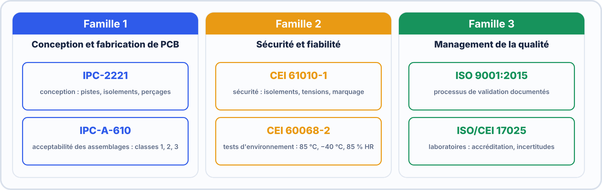
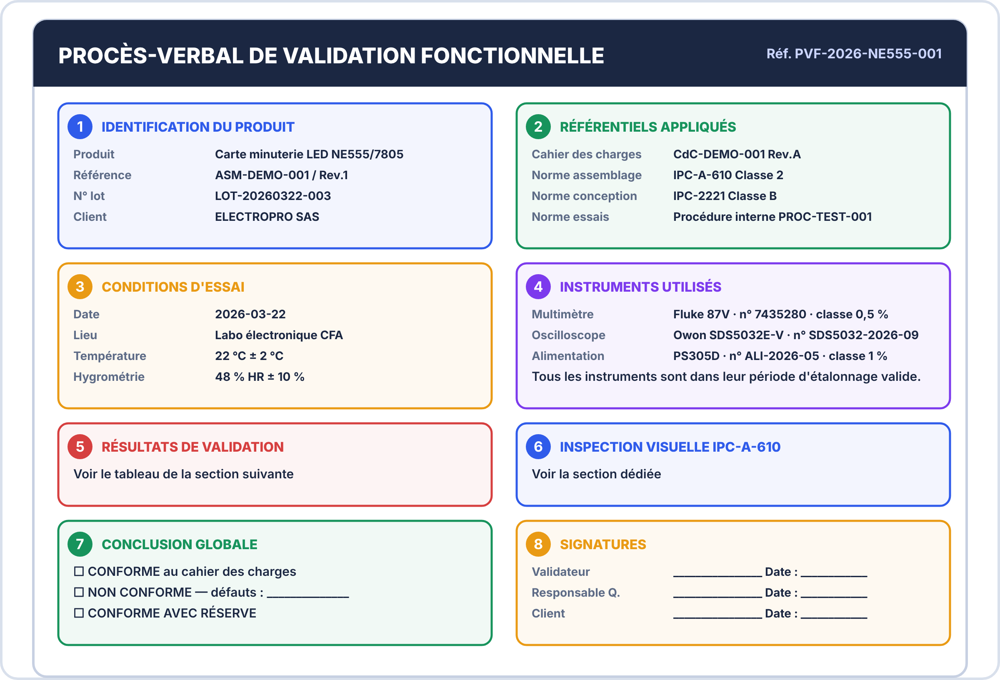

# 📖 FICHE COURS – S7 ANNÉE 3 – E2
## Validation & Conformité : PV Professionnel, Normes IPC/CEI/ISO, DAT Électronique

---

## 🎯 OBJECTIFS

- ✅ Identifier les normes IPC, CEI et ISO applicables à l'électronique embarquée
- ✅ Rédiger un PV de validation fonctionnelle avec incertitudes et conclusion de conformité
- ✅ Appliquer IPC-A-610 Classe 2 à un assemblage réel
- ✅ Structurer un DAT électronique complet (conception + fabrication + validation)


### 🤔 À ton avis ?

Deux fabricants livrent la même carte. Comment le client peut-il **vérifier** qu'elle est bien de bonne qualité, **sans se fier à leur parole** ?

??? question "Voir une réponse possible"
    En s'appuyant sur des **normes** : des règles communes écrites et reconnues. Un PV de validation indique **quelle norme** et **quel critère** la carte respecte, avec **les mesures** qui le prouvent.
    
    Dans cette séance, tu découvres les **normes IPC, CEI et ISO**, tu rédiges un **PV de validation avancé** et tu construis un **DAT** (dossier technique).

---

## 1️⃣ POURQUOI DES NORMES EN ÉLECTRONIQUE ?

### La norme comme contrat commun

> Une norme définit un **langage commun** entre concepteurs, fabricants, acheteurs et contrôleurs. Sans norme :
> - Le fabricant PCB ne sait pas quelle tolérance de découpe est acceptable
> - L'assembleur ne sait pas si un composant légèrement décalé est un rejet ou pas
> - Le client ne sait pas si le produit tiendra 5 ans dans son environnement

> **Une norme n'est pas une contrainte arbitraire — c'est la formalisation de l'expérience industrielle collective.**


> [!TIP] 💡 En clair
> Une **norme** garantit que **tout le monde parle le même langage** : mêmes essais, mêmes critères, mêmes unités. Elle protège le **client** (qualité), le **fabricant** (règles claires) et l'**utilisateur** (sécurité).

### ✅ Vérifie que tu as compris

**Q1.** Pourquoi les normes sont-elles utiles à un client ?

??? success "Réponse"
    Elles permettent de **juger la qualité** avec des critères communs, sans dépendre de la parole du fabricant.

---

## 2️⃣ PANORAMA DES NORMES ESSENTIELLES

### Les 3 familles de normes électroniques




> [!TIP] 💡 En clair
> Trois familles à ne pas confondre : **IPC** (conception et fabrication des cartes), **CEI** (essais d'environnement et sécurité électrique) et **ISO** (qualité et organisation). Nos cartes de bac pro relèvent de la **classe B** (industriel).
>
> **Exemple d'essai CEI :** humidité à **40 °C / 85 % HR pendant 96 h** pour vérifier qu'une carte résiste à un local humide.

### ✅ Vérifie que tu as compris

**Q1.** Quelle famille de normes décrit les essais d'environnement (chaleur, froid, humidité) ?

??? success "Réponse"
    La **CEI** (par exemple la série 60068-2).

**Q2.** À quelle classe IPC correspondent nos cartes ?

??? success "Réponse"
    À la **classe B** (industriel).

**Q3.** Pourquoi teste-t-on une carte à la chaleur ou à l'humidité ?

??? success "Réponse"
    Pour vérifier qu'elle **tient dans son environnement réel** d'utilisation.

> [!SUCCESS] 🧠 À retenir
> - IPC = cartes ; CEI = essais ; ISO = qualité ; bac pro = classe B.

---

### IPC-2221 — Conception PCB

> Norme de référence pour la conception des PCB. Elle définit des exigences dimensionnelles et de performance.

| **Paramètre** | **Classe A (grand public)** | **Classe B (industriel)** | **Classe C (critique)** |
|---|---|---|---|
| Largeur piste min | 0,12 mm | 0,10 mm | 0,05 mm |
| Clearance min (piste/piste) | 0,15 mm | 0,13 mm | 0,08 mm |
| Anneau de pastille min (PTH) | 0,15 mm | 0,10 mm | 0,05 mm |
| Taille via min | 0,45 mm Ø | 0,35 mm Ø | 0,25 mm Ø |

> **En BAC PRO CIEL**, nos cartes correspondent à la Classe B (industriel). Les paramètres DRC de KiCad doivent refléter ces valeurs.

---

### CEI 60068-2 — Tests Environnementaux

> Cette norme définit les **conditions de test** pour qualifier la résistance d'un équipement à son environnement réel.

| **Test** | **Référence CEI** | **Conditions standard** | **Durée** |
|---|---|---|---|
| Chaleur sèche | CEI 60068-2-2 | 85°C | 2 heures |
| Froid | CEI 60068-2-1 | −40°C | 2 heures |
| Humidité | CEI 60068-2-78 | 40°C / 85% HR | 96 heures |
| Vibrations sinusoïdales | CEI 60068-2-6 | 10–2000 Hz, 2g | Balayage |
| Chocs mécaniques | CEI 60068-2-27 | 50g, 11 ms | 3 × 3 axes |
| Cycles thermiques | CEI 60068-2-14 | −40°C ↔ +85°C | 100 cycles |

> **Exemple d'application :** Une station météo extérieure (serre agricole) doit passer les tests CEI 60068-2-78 (humidité) et CEI 60068-2-2 (chaleur) avant d'être qualifiée pour une utilisation à l'extérieur.

---

### CEI 61010-1 — Sécurité Équipements

> Fixe les exigences de sécurité pour les appareils alimentés électriquement utilisés dans un contexte industriel ou de laboratoire.

| **Concept** | **Définition** | **Application** |
|---|---|---|
| **Tension de travail** | Tension maximale présente en utilisation normale | 12V DC dans nos projets |
| **Distance de fuite** | Distance le long d'une surface entre deux conducteurs | ≥ 1,5 mm pour 12V |
| **Distance d'isolement** | Distance dans l'air entre deux conducteurs | ≥ 0,8 mm pour 12V |
| **PELV** | Protective Extra Low Voltage (< 50V DC) | Nos systèmes 3,3V/5V/12V |

---

### ISO 9001:2015 — Management Qualité

> L'ISO 9001 n'est pas une norme technique — c'est une norme de **processus**. Elle exige que :
> - Les exigences soient définies avant la conception
> - Les résultats de validation soient **documentés et traçables**
> - Les non-conformités soient enregistrées et traitées

> En pratique pour BAC PRO CIEL : **tout résultat de test doit être consigné dans un PV daté et signé**, avec la référence de l'exigence vérifiée et la conclusion de conformité.

---

## 3️⃣ LE PV DE VALIDATION FONCTIONNELLE AVANCÉ

### Différence entre PV de mesure (S2-A3) et PV de validation fonctionnelle

| **PV de mesure (S2-A3)** | **PV de validation fonctionnelle (S7-A3)** |
|---|---|
| Vérifie une grandeur physique ponctuelle | Vérifie le comportement du circuit en fonctionnement |
| Instrument + étalonnage + incertitude | Instrument + séquence de test + scénario |
| Conclusion : valeur conforme à la spécification | Conclusion : circuit conforme au cahier des charges complet |
| Signé par le mesureur | Signé par le validateur + le client |

### Structure du PV de validation fonctionnelle

```
━━━━━━━━━━━━━━━━━━━━━━━━━━━━━━━━━━━━━━━━━━━━━━━━━━━━━━━━━━━━━━━━━━
  PROCÈS-VERBAL DE VALIDATION FONCTIONNELLE
  Réf : PVF-2026-NE555-001
━━━━━━━━━━━━━━━━━━━━━━━━━━━━━━━━━━━━━━━━━━━━━━━━━━━━━━━━━━━━━━━━━━

1. IDENTIFICATION DU PRODUIT
   Produit         : Carte minuterie LED NE555/7805
   Référence       : ASM-DEMO-001 / Rev.1
   N° lot          : LOT-20260322-003
   Client          : ELECTROPRO SAS

2. RÉFÉRENTIELS APPLIQUÉS
   Cahier des charges : CdC-DEMO-001 Rev.A
   Norme assemblage   : IPC-A-610 Classe 2
   Norme conception   : IPC-2221 Classe B
   Norme essais       : Procédure interne PROC-TEST-001

3. CONDITIONS D'ESSAI
   Date            : 2026-03-22
   Lieu            : Labo électronique CFA
   Température     : 22°C ± 2°C
   Hygrométrie     : 48% HR ± 10%

4. INSTRUMENTS UTILISÉS
   Multimètre      : Fluke 87V  |  N°7435280  |  Classe 0,5%
   Oscilloscope    : Rigol DS1054Z  |  N°DS1054-2026-09
   Alimentation    : PS305D  |  N°ALI-2026-05  |  Classe 1%
   Tous les instruments sont dans leur période d'étalonnage valide.

5. RÉSULTATS DE VALIDATION
   (voir tableau section suivante)

6. INSPECTION VISUELLE IPC-A-610
   (voir section dédiée)

7. CONCLUSION GLOBALE
   ☐ CONFORME au cahier des charges
   ☐ NON CONFORME — défauts :
   ☐ CONFORME AVEC RÉSERVE

8. SIGNATURES
   Validateur      : ________________  Date : ________________
   Responsable Q.  : ________________  Date : ________________
   Client          : ________________  Date : ________________
━━━━━━━━━━━━━━━━━━━━━━━━━━━━━━━━━━━━━━━━━━━━━━━━━━━━━━━━━━━━━━━━━━
```

### Tableau de résultats de validation (section 5)

| **TC#** | **Exigence** | **Procédure** | **Résultat** | **U (95%)** | **Conforme ?** |
|---|---|---|---|---|---|
| TC-01 | $V_{out} 7805 = 5\,\mathrm{V} \pm 3\,\mathrm{\%}$ | Mesure multimètre entre Vout et GND | 4,987 V | ±0,030 V | ✅ |
| TC-02 | Fréquence = 1 Hz ±10% | Oscilloscope sur pin 3 NE555 | 1,02 Hz | ±0,02 Hz | ✅ |
| TC-03 | LED clignote visuellement | Observation à Vin = 12V | Clignote régulièrement | — | ✅ |
| TC-04 | Rapport cyclique ≈ 50% | Oscilloscope : mesure tHigh / tTotal | 51,8% | ±1,2% | ✅ |
| TC-05 | Courant LED ≤ 25 mA | Ampèremètre en série avec LED | 19,3 mA | ±0,3 mA | ✅ |


> [!TIP] 💡 En clair
> Un **PV de validation fonctionnelle** relie **chaque exigence** à **une mesure** : exigence (ex. « sortie = 5 V ± 5 % »), méthode, valeur mesurée avec son incertitude, **verdict**. Il doit permettre à un tiers de **rejouer** le test.

### ✅ Vérifie que tu as compris

**Q1.** Quelle tension est acceptable si l'exigence est 5 V ± 5 % ?

??? success "Réponse"
    De $5 \times 0{,}95 = 4{,}75\,\mathrm{V}$ à $5 \times 1{,}05 = 5{,}25\,\mathrm{V}$.

**Q2.** Mesure : 5,30 V. Verdict ?

??? success "Réponse"
    **Non conforme** : 5,30 V dépasse 5,25 V.

> [!SUCCESS] 🧠 À retenir
> - Exigence chiffrée → mesure → verdict.

---



---

## 4️⃣ LE DAT ÉLECTRONIQUE

### Définition et positionnement

> Le **DAT électronique** est la déclinaison du DAT général (vu en S18-A2) pour une carte électronique. Il regroupe en un seul dossier tous les éléments nécessaires pour :
> - **Reproduire** la carte (BOM + schéma + fichiers Gerber)
> - **Maintenir** la carte (documentation technique + contraintes)
> - **Valider** la carte (PV de validation inclus)

### Les 3 types de DAT électronique

| **Type** | **Quand** | **Contenu principal** |
|---|---|---|
| **DAT de Conception** | Pendant la conception | Schéma KiCad, BOM, calculs, choix technologiques |
| **DAT de Fabrication** | Avant la production | Fichiers Gerber, BOM industrielle, spécifications assemblage |
| **DAT de Validation** | Après les tests | PV de validation, rapport IPC, fiches d'anomalies |

> En BAC PRO CIEL, vous produisez un **DAT complet** qui intègre les trois.

### Structure du DAT Électronique

```
━━━━━━━━━━━━━━━━━━━━━━━━━━━━━━━━━━━━━━━━━━━━━━━━━━━━━━━━━━━━━━━━━━
  DOSSIER DES ARCHITECTURES TECHNIQUES — ÉLECTRONIQUE
  Réf : DAT-ELEC-NE555-001 | Version 1.0 | 2026-03-22
━━━━━━━━━━━━━━━━━━━━━━━━━━━━━━━━━━━━━━━━━━━━━━━━━━━━━━━━━━━━━━━━━━

SECTION 1 — IDENTIFICATION ET GESTION
  1.1 Page de garde (titre, version, statut, auteurs)
  1.2 Historique des révisions
  1.3 Objet et périmètre du document

SECTION 2 — DESCRIPTION FONCTIONNELLE
  2.1 Fonction générale (à quoi sert la carte)
  2.2 Schéma bloc fonctionnel
  2.3 Interface avec l'environnement (connecteurs, signaux)

SECTION 3 — SCHÉMA ÉLECTRONIQUE
  3.1 Schéma Eeschema (inséré ou référencé)
  3.2 Description des blocs circuits
  3.3 Calculs de dimensionnement (Ra, Rb, C → f ; R3 → If)

SECTION 4 — CONCEPTION PCB
  4.1 Vue de dessus du PCB (capture PCBnew)
  4.2 Dimensions et stackup (simple/double face, épaisseur)
  4.3 Règles de conception appliquées (DRC paramètres)

SECTION 5 — LISTE DES MATÉRIAUX (BOM)
  5.1 BOM complète avec références fournisseurs
  5.2 Variantes acceptables (substituts)
  5.3 Composants critiques ou EOL (End Of Life)

SECTION 6 — FICHIERS DE FABRICATION
  6.1 Référence des fichiers Gerber (version + date)
  6.2 Spécifications de fabrication (matière PCB, finition, couleur)
  6.3 Spécifications d'assemblage (IPC-A-610 Classe X)

SECTION 7 — CONTRAINTES DE FONCTIONNEMENT
  7.1 Tension d'alimentation (min / nominal / max)
  7.2 Plage de température opérationnelle
  7.3 Plage de température de stockage
  7.4 Indice de protection IP
  7.5 Tensions absolues maximales (ne jamais dépasser)

SECTION 8 — RÉSULTATS DE VALIDATION
  8.1 Rapport d'inspection IPC-A-610
  8.2 PV de validation fonctionnelle (référence)
  8.3 Non-conformités et actions correctives

SECTION 9 — PROCÉDURES
  9.1 Procédure de test en production (auto-test)
  9.2 Procédure de remplacement composant

SECTION 10 — ANNEXES
  10.1 Datasheets clés (NE555, 7805)
  10.2 Certifications fournisseurs
  10.3 Historique des anomalies
━━━━━━━━━━━━━━━━━━━━━━━━━━━━━━━━━━━━━━━━━━━━━━━━━━━━━━━━━━━━━━━━━━
```


> [!TIP] 💡 En clair
> Le **DAT** (dossier technique) regroupe **tout ce qu'il faut pour comprendre, fabriquer, tester et maintenir** une carte : schéma, BOM, plan de test, PV, consignes de maintenance. Un bon DAT permet à **quelqu'un d'autre** de reprendre le travail.

### ✅ Vérifie que tu as compris

**Q1.** Cite trois éléments d'un DAT.

??? success "Réponse"
    Par exemple : **schéma**, **BOM**, **plan de test**, **PV**, **consignes de maintenance**.

---


---

## 5️⃣ SECTION 7 — CONTRAINTES DE FONCTIONNEMENT

> Cette section est souvent oubliée et pourtant critique — elle protège le fabricant si le client utilise le produit dans de mauvaises conditions.

### Exemple pour la carte NE555/7805

```
7.1 ALIMENTATION
    Tension nominale     : 12V DC
    Tension min          : 10V (sous ce seuil, le 7805 ne régule plus)
    Tension max absolue  : 35V (limite absolue 7805 — au-delà, destruction)
    Ondulation max       : 200 mV peak-to-peak sur Vin

7.2 TEMPÉRATURES OPÉRATIONNELLES
    Plage opérationnelle : 0°C à +70°C
    Plage de stockage    : −40°C à +85°C
    Point de déclenchement OTP (7805) : 150°C (protection thermique interne)

7.3 INDICE DE PROTECTION
    IP de la carte nue   : IP00 (aucune protection — usage en boîtier uniquement)
    Recommandation       : Intégrer dans boîtier ≥ IP20 intérieur

7.4 TENSIONS ABSOLUES MAXIMALES
    NE555 VCC max        : 16V (au-delà : destruction)
    NE555 Iout max       : 200 mA (sortie pin 3)
    7805 Vin max absolu  : 35V (datasheet)
    LED If max           : 30 mA (dommage irréversible au-delà)
```


> [!TIP] 💡 En clair
> Les **contraintes de fonctionnement** (température, humidité, alimentation, vibrations) fixent **dans quelles conditions** la carte reste conforme. Elles figurent dans le DAT pour que l'utilisateur **ne dépasse pas** les limites.

### ✅ Vérifie que tu as compris

**Q1.** Pourquoi indique-t-on des contraintes de fonctionnement ?

??? success "Réponse"
    Pour que l'utilisateur sache **jusqu'où** il peut utiliser la carte sans risque de panne.

---

## ✅ AUTO-ÉVALUATION

- [ ] Je sais distinguer IPC-A-610 (assemblage) et IPC-2221 (conception PCB)
- [ ] Je sais à quoi sert CEI 60068-2 (tests environnementaux) et en citer 3 tests
- [ ] Je sais pourquoi ISO 9001 exige que les résultats de validation soient documentés
- [ ] Je sais structurer un PV de validation fonctionnelle en 8 sections
- [ ] Je sais pourquoi le PV de validation est différent du PV de mesure de S2-A3
- [ ] Je connais les 3 types de DAT électronique (conception / fabrication / validation)
- [ ] Je sais rédiger la section "Contraintes de fonctionnement" d'un DAT
- [ ] Je comprends que la triple signature (validateur + qualité + client) est un transfert de responsabilité

---

## 📚 VOCABULAIRE CLEF

| **Terme** | **Définition** |
|---|---|
| **IPC** | Institute for Printed Circuits — organisme normatif pour l'électronique |
| **CEI / IEC** | Commission Électrotechnique Internationale — normes électrotechniques |
| **ISO** | Organisation Internationale de Normalisation — normes qualité et processus |
| **IPC-A-610** | Norme d'acceptabilité des assemblages électroniques (brasures, CMS, THT) |
| **IPC-2221** | Norme générique de conception PCB (dimensions, clearances) |
| **CEI 60068-2** | Norme de tests environnementaux (chaleur, froid, humidité, vibrations) |
| **CEI 61010-1** | Norme de sécurité pour appareils électriques de mesure |
| **ISO 9001** | Norme de management de la qualité — exige validation documentée |
| **ISO/CEI 17025** | Norme de compétence des laboratoires d'essais |
| **PVF** | Procès-Verbal de validation Fonctionnelle — preuve de conformité fonctionnelle |
| **DAT Électronique** | DAT spécifique à une carte — schéma + PCB + BOM + contraintes + validation |
| **Dossier de livraison** | Ensemble des documents remis au client : DAT + PVF + fiche MES |
| **DFM** | Design For Manufacturability — conception facilitant la fabrication |
| **OTP** | Over Temperature Protection — protection thermique interne d'un régulateur |
| **EOL** | End Of Life — composant en fin de vie, à remplacer par un substitut |

---

**Document – BAC PRO CIEL – A3 – E2/U22 – Version 1.0 – 2026**
