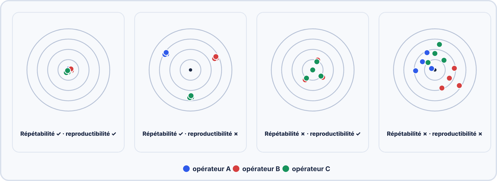
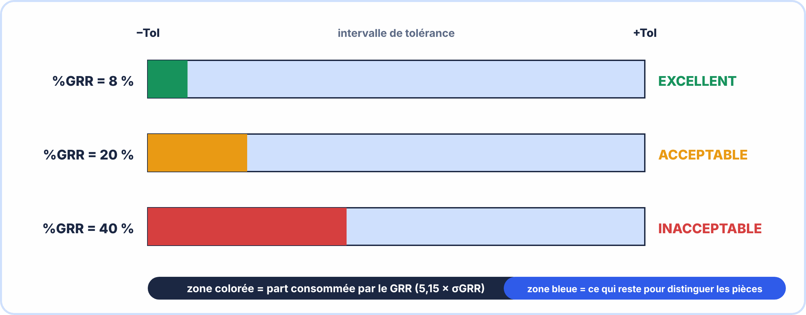

# 📘 FICHE DE COURS — S8 · 3ᵉ ANNÉE · E2

> [!NOTE] 🔶 Approfondissement
> Cette partie va **au-delà de l'essentiel** attendu pour l'épreuve E2. À faire **après** le parcours essentiel (voir l'onglet « L'essentiel en 1 an »), si tu as du temps ou si tu vises plus haut.

## Métrologie Appliquée : Répétabilité · Reproductibilité · Gauge R&R · Limite de Détection

---

> **Nom** : \_\_\_\_\_\_\_\_\_\_\_\_\_\_\_\_\_\_\_\_\_\_\_\_\_\_\_
> **Date** : \_\_\_\_\_\_\_\_\_\_\_\_\_\_\_\_\_\_\_\_\_\_\_\_\_\_\_
> **Compétences** : S8.1 · S8.2 · S8.3 · S8.4 · C8.1

---

## 🔑 Vocabulaire clé

| Terme | Définition | Symbole |
|---|---|---|
| **Répétabilité** | Variabilité d'un même opérateur faisant plusieurs mesures dans les mêmes conditions | $σ_{\mathrm{EV}}$ ou σ_r |
| **Reproductibilité** | Variabilité entre opérateurs différents mesurant le même objet | $σ_{\mathrm{AV}}$ ou σ_R |
| **Gauge R&R** | Gage Repeatability & Reproducibility — méthode industrielle d'analyse des MSE | %GRR |
| **MSA** | Measurement System Analysis — analyse du système de mesure (norme IATF) | — |
| **EV** | Equipment Variation — variation due à l'équipement (= répétabilité) | — |
| **AV** | Appraiser Variation — variation due à l'opérateur (= reproductibilité) | — |
| **GRR** | Gauge Repeatability & Reproducibility — combinaison de EV et AV | $σ_{\mathrm{GRR}}$ |
| **%GRR** | Pourcentage de la tolérance consommé par le système de mesure | % |
| **Étendue R** | max − min d'une série de mesures | Ω, °C... |
| **LDD** | Limite de Décision de Détection — seuil à 95% de détection | — |
| **LD** | Limite de Détection — seuil pratique de détectabilité | — |
| **NDC** | Number of Distinct Categories — nombre de catégories distinctes que peut discerner l'instrument | — |


### 🤔 À ton avis ?

Ton capteur affiche 20,0 °C… puis 20,1… puis 19,9. Et un collègue obtient 20,3 avec le **même** capteur. **Peut-on faire confiance** à ce système de mesure ?

??? question "Voir une réponse possible"
    Pour le savoir, on mesure sa **répétabilité** (ma variation, avec moi-même) et sa **reproductibilité** (la variation d'une personne à l'autre). On compare ensuite ce « bruit » à la **tolérance** à surveiller : c'est le **%GRR**.

---

## 1️⃣ — Répétabilité et Reproductibilité

### Répétabilité (Equipment Variation — EV)

DÉFINITION :  
Variabilité observée quand UN SEUL opérateur mesure le MÊME objet  
PLUSIEURS FOIS avec le MÊME instrument dans les MÊMES conditions.  

CAUSES de la non-répétabilité :  
→ Résolution limitée de l'instrument (arrondi au dernier chiffre)  
→ Bruit électronique de l'instrument  
→ Instabilité de l'objet mesuré (température qui dérive)  
→ Vibrations mécaniques  
→ Variations de l'interface pièce/instrument (contact sondes)  

CALCUL :  
Effectuer n mesures → calculer $σ_{\mathrm{EV}}$ (écart-type des n mesures)  

$$\sigma _EV = \sqrt{Σ(xi - x̄)^2 / (n-1)}$$

Ou méthode des étendues (plus rapide) :  

$$\sigma _EV = R̄ / d2$$

avec R̄ = étendue moyenne des groupes de mesures  
et d2 = constante statistique (d2 = 1,128 pour n=2 · 1,693 pour n=3 · 2,059 pour n=5)  

### Reproductibilité (Appraiser Variation — AV)

```
DÉFINITION :
  Variabilité observée quand DIFFÉRENTS opérateurs mesurent le MÊME objet
  avec le MÊME instrument.

CAUSES de la non-reproductibilité :
  → Formation insuffisante des opérateurs
  → Différences dans la façon de positionner l'instrument
  → Interprétation différente des modes opératoires
  → Fatigue, conditions physiques différentes

CALCUL :
  Comparer les MOYENNES de chaque opérateur :
  AV = x̄_max − x̄_min   (étendue des moyennes inter-opérateurs)
  
  σ_AV = √max(AV²/n − σ_EV²/(n×p) ; 0)
    avec n = nombre de mesures par opérateur par pièce
    et p = nombre de pièces mesurées
    (si le terme sous la racine est négatif → σ_AV = 0 par convention)
```


> [!TIP] 💡 En clair
> **Répétabilité :** un **seul opérateur** mesure **plusieurs fois** le même objet avec le même instrument. **Reproductibilité :** **plusieurs opérateurs** mesurent le même objet avec le même instrument. Dans les deux cas, plus la dispersion est petite, plus le système est **fiable**.

### ✅ Vérifie que tu as compris

**Q1.** Deux opérateurs mesurent la même pièce et trouvent des moyennes différentes. Quelle qualité est en cause ?

??? success "Réponse"
    La **reproductibilité**.

**Q2.** Un seul opérateur trouve des valeurs qui varient d'une mesure à l'autre. Quelle qualité est en cause ?

??? success "Réponse"
    La **répétabilité**.

> [!SUCCESS] 🧠 À retenir
> - Répétabilité = même opérateur ; reproductibilité = opérateurs différents.

---



---

## 2️⃣ — Le Gauge R&R : méthode industrielle

### Pourquoi le Gauge R&R ?

```
En industrie (automobile, aéronautique, médical) :
  → Avant d'utiliser un système de mesure en production, il faut PROUVER qu'il est capable.
  → La norme IATF 16949 (automobile) et ISO 9001 exigent une étude MSA.
  → Un instrument défaillant prend de bonnes pièces pour des mauvaises (faux rebut)
    ou des mauvaises pièces pour des bonnes (risque qualité grave).

Pour un système IoT industriel :
  → Un capteur "malade" peut déclencher de fausses alertes (coût d'intervention)
  → Ou rater une vraie alerte (risque sécurité)
  → Le %GRR permet de décider si le capteur est apte à la surveillance.
```

### Protocole Gauge R&R simplifié

PROTOCOLE (version cours BAC PRO) :  
k = 2 opérateurs (A et B)  
n = 5 mesures par opérateur  
p = 1 pièce (pour simplifier)  

ÉTAPE 1 — Mesures :  
Opérateur A : effectue n mesures → calcule x̄_A et σ_A (ou $R_{A}$)  
Opérateur B : effectue n mesures → calcule x̄_B et σ_B (ou $R_{B}$)  

ÉTAPE 2 — Répétabilité (EV) :  
$σ_{\mathrm{EV}}$ = (σ_A + σ_B) / 2   (moyenne des écarts-types des opérateurs)  

Ou avec les étendues :  
$σ_{\mathrm{EV}}$ = R̄ / d2   avec R̄ = ($R_{A}$ + $R_{B}$)/2 · d2 = 1,693 (pour n=5)  

ÉTAPE 3 — Reproductibilité (AV) :  
AV_brut = |x̄_A − x̄_B|   (différence entre les moyennes)  
$σ_{\mathrm{AV}}$ = √max( AV_brut²/n − σ_EV²/(n×p) ; 0 )  

Simplification fréquente si 1 seule pièce (p=1) :  
$σ_{\mathrm{AV}}$ ≈ |x̄_A − x̄_B| / $\sqrt{n}$   (approximation acceptable)  

ÉTAPE 4 — GRR total :  

$$\sigma _GRR = \sqrt{\sigma _EV^2 + \sigma _AV^2}$$

ÉTAPE 5 — %GRR :  
%GRR = (5,15 × $σ_{\mathrm{GRR}}$ / Tolérance) × 100  

Le facteur 5,15 = 2 × 2,575 = couvre 99% de la distribution normale  

### Interprétation du %GRR

%GRR < 10%       → ✓✓ EXCELLENT  
Le système de mesure est accepté sans restriction.  

10% ≤ %GRR ≤ 30% → ✓ ACCEPTABLE (conditionnel)  
Accepté selon l'importance de l'application.  
Action possible : former les opérateurs, améliorer la procédure.  

%GRR > 30%       → ✗ INACCEPTABLE  
Le système de mesure doit être amélioré ou remplacé.  
On "gaspille" plus de 30% de la tolérance juste en incertitude de mesure.  

NDC (Number of Distinct Categories) :  

$$NDC = 1{,}41 \times (\sigma _pièce / \sigma _GRR)$$

NDC ≥ 5 → instrument capable de distinguer les pièces conformes des non-conformes.  


> [!TIP] 💡 En clair
> Le **Gauge R&R** combine les deux : $\sigma_{\mathrm{GRR}} = \sqrt{\sigma_{\mathrm{EV}}^2 + \sigma_{\mathrm{AV}}^2}$, puis $\%\mathrm{GRR} = \dfrac{5{,}15 \times \sigma_{\mathrm{GRR}}}{\text{tolérance}} \times 100$.
>
> **Exemple :** $\sigma_{\mathrm{EV}} = 0{,}03$, $\sigma_{\mathrm{AV}} = 0{,}04$, tolérance 2,0 :
>
> $\sigma_{\mathrm{GRR}} = \sqrt{0{,}03^2 + 0{,}04^2} = 0{,}05$ ; $\%\mathrm{GRR} = \dfrac{5{,}15 \times 0{,}05}{2{,}0} \times 100 \approx 12{,}9\,\%$.
>
> **Lecture :** moins de 10 % = excellent ; de 10 à 30 % = acceptable sous conditions ; plus de 30 % = inacceptable.

### ✅ Vérifie que tu as compris

**Q1.** Avec $\sigma_{\mathrm{EV}} = 0{,}10$, $\sigma_{\mathrm{AV}} = 0{,}05$ et une tolérance de 2,0, quel est le %GRR ?

??? success "Réponse"
    $\sigma_{\mathrm{GRR}} = \sqrt{0{,}01 + 0{,}0025} \approx 0{,}112$ ; $\%\mathrm{GRR} = \dfrac{5{,}15 \times 0{,}112}{2} \times 100 \approx 28{,}8\,\%$ : **acceptable sous conditions**.

**Q2.** Que signifie un %GRR de 40 % ?

??? success "Réponse"
    **Inacceptable** : 40 % de la tolérance est « consommé » par l'incertitude de mesure.

**Q3.** Pourquoi combine-t-on EV et AV avec une racine carrée de somme de carrés ?

??? success "Réponse"
    Parce que ce sont des **variations indépendantes** : on les combine **en quadrature**, pas en les additionnant.

> [!WARNING] ⚠️ Erreurs fréquentes
> - **Additionner** $\sigma_{\mathrm{EV}}$ et $\sigma_{\mathrm{AV}}$ au lieu de les combiner en quadrature.
> - Oublier de diviser par la **tolérance** : le %GRR n'aurait aucun sens.

> [!SUCCESS] 🧠 À retenir
> - $\%\mathrm{GRR} = \dfrac{5{,}15 \times \sigma_{\mathrm{GRR}}}{\text{tolérance}} \times 100$ ; < 10 % excellent, 10–30 % acceptable, > 30 % inacceptable.

---



---

## 3️⃣ — Limite de détection d'un instrument

### Pourquoi une limite de détection ?

```
PROBLÈME :
  Un capteur de température DHT22 a un bruit de ±0,3°C (σ_répétabilité).
  Un ingénieur veut détecter une variation de 0,1°C dans une serre.
  Est-ce possible ?

RÉPONSE : NON — la variation de 0,1°C est noyée dans le bruit de 0,3°C.
  On ne peut pas distinguer une vraie variation d'un artefact de mesure.
  
LA LIMITE DE DÉTECTION :
  = La plus petite variation qu'un instrument peut détecter avec fiabilité.
```

### Formules de la limite de détection

À PARTIR DU BRUIT DE FOND $σ_{\mathrm{bruit}}$ = σ_répétabilité (quand on mesure une valeur fixe) :  

LDD (Limite de Décision de Détection) :  

$$LDD = 1{,}65 \times \sigma _bruit$$

→ Signal au-dessus de LDD : 95% de chance que ce soit un vrai signal  

LD (Limite de Détection) :  

$$LD = 3{,}3 \times \sigma _bruit$$

→ Signal au-dessus de LD : erreur < 5% sur la décision de détection  

RÈGLE PRATIQUE SIMPLIFIÉE :  
LD ≈ 3 × $σ_{\mathrm{bruit}}$   (règle "3-sigma", très utilisée en pratique)  

Un signal n'est détectable de façon fiable que si sa valeur > LD.  

APPLICATION AU DHT22 (σ_répétabilité = 0,3°C) :  

$$LDD = 1{,}65 \times 0{,}3 = 0{,}50\,\mathrm{°C}$$

$$LD = 3{,}3 \times 0{,}3 = 0{,}99\,\mathrm{°C} \approx 1\,\mathrm{°C}$$

→ Le DHT22 peut détecter de façon fiable des variations ≥ 1°C.  
→ Une variation de 0,1°C est INDÉTECTABLE avec ce capteur.  

### Lien entre σ, résolution et LD

```
RÉSOLUTION ≠ PRÉCISION ≠ LIMITE DE DÉTECTION :

  Résolution = plus petit incrément affiché (ex: 0,1°C pour le DHT22)
  Précision   = erreur max par rapport à la vraie valeur (ex: ±0,5°C spéc.)
  LD          = plus petite VARIATION détectable (dépend du bruit réel)

Exemple :
  Oscilloscope numérique 8 bits :
    Résolution verticale  : 1/256 de la pleine échelle = 3,9 mV pour 1V/div
    σ_bruit observé       : 5 mV
    LD                    : 3 × 5 = 15 mV
  → Le signal affiché semble avoir 4 mV de résolution, mais on ne peut détecter 
    de façon fiable que des signaux supérieurs à 15 mV.
```


> [!TIP] 💡 En clair
> La **limite de détection** est **la plus petite variation** qu'un instrument sait distinguer du bruit. Si tu veux repérer une dérive de 0,1 °C avec un capteur dont le bruit est de 0,5 °C, **tu ne verras rien** : il faut un instrument plus fin.

### ✅ Vérifie que tu as compris

**Q1.** Le bruit d'un capteur est de 0,5 °C. Peut-on détecter une variation de 0,1 °C ?

??? success "Réponse"
    **Non** : la variation est **plus petite que le bruit**.

---

## 4️⃣ — Choisir un instrument pour une application

### Ratio signal/bruit et critère de sélection

```
Pour qu'une mesure soit fiable :
  Variation à mesurer ≥ LD = 3 × σ_bruit

CRITÈRE DE SÉLECTION D'UN INSTRUMENT :
  σ_bruit ≤ (Variation à mesurer) / 3

EXEMPLE — Choisir entre 3 capteurs pour surveiller une variation de 0,5°C :

  Capteur A : σ_répétabilité = 0,1°C → LD = 0,3°C ≤ 0,5°C → ✓ ADAPTÉ
  Capteur B : σ_répétabilité = 0,2°C → LD = 0,6°C > 0,5°C → ✗ INSUFFISANT
  Capteur C : σ_répétabilité = 0,5°C → LD = 1,5°C >> 0,5°C → ✗✗ INADAPTÉ
```

### Application au Gauge R&R — Critère d'aptitude

```
Un système de mesure est apte si :
  (1) %GRR < 30%  (préférence : < 10%)
  (2) NDC ≥ 5
  (3) LD < (plus petite différence à détecter entre pièces)

Ces 3 conditions ENSEMBLE définissent un système de mesure CAPABLE.
```


> [!TIP] 💡 En clair
> Pour **choisir un instrument**, on part du **besoin** : plage de mesure, précision demandée, %GRR visé (< 30 %, idéalement < 10 %), coût. Un instrument « plus précis que nécessaire » coûte cher **sans bénéfice**.

### ✅ Vérifie que tu as compris

**Q1.** Quels critères doit-on regarder pour choisir un instrument ?

??? success "Réponse"
    La **plage**, la **précision**, le **%GRR** attendu et le **coût**.

> [!SUCCESS] 🧠 À retenir
> - On choisit l'instrument à partir du besoin, pas l'inverse.

---

## 📌 Les essentiels à retenir

> ✅ **Répétabilité** = variabilité d'un seul opérateur · calculer $σ_{\mathrm{EV}}$
> ✅ **Reproductibilité** = variabilité entre opérateurs · calculer $σ_{\mathrm{AV}}$
> ✅ **GRR** = $\sqrt{σ_EV² + σ_AV²}$ · **%GRR** = 5,15 × $σ_{\mathrm{GRR}}$ / Tolérance × 100
> ✅ **%GRR < 10%** = excellent · **10-30%** = acceptable · **> 30%** = inacceptable
> ✅ **LD ≈ 3 × $σ_{\mathrm{bruit}}$** (règle pratique des 3 sigma)
> ✅ Un signal n'est détectable que s'il est **> LD**
> ✅ **Résolution ≠ Précision ≠ Limite de détection** (3 concepts distincts !)
> ✅ NDC ≥ 5 → instrument peut distinguer les pièces entre elles
> ✅ Cause principale de mauvaise répétabilité : bruit de l'instrument
> ✅ Cause principale de mauvaise reproductibilité : formation insuffisante des opérateurs

---

*Fiche de Cours Métrologie R&R — BAC PRO CIEL | E2 Systèmes Électroniques | 3ᵉ année S8*
*Compétences : S8.1 · S8.2 · S8.3 · S8.4 · C8.1*
