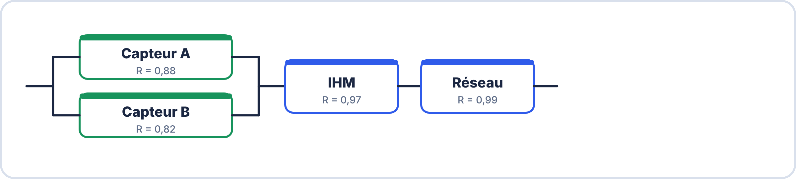

# 🔬 ATELIERS DE REMÉDIATION — S10 · 3ᵉ ANNÉE · E2
## 6 Ateliers Ciblés : Alimentation · Métrologie · PCB · IoT · Fiabilité · CEM

---

> **Utiliser selon votre fiche de lacunes personnalisée**
> **Durée par atelier : 80-90 minutes**
> **Calculatrice + fiche de cours autorisées**

---

## 🟦 ATELIER A — Alimentation & Calcul Thermique

> Pour les apprenants ayant < 12/20 en alimentation au S9.

### Rappel express (5 min)

```
Pdiss = (Vin − Vout) × Iout        (régulateur linéaire)
η = Pout / Pin = Vout/Vin           (rendement approché)
Tj = Tamb + Pdiss × Rθja            (sans radiateur)
Tj max exploitable = 105°C (125−20)
I_moy cycle = (I_actif×t1 + I_veille×t2) / (t1+t2)
Autonomie = Capacité(mAh) / I_moy × 0,80
```

### Exercice A1 — Bilan complet (40 min)

Système : traceur GPS IoT outdoor, batterie LiPo 3,7V/2000mAh  

Composants :  
ESP32 actif GPS     : 200 mA @ 3,3V (30s toutes les 10 min)  
ESP32 deep sleep    : 0,02 mA @ 3,3V (reste du temps)  
GPS NEO-6M          : 50 mA @ 3,3V (actif en même temps que l'ESP32)  
LED statut          : 5 mA @ 3,3V (50% duty, toujours)  
Régulateur LDO      : Vin=3,7V, Vout=3,3V, Rθja=44°C/W, Tamb=30°C  

a) Calcule $I_{\mathrm{moy}}$ ESP32 sur un cycle de 10 min (600s) :  

$\displaystyle I_{\mathrm{moy}} = \dfrac{200 \times 30 + 0{,}02 \times 570}{600} = \underline{\hspace{2.5em}} mA$

b) Calcule $I_{\mathrm{moy}}$ total @ 3,3V :  
$I_{\mathrm{moy}}$ total = I_ESP32_moy + I_GPS_moy + I_LED_moy  

$\displaystyle I_{\mathrm{GPS\_moy}} = 50 \times \dfrac{30}{600} = \underline{\hspace{2.5em}} mA$

$\displaystyle I_{\mathrm{LED\_moy}} = 5 \times 0{,}5 = \underline{\hspace{2.5em}} mA$

$I_{\mathrm{moy}}$ total = \_\_\_\_\_\_\_ mA  

c) Calcule Pdiss LDO et Tj :  
Pdiss = (3,7−3,3) × \_\_\_\_\_\_\_ = \_\_\_\_\_\_\_ W  

$\displaystyle Tj = 30 + \underline{\hspace{2.5em}} \times 44 = \underline{\hspace{2.5em}} °C$

☐ OK ☐ Radiateur nécessaire  

d) Autonomie batterie :  
t = 2000 / \_\_\_\_\_\_\_ × 0,80 = \_\_\_\_\_\_\_ h = \_\_\_\_\_\_\_ jours  

??? success "Réponses"
    a) $I_{moy,ESP32} = \dfrac{200 \times 30 + 0{,}02 \times 570}{600} = \dfrac{6\,011{,}4}{600} \approx 10{,}02\,\mathrm{mA}$.  
    b) $I_{GPS,moy} = 50 \times \dfrac{30}{600} = 2{,}5\,\mathrm{mA}$ ; $I_{LED,moy} = 5 \times 0{,}5 = 2{,}5\,\mathrm{mA}$ ; $I_{moy}$ total $= 10{,}02 + 2{,}5 + 2{,}5 \approx 15{,}0\,\mathrm{mA}$.  
    c) $P_{diss} = (3{,}7 - 3{,}3) \times 0{,}0150 \approx 0{,}006\,\mathrm{W}$ ; $T_j = 30 + 0{,}006 \times 44 \approx 30{,}3\,°\mathrm{C}$ → **OK**, pas de radiateur (très loin de 105 °C).  
    d) Le LDO transmet le même courant à la batterie : $t = \dfrac{2000}{15{,}0} \times 0{,}80 \approx 107\,\mathrm{h} \approx 4{,}4$ jours.

### Exercice A2 — Choisir le bon régulateur (20 min)

```
Pour chaque application, justifie le choix et calcule η ou Pdiss :

Application 1 : Véhicule 12V → Raspberry Pi 5V, 3A
  Type choisi : ________________ · η attendu : _______ %
  Pdiss si linéaire : _______ W · Problème : _______________________

Application 2 : Capteur sur Li-ion 3,7V → MCU 3,3V, 30mA
  Type choisi : ________________ · Vdrop = _______ V
  Pdiss = _______ W · Tj = _______ °C

Application 3 : Amplificateur audio précision ±15V → ±12V, 100mA
  Type choisi : ________________ · Raison (lien CEM) : _____________________
```

??? success "Réponses"

    - **Application 1** : convertisseur **à découpage** (buck) ; $\eta \approx 85$ à $90\,\%$ ; en linéaire : $P_{diss} = (12 - 5) \times 3 = 21\,\mathrm{W}$ → problème : **échauffement énorme**, radiateur impossible à dimensionner raisonnablement.  
    - **Application 2** : **LDO** (faible chute) ; $V_{drop} = 3{,}7 - 3{,}3 = 0{,}4\,\mathrm{V}$ ; $P_{diss} = 0{,}4 \times 0{,}030 = 0{,}012\,\mathrm{W}$ ; $T_j = T_{amb} + 0{,}012 \times R_{\theta ja} \approx T_{amb} + 0{,}6\,°\mathrm{C}$ (avec $R_{\theta ja} \approx 50\,°\mathrm{C/W}$).  
    - **Application 3** : régulateur **linéaire à faible bruit** : un découpage injecterait du **bruit HF** (commutation) qui polluerait le signal audio (lien **CEM**).

### Mini-quiz A (10 min)

```
1. Quelle est la formule de Pdiss pour un régulateur linéaire ?
2. Si Tj calculé = 110°C (sans radiateur), que faire ?
3. Avantage principal du convertisseur à découpage sur une batterie ?
4. Formula de l'autonomie avec facteur pratique inclus ?
5. LDO vs LM78xx : quelle est la différence principale ?
```

??? success "Réponses"

    1. $P_{diss} = (U_{in} - U_{out}) \times I_{out}$.  
    2. 110 °C dépasse 105 °C : ajouter un **radiateur**, réduire la puissance dissipée ou passer à un **découpage**.  
    3. Un **meilleur rendement** donc une **autonomie plus longue**.  
    4. $t = \dfrac{\text{capacité}}{I_{moy}} \times 0{,}80$.  
    5. Le **LDO** fonctionne avec une très faible chute de tension (≈ 0,3 V) ; le LM78xx demande ≈ 2 V de marge.

---

## 🟩 ATELIER B — Métrologie R&R & Limite de Détection

> [!NOTE] 🔶 Approfondissement
> Cette partie va **au-delà de l'essentiel** attendu pour l'épreuve E2. À faire **après** le parcours essentiel (voir l'onglet « L'essentiel en 1 an »), si tu as du temps ou si tu vises plus haut.


> Pour les apprenants ayant < 12/20 en métrologie au S9.

### Rappel express (5 min)

$σ_{\mathrm{EV}}$ = (σ_A + σ_B) / 2          (répétabilité)  
$σ_{\mathrm{AV}}$ ≈ |x̄_A − x̄_B| / $\sqrt{n}$        (reproductibilité)  

$$\sigma _GRR = \sqrt{\sigma _EV^2 + \sigma _AV^2}$$

%GRR = 5,15 × $σ_{\mathrm{GRR}}$ / Tolérance × 100  
< 10% = excellent · 10-30% = acceptable · > 30% = inacceptable  

$$LD \approx 3 \times \sigma _bruit$$

### Exercice B1 — R&R complet (50 min)

> Deux opérateurs mesurent la pression d'un compresseur (consigne 4,0 bar ±0,3 bar).

Capteur 1 (bar) | Capteur 2 (bar)  
Mesure 1 :    3,98       |    4,05  
Mesure 2 :    4,02       |    4,08  
Mesure 3 :    3,97       |    4,03  
Mesure 4 :    4,01       |    4,07  
Mesure 5 :    4,00       |    4,06  
Mesure 6 :    3,99       |    4,04  

Référence : 4,00 bar · Tolérance totale : 0,6 bar  

a) Calcule x̄ et σ de chaque capteur :  

$\displaystyle x̄_1 = \underline{\hspace{2.5em}} bar \cdot \sigma _1 = \underline{\hspace{2.5em}} bar$

$\displaystyle x̄_2 = \underline{\hspace{2.5em}} bar \cdot \sigma _2 = \underline{\hspace{2.5em}} bar$

b) Biais de chaque capteur :  
Biais_1 = \_\_\_\_\_\_\_ · Biais_2 = \_\_\_\_\_\_\_  

c) $σ_{\mathrm{EV}}$, $σ_{\mathrm{AV}}$, $σ_{\mathrm{GRR}}$, %GRR :  

$\displaystyle \sigma _EV = \underline{\hspace{2.5em}} \cdot \sigma _AV = \underline{\hspace{2.5em}} \cdot \sigma _GRR = \underline{\hspace{2.5em}} \cdot %GRR = \underline{\hspace{2.5em}} %$

d) Verdict et recommandation :  
☐ Excellent ☐ Acceptable ☐ Inacceptable  
Recommandation : \_\_\_\_\_\_\_\_\_\_\_\_\_\_\_\_\_\_\_\_\_\_\_\_\_\_\_\_\_\_\_\_\_\_\_\_\_\_\_\_\_\_\_\_\_\_\_  

e) LD du capteur 1 :  

$\displaystyle LD \approx 3 \times \sigma _1 = \underline{\hspace{2.5em}} bar$

Peut-il détecter une variation de 0,02 bar ? ☐ Oui ☐ Non  

??? success "Réponses"
    a) $\bar{x}_1 = 3{,}995\,\mathrm{bar}$ ; $\sigma_1 \approx 0{,}0187\,\mathrm{bar}$ ; $\bar{x}_2 = 4{,}055\,\mathrm{bar}$ ; $\sigma_2 \approx 0{,}0187\,\mathrm{bar}$.  
    b) Biais$_1 = 3{,}995 - 4{,}00 = -0{,}005\,\mathrm{bar}$ ; Biais$_2 = 4{,}055 - 4{,}00 = +0{,}055\,\mathrm{bar}$.  
    c) $\sigma_{EV} = \dfrac{0{,}0187 + 0{,}0187}{2} = 0{,}0187$ ; $\sigma_{AV} \approx \dfrac{|3{,}995 - 4{,}055|}{\sqrt{6}} \approx 0{,}0245$ ; $\sigma_{GRR} = \sqrt{0{,}0187^2 + 0{,}0245^2} \approx 0{,}0308$ ; $\%GRR = \dfrac{5{,}15 \times 0{,}0308}{0{,}6} \times 100 \approx 26{,}5\,\%$.  
    d) **Acceptable** (10 à 30 %), sous conditions. Recommandation : **corriger le biais** du capteur 2 (+0,055 bar, soit près de 10 % de la tolérance) par un réglage ou un étalonnage, puis recommencer l'étude.  
    e) $LD \approx 3 \times 0{,}0187 \approx 0{,}056\,\mathrm{bar}$ : une variation de 0,02 bar est **inférieure** à la limite de détection → **Non**, le capteur 1 ne la détecte pas.  
    *(Remarque : l'énoncé parle de deux opérateurs, mais le tableau compare deux capteurs ; le calcul ci-dessus suit le tableau.)*

### Mini-quiz B (10 min)

```
1. Répétabilité = variabilité due à _______ (même/différents opérateurs ?)
2. %GRR > 30% → que faire ?
3. LD ≈ _______ × σ_bruit (règle 3-sigma)
4. Si LD=0,5 bar et variation à détecter=0,2 bar → capteur apte ? ☐ Oui ☐ Non
5. NDC ≥ _______ → instrument distingue les pièces
```

??? success "Réponses"

    1. **un seul opérateur** (même opérateur, même instrument).  
    2. Améliorer le système de mesure (étalonnage, instrument plus précis, formation des opérateurs) avant de l'utiliser.  
    3. $LD \approx 3 \times \sigma_{bruit}$.  
    4. **Non** : une variation de 0,2 bar est inférieure à $LD = 0{,}5\,\mathrm{bar}$.  
    5. $NDC \geq 5$ : l'instrument distingue correctement les pièces.

---

## 🟧 ATELIER C — PCB et KiCad

> Pour les apprenants ayant < 9/15 en PCB au S9.

### Rappel express (3 min)

```
Flux : Schéma→ERC→Empreintes→PCB→Edge.Cuts→Placement→Routage→DRC→Gerber
Plan de masse CONTINU → petit boucle → peu de rayonnement ✓
Condensateur découplage : 100nF + 10µF, au plus proche du CI (<2mm)
Clearance ≥ 0,2mm · Signal 0,35mm · Alim 0,8mm
```

### Exercice C1 — Identifier 5 violations dans ce PCB (30 min)

```
Description d'un PCB défaillant pour un ESP32 + DHT22 + LED :

  • Condensateur de découplage 100nF placé à 12mm des pins VCC/GND de l'ESP32
  • Plan de masse B.Cu fendu par une piste d'alimentation 5V
  • Piste de signal DHT22 de 18cm (straight run)
  • Sérigraphie "R1" superposée sur le pad de la résistance
  • Clearance entre piste GND et piste VCC : 0,15mm (règle = 0,20mm)
  • Résistance pull-up DHT22 sans valeur saisie (champ Value vide)

Remplir :

Violation 1 : _______________ · Problème CEM : _______________ · Correction : _______________
Violation 2 : _______________ · Problème : _______________ · Correction : _______________
Violation 3 : _______________ · Problème : _______________ · Correction : _______________
Violation 4 : _______________ · Problème : _______________ · Correction : _______________
Violation 5 : _______________ · Problème : _______________ · Correction : _______________
```

??? success "Réponses"
    | N° | Violation | Problème CEM / qualité | Correction |
    |---|---|---|---|
    | 1 | Condensateur de découplage à 12 mm du CI | Grande boucle de courant, découplage inefficace en HF | Le placer à moins de 2 mm des broches VCC/GND |
    | 2 | Plan de masse fendu par une piste 5 V | Le courant de retour fait un détour : grande boucle, fort rayonnement | Router la piste ailleurs ou sur l'autre face, garder le plan continu |
    | 3 | Piste de signal de 18 cm | Se comporte en antenne (émet et capte) | Raccourcir la piste, rapprocher les composants |
    | 4 | Clearance 0,15 mm au lieu de 0,20 mm | Risque de court-circuit et d'erreur DRC | Écarter les pistes à 0,20 mm ou plus |
    | 5 | Sérigraphie « R1 » sur un pad | Gêne la soudure | Déplacer le texte hors des pastilles |
    
    Sixième défaut (bonus) : la valeur de la résistance de pull-up est vide → BOM incomplète, à renseigner (10 kΩ).

### Exercice C2 — Calcul fréquence antenne (15 min)

a) Piste de 18cm : à partir de quelle fréquence se comporte-t-elle comme une antenne ?  

$\displaystyle L=0{,}18\,\mathrm{m} \cdot L > \lambda /20 \to \lambda  < 20 \times 0{,}18=3{,}6\,\mathrm{m} \cdot f > 3 \times 10^{8}/3{,}6 = \underline{\hspace{2.5em}} \mathrm{MHz}$

b) Pour le WiFi ESP32 (2,4GHz), λ/20 = \_\_\_\_\_\_\_ mm  
Toute piste > \_\_\_\_\_\_\_ mm peut rayonner → règle : pistes courtes !  

c) Fente dans un boîtier blindant à 2,4GHz : taille max ?  

$\displaystyle \lambda =0{,}125\,\mathrm{m} \to \lambda /20 = \underline{\hspace{2.5em}} mm$

??? success "Réponses"
    a) $f > \dfrac{3 \times 10^{8}}{3{,}6} \approx 83\,\mathrm{MHz}$.  
    b) $\dfrac{\lambda}{20} = \dfrac{0{,}125}{20} = 6{,}25\,\mathrm{mm}$ ; toute piste de plus de **6,25 mm** peut rayonner à 2,4 GHz.  
    c) Taille maximale d'une fente : $\dfrac{\lambda}{20} = 6{,}25\,\mathrm{mm}$.

### Mini-quiz C (10 min)

```
1. ERC = vérification _______ · DRC = vérification _______
2. F.Mask : les zones NOIRES représentent quoi ?
3. Via standard : Ø ext = _______ mm / perçage = _______ mm
4. Condensateur découplage : distance max au CI = _______ mm
5. Commande KiCad : X=piste · V=via · B=_______ · Alt+3=_______
```

??? success "Réponses"

    1. ERC = vérification **électrique** (du schéma) ; DRC = vérification des **règles de conception** (géométrie du PCB).  
    2. Les zones noires du masque indiquent les **ouvertures du vernis** : le cuivre reste apparent (pastilles à souder).  
    3. Via standard : Ø extérieur **0,8 mm**, perçage **0,4 mm**.  
    4. Moins de **2 mm**.  
    5. B = **remplir les zones** (refill) ; Alt+3 = **vue 3D**.

---

## 🟥 ATELIER D — ESP32, MQTT, Node-RED, InfluxDB

> Pour les apprenants ayant < 12/20 en IoT au S9.

### Rappel express (3 min)

```cpp
// STA : WiFi.begin(ssid,pass) · while(status!=WL_CONNECTED){delay(500);}
// AP  : WiFi.mode(WIFI_AP) · WiFi.softAP(ssid,pass) · IP=192.168.4.1
// WebServer : server.on("/r",h) · server.handleClient() // loop() !
// MQTT : mqtt.connect("ID_UNIQUE") · mqtt.subscribe(t) · mqtt.publish(t,msg)
//        mqtt.loop() // loop() OBLIGATOIRE
// delay() dans loop() → bloque mqtt.loop() → utiliser millis() !
```

### Exercice D1 — Corriger ce code (25 min)

```cpp
// Ce code a 5 erreurs. Trouve-les et corrige-les.

#include <WiFi.h>
#include <PubSubClient.h>

const char* ssid = "Labo"; const char* pass = "pass";
WiFiClient w; PubSubClient mqtt(w);

void onMessage(char* t, byte* p, unsigned int l) {
  String msg = String((char*)p);
  if (msg == "ON") digitalWrite(2, HIGH);
}

void setup() {
  Serial.begin(9600);                           // Erreur 1 : _______________
  WiFi.begin(ssid, pass);
  while (WiFi.status() == WL_CONNECTED) {}     // Erreur 2 : _______________
  
  mqtt.setServer("broker.hivemq.com", 1883);
  mqtt.connect("ESP32");                        // Erreur 3 : _______________
  mqtt.setCallback(onMessage);                  // Erreur 4 : _______________
  mqtt.subscribe("salle/led");
}

void loop() {
  delay(5000);                                  // Erreur 5 : _______________
  mqtt.publish("salle/temp", "23.5");
}
```

??? success "Réponses"
    1. `Serial.begin(9600)` : sur ESP32, on utilise **115200** (messages de démarrage), et il manque `pinMode(2, OUTPUT)`.  
    2. `while (WiFi.status() == WL_CONNECTED)` : condition **inversée** ; il faut `!=`.  
    3. `mqtt.connect("ESP32")` : identifiant **non unique** (deux cartes se déconnectent) et connexion **non testée / pas de reconnexion**.  
    4. `setCallback` doit être appelé **avant** `connect` et `subscribe` ; de plus, dans le callback le `payload` n'est pas terminé par `\0` (copier `l` octets).  
    5. `delay(5000)` **bloque** `mqtt.loop()` (qui n'est d'ailleurs pas appelé) : utiliser `millis()` et appeler `mqtt.loop()` à chaque tour.  
    *(Le repérage exact des 5 erreurs dépend de la lecture du code : à valider par l'enseignant.)*


### Exercice D2 — Node-RED flow (30 min)

```
Décrire ou dessiner le flow Node-RED qui :
1. Reçoit les données MQTT du topic "salle/+/data" (JSON {temp, hum})
2. Parse le JSON
3. Affiche la température sur une gauge (0-50°C, zones couleur)
4. Affiche un graphe historique température (30 derniers points)
5. Déclenche une alerte si temp > 35°C → notification + mqtt-out
6. Stocke tout dans InfluxDB (measurement="salle_data", tags={site})

Nœuds utilisés (dans l'ordre) :
  ___________________________________________________________________________
  
Code function "Parser" (2 outputs : gauge/chart en sortie 1, InfluxDB en sortie 2) :
```
```javascript
var data = msg.payload;
if (!data || data.temp === undefined) { return null; }

var msgVisu = { ______________________________________ };
var msgDB   = { ______________________________________ };

return [msgVisu, msgDB];
```

??? success "Réponses"
    Nœuds, dans l'ordre : `mqtt-in` (salle/+/data) → `json` → `function` (Parser, 2 sorties).  
    Sortie 1 → `ui_gauge` (0–50 °C), `ui_chart` (30 points) et `switch` (temp > 35) → `ui_notification` + `mqtt-out`.  
    Sortie 2 → `influxdb-out`.  
    Code du Parser : `msgVisu = { payload: data.temp, topic: "Température" }` ; `msgDB = { payload: [{ measurement: "salle_data", tags: { site: msg.topic.split("/")[1] }, fields: { temp: data.temp, hum: data.hum } }] }`.

### Mini-quiz D (10 min)

```
1. IP ESP32 en mode AP = _______
2. handleClient() dans loop() : ☐ obligatoire ☐ optionnel
3. msg.topic dans un chart Node-RED = _______ de la courbe
4. Format influxdb-out : msg.payload = [{_______________, tags{}, fields{}}]
5. delay(5000) dans loop() est problématique car : _______________________
```

??? success "Réponses"

    1. **192.168.4.1**.  
    2. **Obligatoire**.  
    3. Le **nom (série)** de la courbe.  
    4. `measurement`.  
    5. Il **bloque `mqtt.loop()`** : la connexion au broker n'est plus entretenue et se coupe.

---

## 🟨 ATELIER E — Fiabilité MTBF / R(t)

> [!NOTE] 🔶 Approfondissement
> Cette partie va **au-delà de l'essentiel** attendu pour l'épreuve E2. À faire **après** le parcours essentiel (voir l'onglet « L'essentiel en 1 an »), si tu as du temps ou si tu vises plus haut.


> Pour les apprenants ayant < 9/15 en fiabilité au S9.

### Rappel express (3 min)

```
λ=1/MTBF · MTBF=TO/n · MTTR=TA/n · D=MTBF/(MTBF+MTTR)
R(t)=e^(−λt) · R(MTBF)=e⁻¹=0,368 ← jamais 50% !
Série    : Rs=R1×R2×R3     (affaiblit)
Parallèle: Rs=1−(1−R1)(1−R2)  (renforce)
e⁻⁰·¹=0,905 · e⁻⁰·²=0,819 · e⁻⁰·⁵=0,607 · e⁻¹=0,368
```

### Exercice E1 — Système IoT industriel (50 min)

**Architecture d'un système de pesée industrielle :**



**Données :** capteur A $\mathrm{MTBF} = 60\,000$ h · capteur B $\mathrm{MTBF} = 40\,000$ h · $T_{\mathrm{amb}} = 25\ ^{\circ}\mathrm{C}$

**a)** Fiabilité du bloc capteurs en parallèle : $R_{\text{capt}} = 1 - (1 - 0{,}88)(1 - 0{,}82) =$ \_\_\_\_\_\_\_ $=$ \_\_\_\_\_\_\_ %

**b)** $R_s$ global : $R_s =$ \_\_\_\_\_\_\_ $\times\ 0{,}97 \times 0{,}99 =$ \_\_\_\_\_\_\_ $=$ \_\_\_\_\_\_\_ %

**c)** Fiabilité après 1 an (8760 h) avec le seul capteur A ($\mathrm{MTBF} = 60\,000$ h) :

- $\lambda_A = \dfrac{1}{60\,000} =$ \_\_\_\_\_\_\_ $\mathrm{h^{-1}}$
- $\lambda_A \times t =$ \_\_\_\_\_\_\_ $\times\ 8760 =$ \_\_\_\_\_\_\_
- $R_A(8760) = e^{-\lambda_A t} =$ \_\_\_\_\_\_\_ $=$ \_\_\_\_\_\_\_ %

**d)** Sur 200 capteurs A mis en service simultanément, combien fonctionnent encore après 1 an ? \_\_\_\_\_\_\_ $\times\ 200 =$ \_\_\_\_\_\_\_ capteurs

**e)** Système de pesée avec $\mathrm{MTBF} = 10\,000$ h et $\mathrm{MTTR} = 4$ h : $D = \dfrac{10\,000}{10\,000 + 4} =$ \_\_\_\_\_\_\_ $=$ \_\_\_\_\_\_\_ %

??? success "Réponses"
    a) $R_{capt} = 1 - 0{,}12 \times 0{,}18 = 0{,}9784 = 97{,}84\,\%$.  
    b) $R_s = 0{,}9784 \times 0{,}97 \times 0{,}99 \approx 0{,}9396 = 93{,}96\,\%$.  
    c) $\lambda_A = \dfrac{1}{60\,000} \approx 1{,}67 \times 10^{-5}\,\mathrm{h^{-1}}$ ; $\lambda_A t \approx 0{,}146$ ; $R_A(8\,760) = e^{-0{,}146} \approx 0{,}864 = 86{,}4\,\%$.  
    d) $0{,}864 \times 200 \approx 173$ capteurs.  
    e) $D = \dfrac{10\,000}{10\,004} \approx 0{,}9996 = 99{,}96\,\%$.

### Mini-quiz E (10 min)

```
1. R(MTBF) = _______ % (pas 50 !)
2. Rs série : Rs ☐ < ☐ > ☐ = Rmin
3. Rs parallèle 2 composants R=0,9 : Rs = 1−(0,1)² = _______%
4. λ = _______ / MTBF
5. D = MTBF / (_______ + _______)
```

??? success "Réponses"

    1. **36,8 %** (pas 50 %).  
    2. $R_s < R_{min}$ (la fiabilité d'une série est inférieure à celle du composant le plus faible).  
    3. $1 - 0{,}1^2 = 0{,}99 = 99\,\%$.  
    4. $\lambda = \dfrac{1}{MTBF}$.  
    5. $D = \dfrac{MTBF}{MTBF + MTTR}$.

---

## 🟪 ATELIER F — CEM

> Pour les apprenants ayant < 6/10 en CEM au S9.

### Rappel express (3 min)

```
Source → Couplage → Victime  (4 couplages : résistif/capacitif/inductif/rayonné)
Conduit < 30MHz · Rayonné > 30MHz
Blindage : continu + masse · fente < λ/20 (λ=3×10⁸/f)
Découplage : 100nF au plus proche CI (<2mm)
Ferrite : absorbe HF sur câbles
Plan CONTINU → petite boucle ✓ · Plan FENDU → grande boucle ✗
fc = 1/(2π×R×C)
```

### Exercice F1 — Identifier couplages et solutions (30 min)

```
Décrire le type de couplage ET proposer une solution pour chaque scénario :

Scénario 1 : Un relais 24V commute un moteur. La masse de ce circuit est partagée avec
  le microcontrôleur ESP32. Quand le relais commute, l'ESP32 redémarre.
  Couplage : _______ · Explication : _______________________
  Solution 1 : __________________ · Solution 2 : __________________

Scénario 2 : Deux pistes PCB parallèles sur 12cm :
  Piste 1 = signal PWM 20kHz · Piste 2 = signal ADC capteur analogique
  Couplage : _______ · Solution PCB : _______________________

Scénario 3 : Câble d'alimentation 5V (2A) cheminant sur 30cm à côté d'un câble
  de données UART. Les données sont corrompues lors de fortes charges.
  Couplage : _______ · Solution câblage : _______________________
```

??? success "Réponses"

    - **Scénario 1** : couplage **résistif** (impédance commune de la masse). Le courant du relais traverse la masse commune et fait varier le potentiel de référence de l'ESP32. Solutions : **masses séparées** (reliées en un seul point), alimentation séparée, **diode de roue libre** sur la bobine, découplage, optocoupleur.  
    - **Scénario 2** : couplage **capacitif** (diaphonie entre pistes parallèles). Solutions : **éloigner** les pistes, ne pas les faire courir en parallèle, intercaler une **piste de garde reliée à la masse**, plan de masse continu.  
    - **Scénario 3** : couplage **inductif** (le courant de 2 A crée un champ magnétique). Solutions : **éloigner** les câbles, les faire se croiser à **angle droit**, **torsader** la paire, utiliser un câble **blindé** pour l'UART.

### Exercice F2 — Calculs (25 min)

a) Boîtier blindant un ESP32 WiFi (2,4GHz) : taille max des fentes ?  

$\displaystyle \lambda  = 3 \times 10^{8}/2{,}4 \times 10^{9} = \underline{\hspace{2.5em}} m \cdot \lambda /20 = \underline{\hspace{2.5em}} mm$

b) Filtre RC pour ADC (signal utile max 20Hz, fc cible 100Hz, R=22kΩ) :  

$\displaystyle C = \dfrac{1}{2\pi  \times 100 \times 22000} = \underline{\hspace{2.5em}} F = \underline{\hspace{2.5em}} nF$

c) Piste PCB de 22cm : fréquence à partir de laquelle elle devient une antenne ?  

$\displaystyle \lambda  < 20 \times 0{,}22 = \underline{\hspace{2.5em}} m \cdot f > 3 \times 10^{8}/\underline{\hspace{2.5em}} = \underline{\hspace{2.5em}} \mathrm{MHz}$

d) 8 affirmations : VRAI ou FAUX  
\_\_\_ Plan de masse continu : courant de retour direct sous la piste  
\_\_\_ Ferrite : réfléchit les signaux HF (≠ les absorbe)  
\_\_\_ Condensateur découplage à 15mm du CI : efficacité optimale  
\_\_\_ Conduites < 30MHz : se propagent par l'air  
\_\_\_ Plan fendu : grande boucle → fort rayonnement  
\_\_\_ Blindage relié à la masse en 2 points : recommandé  
\_\_\_ LDO : génère moins de bruit HF qu'un buck → meilleur pour CEM signal  
\_\_\_ fc = 1/(2πRC) : formule filtre passe-bas  

??? success "Réponses"
    a) $\lambda = \dfrac{3 \times 10^{8}}{2{,}4 \times 10^{9}} = 0{,}125\,\mathrm{m}$ ; $\dfrac{\lambda}{20} = 6{,}25\,\mathrm{mm}$.  
    b) $C = \dfrac{1}{2\pi \times 100 \times 22\,000} \approx 7{,}2 \times 10^{-8}\,\mathrm{F} \approx 72\,\mathrm{nF}$ (valeur normalisée proche : **68 nF** ou **82 nF**).  
    c) $\lambda < 20 \times 0{,}22 = 4{,}4\,\mathrm{m}$ ; $f > \dfrac{3 \times 10^{8}}{4{,}4} \approx 68\,\mathrm{MHz}$.  
    d) 1. **Vrai** ; 2. **Faux** (une ferrite **absorbe** les signaux HF) ; 3. **Faux** (à moins de 2 mm) ; 4. **Faux** (les perturbations conduites se propagent par **les câbles**, pas par l'air) ; 5. **Vrai** ; 6. **Vrai** (pour les hautes fréquences, à valider selon le cours) ; 7. **Vrai** ; 8. **Vrai**.

### Mini-quiz F (10 min)

1. 4 types de couplage : \_\_\_\_\_\_\_ · \_\_\_\_\_\_\_ · \_\_\_\_\_\_\_ · \_\_\_\_\_\_\_  
2. Conduites = < _______ MHz · Rayonnées = > \_\_\_\_\_\_\_ MHz  
3. Fente dans blindage WiFi (2,4GHz) < \_\_\_\_\_\_\_ mm  
4. Plan fendu → courant de retour \_\_\_\_\_\_\_ → grande \_\_\_\_\_\_\_ → fort \_\_\_\_\_\_\_  

$\displaystyle 5. fc = \dfrac{1}{2\pi  \times \underline{\hspace{2.5em}} \times \underline{\hspace{2.5em}}}$

??? success "Réponses"

    1. **Résistif** (impédance commune), **capacitif**, **inductif**, **rayonné**.  
    2. Conduites **< 30 MHz** ; rayonnées **> 30 MHz**.  
    3. Fente **< 6,25 mm**.  
    4. Plan fendu → courant de retour **dévié** → grande **boucle** → fort **rayonnement**.  
    5. $f_c = \dfrac{1}{2\pi \times R \times C}$.

---
