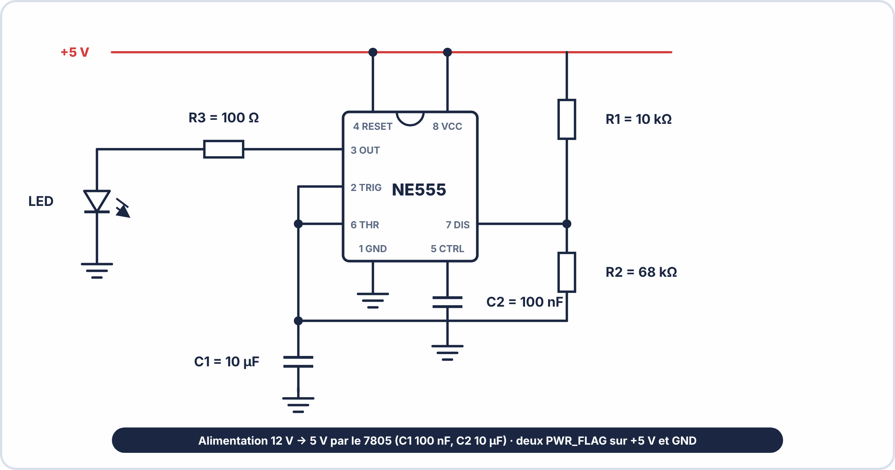

# 📁 DOSSIER TECHNIQUE — TP S11 ANNÉE 3 – E2
## Carte Minuterie LED — AGRITECH Solutions

**À remettre au formateur à la fin de la séance avec votre nom et prénom.**

---

## DOCUMENT 1 — CAHIER DES CHARGES AGRITECH

### Présentation

> **AGRITECH Solutions** commande une carte de démonstration pour ses techniciens terrain. Cette carte, alimentée depuis une batterie 12V, doit faire clignoter une LED rouge pour signaler qu'un équipement est en service.

### Spécifications techniques

| **Paramètre** | **Exigence** |
|---|---|
| Alimentation entrée (Vin) | 12V DC ± 10% (batterie plomb) |
| Tension de sortie régulée | 5V DC ± 5% |
| Fréquence de clignotement | 1 Hz ± 10% |
| Courant LED maximum absolu | 30 mA (ne pas dépasser) |
| Courant LED nominal cible | 20 mA |
| Plage température opérationnelle | 0°C à +60°C |
| Indice de protection | IP00 (usage en boîtier externe) |

---

## DOCUMENT 2 — SCHÉMA ÉLECTRONIQUE (à interpréter)



> **Note :** Ce schéma est le document de référence pour toutes les parties du TP.

---

## DOCUMENT 3 — EXTRAIT DATASHEET NE555 (Texas Instruments)

### Brochage DIP-8


### Mode astable — Formules

```
Fréquence :   f = 1,44 / ((Ra + 2×Rb) × C)        [Hz]
Rapport cyc.: DC = (Ra + Rb) / (Ra + 2×Rb)         [sans unité]
Durée tHigh : tH = 0,693 × (Ra + Rb) × C           [s]
Durée tLow  : tL = 0,693 × Rb × C                  [s]
Période     : T  = tH + tL = 1/f                   [s]
```

### Caractéristiques électriques (extraits)

| **Paramètre** | **Min** | **Typ** | **Max** |
|---|---|---|---|
| VCC | 4,5V | — | 16V |
| Courant de sortie (sink) | — | 200mA | — |
| Fréquence max recommandée | — | — | 300 kHz |

---

## DOCUMENT 4 — EXTRAIT DATASHEET L7805 (STMicroelectronics)

### Brochage TO-220


### Caractéristiques

| **Paramètre** | **Min** | **Typ** | **Max** |
|---|---|---|---|
| Vout | 4,75V | 5,00V | 5,25V |
| Vin min (dropout) | 7V | — | — |
| Vin max absolu | — | — | 35V |
| Courant max | — | — | 1A |
| OTP (protection thermique) | — | 150°C | — |

### Condensateurs recommandés

```
Entrée  : C ≥ 100nF (découplage haute fréquence)
Sortie  : C ≥ 10µF (stabilité en charge variable)
```

---

**Document – BAC PRO CIEL – A3 – E2/U22 – Version 1.0 – 2026**
